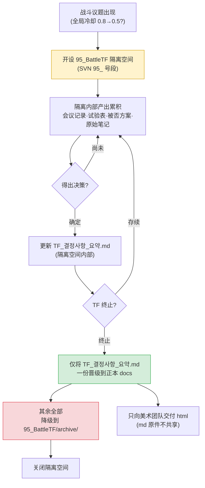

# 16.1 战斗 TF 运营 —— 在隔离的工作空间里,只让决策进入正本

周四下午4点。战斗 TF 会议结束,7个人各自回到工位。白板上留着关于是否要把全局冷却(GCD)从0.8秒下调到0.5秒的痕迹。资深数值策划说"在我的模拟里0.5才对",代码主程说"0.5的话服务器 tick 跟不上"。UI 设计师说"两边我都说不好,只知道冷却条的宽度会变得太窄"。

三个人说的都对。而一旦三个人都开始把各自的结论写进自己领域的文档,下周这三份文档就会相互冲突。数值表里写着0.5,代码规格里写着0.8,UI 指南里写着0.6。谁看都分不清哪一份才是正本。

战斗 TF 存在的理由,正是在一个地方吸收这种冲突。而这种吸收的产物——唯一的一个决策——才应当进入正本文档。其余讨论的残渣都应当止步于隔离的工作空间之内。本章讨论的就是这种隔离与吸收的机制。

---

## 16.1.1 TF 不是常设部门,而是隔离的工作空间

战斗系统的大改不会只涉及一个工种。只要动一个全局冷却,平衡(数值)、代码(服务器 tick)、UI(计量条呈现)、动画(动作时长)、音效(打击感)就会同时受到牵动。如果把这类议题按领域各自推进,决策会拖上2\~4周,而且即便做出决策,各领域之间也会彼此错位。

TF(TaskForce,专项组)就是为了防止这种错位,把多个工种暂时聚到一个工作空间里的单位。关键在于"暂时"和"隔离"。如果把 TF 的讨论原样流入公司的正本文档体系,未经验证的讨论、被否决的方案、正在试验中的数值就会污染正本。因此我们在 SVN 里建立一个以 `95_` 编号开头的隔离工作空间。

`95_BattleTF`。95 号段的编号是一个约定,表示短期 TF 工作空间。一般的正本 docs 使用 10 号段、20 号段的编号,而 90 号段是"临时·隔离·计划终止"的信号。只看文件夹编号,就能立刻传达出"这里不是正本,不要引用在这里看到的数值"。

隔离的规则很简单。

- TF 内部产出的所有文档(会议记录、试验表、被否决的方案、原始笔记)只存在于 `95_BattleTF` 之内。
- TF 终止时,只把 `TF_결정사항_요약.md` **唯一一份**晋级到正本 docs。
- 其余全部下沉到 `95_BattleTF/archive/`,仅作留存。

TF 固化为常设部门之所以危险,原因就在这里。一旦隔离被打破,TF 工作空间里未经验证的数值就会开始被当作正本引用,同样的决策每个季度都会在别的场合被重新推翻。

---

## 16.1.2 从隔离到吸收:整体流程

战斗 TF 的一个周期,结构上就是:开启一个隔离空间,在其中积累讨论、试验与决策,终止时只把决策吸收进正本。



议题从左上角进来,在黄色的隔离空间里处理掉所有杂音,只有绿色的那一格——决策摘要——离开进入正本。红色代表降级。这一张图就是 95 号段工作空间运营的全部。

---

## 16.1.3 实操记录(worked transcript)—— 把决策摘要整理成可吸收的形态

TF 终止时最费手的事,是从一个季度的会议记录、试验表里筛出"只有要晋级到正本的决策"。讨论很长,被否决的方案和已确定的方案混在一起,同一个数值在每次会议里写得都略有不同。这件事若由人手工整理,光是终止工作就要花掉一整天。

以下是我实际运行的提示词、Claude 的原始输出,以及我如何验证、否决、再请求它的全过程。这份实操记录(worked transcript,完整保留的真实操作过程记录)不做摘要,原样刊出。

### 第一次提示词(全文)

```
从下面 95_BattleTF 的 6 份会议记录中,只挑出要晋级到正本的已确定决策,
生成 TF_결정사항_요약.md 的草稿。TF 即将终止。
只要已确定的(排除被否决、试验中、"下次再说"的),每条决策
按 决策ID·主题·确定值·依据(数据来源)·决策者·确定日期 的格式。
同一主题若在每次会议里数值有变,只保留最终值,舍弃之前的。
是否确定若不明确,不要舍弃,单独归入 [需复核];若没有依据来源,标注 [依据未记录]。

会议记录:
--- 会议记录 2026-W14-mon ---
议题1:全局冷却 0.8→0.5 评估。数值模拟(sim_gcd_0407.xlsx)显示
0.5 使 DPS 方差 -12%。代码主程:0.5 因服务器 tick(33ms)上限,请求暂缓。
决策:初步一致同意 0.6(暂定)。下次会议前由代码侧做 0.6 负载测试。
议题2:闪避 i-frame 12f→10f。动画总监称动作为 8f,10f 会造成视觉断裂。
决策:确定维持 12f。决策者 策划主管。
...(无省略,实际放入的是 6 份会议记录全文)...
--- 会议记录 2026-W16-thu ---
议题1:全局冷却。0.6 负载测试通过(服务器 tick 余量 18%)。
决策:确定 0.6。决策者 策划主管。依据 sim_gcd_0407.xlsx + load_0415.log。
议题3:击杀奖励金币 1.2 倍。数值提案,无依据。暂缓。
```

### Claude 的原始输出(原样)

```markdown
# TF_결정사항_요약.md(草稿)

## 已确定决策

### D-GCD-01 | 全局冷却
- 确定值:0.6 秒(原 0.8 秒)
- 依据:sim_gcd_0407.xlsx(DPS 方差影响)、load_0415.log(服务器 tick 负载余量 18%)
- 决策者:策划主管
- 确定日期:2026-W16-thu
- 备注:W14 曾提出 0.5,但因服务器 tick 上限收敛到 0.6。0.5 方案作废。

### D-IFRAME-01 | 闪避 i-frame
- 确定值:维持 12 帧
- 依据:[依据未记录] —— 仅记录了"动画动作 8f 会造成视觉断裂"这一定性判断
- 决策者:策划主管
- 确定日期:2026-W14-mon

## [需复核]

### R-COIN-01 | 击杀奖励金币 1.2 倍
- 状态:暂缓(数值提案,无依据数据)
- 判断:因未提交依据无法确定。建议 TF 终止后转为数值团队的单独议题。
```

### 我的验证 —— 接受了什么,拒绝了什么

我逐条看了三个项目。

**D-GCD-01 原样通过。** 舍弃 W14 的 0.5/0.6 暂定方案、只留下 W16 的 0.6 确定值,这是准确的。规则 3 得到了正确执行。把两个依据来源合在一起也没错。

**D-IFRAME-01 被我拒绝了。** Claude 把它归类为"确定",但依据是 `[依据未记录]`。仅凭定性判断(视觉断裂)就放进确定决策,看正本的其他人就找不到"为什么是 12f"的依据。这是规则 1 与规则 5 的冲突情形——Claude 因为决策者已确定就当作"确定",而我必须应用"没有依据的确定不能进正本"这条我们的 docs 政策。这条政策没有写在会议记录里,Claude 自然无从知晓。

**R-COIN-01 分类正确,但开的"处方"过头了。** "建议转为数值团队的单独议题"是 Claude 编造出来的流程。我们公司没有那样的转交轨道。分类(需复核)予以采纳,处方句子则舍弃。

### 第二次再请求提示词

```
把验证结果反映进去,重做一遍。D-GCD-01 原样保留,
D-IFRAME-01 因为依据只有定性判断,从确定里拿掉,移到 [补充依据后晋级]。
R-COIN-01 保留分类,但去掉"建议转交"之类的处方句子——我们公司的流程你不清楚,只写状态和事实。
另外,不要编造会议记录里没有的流程、轨道、团队名称,不确定就用 [需策划主管判断] 留空。
// (意图:D-IFRAME-01 晋级正本的条件 = 会议记录附上动画总监的动作帧测量数据)
```

### 第二次输出(最终版)

```markdown
# TF_결정사항_요약.md

## 已确定决策(晋级正本对象)

### D-GCD-01 | 全局冷却
- 确定值:0.6 秒(原 0.8 秒)
- 依据:sim_gcd_0407.xlsx、load_0415.log(服务器 tick 负载余量 18%)
- 决策者:策划主管 / 确定日期:2026-W16-thu
- 备注:0.5 方案因服务器 tick 上限作废。

## [补充依据后晋级]

### D-IFRAME-01 | 闪避 i-frame 维持 12f
- 仅记录了定性判断(相比动画动作 8f 的视觉断裂)。
- 晋级条件:会议记录附上动作帧测量数据。

## [需策划主管判断]

### R-COIN-01 | 击杀奖励金币 1.2 倍
- 状态:暂缓。数值提案,无依据数据。无确定值。
```

在这份最终版里,只有"已确定决策"这一节——D-GCD-01 一条——晋级到了正本 docs。其余两节都下沉到了 `archive/`。一个季度的 6 份会议记录,就此被吸收成正本里的一行。

AI 做到的和做不到的,在这里分野。AI 横跨 6 份会议记录,追踪同一主题的数值变化,分离被否方案,标注依据缺失——把六份会议记录一行一行对照的这种简单重复,恰恰是最容易从人手里漏掉的环节。但"没有依据的确定不能进正本"的政策适用、"没有转交轨道"这一公司事实、"确定/暂缓"的最终判断,全都由人来做。抹去 AI 那部分,抽取与整理的劳动就消失了;但正本里放什么,这个决定仍留在人的手里。

---

## 16.1.4 外部请求以 3-track 分类后进入

进入 TF 的议题并非都来自内部。发行商、美术外包、商务团队会提出"帮忙做一下这个战斗相关的事"的请求。如果不加甄别地都当作 TF 议题接下来,TF 就会沦为对外的接诉窗口。

因此,外部请求一收到就分成三条支线。只有需要战斗决策的才投入 95_BattleTF,一个领域就能了结的由负责人单独处理,超出范围、依据不足的则写明理由后回复、暂缓。进入 TF 的只有第一条支线——这是防止 TF 变质为接诉窗口的第一道防线。分类本身是人的判断,但读一读收到的请求文本、先给"这件事牵涉几个领域"打上初步标签这种程度,可以先让 AI 过一遍。

这套三角分类(`request-triangulate`)的判定顺序、实操记录、各轨道的后续处理,由下一章 16.2 专门讲。这里只点明"TF 只接第一条支线"这条入口规则。

---

## 16.1.5 只向美术团队交付 html —— md 无需学习

TF 决策晋级为正本后,就把它共享给相关团队。这里存在一种不对称。对美术团队不给 Markdown 原件(.md),只交付渲染后的 html。

理由很简单。美术团队只需要知道决策的**结果**。"冷却条请按 0.6 秒为基准重新确定宽度"——这一句就是他们需要的全部。md 原件里含有决策 ID 体系、atom 引用、被否决的 0.5 方案的痕迹、依据数据的文件名。这些是策划与代码共享的工作语言,并不是美术需要去学习的东西。

若原样把 md 给过去,美术团队要付出两种成本。其一,为解读与自己无关的标注体系而耗费时间。其二,可能把未经验证、已被否决的信息误当成决策。html 挡住了这两点——只呈现干净渲染后的决策结果,内部标注在构建过程中被过滤掉。

写成原则就是:**工作语言(md)只在使用它的工种内部流转,对外只输出成果物(html)。** 这与 TF 工作空间隔离(95 号段)是同一套哲学。内部使用的原始素材留在内部,对外只送出被吸收后的结果。

---

## 16.1.6 TF 运营的根基 —— 五条原则

隔离·吸收机制要运转起来,底下必须铺着五条运营原则。缺了任何一条,TF 都会垮成一个清谈场。

- **决策权明确** —— 会议上,谁是最终决策者,必须按议题类型事先定好。战斗规则归策划主管,数值归资深数值策划,实现方式归代码主程,领域间冲突升级(escalate)到游戏总监。决策权一旦含糊,会议就会拖成清谈。
- **会议记录义务** —— 没有会议记录的决策不算决策。它必须作为记录留在隔离空间里。终止时要吸收的原材料,正是这些会议记录。
- **数据优先** —— 输入的是数据,而不是意见。"我觉得"一多,TF 就会失效。前面实操记录中让系统自动标注 `[依据未记录]`,也是这条原则的延伸。
- **时限** —— 给每个议题都附上决策、试验、实现、验证的时限。没有时限的议题会漂上一两周。
- **定期再评估** —— TF 不是永久的。每个季度重新审视是否存续。当季度决策数跌到一定数量以下,就解散或缩编。不过若预计下个季度议题会激增,则事先约定延长一个季度。

五条原则捆在一起运作时,隔离的 95 号段空间就不再是清谈场,而成为决策工厂。

---

## 16.1.7 常见陷阱

整理 TF 运营中期以后反复出现的陷阱与处方。

| 陷阱 | 症状 | 处方 |
|---|---|---|
| 变质为清谈场 | 只交换意见,不出决策 | 每次会议强制留 N 个决策槽位 |
| 越权 | TF 干预其他领域的决策 | 明确决策权表 |
| 成员负担过重 | 重复参加 5\~6 个 TF,侵蚀本职工作 | TF 参与合计每周上限 8 小时 |
| 永久化 | 不解散,反复开同样的会 | 季度再评估 |
| 隔离泄漏 | 95 号段未经验证的数值被当作正本引用 | 晋级正本只限决策摘要一份 |
| 对外脱节 | 决策不向外部共享 | 晋级正本 + 交付 html |

隔离泄漏最安静,也最危险。文件夹编号的约定一旦崩塌,一切都会崩塌。

---

## 16.1.8 度量 —— TF 所吸收的东西

仅从作者项目A的运营记录中摘取方向与比例。下面的数值不是绝对值,而是相对于没有 TF 时、运营 TF 后的变化方向——绝对周期因团队规模、构建周期而异(基于作者环境的观察)。

| 项目 | 无 TF | 运营 TF | 方向 |
|---|---|---|---|
| 单条战斗决策的周期 | 各领域分头,数周 | 数天量级 | 缩短 |
| 决策后领域间冲突 | 每季度多起 | 每季度少数 | 减少 |
| 游戏总监升级(escalation) | 每周多起 | 每周 1\~2 起 | 减少 |
| 领域间信息共享 | 零散 | 靠会议记录、晋级正本固定下来 | 体系化 |

回收最多的,是游戏总监的时间。领域间的决策被 TF 在隔离空间里吸收掉,因此上升到总监层面的冲突就减少了。TF 归根结底是一个装置:把"过去由总监逐一调解的领域间共识",下放到一个工作空间里来处理。

---

## 本章要点

- TF 是以 95 号段隔离的临时工作空间,终止时只有一份决策摘要被吸收进正本。
- AI 横跨会议记录抽取、整理决策,但是否晋级正本由人来定。
- 外部请求以 3-track 分类,对美术团队只送出成果物 html。

---

> **游戏之外的应用。** "在隔离的工作空间里,只让决策进入正本"这一原理,原封不动地适用于所有与游戏无关的跨部门项目。比如设想一个由市场、法务、销售一起讨论新版条款修订的 TF。把会议记录、评审意见、被否决的措辞草稿放在共享云盘的临时文件夹(像 `95_약관TF` 这样的隔离空间)里,TF 结束后只把 `최종_확정문구.docx` 一份上传到公司正本文档库,其余下沉到归档。这样一来,六个月后当有人问"这条条款当初为什么这么定"时,就能避免未确定的草稿冒充正本混进来的事故。

---

## 动手试试 —— 季度终止时的决策吸收

**setup**
- 在 SVN(或文件夹)里建立 `95_BattleTF/` 隔离空间,把一个季度的会议记录都收进去。
- 预先建好 `95_BattleTF/archive/`(降级对象要去的地方)。

**prompt**
- 把本章第一次提示词连同会议记录全文一起贴上。核心规则:① 只要已确定决策 ② 同一主题只留最终值 ③ 不明确时不要舍弃,分开标注 ④ 无依据就写明 ⑤ 不要编造公司流程、团队名称。

**verify**
- 逐条查看输出中的"确定"分类。依据只有定性判断的项目,从"确定"里拉下来(适用晋级正本政策)。
- 检查 AI 生成的处方句子(转交、轨道、建议)里是否混入了并不存在的流程,发现就删掉。
- 只把"已确定决策"这一节复制到正本 docs,其余下沉到 `archive/`。

---

## 16.1.9 单人精简版

对独自工作的单人开发者,隔离·吸收同样有效。把"TF"换成"我脑子里的多个角色"就行了。

- 决定一个功能时,挖一个 `95_temp_결정/` 之类的临时文件夹,把模拟、笔记、被否方案全都倒进去。
- 决定敲定后,只把 `결정요약.md` 一份移到主工作文件夹,临时文件夹整个下沉到 `archive/`。
- 交给外部(美术外包、译者)时,把决策摘要渲染成 html 只交付结果,自己的工作笔记(md)不要给。

有了隔离空间,仅凭文件夹位置就能区分"这个数值是已确定还是还在试验中"。即使是一个人,这也是不把同样的混乱留给未来的自己的最便宜的方法。
