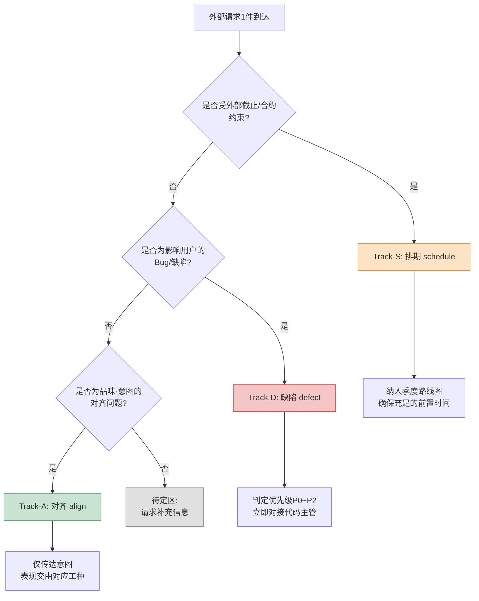

# 16.2 与其他工种的协作 —— 把外部请求分入三条轨道（3-track）

周二上午,即时通讯工具几乎同时响了三次。

美术主管:"战斗特效的配色,现在的色调太暗沉了,可以做得更明快一些吗?"

QA主管:"存在公会签到奖励发放两次的情况。附上复现视频。"

发行商负责人:"请在东南亚版本中落实伊斯兰文化圈的指南。要在下个季度审核之前完成。"

三条消息的字数相近。然而,一条是30分钟就能搞定的事,一条是必须立刻拉住代码主管处理的事故,一条是要塞进季度计划里的外部排期。仅仅因为它们落进了同一个收件箱就以同等分量对待的话,就会在30分钟的小事上耗掉半天,而真正的事故却被搁置到傍晚。

涌向策划的请求,性质各不相同,差异之大不亚于工种的多样。问题在于,它们全都以"一行消息"这种相同的形态到达。本章讨论的,就是在收到这些一行消息的瞬间将其分入三条轨道的工作。轨道一旦分清,该立刻停下手头做什么、又该把什么推到之后,就随之确定了。

---

## 16.2.1 协作左右着本职工作

策划既不直接写代码,也不直接做美术和音效。他只是撰写规格说明、传达意图、验证结果。所有产出都要经由其他工种之手才能问世。因此,协作的质量直接决定策划产出的质量。

在笔者担任总监的项目A（移动优先的MMORPG,中等规模（10\~50人）团队）中,策划日常协作的工种铺开来看是这样的。

<svg viewBox="0 0 720 300" xmlns="http://www.w3.org/2000/svg" font-family="sans-serif" font-size="13">
  <rect x="300" y="120" width="120" height="60" rx="8" fill="#2b3a55" stroke="#1a2433"/>
  <text x="360" y="146" fill="#fff" text-anchor="middle" font-weight="bold">策划</text>
  <text x="360" y="166" fill="#cdd6e5" text-anchor="middle" font-size="11">时间的40~60%</text>

  <g fill="#e8edf5" stroke="#9fb0c9">
    <rect x="40" y="30" width="130" height="44" rx="6"/>
    <rect x="40" y="100" width="130" height="44" rx="6"/>
    <rect x="40" y="170" width="130" height="44" rx="6"/>
    <rect x="40" y="240" width="130" height="44" rx="6"/>
    <rect x="550" y="30" width="130" height="44" rx="6"/>
    <rect x="550" y="100" width="130" height="44" rx="6"/>
    <rect x="550" y="170" width="130" height="44" rx="6"/>
  </g>
  <g fill="#1a2433" text-anchor="middle">
    <text x="105" y="50">开发（代码·工具）</text><text x="105" y="66" font-size="10" fill="#5a6a82">每天</text>
    <text x="105" y="120">美术</text><text x="105" y="136" font-size="10" fill="#5a6a82">每周2~3次</text>
    <text x="105" y="190">音效</text><text x="105" y="206" font-size="10" fill="#5a6a82">每周1~2次</text>
    <text x="105" y="260">动画</text><text x="105" y="276" font-size="10" fill="#5a6a82">每周1~2次</text>
    <text x="615" y="50">QA</text><text x="615" y="66" font-size="10" fill="#5a6a82">每周1次+MS</text>
    <text x="615" y="120">运营·CS</text><text x="615" y="136" font-size="10" fill="#5a6a82">每周1次</text>
    <text x="615" y="190">外部（发行·平台）</text><text x="615" y="206" font-size="10" fill="#5a6a82">每季度1~2次</text>
  </g>

  <g stroke="#9fb0c9" stroke-width="1.2" fill="none">
    <path d="M170 52 C 240 90, 270 120, 300 135"/>
    <path d="M170 122 C 230 130, 260 140, 300 148"/>
    <path d="M170 192 C 230 175, 260 162, 300 158"/>
    <path d="M170 262 C 240 210, 270 180, 300 170"/>
    <path d="M550 52 C 480 90, 450 120, 420 135"/>
    <path d="M550 122 C 490 130, 460 142, 420 150"/>
    <path d="M550 192 C 490 175, 460 162, 420 160"/>
  </g>
</svg>

策划要与七个工种从每天到每季度不等地相互咬合。策划在工位上花费的时间里,有40\~60%都投入到这类协作中。花在本职(设计)上的时间,不过是剩下的那一半而已。既然如此,压缩协作时间,就等于延长本职工作的时间。而吞噬协作时间的最大原因,在于无法对收到的请求分类,把精力耗在了不该耗的地方。

---

## 16.2.2 一行请求所隐藏的三种性质

回到前面的三条消息。从表面上看,它们都是"请帮我……"。但在这背后,隐藏着三种不同的性质。

- 美术主管的配色请求属于**品味与意图的范畴**。它不是对错问题,而是对齐(达成一致)的问题。几乎不需要代码,也不需要排期协调。
- QA的重复奖励Bug是**须立即处理的缺陷**。它直接关系到用户资源,因此优先级高,必须马上安排代码主管介入。
- 发行商的指南落实是**受外部排期约束的变更**。它范围广,有季度审核这一外部截止期,且牵涉多个工种。

笔者用一个词分别称呼这三种性质:**对齐 (align)**、**缺陷 (defect)**、**排期 (schedule)**。把收到的请求先塞进这三者之一 —— 在项目A中,这项工作被固化为一个名为 `request-triangulate` 的工作流。之所以取名三角测量 (triangulate),是取其用三个基准点(工种性质·紧急度·外部依赖)将一个点(请求)包围起来、从而确定其位置之意。

分类流程如下。



提问的**顺序**是关键。之所以最先追问排期依赖,是因为对于有外部截止期的事,前置时间优先于内部判断。如果把距季度审核还剩3周的事归类为"以后对齐一下就行",那么等对齐完成时,截止期已近在眼前。把缺陷放在第二位的理由是,已经在影响用户的事,永远优先于品味层面的讨论。对齐排在最后。只有既不紧急、又不受外部约束、也不伤害用户的事,"慢慢对齐"才成立。

如果三个问题的答案都是"否",那不是分类失败,而是**信息不足**。这种时候不要硬给它定轨道,而是放进待定区并反问回去。"这个是必须进下一个版本,还是先评估一下就好?"这样一句话,通常就能定下轨道。

---

## 16.2.3 实操记录（worked transcript）:把收件箱分入轨道

如果这套分类只在脑子里做,忙碌的日子就会崩掉。因此,笔者的做法是把收到的一批请求整个丢给AI做初步分类,再对结果加以验证·修正。下面几乎原样照搬了实际跑过的一轮。不做概括,连AI出错的地方和笔者否决的部分都一并保留。

### 提示词全文

```text
请把下面这些外部请求分入三条轨道 —— Track-S（排期:受外部截止·合约·审核约束的）,
Track-D（缺陷:影响用户的Bug,P0~P2判定）、Track-A（对齐:品味·意图,以对齐收尾）。
按外部依赖 → 用户影响 → 品味/意图 的顺序审视,归入最先命中的轨道并据此确定,
三者都不是则放入待定,并给出1个反问的问题。
输出按每条请求列出 | 轨道 | 依据(1行) | 下一步行动(1行) |。

[请求列表]
1. 美术主管:战斗特效配色暗沉。可否做得更明快?
2. QA主管:公会签到奖励重复发放Bug。有复现视频。
3. 发行商:在东南亚版本中落实文化圈指南。下个季度审核前。
4. 音效总监:Boss BGM的前奏比战斗开始时机晚了0.5秒。
5. 运营团队:多名用户反馈"公会聊天字体太小"。
```

### Claude原始输出

```text
| # | 轨道 | 依据 | 下一步行动 |
|---|------|------|-----------|
| 1 | Track-A | 配色色调属品味·意图范畴,与外部/Bug无关 | 仅传达意图(战斗的紧张感),饱和度决定交由美术 |
| 2 | Track-D | 奖励重复=直接影响用户资源,可复现 | 判定P0,立即对接代码主管,评估热修复 |
| 3 | Track-S | 受季度审核这一外部截止期约束 | 纳入季度路线图,拆解指南条目后估算前置时间 |
| 4 | Track-A | BGM时机看似是演出品味问题 | 与音效总监对齐 |
| 5 | Track-D | 字体可读性属UI缺陷 | 登记为P2 Bug |
```

### 人工验证 / 否决

在第4条和第5条上,笔者停了下来。

**否决第4条。** AI把BGM前奏延迟看成了"演出品味(Track-A)"。但"比战斗开始时机晚0.5秒"不是品味,而是**同步缺陷**。问题很可能不在于更换音源本身,而在于BT(行为树)上的触发时点与音频提示 (cue) 错位。这件事不会靠对齐了结,而是要动到动画·代码那边的时序数据。→ **更正为Track-D。** 但因不影响用户资源,定为P2。

**第5条降级为待定。** AI把"字体太小"径直断定为UI缺陷(Track-D)。然而,这到底是缺陷还是品味,仅凭消息本身无法分清。如果字体是按设计规格渲染的、只是"感觉偏小",那更接近对齐(Track-A);如果是渲染得比规格更小、显示出错,那就是缺陷(Track-D)。→ **待定。向运营团队反问:**"是相对于规格中的字号实际显示偏小,还是希望把规格本身调大?"

### 再次请求

把否决的两条纳入考虑后再次投出的提示词,追加指令很简短。

```text
将第4条的'相对战斗开始延迟0.5秒'重新归类为同步缺陷(Track-D, P2)。
补充1个问题,确认时序是在BT触发/音频提示中的哪一处错位。
将第5条作待定处理,并明确写出询问'是否为相对规格的实际渲染'的问题。
```

再次输出将第4条更正为 `Track-D / P2 / "确认BT战斗开始节点的音频提示偏移量是否为0,或BGM片段本身是否含有0.5秒静音"`,将第5条更正为 `待定 / "由运营团队再确认:是相对规格渲染偏小,还是请求上调规格"`,如此回传。至此,分类宣告完成。

在这里,AI做的事和人做的事被清晰地区分开来。AI快速地对五条做了初步分配,给出了一张**没有空格的表**。人则揪出了其中**轨道边界微妙的两条**(看似品味实为同步缺陷的BGM,看似缺陷却可能是品味的字体)。把五格无遗漏地填满,和察觉其中两格填错了,是两种不同的能力;这份实操记录正是把这两件事分别交给各自擅长的一方来做。

---

## 16.2.4 每条轨道的处理各不相同

分类结束后,每条轨道都进入完全不同的后续工作。虽然从同一张表出发,终点却各不相同。

被归入 **Track-A（对齐）** 的请求,按"只传达到意图为止,表现交由委托"的原则处理。对于美术的配色请求,笔者给出的回答不是饱和度数值,而是意图。"这场战斗是Boss第1阶段,紧张感是核心。希望压迫感优先于明快感。在此前提下,饱和度交由美术判断。"策划一旦直接指定饱和度数值,美术的自主性就被削减,产出的责任归属也随之模糊。守住意图与表现之间的界线,就是对齐轨道的全部。

被归入 **Track-D（缺陷）** 的请求,接下来是优先级判定与对接代码。公会奖励重复(P0)当场移交给了代码主管,BGM同步(P2)则登记进待办列表 (backlog),同时附上推测原因的问题。在缺陷轨道中,策划的工作不是"修复",而是**排定优先级并给出准确的输入**。区分P0与P2的标准是"当下是否影响用户资源·游戏进度"。奖励重复直接关系到资源,故为P0;BGM延迟0.5秒虽令人不适,却不妨碍进度,故为P2。

被归入 **Track-S（排期）** 的请求,进入季度路线图。发行商的文化圈指南虽是一行请求,实际上却会拆解成多个条目 —— 宗教象征物的表现、色彩禁忌、文本方向、角色服饰。关键在于,一收到它就回复"会评估",并将其整体搁上季度计划。有外部截止期的事,哪怕看着不大,前置时间也是命脉,一旦起步太晚,必定出事故。

把这三条岔路一目了然地对比,是这样的。

<svg viewBox="0 0 720 240" xmlns="http://www.w3.org/2000/svg" font-family="sans-serif" font-size="13">
  <g>
    <rect x="20" y="30" width="210" height="180" rx="10" fill="#c9e4d0" stroke="#4f9d6a"/>
    <rect x="255" y="30" width="210" height="180" rx="10" fill="#f6c6c6" stroke="#c25151"/>
    <rect x="490" y="30" width="210" height="180" rx="10" fill="#fde2c4" stroke="#c98a3a"/>
  </g>
  <g text-anchor="middle" font-weight="bold" fill="#1a2433">
    <text x="125" y="58">Track-A · 对齐</text>
    <text x="360" y="58">Track-D · 缺陷</text>
    <text x="595" y="58">Track-S · 排期</text>
  </g>
  <g text-anchor="start" fill="#23303f" font-size="12">
    <text x="38" y="92">判定问题</text>
    <text x="38" y="112" fill="#3c5a45">是品味·意图吗?</text>
    <text x="38" y="142">策划的工作</text>
    <text x="38" y="162" fill="#3c5a45">仅传达意图,</text>
    <text x="38" y="180" fill="#3c5a45">表现交由委托</text>

    <text x="273" y="92">判定问题</text>
    <text x="273" y="112" fill="#7a2e2e">影响用户的Bug?</text>
    <text x="273" y="142">策划的工作</text>
    <text x="273" y="162" fill="#7a2e2e">P0~P2判定,</text>
    <text x="273" y="180" fill="#7a2e2e">对接代码主管</text>

    <text x="508" y="92">判定问题</text>
    <text x="508" y="112" fill="#7a5320">受外部截止期约束?</text>
    <text x="508" y="142">策划的工作</text>
    <text x="508" y="162" fill="#7a5320">拆解条目,</text>
    <text x="508" y="180" fill="#7a5320">确保前置时间</text>
  </g>
</svg>

分类准确时,同一收件箱里的五行就会干净利落地分散到三条不同的处理线上。分类出错时,缺陷会被拖进对齐会议白白耗掉时间,或者排期事项起步太晚,在截止期前夕爆发。

---

## 16.2.5 用TF隔离来协作

有时请求不是一两条,而是成团涌来。比如发行商审核前的那几周,或战斗系统全面改版这样的局面。这种时候,把工作本身隔离到 `95_BattleTF` 这样的临时工作空间里,结束后只把决定提升为正本。那套隔离·吸收机制,以及"只向美术团队交付html(md学习为0)"的做法,已在前一章16.1中全部讲过。

从分类(3-track)的角度再补一句,是这样的。膨胀成一整团的协作,大多是Track-S(排期)事项跨越多个工种被拆解的局面;当逐条按轨道处理已应付不来时,就把它挪进"隔离工作空间"这个高一层的容器里盛放。也就是说,如果3-track分类是入口,那么TF隔离就是容纳通过入口的那一大团的房间。

---

## 16.2.6 常见失败与处方

| 失败模式 | 处方 |
|---|---|
| 把所有请求以同等分量处理 | 一收到就做3-track分类,从外部依赖开始问 |
| 把排期事项误分为对齐 | 把判定顺序的第1位固定为外部截止期的提问 |
| 把看似品味的同步缺陷当作对齐处理 | "时机/数值错位"先怀疑是缺陷 |
| 把看似缺陷的品味断定为缺陷 | 反问"是否为相对规格的实际渲染",转入待定 |
| 在对齐轨道中策划连表现也一并决定 | 只到意图为止,表现交由工种委托 |
| 排期事项起步太晚 | 立即纳入季度路线图,确保前置时间 |

这张表的一半是分类阶段的失误,另一半是分类之后处理的失误。即便分类准确,若各轨道的处理手法出错,效果也会烟消云散。(与TF隔离·提升·媒介相关的陷阱,参见16.1的陷阱表。)

---

### 本章要点

- 外部请求分为对齐·缺陷·排期三条轨道;若以同等分量对待,就会在30分钟的小事上耗掉半天。
- 判定顺序是外部截止期→用户影响→品味;顺序一旦搞错,排期事项就会在截止期前夕爆发。
- AI擅长做没有空格的初步分配,而轨道边界的判定则由人更准确。

---

> **游戏之外的应用。** 一行请求仅因落进同一个收件箱就被以同等分量对待,这个问题并非游戏独有,而是所有服务策划·PM的日常本身。把涌入的请求分为"对齐(品味·方向)·缺陷(影响用户的Bug)·排期(外部截止期)"三条轨道的分类法,换个领域照样奏效。比如,某位Web服务PM的即时通讯工具里同时落进"把按钮颜色调亮一点(对齐)""支付收据被重复发送(缺陷)""个人信息保护法修订落实截止还剩3周(排期)",那么按外部截止期→用户影响→品味的顺序,归入最先命中的轨道,就能立即为支付Bug安排人手,而法律修订则从确保前置时间做起。

---

### 动手试试

**Web聊天机器人最简路径(无需终端)** —— 本章的核心不在于工作流脚本,而在于"把一行请求分入对齐·缺陷·排期三条轨道"这一构想。这个构想,即使没有CLI·hook·atom这套基础设施,仅凭Web聊天机器人(ChatGPT或Claude网页版)也能原样再现。下面两个步骤是主干。
1. 把当天收到的请求不拘格式地一行行汇集起来。从即时通讯工具·邮件·备忘录哪里扒来都行。
2. 在Web聊天机器人的输入框里贴上下面的提示词,再在其下粘贴汇集好的请求列表。这就是把 `request-triangulate` 所做的初步分类,用手工做一遍。
   ```
   请把下面这些请求分入Track-A(对齐)/Track-D(缺陷)/Track-S(排期)。
   按外部截止期 → 影响用户的Bug → 品味·意图 的顺序审视,归入最先命中的轨道并确定,
   三者都不是则放入待定,并给出1个反问的问题。输出为 | 轨道 | 依据1行 | 下一步行动1行 |。
   [粘贴请求列表]
   ```
   接下来,只需人工验证输出表中的两格 —— 如果"时机·数值错位"被归为对齐,就怀疑是同步缺陷;如果"某某偏小/偏慢"这类主观感受上的不满被断定为缺陷,就反问"是否为相对规格的实际渲染",将其降为待定。脚本·工作流,只需等到这套分类做熟了、每天的批量开始吃力时,再引入即可。

**setup.** 把涌入的外部请求汇集到一处(频道·文档)。把三条轨道的定义各写一行 —— 对齐(品味·意图)、缺陷(影响用户的Bug)、排期(外部截止期)。

**prompt.** 把汇集好的请求批量丢给AI,并固定判定顺序。

```text
请把下面这些请求分入Track-A(对齐)/Track-D(缺陷)/Track-S(排期)。
按外部截止期 → 影响用户的Bug → 品味·意图 的顺序审视,归入最先命中的轨道并确定,
三者都不是则放入待定,并给出1个反问的问题。输出为 | 轨道 | 依据1行 | 下一步行动1行 |。
[粘贴请求列表]
```

**verify.** 在输出表中亲自验证两处。(1)如果"时机·数值错位"被归为对齐,就怀疑它是不是同步缺陷。(2)如果"某某偏小/偏慢"这类主观感受上的不满被断定为缺陷,就反问"是否为相对规格的实际渲染",将其降为待定。只要人把握住这两处边界,其余的就可以信任。

### 单人精简版

如果你是既没有团队也没有TF的单人开发者,那就保留轨道不变,只更换对象。把商店评论、Discord反馈、Beta测试者的备注汇集到一份文档里,每周1次用上面的提示词批量分类。对齐(品味)按"只要不与我的愿景冲突就采纳",缺陷(Bug)在当周处理,排期(商店审核·活动截止)则连同前置时间一起录入日历。集中整备期间的隔离文件夹运作,照16.1的单人精简版做即可。
