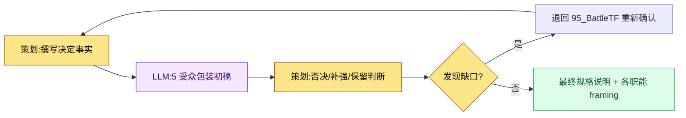

# 16.3 一个决定,三种包装 —— 按职能包装产出物的 framing

95_BattleTF 会议室。把公会签到奖励确定为资源 +5 的那天下午,我把同一个决定分发到了三个地方。策划组频道里放的是一份规格说明 markdown,程序组那里是一行数据字段,美术组那里是一张单屏 html。三边几乎同时给了回应。主程问"触发时机在哪里",美术总监问"签到按钮的位置和 06_UI 指南对得上吗",动画师则什么都没说。明明是同一个决定,三个人看到的却完全不同。

本章正是把这种"看法各异"从事故变成设计的记录。把同一个决定按职能包装成不同形态 —— 这就是 framing。

---

## 16.3.1 同一个决定,五个人各读各的

公会签到奖励这一个决定,牵涉的受众有五类。他们读同一句话,也只挑自己领域的部分读,其余的都略过。被略过的地方就会出事故。

| 受众 | 会专注去读的 | 本能会跳过的 |
|---|---|---|
| 主程 | 数据字段·接口·触发时机 | 色调·叙事·演出 |
| 美术总监 | 界面布局·组件·风格指南 | 数据完整性·触发 |
| 音效总监 | 行为触发·氛围·时长 | 数据细节 |
| 动画师 | 动作·时序·状态转换 | 视觉基调·数值 |
| QA | 验收标准·风险·边缘场景 | 实现方式的内部 |

问题不在信息的量,而在呈现的方式。把一份厚厚的规格说明一模一样地摆到五个人的桌上,五个人各自翻开不同的页、合上不同的页。framing 不把这种"翻开"交给偶然,而是有意去安排。

下面这张 framing 矩阵,展示同一个决定在跨越职能边界时会换上怎样的形态。

<svg viewBox="0 0 720 360" xmlns="http://www.w3.org/2000/svg" role="img" aria-label="同一个决定按职能拆分为不同产出物的 framing 矩阵">
  <rect x="0" y="0" width="720" height="360" fill="#fbfbfd"/>
  <!-- source decision -->
  <rect x="270" y="20" width="180" height="52" rx="8" fill="#1f2d3d"/>
  <text x="360" y="42" text-anchor="middle" fill="#ffffff" font-family="sans-serif" font-size="14" font-weight="bold">决定:签到奖励 = 资源 +5</text>
  <text x="360" y="60" text-anchor="middle" fill="#aeb9c6" font-family="sans-serif" font-size="11">95_BattleTF / 单一事实</text>
  <!-- arrows -->
  <line x1="360" y1="72" x2="120" y2="140" stroke="#9aa7b4" stroke-width="1.5"/>
  <line x1="360" y1="72" x2="360" y2="140" stroke="#9aa7b4" stroke-width="1.5"/>
  <line x1="360" y1="72" x2="600" y2="140" stroke="#9aa7b4" stroke-width="1.5"/>
  <!-- three framings -->
  <rect x="30" y="140" width="180" height="86" rx="8" fill="#e8f0fe" stroke="#4a73b8" stroke-width="1.5"/>
  <text x="120" y="162" text-anchor="middle" fill="#1f2d3d" font-family="sans-serif" font-size="13" font-weight="bold">策划 → markdown</text>
  <text x="120" y="182" text-anchor="middle" fill="#33414f" font-family="sans-serif" font-size="11">意图·规则·依据全文</text>
  <text x="120" y="200" text-anchor="middle" fill="#33414f" font-family="sans-serif" font-size="11">含供学习的上下文</text>
  <text x="120" y="218" text-anchor="middle" fill="#7a8794" font-family="sans-serif" font-size="10">spec_guild_attendance.md</text>

  <rect x="270" y="140" width="180" height="86" rx="8" fill="#fdeee8" stroke="#b8674a" stroke-width="1.5"/>
  <text x="360" y="162" text-anchor="middle" fill="#1f2d3d" font-family="sans-serif" font-size="13" font-weight="bold">美术 → html</text>
  <text x="360" y="182" text-anchor="middle" fill="#33414f" font-family="sans-serif" font-size="11">单屏·布局·组件</text>
  <text x="360" y="200" text-anchor="middle" fill="#33414f" font-family="sans-serif" font-size="11">md 学习 0(仅传达)</text>
  <text x="360" y="218" text-anchor="middle" fill="#7a8794" font-family="sans-serif" font-size="10">guild_screen_v3.html</text>

  <rect x="510" y="140" width="180" height="86" rx="8" fill="#e8f6ec" stroke="#4a9a5e" stroke-width="1.5"/>
  <text x="600" y="162" text-anchor="middle" fill="#1f2d3d" font-family="sans-serif" font-size="13" font-weight="bold">程序 → 数据</text>
  <text x="600" y="182" text-anchor="middle" fill="#33414f" font-family="sans-serif" font-size="11">字段·接口·触发</text>
  <text x="600" y="200" text-anchor="middle" fill="#33414f" font-family="sans-serif" font-size="11">明示校验 lint 项</text>
  <text x="600" y="218" text-anchor="middle" fill="#7a8794" font-family="sans-serif" font-size="10">guild_table 1 row</text>
  <!-- invariant band -->
  <rect x="30" y="262" width="660" height="72" rx="8" fill="#ffffff" stroke="#c7ced6" stroke-width="1.2"/>
  <text x="360" y="286" text-anchor="middle" fill="#1f2d3d" font-family="sans-serif" font-size="12" font-weight="bold">不变事实(三种包装都必须保留的内容)</text>
  <text x="360" y="308" text-anchor="middle" fill="#33414f" font-family="sans-serif" font-size="11">数值 = +5 · 时点 = 每日首次登录 · 范围 = 全体公会成员</text>
  <text x="360" y="326" text-anchor="middle" fill="#7a8794" font-family="sans-serif" font-size="10">包装可以不同,但这三个值只要对不上,framing 就失败</text>
</svg>

包装因受众而异,但垫在底层的不变事实(数值·时点·范围)在任何一种包装里都不能动摇。framing 的技艺不在于"呈现得不一样",而在于"呈现得不一样的同时,保留同样的内核"。

---

## 16.3.2 实操记录 —— 把一个决定做成三种包装

如果每次都靠手工重新塑造 framing,负担太大,最后就干脆不做了。所以我采用这样一种方式:抛出一个决定,一次性拿到各职能的包装初稿。下面是围绕公会签到奖励这个决定实际往来的完整记录。未加修饰,原样搬来。

### 提示词全文

```
[决定事实 —— 在 95_BattleTF 上确定]
- 公会签到奖励 = 公会资源 +5
- 触发:公会成员当天首次登录时 1 次
- 范围:该公会的全体公会成员各自
- UI:公会界面顶部显示资源总量 + "签到"按钮

把这一个决定按三个职能分别包装一下。
策划用 markdown 写意图·规则·数据影响;美术把要放进 html 的界面规格
以布局·组件·风格指南引用为中心(禁止提及数据·触发);
程序用一行数据·接口·触发·校验项。
三种包装都要把不变值(+5、首次登录 1 次、全体公会成员)一模一样地钉进去,
不确定的值不要编造,用 [待确认] 标出。
```

### Claude 原始输出(未做摘要与整理)

```
1) 策划 → markdown

## 公会签到奖励
- 意图:把每天 1 次的登录换算成公会层面的协作资源,以提升留存率。
- 规则:公会成员当日首次登录时,公会资源 +5。每天 1 次。以公会为单位累计。
- 数据影响:guild_resource_total 增加。需监控资源通胀 [待确认:上限未定]。

2) 美术 → 界面规格(放进 html 的内容)
- 在公会界面顶部区域显示资源总量(progress_bar + 数字 badge)。
- 右侧放"签到"按钮。按下时的状态变化遵循 06_UI 指南的按钮状态规则。
- 样式:符合 06_UI 指南。颜色 [待确认:公会主题色 token 未指定]。
- (数据数值·触发在本包装中有意排除)

3) 程序 → 数据/接口
- 数据:在 guild_table 中新增字段 —— guild_resource_total (int, default 0)
- 接口:GuildResourceManager.add(guild_id, amount)
- 触发:在每日首次登录事件钩子中调用 add(guild_id, 5) 1 次
- 校验:integrity_check_guild_resource(不可为负 / 拦截每日超过 1 次的调用)
- 并发:同一公会成员在多设备同时登录时的重复累加 [待确认]
```

### 人工验证·否决

原始输出没有直接采用。我抓出了三处。

- **否决**:美术包装里"按下按钮时的状态变化遵循 06_UI 指南"这句话。95_BattleTF 的原则是不让美术组学习 md、只给它 html,而这种引用指南的措辞会诱使人跳转到外部文档。为了让内容在一张界面里闭合,我决定把状态示例内联写进去。
- **要求补强**:程序包装里的 `[待确认]` 两处(资源上限、多设备重复累加)是决定事实里原本没有的缺口。AI 没有编造而是标了出来,这个判断是对的;但这在 framing 之前先是决定本身的漏洞,应当退回 95_BattleTF。
- **保留**:三个不变值(+5、首次登录 1 次、全体公会成员)在三种包装里都被一致地写入了。唯独这部分我没有动。

### 再次请求

```
修改一下美术包装:
- 把"遵循 06_UI 指南"这类引用外部文档的措辞全部删除。
- 把按钮按下/等待/完成 3 种状态的视觉差异直接写进界面规格里。
- 以美术组只看这一张就开工为前提,做到自足,不跳转到其他文档。

程序包装里的 [待确认] 2 项从产出物中拿掉,
改为在最上面单独放一个"需 95_BattleTF 重新确认的项"区块。
```

经过这一次的否决·再次请求,产出物变成了三个职能各自在自己岗位上拿来就能用的形态。AI 塑造出了三份包装初稿,还在缺口处标了记号;但在哪一种包装里删掉什么 —— 从美术包装里去掉外部引用、从程序包装里剔除未定项 —— 这一刀终究还是落在我手里。framing 的核心判断不在于纳入,而在于排除。

---

## 16.3.3 三种 framing 方式与回本时点

包装放在哪里,方式就随之分岔。三种之中用哪一种,取决于规格说明的体量和运营的余力。

**(1) 同一文档内的按受众摘要。** 在正文之后附上各职能的摘要小节。五个人共享同一个文件,但各自只读自己那一节。

```markdown
## 按受众摘要

### 代码(实现)
- 数据:guild_table.guild_resource_total (int)
- 接口:GuildResourceManager.add(guild_id, amount)
- 触发:每日首次登录 1 次
- 校验:integrity_check_guild_resource

### 美术(视觉)
- 界面:公会顶部资源总量 + 签到按钮
- 组件:progress_bar、badge、button(3 状态)
- 优先级:本次里程碑

### QA(验证)
- 验收标准:签到后公会资源 +5 生效,拦截每日超过 1 次
- 风险:资源通胀、多设备重复累加
```

**(2) 按受众拆分的独立产出物。** 在一个正文之外,再为各职能各自分出文件。95_BattleTF 里只给美术组发 html、不发 md 的做法,就是这种方式的实战形态 —— 同一个决定,不同职能连媒介本身都不同。

```
spec_guild_attendance.md     — 策划正文(完整上下文)
guild_screen_v3.html         — 美术(仅 html,md 学习 0)
guild_table 1 row + add()    — 程序(数据/接口)
qa_guild_attendance.md       — QA(验收标准·风险)
```

适合体量大的规格说明,而且媒介能直接进入各职能的工具。代价是一个决定一改,就得连着修改多个产出物,运营负担很大。

**(3) Wikilink 图。** 正文里只放各职能的起点链接,各人沿着自己的分支去探索。

```
[[spec_guild_attendance]]
   ├── [[code_guild_table]]
   ├── [[ui_guild_screen_v3]]
   └── [[qa_guild_attendance]]
```

三种方式的成本与回本如下。下表数值中的"效果"为作者估算(未经验证),只应信赖方向与相对比例。

| 方式 | 成本 | 回本时点 |
|---|---|---|
| (1) 按受众摘要 | 正文篇幅 +30% 上下 | 几乎所有规格说明中都能立刻回本 |
| (2) 独立产出物 | 运营 N 份产出物 | 仅当体量大且媒介按职能不同时才回本 |
| (3) Wikilink 图 | 前期投入图谱基础设施 | 当规格说明累积到图本身成为资产时才回本 |

大多数规格说明适用 (1)。成本最小,回本最快。(2) 只在像美术 html 这样媒介已经分岔的场合使用;(3) 则在规格说明积累足够、链接图能产生探索价值时才开启。

---

## 16.3.4 把受众固定为五类

如果每份规格说明都重新定义受众,framing 就每次都要重新塑造。所以要把代号固定下来。

| 受众代号 | 领域 |
|---|---|
| code | 代码·系统·数据 |
| art | 美术·视觉·UI |
| sound | 音效·音响 |
| anim | 动画·动作 |
| qa | QA·验证 |

这五类就是内部运营标准。外包·法务这类外部受众,在这套标准之外另行处理。固定为五类之后,把 framing 交给 LLM 时,就不必每次重写受众定义,还能用清单抓出被漏掉的受众。

---

## 16.3.5 自动化及其陷阱

如果每份规格说明都手工写五个职能的摘要,最后就不写了。所以我把流程这样串了起来。



策划只写决定事实,LLM 就生成五份包装初稿,策划再判断否决·补强·保留。一旦出现缺口(`[待确认]`),就不在 framing 阶段处理,而是退回决定阶段 —— 因为 framing 不是填补决定漏洞的工具,而是搬运既定决定的工具。

在这个循环里反复踩中的四个陷阱,连同对策一并列在下面。

| 陷阱 | 症状 | 对策 |
|---|---|---|
| 信息重复 | 同样的内容在正文·摘要里重复,加重运营负担 | 正文写 1 次,摘要只写差异项 |
| 信息遗漏 | 对某个职能至关重要的值整块缺失 | 用 5 受众固定清单检查遗漏 |
| 忽略正文 | 只看摘要,漏掉正文的上下文 | 在摘要末尾注明"依据见正文" |
| 媒介错配 | 给美术发 md,增加学习负担 | 固定职能媒介原则(美术=html) |

自动化能把撰写负担降到每份规格说明 5 分钟上下,但否决·补强·保留的判断并不会随之自动化。那份判断才是人的位置。

---

## 16.3.6 度量 —— 开启 framing 之后

下面是作者所运营的项目A中,framing 引入前后的对比数值。绝对数值为作者估算(未经验证),值得信赖的是变化的方向与相对比例。

| 指标 | 无 framing | 有 framing | 方向 |
|---|---|---|---|
| 各职能误读事故 | 每季度 15\~20 起 | 每季度 3\~5 起 | 大幅减少 |
| 受众阅读规格说明的时间 | 15\~30 分钟 | 5\~10 分钟(只读自己那节) | 减少 |
| 从决定到开工 | 1\~2 天 | 4\~8 小时 | 缩短 |
| 各职能间的解读冲突 | 每季度 8\~12 起 | 每季度 2\~3 起 | 减少 |
| 规格说明的撰写时间 | 1\~2 小时 | 1.5\~2.5 小时(LLM 辅助) | 小幅增加 |

规格说明的撰写本身会稍微变长,因为要叠加各职能的包装。但在那之后,各职能的作业周期缩短,从决定到开工的整体时间随之减少。这一权衡正是引入 framing 的核心依据。如果团队觉得 LLM 辅助审校负担重,那么先在方式 (1) 中把手写的 5 受众摘要固定下来、再叠加自动化,这个顺序更稳妥。

---

> **游戏之外的应用。** 把同一个决定按受众包装成不同形态、而不变事实(数值·时点·范围)在任何地方都保留,这套 framing 不只用于游戏,也原样适用于任何组织的公告与发布沟通。比方说,如果决定了"订阅费从 7 月 1 日起上调到 9,900 韩元(约 50 元人民币)"这一件事,那么对开发组是计费表字段·生效时点这类数据,对设计组是一张通知横幅界面,对客服组则是预估咨询的应答话术,包装就此分岔。三种包装各不相同,但"9,900 韩元·7 月 1 日·新老订阅用户全体"这三个数字,只要在任何一种包装里对不上,那一刻客户纠纷就会爆发。

---

## 16.3.7 动手试试

**setup**

- 把 5 种职能受众(code·art·sound·anim·qa)作为固定定义录入团队 wiki。
- 定好各职能的媒介原则(例:美术=html、程序=数据 row、策划=md)。
- 把一份规格说明按决定事实的形式准备好(不变值 = 明示数值·时点·范围)。

**prompt**

```
[决定事实]
(数值·时点·范围逐行写)

把这个决定按 code·art·sound·anim·qa 中相应的职能来包装。
每种包装都去掉该职能不关心的信息,但不变值(数值·时点·范围)在任何包装里都一模一样地钉进去,
美术包装不引用其他文档、仅凭这一张就自足;不确定的值不要编造,用 [待确认] 标出。
```

**verify**

- 逐行对照三种包装,确认不变值(数值·时点·范围)是否全都一致。
- 如果出现 `[待确认]`,不要在 framing 处理,而要退回决定阶段(95_BattleTF 类的 TF)。
- 如果美术包装里还留有引用外部文档的措辞,请删除。

**单人精简版**

如果你是一个人工作,就把受众减到两类 —— "以后的我"(实现)和"审校者"(QA)。写下一行决定事实,请 LLM"把它拆成实现备忘和审校清单两份",然后只需对照这两份里的核心数值是否一致即可。哪怕受众只有两类,"把同一个决定包装成不同形态、但保留不变值"这一 framing 骨架照样运作。

---

### 本章要点
- 把同一个决定按职能包装成不同形态、同时保留不变值,这就是 framing 的本质
- framing 的核心判断不在于放进什么,而在于在哪种包装里删掉什么
- LLM 能做到包装初稿与缺口标注为止,否决·补强·保留的判断则归于人
