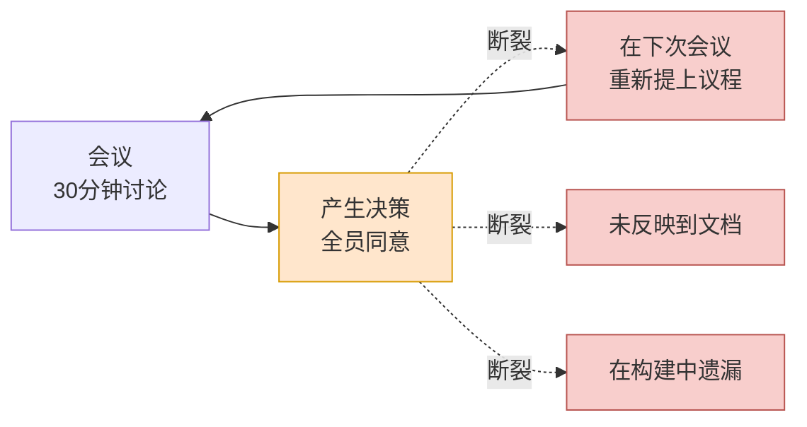
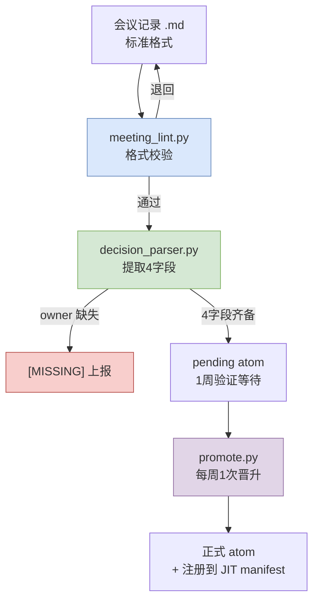

# 17.1 会议记录为何是最大的痛点

会议结束已过去5分钟。会议室的白板上还留着字迹。"战斗受击判定,采用客户端先行处理。但服务器验证的优先级放到下一个冲刺。"这是5个人花了30分钟才得出的结论。所有人都点了头,有人还拍了照片。

3周后,同样的5个人再次聚到同一间会议室。议程列表的第一行写着:"战斗受击判定 —— 客户端先行处理 vs 服务器验证,需要决策。"没有人记得3周前的结论。白板照片存在某人的相册里的某个角落,而那个人今天休假。又花了30分钟。这次得出了相反的结论。

这就是会议记录之所以是最大痛点的全部原因。会议上会作出决策。然而那个决策却**无法流转(propagate)**到下一次会议、下一份文档、下一个构建。决策作出了,却无法传播。本章讲的正是用数据接续那道断裂环节的故事。

---

## 17.1.1 会议 → 决策 → 执行,断在何处

笔者运营的个人 RnD 系统分成了17份文档:atom 命名规范、关系图自动化、Layer 映射指南、JIT 注入基础设施等。其中吞掉最多时间的单一文档,是会议记录改进计划。它的分量之大,足以与其他16份加在一起相提并论。

起初我感到不解。会议记录嘛,不就是照着记下来就行了吗?然而实际测量后发现,痛点的位置不在会议记录的*撰写*,而在会议记录*之后*。会议上决策确实作出了。问题在于:这个决策由谁负责、依据什么、期限到何时、接续到什么 —— 这些在走出会议室门的那一刻就蒸发了。

把这道断裂画成一个场景,便是如此。



虚线就是断裂的传播。决策(橙色)作出了,却没有流向三条分支(红色)中的任何一条。无法流出的决策会在3周后回到会议上。箭头向上弯折、重新回到会议的那个循环,正是痛点的本体。

一旦传播断裂,四件事会同时发生。

失去决策的历史。面对"当初为什么那么定?",只能以"记不清了,再约一次会吧"来回答。重复会议增多。同一议题每个季度都被重新提上议程。新加入者抓不住上下文。由于看不到决策的累积,每次都得一对一地解释。而且 AI 辅助变得无力。因为没有上下文,回答只停留在泛泛之谈。会议记录一旦散落各处,就无法把"我们团队以前对这个议题是怎么决策的"提供给 AI,于是 AI 只会返回互联网上的平均值。

这四件事都出自同一个根源。**因为决策被当作备忘,而非当作数据来对待。**备忘会挥发,而数据会流动。

---

## 17.1.2 把会议记录看作决策数据库,而非产出物

这里需要把视角翻转一次。若把会议记录看作"会议的产出物",那么记下来、存档,任务就结束了。存档的会议记录就像桌上的便签纸。当天看得见,到了下周就不知道去哪儿了。

若把会议记录看作"决策数据库",它就变成了一项完全不同的工作。资产不是会议记录本身,而是从会议记录中提取出来的**决策**;这个决策必须可检索、可引用、可传播。会议记录只不过是一条把决策开采上来的矿脉罢了。

用代码强制推行这一转变,正是第17部分的主干。笔者的系统里有一个支撑这一转变的 atom,名为 `decision_summary_not_clickup_mirror`。展开来说,它是"会议记录的决策摘要不是 ClickUp(任务追踪器)的镜像"这一原则。

这个 atom 为何必要,正戳中了痛点的要害。很多团队会把会议记录的决策槽直接誊抄到任务看板上。这样一来,"要做的事"留下了,"为什么那么定(依据)"却消失了。任务追踪器装的是*要做什么*,而不装*为什么那么定*。3周后会议重复的原因,恰恰就是这个。要做的事已经关闭,却没有依据,于是有人问起"话说这个当初为什么决定要这么做来着",却没人答得上来。所以决策摘要不能成为追踪器的镜像,而必须是一份怀有依据(rationale)的独立资产。atom 名称本身就是这条禁止线。

---

## 17.1.3 把决策拆成四个字段

能够传播的决策与会挥发的决策,差别在于结构。会挥发的决策是"采用客户端先行处理"这样一个句子。能够传播的决策则被分解成4个字段。

<svg viewBox="0 0 720 300" xmlns="http://www.w3.org/2000/svg" font-family="sans-serif">
  <rect x="0" y="0" width="720" height="300" fill="#fbfbfb" stroke="#ddd"/>
  <text x="360" y="32" font-size="17" font-weight="bold" text-anchor="middle" fill="#333">一条决策 = 4个字段</text>
  <!-- decision -->
  <rect x="30" y="60" width="310" height="80" rx="6" fill="#dae8fc" stroke="#6c8ebf"/>
  <text x="46" y="86" font-size="14" font-weight="bold" fill="#1f3a5f">decision</text>
  <text x="46" y="108" font-size="12" fill="#333">定了什么</text>
  <text x="46" y="128" font-size="11" fill="#666">"受击判定 客户端先行处理"</text>
  <!-- owner -->
  <rect x="380" y="60" width="310" height="80" rx="6" fill="#d5e8d4" stroke="#82b366"/>
  <text x="396" y="86" font-size="14" font-weight="bold" fill="#2d5016">owner</text>
  <text x="396" y="108" font-size="12" fill="#333">谁来负责</text>
  <text x="396" y="128" font-size="11" fill="#666">团队成员 A(没有则 [MISSING])</text>
  <!-- rationale -->
  <rect x="30" y="160" width="310" height="80" rx="6" fill="#ffe6cc" stroke="#d79b00"/>
  <text x="46" y="186" font-size="14" font-weight="bold" fill="#7a4f00">rationale</text>
  <text x="46" y="208" font-size="12" fill="#333">为什么那么定</text>
  <text x="46" y="228" font-size="11" fill="#666">"体感响应速度优先,承受外挂风险"</text>
  <!-- follow_up -->
  <rect x="380" y="160" width="310" height="80" rx="6" fill="#e1d5e7" stroke="#9673a6"/>
  <text x="396" y="186" font-size="14" font-weight="bold" fill="#4a2d5f">follow_up</text>
  <text x="396" y="208" font-size="12" fill="#333">接续到什么</text>
  <text x="396" y="228" font-size="11" fill="#666">"下一个冲刺的服务器验证任务"</text>
  <!-- caption -->
  <text x="360" y="278" font-size="12" text-anchor="middle" fill="#555">owner 为空时管线以 [MISSING] 上报 —— 强制传播的责任线</text>
</svg>

4个字段中最重要的是 `owner`。决策若没有负责人,那个决策就不是任何人的事;而不是任何人之事的决策,不会传播到执行。所以笔者的提取管线在 owner 为空时不会就那样放过,而是用 `[MISSING]` 明确上报。它把"责任线为空"这一事实本身抬升到表面上来。

`rationale` 是前面所说的 `decision_summary_not_clickup_mirror` 原则所栖身的地方。没有依据,3周后会议就会重复。`follow_up` 是决策通向实际执行的桥。这个字段一旦为空,决策就只停留为决策,触及不到构建。

---

## 17.1.4 提取管线 —— 从会议记录中开采决策

这4个字段由人每次手动填写也是可行的,但那样强制力就弱。笔者的系统使用一条从会议记录中自动提取决策、并上报缺失字段的管线。3个脚本串行相接。



第一步 `meeting_lint.py` 检查会议记录是否遵循标准格式:是否有 frontmatter,议题/决策/行动/下次会议这4个槽是否已填。格式损坏的会议记录会在这里被退回,回到撰写者手中。自动解析器只能处理格式受强制约束的输入,因此这道 lint 充当整条管线的入口关卡。

第二步 `decision_parser.py` 是核心。它读取决策槽,分解为4个字段(decision/owner/rationale/follow_up)。这里若找不到 owner,不会丢弃那个决策,而是以 `[MISSING]` 上报。因为让没有负责人的决策悄然通过是最危险的。

第三步是:被提取出来的决策不会立刻成为正式资产,而是以 `pending` 状态等待1周。这段验证期就是可逆关卡。若在1周内暴露出"这不是决策,而是讨论"或者"依据错了",就将其废弃。然后 `promote.py` 在每周1次的评审中,只把存活下来的决策移到正式 atom 文件夹,并注册到 JIT manifest。被注册的决策会从下一次会话起自动注入到相关工作中。至此,决策才开始流动。

可逆与不可逆的边界就在这里。到 pending 废弃为止都是可逆的。然而一旦 promote 结束、决策传播到其他文档、数据表、构建,从那时起就是不可逆的。因为团队成员的认知会改变,而从属决策会在其之上层层堆积。所以一切审校都必须在 promote 之前 —— 也就是 pending 的可逆区间内 —— 完成。

---

## 17.1.5 实操记录 —— 让一份损坏的会议记录通过

只讲抽象难以体会,所以这里原样搬来一份把实际损坏的会议记录放进管线跑一遍的实操记录(worked transcript)。输入是一份格式塌了一半的会议记录。

**输入 —— `2026-06-02-battle.md`(格式不良)**

```markdown
---
type: meeting_note
date: 2026-06-02
category: battle
---

## 议题
1. 受击判定位置(客户端 vs 服务器)

## 决策
- 受击判定决定在客户端先行处理。体感响应速度比服务器往返
  更重要的意见占了上风。外挂风险予以承受。
- 服务器验证放到下一个冲刺,作为独立任务。

## 行动项
- [ ] 服务器验证设计
```

这份会议记录虽然写了决策,但 owner 哪里都没有。谁来负责服务器验证是空的。下次会议的日程槽也整个缺失。我把它放进解析器,看看会得出什么。

**提示词(附加在 decision_parser.py 上的 LLM 辅助提示词全文)**

```
读取以下会议记录的 "## 决策" 槽,为每条决策提取4个字段:
decision、owner、rationale、follow_up。
- 若无法从正文中确定 owner,必须标注为 "[MISSING]"。
  不要靠推测填充。
- rationale 只引用正文中写明的依据。没有则填 "[MISSING]"。
- follow_up 与行动项或下一个冲刺的提及相关联。
仅以 JSON 数组输出。

[粘贴会议记录正文]
```

**Claude 原始输出(不作摘要,原样呈现)**

```json
[
  {
    "decision": "受击判定在客户端先行处理",
    "owner": "[MISSING]",
    "rationale": "体感响应速度比服务器往返更重要。外挂风险予以承受",
    "follow_up": "服务器验证作为下一个冲刺的独立任务推进"
  },
  {
    "decision": "把服务器验证分离为下一个冲刺的独立任务",
    "owner": "[MISSING]",
    "rationale": "[MISSING]",
    "follow_up": "与行动项'服务器验证设计'关联(负责人未指定)"
  }
]
```

在这里停下,检查了输出。两条决策的 owner 都被判为 `[MISSING]`。准确 —— 会议记录里哪里都没有负责人,所以没有靠推测填充是对的。第二条决策的 rationale 也是 `[MISSING]`,实际上正文中确实没有第二条决策的依据。这意味着解析器没有编造,让人放心。

不过有一处含糊。第一条决策的 follow_up 是"把服务器验证放到下一个冲刺",这与第二条决策内容重叠。解析器把两条决策的边界看得略微模糊了。这是需要人介入的地方。

**人工否决 + 重新请求**

```
第一条决策的 follow_up 与第二条决策正文重复。
把第一条的 follow_up 收窄为"创建服务器验证任务",
服务器验证的具体内容移交给第二条决策。
并且两条决策的 owner 都是 [MISSING],因此
在把这份会议记录放上 pending 之前,需要确定 owner 这一点,
把该警告行加到输出的最顶端。
```

**Claude 重新输出(原始)**

```
⚠️ 警告:2条决策的 owner 均为 [MISSING]。pending 晋升前
   需请会议主持人确定 owner。

[
  {
    "decision": "受击判定在客户端先行处理",
    "owner": "[MISSING]",
    "rationale": "体感响应速度优先,承受外挂风险",
    "follow_up": "创建服务器验证任务(详情见决策 #2)"
  },
  {
    "decision": "把服务器验证分离为下一个冲刺的独立任务",
    "owner": "[MISSING]",
    "rationale": "[MISSING]",
    "follow_up": "关联'服务器验证设计'行动项"
  }
]
```

这段实操记录展示的正是第17部分的核心。解析器把决策开采了上来,却没有隐藏 owner 这条责任线为空的事实。`[MISSING]` 被标了两次,而这作为"请确定 owner"的信号回到了会议主持人那里。决策要传播到执行,就必须有负责人;没有负责人时,系统会把它推到表面上来。一份损坏的会议记录要通过这道关卡,人就只能把 owner 填进去。传播的第一个结,就在这里打上。

顺带一提,上面输出中的 `⚠️` 只是控制台的警告行,并非正文格式的一部分。会议记录本身仍然是干净的4槽 Markdown。

---

## 17.1.6 剪去旁枝,立起脊柱

第17部分原本设计为6章(动机·提取·分类·图注·同步·AI 辅助),后来合并精简为4章。因为图像图注与同步是会议记录的旁枝,而把最大的痛点"决策传播"归拢为一章、立在前面才是对的。我把最大的痛点(会议 → 决策 → 执行 传播)提到 §17.1,再把纾解这一痛点的管线(meeting_lint → decision_parser → promote)紧随其后安排。

把会议记录当作数据库来对待的视角、把决策拆成4字段的结构、owner 为空时以 `[MISSING]` 上报的关卡、pending 1周的可逆验证 —— 这四者把断裂的传播重新接续起来。决策作出了却不流动的痛点,只要把决策做成能够流动的形态,就能纾解。

---

### 本章要点
- 痛点的本体不是会议记录的撰写,而是会议 → 决策 → 执行 传播的断裂。
- 决策要拆成4字段(decision/owner/rationale/follow_up)才会流动。没有 owner 就以 [MISSING] 上报。
- 会议记录不是产出物,而是决策数据库(DB)。不能成为追踪器的镜像。

---

> **游戏之外的应用。** "会议上决策作出了,那个决策却无法流转到下一次会议"这一痛点,不只发生在游戏开发,而是每周在所有职场的会议室里重复上演。把决策不写成一句话的备忘,而是拆成四个字段(做什么·谁·为什么·下一步行动)来记录,负责人为空时以 `[MISSING]` 抬升到表面 —— 这种做法可以原样搬到任何会议中。比如在营销周会上,如果达成了"下一次活动以 Instagram 为中心"的共识,那就为它附上 owner(谁来执行)、rationale(为什么是 Instagram —— 依据上季度的转化率)、follow_up(编写预算方案)。3周后"那件事谁说要做来着"这样的疑问,就再也不会出现。

---

## 动手试试

**Web 聊天机器人最简路径(无需终端)** —— 本章的核心不是脚本,而是"把决策拆成4字段、让它流动"这一构想。这一构想无需 CLI、hook、atom 基础设施,仅凭 Web 聊天机器人(ChatGPT 或 Claude 网页版)也能原样重现。以下三个步骤才是主线。
1. 会议结束后,把会议记录(或会议备忘)原样复制。没有格式也没关系。
2. 在 Web 聊天机器人的输入框里粘贴下面的提示词,并在其下方粘贴会议记录(`[会议记录正文]` 处)。这就是把 `decision_parser.py` 所做的事手动做一遍。
   ```
   从以下会议记录中,为每条决策以表格形式提取4个字段:
   decision(做什么)、owner(谁负责)、rationale(为什么)、follow_up(下一步行动)。
   - 无法确定 owner 时必须填 "[MISSING]"。禁止推测。
   - rationale 只取正文中写明的依据。没有则填 "[MISSING]"。
   [会议记录正文]
   ```
3. 在输出表中,把标了 `[MISSING]` 的格子向会议主持人确认后填上。把完成的表格按日期顺序追加堆叠到 `decisions.md` 这样一份文档里,这份文档就是决策数据库(DB)。检索用文档内查找(Ctrl+F)就够了。脚本、atom、JIT 等,等到这个习惯积累起来、检索变得吃力时再引入即可。

**setup**(基础设施版本 —— 在上面的最简路径上手之后)
- 确定一份会议记录标准格式。frontmatter(type/date/category)+ 4个槽(议题/决策/行动/下次会议)。
- 准备3个脚本:用于格式校验的 `meeting_lint.py`、用于决策提取的 `decision_parser.py`、用于晋升的 `promote.py`(起初仅有 lint 与 parser 就够了)。
- 明确决策的4个字段:decision、owner、rationale、follow_up。把 owner 为空时强制 `[MISSING]` 的规则放进 parser。

**prompt**(附加在 decision_parser 上的 LLM 辅助提示词)
```
读取以下会议记录的 "## 决策" 槽,为每条决策提取4个字段:
decision、owner、rationale、follow_up。
- 无法确定 owner 时必须填 "[MISSING]"。禁止推测。
- rationale 只引用正文中写明的依据。没有则填 "[MISSING]"。
- follow_up 与行动项、下一个冲刺的提及相关联。
仅以 JSON 数组输出。
[会议记录正文]
```

**verify**
- 确认输出中每条决策的 owner 都已填上。只要还有一个 `[MISSING]`,就必须先向会议主持人请求确定 owner,之后才放上 pending。
- 查看 rationale 是否编造了正文中没有的依据(没有时应为 `[MISSING]` 才正常)。
- 在 pending 放置1周后,只把每周1次评审中存活下来的决策用 `promote.py` 晋升为正式 atom。

## 17.1.7 单人精简版

如果3个脚本让你觉得负担,就这样精简。只把会议记录格式统一为4个槽,会议结束后仅取出决策槽,用上面的提示词在 LLM 上跑一次。只对 owner 显示为 `[MISSING]` 的决策,当场把负责人填进去。即使没有自动化,仅做这一点,也能挡住"决策没有负责人"这一最常见的传播断裂。lint、promote 等,等到会议记录堆积、需要检索时再添加即可。
