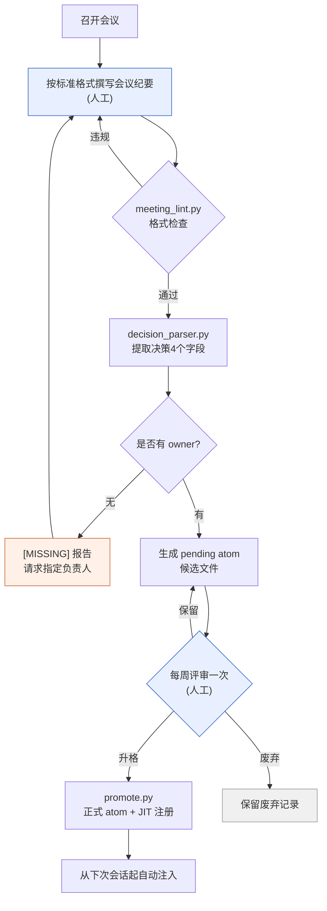

# 17.2 从会议纪要中挖掘决策的提取管线

周三早上,刚到公司,团队即时通讯工具里就弹出一条提醒。"上周不是定好把背包格子数增加到30格了吗?谁负责改数据表来着?"没有人能在这条讨论串里给出答案。会议纪要肯定是有的,在某个文件夹里。打开一看,议题和讨论密密麻麻,可"到底决定了什么、谁来负责"却化在了字里行间。结果下一次会议上,又把同一个议题从头再提一遍。

本章讲的是填补那三天空白的机器。一份会议纪要进来后,通过格式检查,提取出决策的四个字段,没有负责人的决策会被贴上 [MISSING] 标签,生成候选文件,一周后经过评审,成为可自动注入的资产。人工只触及两端两处——撰写会议纪要的入口,以及每周评审一次的出口。

---

## 17.2.1 管线整体流程

先用一张图看全貌。每一个方框要么是一段小脚本,要么是人的判断。需要人工经手的方框只有两个,其余都自动流转。



只有两个蓝色方框(撰写会议纪要、每周评审一次)是人工,其余都是脚本。橙色方框([MISSING] 报告)是自动检查重新把人叫回来的地方。当决策没有负责人时,管线并不是就此停下,而是把决策退回到撰写会议纪要的步骤,直到定下谁来负责为止。这正是这条管线的核心设计——不悄悄放过空白,而是大声报告出来。

整个资产的文件夹结构是这样安排的。

<svg xmlns="http://www.w3.org/2000/svg" viewBox="0 0 720 300" font-family="monospace" font-size="13">
  <rect x="10" y="10" width="700" height="280" fill="#fafafa" stroke="#cccccc"/>
  <text x="24" y="38" font-weight="bold">meeting_pipeline/</text>
  <line x1="40" y1="48" x2="40" y2="270" stroke="#bbbbbb"/>
  <text x="52" y="68">scripts/</text>
  <text x="80" y="92" fill="#3366cc">meeting_lint.py</text>
  <text x="300" y="92" fill="#777777">格式·必需章节检查</text>
  <text x="80" y="116" fill="#3366cc">decision_parser.py</text>
  <text x="300" y="116" fill="#777777">提取决策4个字段 + owner [MISSING] 报告</text>
  <text x="80" y="140" fill="#3366cc">promote.py</text>
  <text x="300" y="140" fill="#777777">pending → 正式 atom + 更新 JIT manifest</text>
  <text x="52" y="172">meetings/</text>
  <text x="80" y="196" fill="#999999">2026-05-18_battle_tf.md</text>
  <text x="300" y="196" fill="#777777">标准格式会议纪要(输入)</text>
  <text x="52" y="228">atoms/pending/</text>
  <text x="80" y="252" fill="#cc6633">meeting_decision_2026-05-18_D1.md</text>
  <text x="300" y="252" fill="#777777">候选(等待1周验证)</text>
</svg>

---

## 17.2.2 第1步 —— 强制格式的 lint

要能提取,会议纪要就得是机器可读的样子。如果没有 "## 决策" 章节,或者决策混在一整段行文里,解析器就什么都提不出来。所以最先加入的是格式检查。`meeting_lint.py` 做的事很简单:是否有必需的 frontmatter,是否有必需的章节,决策槽位是否以 `D1`、`D2` 的格式填好。

```python
# meeting_lint.py 骨架
REQUIRED_FRONTMATTER = ["type", "date", "category", "attendees"]
REQUIRED_SECTIONS = ["## 议题", "## 决策", "## 行动项", "## 下次会议"]
ALLOWED_CATEGORIES = ["art", "battle", "daily", "issue", "review"]

def lint(meeting_note_path):
    fm, body = parse_markdown(meeting_note_path)
    errors = []
    for key in REQUIRED_FRONTMATTER:
        if key not in fm:
            errors.append(f"缺少 frontmatter: {key}")
    if fm.get("category") not in ALLOWED_CATEGORIES:
        errors.append(f"category 值不合法: {fm.get('category')}")
    for section in REQUIRED_SECTIONS:
        if section not in body:
            errors.append(f"缺少章节: {section}")
    if "## 决策" in body:
        block = extract_section(body, "## 决策")
        if not any(l.strip().startswith("- D") for l in block.split("\n")):
            errors.append("决策槽位为空(需要 D1、D2… 格式)")
    return errors
```

把这项检查挂到会议纪要的提交前钩子上。一旦违反格式,提交本身就会被拦下。若只当作建议,忙的时候就会悄悄跳过,而跳过一次的格式到了下周就会垮掉。只要被拦上1\~2周,格式就会成为习惯。不过,要是太严苛,连撰写会议纪要本身都会被拖延,所以在适应期之后把 false positive 集中清理一次,才是现实的运营方式。

---

## 17.2.3 第2步 —— 挖掘决策四个字段的解析器

在通过格式检查的会议纪要中,`decision_parser.py` 读取决策槽位。从一条决策里要提取的,正好是四样东西。**决定了什么(decision)、谁来负责(owner)、为什么这么定(rationale)、接下来该做什么(follow_up)。** 这四个字段让决策成为资产。尤其是 owner。没有负责人的决策不是决策,而是一厢情愿的希望。所以当 owner 为空时,解析器不会悄悄留个空格,而是填入 `[MISSING]` 予以报告。

从这里到最后,我们不跳过任何一行,跟着一份会议纪要变成资产的全过程走一遍。这是从输入到 atom 升格的单一连贯示例。

```text
================ 输入: meetings/2026-05-18_battle_tf.md ================
---
type: meeting
date: 2026-05-18
category: battle
attendees: [이민수, teammate_a, teammate_b]
related_atoms: [combat_global_cooldown_constant]
---
## 议题
- 统一战斗全局冷却(GCD)值
- 回复技能是否作为 GCD 例外

## 决策
- D1: 将战斗全局冷却统一为0.5秒。(负责人: teammate_a) [依据: 与 refgame 对比的输入响应体感测试中,0.5秒最为稳定]
- D2: 回复技能从全局冷却中排除。[依据: 担心回复循环被打断]

## 行动项
- @teammate_a: 将战斗数据表的 cooldown 列批量设为0.5 (~MM-DD)

## 下次会议
- MM-DD 14:00,评审回复循环1周测试结果

================ $ python meeting_lint.py meetings/2026-05-18_battle_tf.md ================
[OK] frontmatter 4/4,章节 4/4,检测到2条决策槽位。允许提交。

================ $ python decision_parser.py meetings/2026-05-18_battle_tf.md ================
[
  {
    "id": "D1",
    "decision": "将战斗全局冷却统一为0.5秒。",
    "owner": "teammate_a",
    "rationale": "与 refgame 对比的输入响应体感测试中,0.5秒最为稳定",
    "follow_up": "将战斗数据表的 cooldown 列批量设为0.5 (~MM-DD)",
    "source_meeting": "2026-05-18_battle_tf.md",
    "category": "battle",
    "related_atoms": ["combat_global_cooldown_constant"]
  },
  {
    "id": "D2",
    "decision": "回复技能从全局冷却中排除。",
    "owner": "[MISSING]",          # ← 未填写负责人。解析器予以报告
    "rationale": "担心回复循环被打断",
    "follow_up": null,             # ← 也没有后续行动
    "source_meeting": "2026-05-18_battle_tf.md",
    "category": "battle",
    "related_atoms": ["combat_global_cooldown_constant"]
  }
]
[WARN] D2: owner=[MISSING] —— 没有负责人的决策。暂缓生成 pending,退回会议纪要撰写者。

================ 生成 pending: 仅 D1 通过 ================
$ cat atoms/pending/meeting_decision_2026-05-18_D1.md
---
name: meeting_decision_2026-05-18_D1
description: 战斗全局冷却统一为0.5秒的决策
status: pending
type: decision
source_meeting: 2026-05-18_battle_tf.md
owner: teammate_a
category: battle
related_atoms: [combat_global_cooldown_constant]
created: 2026-05-18
---
## 决策
将战斗全局冷却统一为0.5秒。
## 依据
与 refgame 对比的输入响应体感测试中,0.5秒最为稳定。
## 后续行动
- [ ] @teammate_a: 将 cooldown 列批量设为0.5 (~MM-DD)

================ 1周后的每周评审 ================
$ python promote.py atoms/pending/meeting_decision_2026-05-18_D1.md
[PROMOTE] → atoms/combat_global_cooldown_constant_decisions/meeting_decision_2026-05-18_D1.md
[JIT] manifest 注册: trigger=(전투|쿨다운|GCD|cooldown), atom 18个 → 19个
[OK] 从下次会话起,输入"全局冷却"时自动注入该决策。
```

这一个方框就是管线的全部。值得注意的是 D2。决策内容没问题,依据也有,可 owner 是空的。解析器不会就这么放它通过。它填入 `[MISSING]`,暂缓生成 pending,并退回给撰写者。D2 会在几天后"评审回复循环1周测试结果"的会议上获得负责人,再次进入流程。正是这一次拦下空白的退回,让三天后团队即时通讯工具里"那件事到底谁负责来着?"永远不再出现。

"没有 owner 就报告"这条规则本身,用一个 atom 固化了下来(`decision_summary_not_clickup_mirror`,§17.1.2)。任务工具里也许挂着一条"修改数据表"的待办,但这条待办为什么、是哪个决策的结果,只留在会议纪要 atom 里。

---

## 17.2.4 第3步 —— 在 pending 里静置一周

经解析器通过的决策不会立刻成为正式 atom,而是在 `pending/` 里等待一周。因为在会议上信心十足定下的事,运营一周后被推翻是常有的。上面例子里的 D2 正处在这样的危险地带。"回复技能排除在 GCD(全局冷却)之外"这一决策,若在1周测试中回复循环出现问题,就可能再次被推翻。pending 就是强制留出让墨水变干的时间的那一格。

而且,废弃也要作为资产留存。假如像 D2 这样的决策在1周测试中垮掉了,不是直接删除,而是生成一个废弃记录 atom。

```markdown
---
name: meeting_decision_2026-05-18_D2_DISCARDED
status: discarded
discarded_reason: 1周测试结果显示回复循环 DPS 曲线崩溃
---
## 原决策
对回复技能也应用0.5秒的全局冷却。
## 废弃原因
1周测试中回复循环 DPS 下降,导致整体平衡崩溃。回退为排除决策。
## 教训
"回复排除在 GCD 之外为标准" → 升格为 combat_healing_skill_cooldown_exception atom。
```

废弃记录会成为下次会议上"这个议题以前没试过吗?"的答案。它是防止同样的错误犯第二遍的最廉价的工具。不过废弃记录堆积起来会变成检索噪声,因此需要每季度清理重复项、只留下教训的整理。

---

## 17.2.5 第4步 —— 每周评审一次与升格

每周在固定的时间集中查看 pending 候选。结果是三者之一。

| 结果 | 处理 |
|---|---|
| 升格 | pending → 移动到正式 atom 文件夹,注册 JIT manifest |
| 废弃 | 决策被推翻 → 从 pending 移除,保留废弃记录 atom |
| 保留 | 信息不足 → pending 延长1周 |

评审大约每10个 atom 花15分钟。一旦决定升格,`promote.py` 会一次性处理文件移动和 manifest 更新。

```python
# promote.py 骨架
def promote(pending_path):
    fm, body = parse_markdown(pending_path)
    target = ATOM_BASE / f"{fm['related_atoms'][0]}_decisions" / f"{fm['name']}.md"
    move(pending_path, target)
    manifest = json.load(open(JIT_MANIFEST))
    manifest['atoms'].append({
        "name": fm['name'],
        "path": str(target),
        "trigger_regex": build_trigger(fm),   # related_atoms + category 关键词
        "description": fm['description'],
        "added": today(),
    })
    json.dump(manifest, open(JIT_MANIFEST, "w"), indent=2)
    log_promotion(fm['name'])
```

当 `trigger_regex` 在下次会话中与用户输入匹配时,这条决策就会被自动注入。在上面的例子里,输入"全局冷却",D1 决策及其依据就会一并进来。这正是过去靠手工誊抄的决策,在需要的那一刻自动浮现、成为资产的转折点。

---

## 17.2.6 度量 —— 与手工誊抄相比有何不同

这是笔者在项目A的运营经验中,把只定下标准格式的阶段与启动了管线的阶段作对比后的印象。下面的数字并非精确计量,而是运营中体感到的方向和大致比例,其中掺有笔者的推测(未经验证)。

| 项目 | 仅格式(手动提取) | 启动管线 |
|---|---|---|
| 会议纪要 → 决策提取时间 | 每次会议 20\~30分钟 | 不到1分钟 |
| 决策的 atom 升格比例 | 5\~10%(整理时间不足) | 60\~80%(全量审查) |
| "以前不是决定过吗?"的重复会议 | 每季度 5\~10次 | 每季度 0\~2次 |
| 负责人不明的决策 | 无法追踪 | 通过 [MISSING] 报告即时可见 |

变化最大的是升格比例。靠手工整理时,由于没有时间,90%以上的决策都挥发掉了。一自动化,全量审查成为可能,有价值的决策便一条不落地留存下来。方向是明确的。比例的精确数值则随团队规模和会议频率而变化。

---

## 17.2.7 常见失败与处方

| 模式 | 处方 |
|---|---|
| 只把 lint 当作建议来运营 | 用提交钩子强制 |
| 在决策槽位里连讨论也写进去 | 决策只写一句话,依据放到单独字段 |
| 让 owner 空白就这么通过 | [MISSING] 报告 + 暂缓 pending 予以退回 |
| pending 评审一再拖延 | 在周复盘里设固定槽位,哪怕5分钟也每周做 |
| 不留废弃记录 | 废弃也作为单独 atom 保留 |

这五行几乎就是全部。尽可能减少需要靠人的意志力去坚守的环节,把格式检查和 owner 检查交给机器,这就是这套系统的稳定点。

---

## 本章要点
- 一份会议纪要经 lint → 解析器 → pending → 评审 → JIT 注册自动流转,成为资产。
- 决策的四个字段中,若 owner 为空,解析器会填入 [MISSING] 予以退回。
- pending 静置1周与废弃记录的留存,强制留出让决策的墨水变干的时间。

---

> **游戏之外的应用。** 把一份会议纪要送上"格式检查→决策提取→1周验证→正式注册"的传送带,人只在入口(撰写)和出口(每周评审一次)两处经手——这套结构不止适用于游戏,也能移植到任何知识劳动团队的文档运营中。比如咨询团队处理客户会谈笔记时,只要统一笔记格式,用 LLM 先把"决策·负责人·依据·下一步行动"这些槽位做一次初步提取,负责人为空就弹出 `[MISSING]` 予以退回,只把静置了一周的决策升格为正式的行动追踪器即可。手工整理时挥发掉90%以上的会议决策,一旦放上传送带,就成为全量审查的对象,一条不落地留存下来。

---

## 动手试试

**setup.** 在会议纪要文件夹里放一份标准格式模板,把 `meeting_lint.py` 挂到提交前钩子上。把 frontmatter 的4个字段和4个章节设为必需。

**prompt.** 把一份会议纪要交给解析器,像下面这样下达指令。

> 从这份会议纪要的 `## 决策` 章节中,为每条决策提取 decision / owner / rationale / follow_up 四个字段,输出为 JSON。对于没有明确写出 owner 的决策,把 owner 标记为 `[MISSING]`,并单独汇总到警告行里。不要靠推测来填。

**verify.** 若输出的 JSON 中有决策被填入了 `[MISSING]`,就不要为该决策生成 pending,而是退回给会议纪要撰写者。只为 owner 全部填好的决策生成 pending 候选文件,一周后在每周评审中定下升格·废弃·保留。

### 单人精简版
如果是一个人工作,三个脚本加提交钩子就太重了。只把会议纪要的 `## 决策` 章节标准化,每条决策用一行写下 `D1: 什么 / 负责人: 我 / 依据: 为什么`。每周一次,把那一周会议纪要里的决策行摘出来,汇集到一个文件(`decisions.md`)里,负责人为空的行就亲手留个 `[MISSING]` 标记,下周补上。脚本以后手忙不过来时再加也不迟。关键是"决策一行·写明负责人·每周汇集一次"这三个习惯。
