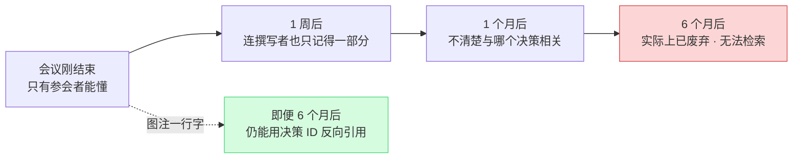
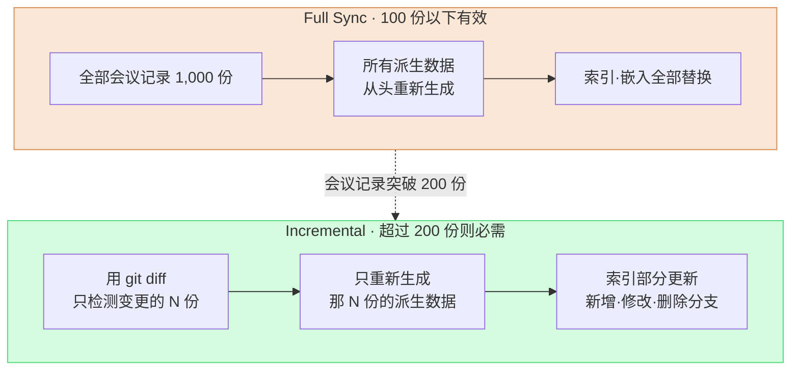

# 17.3 会议分类·图注·同步 —— 让会议记录成为资产的三条主轴

> 会议记录的目的不是堆积。真正的目的是:半年后仍能被检索到、能引向决策、并在两台 PC 上呈现为相同的状态。

---

周二下午。我想起来,一年前的一次会议上明明约定过,要把角色服装的饱和度降低一档。可是那份会议记录怎么也找不到。打开文件夹一看,`meeting_0413.md`、`회의_수정본_final.md`、`IMG_2034.png` 之类的两百来个文件只是按日期堆在一起。既没有分类,没有图注,也没有统一的命名。决策就在某个地方,但通往那个决策的路径已经消失了。

会议记录要成为资产,需要三件事同时运转。**分类**建立检索的第一入口,**图注**(caption)让一半的图像保持可检索状态,**同步**则让处理成本即便在超过 1,000 份时也只绑定在变更部分上。这三者只要缺一,会议记录就会沦为越堆越沉的死堆。

在 §17.1·§17.2 中,我们搭建了把会议记录转换为提取管线的流程 —— 用 `meeting_lint.py` 检查格式,`decision_parser.py` 提取决策的四个字段(`decision` / `owner` / `rationale` / `follow_up`),owner 缺失时以 `[MISSING]` 上报,先汇入 pending atom,再由 `promote.py` 提升。本章讲的是支撑这条管线长期不崩坏的三项运营标准。

---

## 17.3.1 分类 —— 检索的第一入口

会议记录随着时间推移会累积到数百、数千份。检索不到的资料不是资产。分类就是检索的第一个分岔口。这就像在办公室的文件柜上贴标签。没有标签的柜子,最终没有人会去打开。

笔者负责的项目A(MMORPG 开发)把分类归为五个。关键在于保持**小而正交**。

<svg viewBox="0 0 720 220" xmlns="http://www.w3.org/2000/svg" font-family="sans-serif" font-size="13">
  <rect x="10" y="10" width="130" height="190" rx="8" fill="#fce7d6" stroke="#d98a4a"/>
  <text x="75" y="34" text-anchor="middle" font-weight="bold">art</text>
  <text x="75" y="58" text-anchor="middle" font-size="11">视觉·美术方向</text>
  <text x="75" y="78" text-anchor="middle" font-size="10" fill="#666">概念评审</text>
  <text x="75" y="94" text-anchor="middle" font-size="10" fill="#666">环境色调共识</text>
  <text x="75" y="120" text-anchor="middle" font-size="10" fill="#a05a20">→ 图注占比↑</text>

  <rect x="150" y="10" width="130" height="190" rx="8" fill="#d6e7fc" stroke="#4a7ad9"/>
  <text x="215" y="34" text-anchor="middle" font-weight="bold">battle</text>
  <text x="215" y="58" text-anchor="middle" font-size="11">战斗·平衡</text>
  <text x="215" y="78" text-anchor="middle" font-size="10" fill="#666">冷却时间·DPS</text>
  <text x="215" y="94" text-anchor="middle" font-size="10" fill="#666">伤害曲线</text>
  <text x="215" y="120" text-anchor="middle" font-size="10" fill="#2050a0">→ atom 提取↑</text>

  <rect x="290" y="10" width="130" height="190" rx="8" fill="#d6fce0" stroke="#4ad97a"/>
  <text x="355" y="34" text-anchor="middle" font-weight="bold">daily</text>
  <text x="355" y="58" text-anchor="middle" font-size="11">例行进度共享</text>
  <text x="355" y="78" text-anchor="middle" font-size="10" fill="#666">站会</text>
  <text x="355" y="94" text-anchor="middle" font-size="10" fill="#666">今日待办</text>
  <text x="355" y="120" text-anchor="middle" font-size="10" fill="#207040">→ 几乎无决策</text>

  <rect x="430" y="10" width="130" height="190" rx="8" fill="#fcd6d6" stroke="#d94a4a"/>
  <text x="495" y="34" text-anchor="middle" font-weight="bold">issue</text>
  <text x="495" y="58" text-anchor="middle" font-size="11">紧急问题处理</text>
  <text x="495" y="78" text-anchor="middle" font-size="10" fill="#666">构建失败</text>
  <text x="495" y="94" text-anchor="middle" font-size="10" fill="#666">上线前事故</text>
  <text x="495" y="120" text-anchor="middle" font-size="10" fill="#a02020">→ 必须事后整理</text>

  <rect x="570" y="10" width="130" height="190" rx="8" fill="#ece6fc" stroke="#7a4ad9"/>
  <text x="635" y="34" text-anchor="middle" font-weight="bold">review</text>
  <text x="635" y="58" text-anchor="middle" font-size="11">里程碑·QA</text>
  <text x="635" y="78" text-anchor="middle" font-size="10" fill="#666">MS 验收</text>
  <text x="635" y="94" text-anchor="middle" font-size="10" fill="#666">季度复盘</text>
  <text x="635" y="120" text-anchor="middle" font-size="10" fill="#502090">→ 摘要 atom</text>

  <text x="360" y="172" text-anchor="middle" font-size="11" fill="#444">五格互不重叠 —— 一次会议正好归入一格</text>
  <text x="360" y="192" text-anchor="middle" font-size="11" fill="#444">一旦扩到六格,"这算 art 还是 battle?"就会每周堵住会议</text>
</svg>

五个并不是所有团队的标准答案。如果是以非战斗系统为核心的项目,就需要把 `battle` 换成 `system` 这样的调整。关键不在于数字,而在于**把分类保持得足够小,小到分类决定本身不会堵住会议**这一原则。

### 一次会议一个分类

会议横跨两个格子的情况经常发生。如果在评审角色概念时顺带敲定了战斗动作,那算 art 还是 battle?原则是**只以主产出物为准取其一**。如果概念是主产出物,就归为 art,战斗动作则用 `sub_topic` 字段作辅助记录。

```yaml
---
type: meeting_note
category: art
sub_topic: [character, battle_motion]
date: 2026-05-18
attendees: [teammate_a, teammate_b, teammate_c, 李旼洙]
related_atoms: [character_concept_kim, battle_motion_kim]
confidential: internal
---
```

`sub_topic` 只是检索的第二层过滤,不用于路由决策。路由始终只以 `category` 这一个值运作。一旦这条单值原则被破坏,§17.2 的 `promote.py` 就无法判断该把 atom 送往哪个文件夹,各分类统计之和也会对不上。正交性不是美观问题,而是管线完整性的前提。

### 每个分类的运营各不相同 —— 这才是拆分的真正价值

把它分成五格的真正理由,并不是检索标签。而是因为每一格的运营方式都不同,只有拆开,差异化运营才能自然而然地被设计出来。

`art` 的附件图像多,下一节的图注标准是必需的。由于决策以视觉为中心,决策槽里会放入 `` 这样的图像引用。`battle` 的决策是数值·规则,atom 自动提升的比例最高,而且一行决策会牵动配置表的批量变更,因此影响范围的可视化(第11部分的关系图)很重要。`daily` 几乎没有决策才是常态,又因累积很快,故按周拆入自动文件夹(`daily/2026-W21/`)。`issue` 的会议记录较为杂乱,因此把事后 24 小时内整理定为义务,并把防止复发的 atom 提取到 `issue_postmortem/`。`review` 篇幅长,故另行撰写 5\~10 行的摘要 atom,让它在下一次季度复盘中被自动引用。

新增分类要极为谨慎。每季度发生 5 次以上、运营方式与既有五个明显不同、需要单独的路由文件夹、且一个月后仍能维持 5 次以上 —— 只有全部通过这四个条件才予以考虑。就笔者的运营经验而言,五个维持了一年以上,即便 `tech_review` 或 `external` 这样的候选一度浮现,最终也都被 `sub_topic` 吸收了。

### AI 分类器只应作为辅助

分类以人在撰写时直接录入为主。只有像从外部收到的资料那样存在缺失的会议记录,才用 AI 分类器来辅助。用关键词词典能捕获约 90%,剩下的 `uncertain` 才交给 LLM 或人来判定。

委托给 LLM 时,施加强约束的提示词更稳定。下面是实际使用的提示词全文。

```
以下是会议记录。请归入 5 个分类之一。

分类:
- art: 视觉·美术方向
- battle: 战斗系统·平衡
- daily: 例行进度共享
- issue: 紧急问题处理
- review: 里程碑·QA 评审

会议记录:
[全文或前 500 字]

响应格式:只给一个分类单词。禁止任何说明·依据·不确定表述。
若响应不是 5 个分类之一,则视为系统失败。
```

把同一份会议记录(下面是 art 会议的开头)输入进去时,Claude 的原始输出是这样的。

> 输入的会议记录:
> `角色 K_007(学者)概念 v3 评审。有意见认为服装色调的饱和度过高。达成一致:降低一档。约定下次会议一并检查战斗动作的色调。`

> Claude 输出:
> `art`

干净利落地只输出了一个单词。然而,把 daily 会议记录喂给同一个提示词时,也发生过这样的情况。

> 输入:`今天的构建在凌晨挂了,原因看起来是配置表合并冲突。计划先热修复,之后再正式修改。`

> Claude 输出:
> `issue`

表面上这是 daily 站会里冒出的一句话,但 Claude 根据内容把它分到了 `issue`。**这正是不能把分类器当作首选的原因。** 人会做出这样的运营判断:"这是 daily 当中突然冒出的构建事故,应该拆成单独的 issue 会议。"而 AI 只看文本就贴标签。标签也许没错,但要不要拆分会议,它决定不了。所以人为主,LLM 只止步于对缺失部分的辅助。

在季度复盘中,会统计各分类的会议数量,以观察"时间花在哪里"。下面的分布是笔者的估算(未经验证),绝对数量只是示例,只有比例的大小关系与实际运营的体感一致。

| 分类 | 占比(估算) | 备注 |
|---|---|---|
| `daily` | 约 1/3 | 每日例行,几乎没有决策 |
| `battle` | 约 1/5 | 战斗 TF 每周 2 次 |
| `art` | 约 1/7 | 美术评审 + 外部会议 |
| `issue` | 低 | 构建事故等 |
| `review` | 最低 | 里程碑·季度复盘 |
| 其他 | 约 1/5 | 1:1、外部等非分类 |

如果 `issue` 在某个季度格外突出,那么改善构建·CI 稳定性就会浮上为下一个优先事项。分类不仅用于检索,也是映照组织时间分配的一面镜子。

---

## 17.3.2 图注 —— 让一半图像存活下来的一行字

`art` 会议记录的正文有一半是图像。而没有图注的图像,就像堆在桌上的一叠照片。当天什么都记得,可一个月后,只有在背面写了一行备注的照片才能存活下来。



图像占了会议记录的一半,若无法检索,就等于会议记录资产的一半消失了。让那一半存活下来的,就是一行图注。

### 图注三要素

项目A 的图注标准三行就写完。

```markdown


**[图 1]** 角色 K_007(学者)概念 v3 —— 服装色调饱和度降低一档
*决策:D2(服装饱和度 -10%) | 下一步行动:v4 制作(~MM-DD)*
```

三个要素各自打开不同的检索路径。**编号 + 一行说明**留下在正文中以"参见图 1"引用的路径,**决策 ID 引用(D2)**留下"与此决策关联的图像"这一反向引用,**下一步行动**留下后续工作的线索。三行都能在 1 分钟内写完。"即时附加"并不意味着"在会议中撰写"。现实的做法是:会议中只整理决策,结束后立刻在 10 分钟内补齐图注。

### 文件名和文件夹是第一入口

和图注同样重要的是文件名。因为文件夹和文件名本身就是检索的第一入口。

```
会议记录文件夹/
├── 2026-05-18_art_review.md
└── images/
    └── 2026-05-18_art_review/
        ├── character_kim_concept_v3.png
        ├── env_palette_comparison.png
        └── reference_external_game_a.png
```

规则是 `<主题>_<条目>_<版本 or 备注>.<ext>`,禁止使用韩文·空格·特殊字符(防止路径编码事故)。`IMG_2034.png`(毫无含义)、`김캐릭터 v3.png`(韩文·空格)、`final_final_v3_real.png`(版本无意义)、`untitled.png`(废弃候选)全都是反模式。与其依赖人的自觉,不如在 `meeting_lint.py` 里加一条检查规则来强制执行更好 —— 在 §17.2 中把格式检查自动化的那个 lint 上,再叠加一行文件名检查就够了。

### 外部资料出处与 confidential 等级

会议中经常会引用外部游戏·美术作为参考。若没有出处,就会直接酿成版权事故。

```markdown


**[图 3]** 参考图像 —— refgame(Developer Y, 2024)
*引用理由:比较相似概念的饱和度处理。无直接借用。*
```

出处(游戏名·开发商·年份)·引用理由·是否直接借用,都要一一注明。而且图像比文本的泄露风险更大,因此在 frontmatter 中标注等级。

```yaml
confidential: internal   # internal / restricted / external_ok
images:
  - file: character_kim_concept_v3.png
    confidential: restricted
    reason: 未公开的角色设计
```

`internal` 指公司内部共享,`restricted` 指仅限该 TF·负责人,`external_ok` 指获准用于营销·外部共享。会议记录构建时按等级分离输出,非 `external_ok` 的图像在外部共享版中自动做模糊处理。这一自动分离带来的直接效果,是把外部共享的遮罩事故实质上降为 0。

### 图注也让 AI 打初稿

给 50 张图像手写 50 条图注是个负担。把正文和文件名交给 AI,批量拿到初稿。

```
以下是会议记录正文 + 图像文件列表。

[会议记录正文]
[10 个图像文件名]

请为每张图像撰写图注初稿。

格式:
- [图 N] <说明> —— <核心决策或变化>
- *决策:D? | 下一步行动:?*

对于在正文中找不到依据的图像,标注为"内容不明 —— 需撰写者确认"。
```

这里最后一行才是关键。输入同一份会议记录时,Claude 对正文中有依据的图像都加了图注,但对 `reference_external_game_a.png` 则这样回答。

> Claude 输出(节选):
> `[图 3] reference_external_game_a.png —— 内容不明,需撰写者确认。正文中未注明这张外部参考图像的引用理由。`

这是 AI 把不知道的事情如实上报为"不知道"。撰写者据此补上引用理由。若仅凭正文上下文仍不够,就只挑核心的 5\~10 张送入 Vision 模型(由于图像 token 成本高,不会全部跑一遍)。

```python
# 只选用核心的 5~10 张图像 —— 每张图像的 token 成本很高
response = client.messages.create(
    model="claude-opus-4-8",
    messages=[{
        "role": "user",
        "content": [
            {"type": "image", "source": {"type": "base64", "data": img_b64}},
            {"type": "text", "text": "用一行中文描述这张图像。禁止猜测,只描述看到的。"},
        ],
    }],
)
```

撰写者把这一行整理成图注格式。没必要对所有图像都跑 Vision。仅核心的 5\~10 张,就足以显著提升可检索性。

图注写得好的一年份会议记录,本身就成为一份视觉开发文档(visual development document)。`character_kim` v1 → v2 → v3 的视觉变化可以用决策 ID 追溯,只筛选 `external_ok` 等级就能自动整理出对外汇报资料,把各领域的核心图像 + 图注汇集起来则成为新团队成员的入职资料。若以笔者的估算(未经验证)来表达引入图注前后的变化,**方向**是这样的 —— 半年前会议记录的检索成功率大幅上升,"这张图我在哪见过?"这类重复提问大幅减少,外部共享的遮罩事故收敛于 0。绝对数值因团队而异,但仅凭阶段 1·2(文件名标准 + 图注格式),那个方向就已经清晰地显现出来。

---

## 17.3.3 同步 —— 不是全量,而是只处理变更部分

会议记录本身是文本文件,用 git 就够了。同步真正的对象,是从会议记录中**派生出的数据** —— §17.2 的 pending atom 候选、JIT manifest、分类统计、决策索引(`decision_index.json`)、图注索引、按 confidential 等级的构建输出,以及用于向量检索的 LLM 嵌入(embedding)。这些数据都必须对会议记录的变更做出响应。

问题在于:会议记录一旦超过 1,000 份,每次都重新处理全量的成本会占到运营的一半。这就像停下整条生产线,把所有零件重做一遍 —— 明明只改了一个零件。



Full Sync 实现简单,状态不一致的风险为 0,在引入初期(100 份以下)反而更安全。这并不是说 Full 是坏做法。只是与会议记录数量成线性正比的成本,会从超过 200 份的那个位置开始成为瓶颈。到那时就切换到 Incremental。

### 变更检测以 git diff 为准

Incremental 的第一步,是准确判定"哪些文件发生了变更"。文件 mtime 虽快,但只要 `touch` 一下就会被当作变更,精度低。文件哈希以内容为准,准确,但对新增·删除的区分较弱。笔者推荐基于 **git diff**。记录下最后一次 sync 时的提交哈希,只处理其后发生变更的文件。它能准确捕获新增·修改·删除,同时额外的状态管理负担最小。

```python
# incremental_sync.py 骨架
def get_changed_files(last_sync_commit):
    result = subprocess.run(
        ["git", "diff", "--name-only", last_sync_commit, "HEAD", "--", "meetings/"],
        capture_output=True, text=True
    )
    return result.stdout.strip().split("\n")

def sync():
    last_commit = read_state("last_sync_commit")
    for path in get_changed_files(last_commit):
        if not os.path.exists(path):
            handle_deletion(path)        # 批量删除 atom·索引·嵌入
        elif is_new(path, last_commit):
            handle_creation(path)        # lint → 提取决策 → pending atom → 索引 → 嵌入
        else:
            handle_modification(path)    # 使既有派生失效后重新处理
    write_state("last_sync_commit", get_current_commit())
```

这里还有一个对成本影响最大的分支。即会议记录是**正文**也变了,还是只有 **frontmatter** 变了。

```python
def detect_change_scope(file_path, last_commit):
    diff = subprocess.run(
        ["git", "diff", last_commit, "HEAD", "--", file_path],
        capture_output=True, text=True
    ).stdout
    fm_lines, body_lines = split_diff_by_section(diff)
    return {"frontmatter_changed": bool(fm_lines), "body_changed": bool(body_lines)}

scope = detect_change_scope(path, last_commit)
if scope["body_changed"]:
    full_reprocess(path)          # 含嵌入重新生成
elif scope["frontmatter_changed"]:
    metadata_only_update(path)    # 嵌入重新生成为 0
```

如果只是 `category` 或 `confidential` 这类元数据变了,就没必要重新生成 LLM 嵌入。嵌入通常是同步成本中最大的一块,因此这一次分支能大幅降低成本。嵌入以 `content_hash` 为准做缓存 —— 正文哈希相同就直接复用缓存的嵌入,而仅修改 frontmatter 时,嵌入调用为 0。

成本差异的**方向**很明确(下面是笔者估算,并非绝对值)。在每周变更 50 份左右的运营中,相比每周 Full re-embed,Incremental 的嵌入成本降到了几十分之一的水平。会议记录越增加,Full 的成本就与累积量成正比地变大,而 Incremental 的成本只绑定在每周的变更份数上,与累积量无关,几乎是平的。这种"与累积无关"的性质,正是 Incremental 的本质价值。

### 两道安全网 —— 定期 Full re-sync 与单 PC sync

Incremental 快,但代价是背负着累积性不一致的风险。若因一个小 bug 漏掉了一条 atom,这个遗漏不会在下一次 Incremental 中自行修复。因此加装护栏 —— 每天 Incremental,每周对最近 1 周份做 Partial Full(验证),**每月一次全量 Full re-sync** 来检查索引·嵌入的一致性。若在每月检查中发现不一致,就加固变更检测逻辑。这每月一次,是长期运营的最后一道安全网。

在此之上,还叠加一层 PC 分离运营。笔者在公司 PC 和家里 PC 两处处理会议记录。原则是 **sync 作业只在一台 PC 上**执行。

| 流程 | 处理 |
|---|---|
| 公司 PC → git push | 由公司 PC 负责 sync 作业(重新生成派生数据) |
| 家里 PC → git pull | 只更新 `last_sync_commit`,无需重新处理 |
| 两侧都变更后 merge | 以 merge 结果为准重新计算 changed 文件 |

若两侧同时 sync,`last_sync_commit` 状态就会冲突,而这种冲突会悄悄地让索引错位。把一台 PC 固定为 sync 主体这条简单的规则,才是最可靠的防御。

---

## 17.3.4 三条主轴在同一条管线中交汇之处

分类·图注·同步并不是各自为政的标准。三者在 §17.2 的提取管线之上被拧成一条流。

会议记录一经撰写,`category` 就决定 `promote.py` 的路由,图注的决策 ID 与 `decision_parser.py` 提取的决策四字段相连接,而如此生成的所有派生数据,再由 Incremental sync 只挑变更部分来更新。本章运营的出发点是 `decision_summary_not_clickup_mirror`(§17.1.2)。分类打开通往决策的路径,图注留下决策的视觉证据,同步则把那份决策资产在两台 PC 上保存为相同的状态。

周二下午的那种茫然 —— 明明达成了一致,却无路可达的那种状态 —— 会在这三条主轴运转的瞬间消失。用 `category: art` 把文件夹收窄,用图注里的 `决策: D2` 触及准确的决策,同步再把那份会议记录在家里也呈现为相同的样子。

---

> **游戏之外的应用。** 资料只有被检索·被引用·被同步,才终于成为资产 —— 这条原则并非游戏会议记录独有,而是所有与文档打交道的职场人的共同课题。分类(小而正交的类别)·图注(附件图像的一行说明)·同步(不是全量,只有变更部分)这三条主轴,即便换掉领域也照旧成立。比如,销售团队若积累一年份的客户会谈资料,只要把分类固定在"新提案·合同谈判·售后支持"等五格以内,给每张附上的报价单截图都配一行像"[图 1] A 公司第 2 轮报价 —— 单价下调 5%"这样的说明,云同步只挑改动过的文件来处理就行。这样,半年后想找"当时为什么把单价压下来了",一行图注就能立刻查到。

---

## 17.3.5 动手试试

**setup**
1. 把会议分类定义在 5 个以内(以 art / battle / daily / issue / review 为出发点,按团队情况替换 1\~2 个)。
2. 在 `meeting_lint.py` 中追加两项检查 —— `category` 是否为已定义值之一,图像文件名是否符合 `<主题>_<条目>_<版本>` 模式(无韩文·无空格)。
3. 在 frontmatter 中加入 `confidential` 字段,并准备用于记录 `last_sync_commit` 的状态文件。

**prompt**(辅助分类缺失的会议记录)
```
以下是会议记录。请归入 5 个分类之一。
[5 行分类定义] / [会议记录前 500 字]
响应格式:只给一个分类单词。禁止任何说明·依据·不确定表述。
若响应不是 5 个分类之一,则视为系统失败。
```

**verify**
1. 亲自检索一下:任取一份半年前的会议记录,能否仅凭分类 + 图注决策 ID 找到它。
2. 确认 `git diff --name-only <last_sync_commit> HEAD` 捕获的变更文件数,是否与实际修改的会议记录数一致。
3. 不要不加批判地接受 AI 的分类结果,对 `uncertain` 以及"daily 当中出现的决策"这类情况,让人再看一遍。

---

## 17.3.6 单人精简版

如果你是独自工作的策划,就这样精简。

- **分类**:分类只从 2 个开始 —— `decision`(有决策的会议)和 `log`(进度记录)。只对有决策的会议打理图注·atom,其余的堆进日期文件夹即可。
- **图注**:confidential 等级·Vision 辅助全部跳过,**只对牵涉决策的图像**加上图注三要素。一张图像一行就够了。
- **同步**:派生数据不必做到嵌入。只保留 `decision_index.json`(决策 ID → 会议记录路径映射)这一个文件,保存会议记录时只更新那一行。git 即同步,在积累到需要区分 Full/Incremental 的量之前,每次全量重新生成就足够了。

即便在单人规模下,不变的核心只有一个 —— **留下通往决策的路径**。分类·图注·同步只不过是撑起这条路径的三根支柱,完全可以按规模把它们立得纤细一些。

---

### 本章要点
- 分类保持在 5 个以内,小而正交,一次会议只按一个 category 路由。
- 图注三要素(编号·决策 ID·下一步行动)让一半的图像在半年后仍然存活。
- 同步不做全量,只处理 git diff 的变更部分,每月用 Full 来校正。

### 下一章预告
- 17.4 AI 辅助会议记录·决策追踪自动化 —— 从提取到提升的完全自动化
