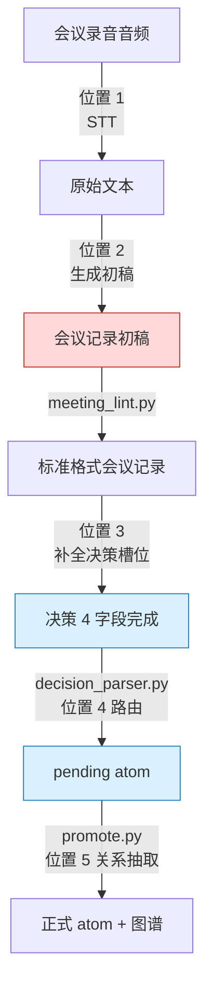
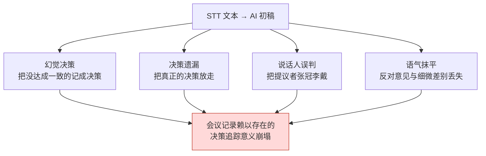

# 17.4 把会议记录变成决策数据库 —— AI 自动化的 5 个切入点

> 距离里程碑演示还有三天,午饭时,一位策划放下餐盘问道:"把任务奖励金币提高到 1.5 倍那件事,是会上定下来的吧?可以录入配置表了吗?"旁边的人答道:"那不是有人只是提议'要不试试看'吗。"90 分钟的录音文件和某人用键盘敲下的两页备忘录,确实都在。但那份记录装下了"讨论了什么",却没能装下"决定了什么、由谁负责、为什么这么定"。

把公司的 17 份 R&D 文档按"痛点"程度排序时,占比最大的是会议记录改进计划书。这出乎意料。既不是战斗平衡,也不是内容量产管线。最痛的地方只有一个:会上做出的决策没有传导到执行。

于是我把会议记录系统重新设计成了决策追踪数据库,并用六个月的亲自运营,验证了在这条流程的哪些环节该放入 AI、哪些环节不该放。本章就是这 5 个切入点的地图。

---

## 17.4.1 AI 自动化可以介入的 5 个切入点

从录音文件开始,到决策图谱更新为止,在整条会议记录管线中能安放 AI 助手的位置,正好有 5 个。但不会 5 个同时放入。因为每个位置的成熟度和出事风险各不相同。



红色(位置 2)是最诱人也最危险的位置,蓝色(位置 3、4)是最先引入的安全位置。管线中间的 `meeting_lint.py` → `decision_parser.py` → `promote.py` 不是 AI,而是确定性脚本。AI 只进入这个确定性骨架之间"需要判断的缝隙"。

用一句话概括各切入点的性质,如下。

- **位置 1(STT,Speech-to-Text,语音→文本)**:语音 → 文本。成熟度最高,风险最低。
- **位置 2(生成初稿)**:文本 → 会议记录初稿。诱惑最大,风险最高。
- **位置 3(补全决策槽位)**:为人所声明的决策填入依据与影响。ROI(Return on Investment,投资回报)第一。
- **位置 4(atom 路由)**:推荐把决策放进哪个文件夹。
- **位置 5(关系抽取)**:自动推断 atom 之间的依赖关系。对非确定性最脆弱。

---

## 17.4.2 确定性骨架 —— 先造出让 AI 介入的缝隙

在谈 AI 自动化之前,得先看不属于 AI 的脚本骨架。因为会议记录之所以能成为决策数据库,关键不在 LLM,而在三个小小的 Python 脚本。

标准格式的会议记录在末尾有一个决策块。块中的每条决策都强制要求四个字段。

```markdown
## Decisions

D1:
  decision: 将战斗全局冷却统一为 0.5 秒
  owner: teammate_a
  rationale: 技能连招测试中 0.3 秒经常丢输入(正文 14:22)
  follow_up: 在连招设计表中落实 GCD 0.5,6/13 前完成
```

这个块由 `decision_parser.py` 读取。核心动作很简单——四个字段中只要有一个为空,就打上 `[MISSING]` 上报。尤其是没有 `owner` 时,那条决策就是"无人负责的决策",也就是不会被执行的决策,因此拦得最狠。

```
$ python decision_parser.py 2026-06-06_combat-sync.md

D1: OK   (owner=teammate_a)
D2: [MISSING owner]  "治疗技能是否排除 GCD,待议" —— 无 owner,阻止晋级
D3: [MISSING rationale]  依据字段为空,警告
```

被打上 `[MISSING owner]` 的 D2,连 `pending` 文件夹都进不去。在人补上 owner 之前,它不会被当作决策。这就是从结构上防止"会开了,却什么都没推进"的装置。

通过的决策由 `promote.py` 变成 `pending atom`,在每周一次的评审关卡上经人批准后,晋级为正式 atom。此时适用的原则就是 `decision_summary_not_clickup_mirror` atom(§17.1.2)。任务看板追踪"要做什么",决策数据库追踪"为什么这么定"。把两者混在一起,两者都会坏掉。

这三个脚本是骨架,AI 是填补这副骨架空白的助手。顺序一旦颠倒——由 AI 来搭骨架——幻觉就会摧毁决策数据库的信任本身。

---

## 17.4.3 最危险的位置 —— 为什么把位置 2 放到最后

位置 2(STT 文本 → 自动生成会议记录初稿)是所有团队最想先做的位置。因为"只要把录音丢进去,会议记录就出来"这幅图景太诱人了。而恰恰是这份诱惑,让它以最高的代价失败。

失败的样态有四种。



其中最致命的是幻觉决策。会上有人只是抛出一句"全局冷却是不是 0.5 秒更好?"的意见,AI 初稿却写成"全局冷却已达成一致为 0.5 秒"。三周后,这一行被落实进配置表,连招设计在其上叠加,QA 用例也随之写就。一个从未达成一致的决策,不可逆地扩散开来。

因此位置 2 适用几条绝对原则。

- AI 初稿**始终**要经主持人审核。任何情况下都没有自动提交。
- 决策槽位**不由 AI 填写**。AI 只概括议题和发言,决策是否存在由人来声明。
- 原始 STT 文本要与摘要**分开永久保存**。若只留摘要,一旦依据变得模糊,就无法再回到原文核验。

这不是说位置 2"永远不做"。当位置 3、4、1 稳定下来、主持人亲身体会到 AI 输出的局限之后,引入位置 2 的价值是足够大的。只是**顺序上排在最后**而已。

---

## 17.4.4 位置 3 —— 补全决策槽位为何 ROI 第一

这是六个月运营中产出效果最大的位置。人声明决策的存在,AI 填写这条决策的附属字段。与位置 2 的决定性区别在于:**决策存在这一事实本身,由人先行钉死**。

有三样东西,人亲手填太费时间,便由 AI 起草。

- **rationale**:从会议正文中引用作为决策依据的发言
- **affected_atoms**:推荐受影响的系统、配置表候选
- **follow_up**:从决策导出的后续行动候选

关键在于提示词**强制引用依据、并明确禁止幻觉**。下面是实际运营中使用的补全提示词全文。

### 实操记录(worked transcript)—— 补全决策槽位

**提示词(由人输入):**

```
看下面的会议正文,只填主持人已声明的决策 D1("将战斗全局冷却统一为 0.5 秒")的
owner / rationale / affected_atoms / follow_up 这四栏。
不要新造决策。rationale 要把正文发言连同时间戳原样引用,
没有依据的栏不要臆测,写上"无依据"。
// (意图:affected_atoms 只取正文提到的系统与表,最多 3 个)

[会议正文]
(14:18) teammate_a: 现在 GCD 是 0.3 秒,连续按技能时输入老是被吞。
(14:22) teammate_b: 昨天的连招测试里,0.3 秒下第二个技能放不出来的
        情况大概占 30%。我留了日志。
(14:25) teammate_a: 那就提到 0.5 秒吧。我来在连招表里落实。
(14:26) 主持人: 就走 0.5 秒。定了。
(14:31) teammate_c: 治疗技能如果套 GCD,危急时就用不了,那个怎么办……
(14:33) 主持人: 那个下次单独看。
```

**Claude 输出(原样):**

```
1. owner: teammate_a
   依据:(14:25) "我来在连招表里落实。" —— teammate_a
   明确表示由本人负责。

2. rationale:
   - (14:18) teammate_a: "GCD 0.3 秒下连续按技能时输入被吞"
   - (14:22) teammate_b: "连招测试中 0.3 秒下第二个技能未触发
     的情况约 30%,有日志"
   → 0.3 秒的输入丢失问题,是 0.5 秒决策的直接依据。

3. affected_atoms (基于正文提及的候选):
   - atoms/combat/global_cooldown
   - 连招设计表(正文 14:25 提到"连招表")
   - atoms/combat/skill_recovery  ← 但 (14:31) 中治疗技能的
     GCD 例外讨论"被推迟"(14:33)。是否纳入本决策的影响范围
     尚不确定。依据薄弱,需人工确认。

4. follow_up:
   - teammate_a: 在连招设计表中落实 GCD 0.5 秒
   - [单独议题] 治疗技能是否 GCD 例外不在本决策范围内,
     拆分为下次会议议题(14:33 主持人发言)
```

**人的核验/否决:**

主持人审核了输出。owner 和 rationale 的引用准确,直接采用。`affected_atoms` 的第三个候选 `skill_recovery`,AI 自己上报了"依据薄弱,需人工确认",经主持人判断,把它从本决策的影响范围中**排除**了——治疗技能的例外是另一条决策的事,而不是这次 D1 的影响。follow_up 中"拆分为单独议题"的建议被采纳,登记为下次会议的议题。

这里重要的是,AI 没有用幻觉硬把不确定的项目塞进来,而是**主动上报了不确定性**。正是"禁止臆测与幻觉,没有依据就写明无依据"这条提示词约束,造就了这份诚实的输出。去掉约束,AI 会理直气壮地把 `skill_recovery` 放进 affected_atoms,而那个幻觉会扩散到图谱里。

审核完毕的决策块通过 `decision_parser.py`——因为四个字段都已填满,没有 `[MISSING]`——进入 `pending atom`。

---

## 17.4.5 位置 4 —— atom 路由,以及位置 5 —— 关系抽取

当通过位置 3 的 pending atom 晋级到正式文件夹时,由 AI 推荐送往哪个文件夹(位置 4)。

```
把这个 atom("战斗全局冷却统一为 0.5 秒 / owner teammate_a")放进下面哪个
文件夹更合适,按优先级最多选 3 个。不要提议新建文件夹,
只在这个列表里选。
- atoms/combat/  atoms/character/  atoms/operations/  atoms/visual/
```

"禁止新建文件夹"是核心约束。去掉它,AI 就会没完没了地提议 `atoms/combat_timing/`、`atoms/gcd_rules/` 之类的文件夹,类别无限增殖,检索与自动注入随之崩坏。类别要保持少而正交,并以一年以上不变动为原则。AI 只在那个封闭列表里挑选。

位置 5(atom 之间的关系抽取)最晚、最慎重地引入。它是推断已晋级 atom 之间依赖关系的位置。

```
新增 atom A: "治疗技能排除全局冷却"
既有 atom B: "全局冷却统一为 0.5 秒"

推断出的关系:
  A.exception_of: [B]
  A.derives_from: [B]
  B.affects: [A]   ← 反向自动赋予
```

问题是,这种推断正面暴露在 LLM 的非确定性之下。同样的输入,昨天和今天会得出不同的关系。缓解装置有三种——`temperature=0`,并在支持的模型上固定 seed;给出候选、由人批准的审核关卡;以及只抽取单向、反向再由脚本确定性补齐的方式。因为若把双向都交给 LLM,总会漏掉一边。

---

## 17.4.6 一次 1\~2 个 —— 引入顺序即是安全装置

同时开启 5 个切入点,是最常见也最昂贵的失败。运营负担比效果更早到来,团队会把整套系统一起丢弃。下面是实际遵循的顺序。

<svg viewBox="0 0 720 240" xmlns="http://www.w3.org/2000/svg" font-family="sans-serif" font-size="13">
  <line x1="40" y1="40" x2="40" y2="210" stroke="#999" stroke-width="2"/>
  <!-- step 1 -->
  <circle cx="40" cy="50" r="7" fill="#2980b9"/>
  <text x="60" y="48" font-weight="bold">第 1 步 · 位置 3 补全决策槽位</text>
  <text x="60" y="66" fill="#666">1~2 个月 · ROI 第一,从风险最低起步</text>
  <!-- step 2 -->
  <circle cx="40" cy="95" r="7" fill="#2980b9"/>
  <text x="60" y="93" font-weight="bold">第 2 步 · 位置 4 atom 路由推荐</text>
  <text x="60" y="111" fill="#666">再加 1 个月 · 强制文件夹候选封闭列表</text>
  <!-- step 3 -->
  <circle cx="40" cy="140" r="7" fill="#27ae60"/>
  <text x="60" y="138" font-weight="bold">第 3 步 · 位置 1 STT</text>
  <text x="60" y="156" fill="#666">自托管基础设施落地后 · 出于安全规避外部 API</text>
  <!-- step 4 -->
  <circle cx="40" cy="185" r="7" fill="#c0392b"/>
  <text x="60" y="183" font-weight="bold">第 4 步 · 位置 2 会议记录初稿</text>
  <text x="60" y="201" fill="#666">上述 3 个稳定后,最为慎重 · 绝对禁止自动提交</text>
  <!-- step 5 -->
  <circle cx="40" cy="225" r="7" fill="#8e44ad"/>
  <text x="60" y="223" font-weight="bold">第 5 步 · 位置 5 关系抽取</text>
</svg>

把位置 2 放到最后,是这个顺序的核心。最想做的位置最后才做——这有违直觉,但让最熟练的手落在最危险的操作台上,才是作业现场的安全原则。

从成本上看,这个顺序也合理。以每月 100 场会议计,位置 3 约 $5\~10,位置 4 约 $1\~2(基于作者运营环境的估算,未经验证),**只开这两个,每月也不到 $10**。产出效果最大的两个位置,恰恰最便宜。

---

## 17.4.7 before / after —— 同一场会议,两份会议记录

同一场会议用两种方式记录时的差异,就是本章的全部概括。

**Before —— 自由叙述式会议记录(无 AI,或把位置 2 连决策槽位都交出去的情形):**

```markdown
## 2026-06-06 战斗同步会议

讨论了 GCD 相关。有人提出 0.3 秒太短。
说连招测试中出过问题。提到了 0.5 秒。
治疗技能例外也被顺带提了一句。
气氛上大体朝 0.5 秒的方向收拢。
```

三周后再打开这份会议记录,"朝 0.5 秒收拢的气氛"到底是决策还是意见、谁负责落实进表、治疗技能例外是定了还是推迟了,**谁都无法复原**。没有说话人,没有 owner,依据也只在正文某处,只能重新去听录音。

**After —— 决策槽位 + 位置 3 补全的会议记录:**

```markdown
## 2026-06-06 战斗同步会议

### 议题摘要(AI 辅助)
- 战斗全局冷却(GCD)0.3 秒的输入丢失问题
- 治疗技能是否 GCD 例外(拆分为单独议题)

### Decisions  (人声明 + AI 补全)
D1:
  decision: 将战斗全局冷却统一为 0.5 秒
  owner: teammate_a
  rationale: |
    - (14:18) teammate_a: 0.3 秒下连续按技能时输入被吞
    - (14:22) teammate_b: 连招测试 0.3 秒第二个技能未触发 ~30%,有日志
  follow_up: teammate_a —— 在连招设计表中落实 GCD 0.5 秒(6/13 前)
  affected_atoms: [atoms/combat/global_cooldown, 连招设计表]

### 拆分出的议题
- 治疗技能 GCD 例外 → 下次会议(14:33 主持人决定)
```

三周后,这份会议记录已被 `decision_parser.py` 读取并连入图谱,任何人问起"为什么是 0.5 秒",都能凭 rationale 的两行引用即时作答。因为写明了 owner,便能追踪 follow_up 是否已执行;就连治疗技能例外**不是决策而是被推迟的议题**这一事实也得到保存。

造成差异的不是 AI 的篇幅,而是**在保留人声明决策的位置的前提下,只把填依据交给 AI 的结构**。把上面 After 会议记录中 AI 填写的段落(议题摘要、rationale 引用、affected_atoms 候选)全部删掉,剩下的只有一行决策和 owner——会议记录的信息量有一半以上来自 AI 补全,但关键在于,这一半全都是通过了人工审核的依据引用。

---

## 本章要点

- 先立起会议记录的确定性骨架(meeting_lint → decision_parser → promote),AI 只填补其缝隙中的空白。
- 决策的存在由人声明,AI 只补全依据、owner 与影响——位置 2 的决策自动生成会招致不可逆的幻觉。
- 不要同时开启 5 个切入点,而是从位置 3、4 起一次 1\~2 个,把最诱人的位置 2 放到最后引入。

---

> **游戏之外的应用。** "决策的存在由人声明,AI 只填依据、责任人与影响"这条原则,不止游戏,对所有用 AI 整理录音的职场人都同样适用,是一条安全线。最诱人的位置(把录音整段自动生成为会议记录)之所以最危险,是因为 AI 会把"是不是 0.5 秒更好"这样的意见,变造成"已达成一致为 0.5 秒"这样的决策——正是这种幻觉。比如人事部门整理考评会议的录音时,只由主持人亲自钉死"确定为 B 级"这条决策,而只让 AI 做"从录音中引用支撑这个等级的发言,没有就说没有"。一旦让 AI 来做决策,一个从未达成一致的评价,就会不可逆地留在人事记录里。

---

## 动手试试

**setup**
1. 在会议记录标准格式中建立 `## Decisions` 块,并对每条决策强制 `decision / owner / rationale / follow_up` 四个字段。
2. 编写 `decision_parser.py`——四个字段中只要有一个为空就输出 `[MISSING <字段>]`,尤其当 `owner` 为空时阻止晋级。
3. 把"决策摘要不是任务看板的镜像,而是承载'为什么'的独立资产"这条规则(`decision_summary_not_clickup_mirror`)写成明文。

**prompt**
4. 写位置 3 的补全提示词。必须包含的约束:"不要新造决策 / 引用正文依据并附上时间戳 / 没有依据就写明'无依据' / 禁止臆测与幻觉"。要求 rationale、owner、affected_atoms、follow_up 四个槽位。
5. 在位置 4 的路由提示词中放入"禁止新建列表之外的文件夹 + 封闭的文件夹列表"。

**verify**
6. 用 `decision_parser.py` 跑一遍补全后的决策块,确认没有 `[MISSING]`。
7. AI 填写的 affected_atoms 中被标为"依据薄弱"的项目,由人亲自审核后排除或采纳。任何情况下都不做自动提交。

**单人精简版**
如果你独自工作或没时间装工具,不用脚本,只在会议记录末尾手写四行决策块(`决定 / 负责 / 依据 / 下一步行动`)即可。即便 owner 就是你自己,也要写上名字。对 AI 只需说"从会议备忘里引用这条决策的依据,没有就说没有"。即便没有管线,只要**声明决策的位置**和**强制引用依据的提示词**这两样,会议记录就会开始变成决策数据库。
