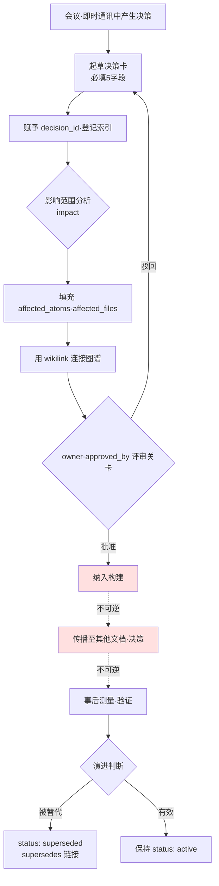

# 18.1 决策追踪系统

那是季度会议进行到一半的时候。战斗设计师提议"把全局冷却(GCD)统一为 0.5秒",大家都点头赞同。可是坐在旁边的资深同事举起了手。"这不是和去年第四季度定的 0.3秒相冲突吗?当时为什么定成 0.3秒来着?"会议室一时安静下来。没有人记得那个决定的依据。翻遍了会议记录,却只有"在战斗 TF 中讨论过"这一行字。最后花了 30分钟去重现去年的决定,即便如此,"为什么是 0.3"始终没能找到。

决策的难点不在于做出,而在于追踪。一年积累数百件之后,哪个决策还有效、哪个已经废弃,哪个决策又以另一个决策为前提,单靠人脑已经跟不上。本章讨论的,是把决策固化为 atom(最小知识单元)、将其转化为可追踪资产的系统。核心很简单:把一个决策记录为一张带有 `decision_id`、`owner`、`rationale` 的卡片,用 wikilink 把卡片彼此相连形成图谱,再用 grep 反向追溯影响波及到哪里。

## 18.1.1 决策卡:固化为 atom

决策追踪的最小单位是决策卡。这里原样取自笔者所负责的项目A(MMORPG 开发)中实际使用的一张卡片,正是前面会议上发生冲突的那个 0.5秒统一决定。

```yaml
---
decision_id: D2026_Q2_017
title: 战斗全局冷却统一为 0.5秒
type: system_change
status: active        # active / superseded / deprecated
created: 2026-04-18
owner: teammate_a      # 战斗设计师,决定的发起者·所有者
approved_by: 李旼洙    # Design Director
approval_meeting: 95_BattleTF_2026-04-18

scope:
  - combat_system
  - all_active_skills

content: |
  对所有战斗主动技能应用 0.5秒全局冷却。
  治疗技能除外(单独决定 D2026_Q2_018)。

rationale:
  - 连招输入的可读性问题(用户反馈累积)
  - 模拟中战斗平均时长呈增加方向
  - 新用户学习曲线趋于平缓

affected_atoms:
  - combat_global_cooldown_constant
  - combat_skill_cooldown_rule

affected_files:
  - CombatBalance.xlsx
  - CombatFormula_v3.md
  - UI/skill_cooldown_indicator

implementation:
  target_build: 2026-05-09
  impl_owner: teammate_b    # 代码负责人
  qa_owner: teammate_c      # 资深 QA

related_decisions:
  - supersedes: D2025_Q4_034   # 之前的 0.3秒决定
  - relates_to: D2026_Q2_018   # 治疗例外
---
```

三个字段是脊椎。`decision_id` 为决策赋予永久地址。`owner` 钉死"谁对这个决策负责"。`rationale` 回答半年后的"当时为什么这么做?"。会议上没能找到的那个"为什么是 0.3",本应正是写在 `D2025_Q4_034` 的 `rationale` 字段里的内容。其余字段(`scope`、`affected_atoms`、`related_decisions`)是为影响追踪和图谱连接而铺设的线路。

这里引入了一项设计决策。如果强制填满全部 12个字段,人们就会连卡片本身都不愿写。因此把它分成必填的 5个字段(`decision_id`、`title`、`owner`、`status`、`rationale`)和选填的 7个字段。会议上做出决定后即使只填这 5个字段,卡片也是有效的,其余的在实现阶段再补。

## 18.1.2 决策追踪的整体流程

一张卡片从产生到废弃要走过怎样的路径,构成了追踪系统的骨架。请注意不可逆关卡位于何处。



从起草(B)到评审关卡(G)全部是可逆阶段。无论是修改还是废弃卡片,成本都几乎为零。然而纳入构建(H)之后就是实质上的不可逆了。用户已经体感到的变更,即便用热修复回退,也会在社区认知中留下痕迹;而当后续决策开始以这个决策为前提层层累积时,回退成本会呈指数级增大。因此决策者的一切评审都必须在关卡 G 处结束。这与第5部分讨论的"录音·选角是不可逆阶段"原则,是完全相同的结构。

## 18.1.3 决策图谱:把卡片连起来

把卡片做成 atom 之后,卡片彼此就能相连。`related_decisions` 中的 `supersedes`、`relates_to` 成为图谱的边。前面会议上的冲突,其实就是这张图谱的一个片段。

<svg viewBox="0 0 640 280" xmlns="http://www.w3.org/2000/svg" font-family="sans-serif" font-size="13">
  <defs>
    <marker id="arrow" markerWidth="10" markerHeight="10" refX="9" refY="3" orient="auto" markerUnits="strokeWidth">
      <path d="M0,0 L9,3 L0,6 Z" fill="#555"/>
    </marker>
  </defs>
  <!-- nodes -->
  <rect x="40" y="20" width="220" height="48" rx="6" fill="#eef2f8" stroke="#888"/>
  <text x="150" y="40" text-anchor="middle" fill="#333">D2025_Q4_034</text>
  <text x="150" y="58" text-anchor="middle" fill="#777" font-size="11">全局冷却0.3秒 (deprecated)</text>

  <rect x="40" y="116" width="220" height="48" rx="6" fill="#dff0df" stroke="#5a5"/>
  <text x="150" y="136" text-anchor="middle" fill="#333">D2026_Q2_017</text>
  <text x="150" y="154" text-anchor="middle" fill="#777" font-size="11">全局冷却0.5秒 (active)</text>

  <rect x="380" y="116" width="220" height="48" rx="6" fill="#dff0df" stroke="#5a5"/>
  <text x="490" y="136" text-anchor="middle" fill="#333">D2026_Q2_018</text>
  <text x="490" y="154" text-anchor="middle" fill="#777" font-size="11">治疗技能冷却例外 (active)</text>

  <rect x="380" y="212" width="220" height="48" rx="6" fill="#fdf3df" stroke="#cb5"/>
  <text x="490" y="232" text-anchor="middle" fill="#333">D2026_Q2_025</text>
  <text x="490" y="250" text-anchor="middle" fill="#777" font-size="11">PvP 全局冷却变体 (active)</text>

  <!-- edges -->
  <line x1="150" y1="68" x2="150" y2="116" stroke="#555" marker-end="url(#arrow)"/>
  <text x="160" y="96" fill="#555" font-size="11">supersedes</text>

  <line x1="260" y1="140" x2="380" y2="140" stroke="#555" marker-end="url(#arrow)"/>
  <text x="285" y="132" fill="#555" font-size="11">relates_to</text>

  <line x1="490" y1="164" x2="490" y2="212" stroke="#555" marker-end="url(#arrow)"/>
  <text x="500" y="192" fill="#555" font-size="11">relates_to</text>
</svg>

如果当时有这张图谱,会议 30秒就能结束。打开 `D2026_Q2_017` 就能看到 `supersedes: D2025_Q4_034`,点一下那张卡的 `rationale`,"为什么是 0.3"就原样出现了。图谱是决策的演进历史,而决策的演进历史就是游戏的历史。连像 PvP 变体(`D2026_Q2_025`)这样从本决策派生出的分支,也能一目了然地追踪到。

## 18.1.4 自动提取影响范围 —— impact

决策卡的 `affected_atoms`、`affected_files` 若由人一个个去填,总会漏。项目A里有一个叫 `impact` 的影响范围提取流程。它接收一个决策 atom,朝三个方向扫描图谱。

- **入边(inbound edge)**:引用这个 atom 的其他 atom(谁依赖于我)
- **本体 `affects` 链接**:明确声明"产生影响"的关系
- **wikilink 反向引用**:在正文中引用了 `[[combat_global_cooldown_constant]]` 的所有文档

三条路径的并集,才是决策真正的影响范围。在此之上,`portal_layer_change_impact_check` atom 会额外检查"是否触及门户层(对外暴露的文档·API 规格)"。一旦涉及门户层,等级就上调一级。因为对外传播的回退成本更高。

## 18.1.5 实操记录(worked transcript):从会议记录到决策卡

理论到此为止。下面把实际向 LLM 抛出一整段会议记录、拿到决策卡的全过程,连同提示词全文和原始输出原样刊出——这就是实操记录(worked transcript,完整保留真实操作过程的记录)。不做摘要。Claude 混淆的地方、人工驳回的地方,乃至重新请求,全部呈现。

### 第1次提示词(全文)

```
把下面的会议记录转成决策卡 YAML。schema 为
decision_id / title / type / status / owner / approved_by / scope /
content / rationale / affected_atoms / affected_files / related_decisions。
owner 是发起者,approved_by 是审批者。affected_atoms 和 related_decisions
只写会议记录里实际出现的,不要臆测。
// (意图:decision_id 为 D{YYYY}_Q{n}_{seq},不知道 seq 就填 XXX)

[会议记录]
- 决定把战斗全局冷却统一为 0.5秒(teammate_a 发起)。
  当前每个技能各不相同,有反馈称连招可读性差,已累积。
- 有人指出去年定的 0.3秒太快,连招会糊成一团。
- 治疗技能若套用 0.5秒就无法应对危机,需要做例外处理。
- 总监(李旼洙)审批。teammate_b 负责实现,teammate_c 负责 QA。
- target build 为 5月9日。
```

### Claude 第1次输出(原样,未加工)

```yaml
---
decision_id: D2026_Q2_XXX
title: 战斗全局冷却统一为 0.5秒
type: system_change
status: active
owner: teammate_a
approved_by: 李旼洙
approval_meeting: 95_BattleTF
scope:
  - combat_system
  - all_skills          # ← 明明有治疗技能例外,却当作了 all_skills
content: |
  对所有战斗技能应用 0.5秒全局冷却。
rationale:
  - 连招可读性反馈累积
  - 去年 0.3秒太快,连招糊掉
affected_atoms:
  - combat_global_cooldown      # ← 与实际 atom 名不符。属于臆测
affected_files: []              # ← 留空。会议记录未明确说明
implementation:
  target_build: 2026-05-09
  impl_owner: teammate_b
  qa_owner: teammate_c
related_decisions:
  - supersedes: D2025_Q4_XXX    # 去年的 0.3秒决定。不知道 seq
  - relates_to: 治疗技能例外决定(ID 未定)  # ← 用叙述而非链接填写
---
```

实话说,这份输出只值 60分。做对的和做错的混在一起。

- **做对**:`owner`/`approved_by` 区分准确,`target_build`·实现者·QA 准确,捕捉到了 `supersedes` 关系。
- **做错 ①**:在 `scope` 里放了 `all_skills`。明明标注了治疗技能例外,却当成了全部。
- **做错 ②**:在 `affected_atoms` 里臆测填了 `combat_global_cooldown`。项目实际的 atom 名是 `combat_global_cooldown_constant`。它违反了"不要臆测"的指示。
- **做错 ③**:把 `related_decisions` 里的治疗例外用自然语言叙述而非链接来填。
- **含糊**:把 `affected_files: []` 留空了。这是忠实遵循了指示,但影响文件不可能没有。

### 人工验证·驳回

笔者没有原样接受这张卡。把 ①②③ 写成驳回理由重新发起了请求。驳回的核心是 **atom 名的臆测**。atom ID 哪怕错一个字符,后续的 grep·反向引用就会全部落空。追踪系统的准确度,系于 atom ID 的准确度。

### 第2次提示词(重新请求,全文)

```
改三处。scope 因为治疗技能属于例外,别用 all_skills,
改成 all_active_skills,治疗例外写进 content。affected_atoms
之前叫你别臆测你却臆测了——不知道 atom 实名就留成 [待确认],只加注释
说明要确认什么,索引我自己来看。related_decisions 把治疗例外
用 relates_to 指向 D2026_Q2_018,supersedes 指向 D2025_Q4_034。affected_files
也只作为 [待确认] 候选。
```

### Claude 第2次输出(未加工)

```yaml
affected_atoms:
  # [待确认] 以下为候选。需在索引中确定准确的 atom ID。
  - combat_global_cooldown_constant   # 全局冷却常量值
  - combat_skill_cooldown_rule        # 各技能的冷却规则(含例外处理)
affected_files:
  # [待确认] 会议记录中没有。按 type=system_change 的通常影响候选:
  - CombatBalance.xlsx        # 冷却数值表
  - CombatFormula_v3.md       # 战斗公式文档
  - UI/skill_cooldown_indicator   # 冷却 UI 指示器
related_decisions:
  - supersedes: D2025_Q4_034
  - relates_to: D2026_Q2_018
scope:
  - combat_system
  - all_active_skills
content: |
  对所有战斗主动技能应用 0.5秒全局冷却。
  治疗技能除外(单独决定 D2026_Q2_018)。
```

第2次变得诚实了。它没有臆测 atom 并下定论,而是打上 `[待确认]` 标记并附上依据注释。笔者打开 atom 索引,确认 `combat_global_cooldown_constant`、`combat_skill_cooldown_rule` 这两个名字确实存在,便摘掉了标记。`affected_files` 的三个候选也在与索引比对后予以确定。本章开头刊出的最终卡片,就是这一成果。

这份实操记录的教训只有一个:**LLM 作为决策卡的初稿撰写者很强大,但 atom ID 与决策 ID 的最终确定,必须由人与索引比对。** AI 探索候选,人来采纳。两者角色一旦混淆,错误的 atom 名就会污染整张图谱。

## 18.1.6 用 grep 反向追溯影响

当卡片与图谱以 atom ID 相互绑定时,"这个决策会影响到哪里"用一行 grep 就能给出答案。把决策 `D2026_Q2_017` 的核心 atom `combat_global_cooldown_constant`,在稿件·数据表·决策卡全体中做反向引用扫描。

```
rg "combat_global_cooldown_constant" --type md --type yaml -l
# → D2026_Q2_017.yaml          (决策卡本身)
#   D2026_Q2_025.yaml          (PvP 变体 —— 再次引用了该常量)
#   CombatFormula_v3.md        (公式文档)
#   95_BattleTF_2026-04-18.md  (会议记录原件)
```

这个结果就是一张"改动这个常量,就会牵动四处"的影响地图。PvP 变体卡片引用了同一个常量这一事实,靠人的记忆很容易漏掉,而 grep 不会漏。这之所以可能,正是因为 atom ID 准确——如果用第1次输出的 `combat_global_cooldown` 去 grep,这四行里一个也不会命中。等级分类(§18.2)、全周期工作流(§18.3)、grep 工作流的精细化(§18.4),全都立于这份 atom ID 的准确性之上。

## 18.1.7 追踪系统带来的差异

下面比较笔者的项目A引入追踪系统前后的情况。以下数字是笔者的推定(未验证),建议按方向和比例来读,而非绝对值。

| 条目 | 无系统 | 系统运行 | 方向 |
|---|---|---|---|
| "以前是否决定过?"的重议 | 每季度 8\~12件 | 每季度 0\~2件 | 大幅减少 |
| 掌握决策影响范围 | 1\~2天 | 用 grep 数分钟 | 大幅缩短 |
| 追踪决策演进历史 | 依赖资深成员记忆 | 图谱自动 | 消除对人的依赖 |
| 新成员学习决策历史 | 1\~2个月 | 1\~2周 | 效果最大 |

效果最大的是最后一行。新成员不再拉着资深同事追问"这游戏为什么变成现在这个样子",而是顺着决策图谱自己读下去。决策追踪也就成了公司的决策学习资产。只是系统刚引入的那个季度,写卡片的负担确实存在。先从必填的 5个字段落实、再逐步扩大,是稳妥的路径。

## 18.1.8 从保守到进步 —— 自动化立于 atom 分解之上

到目前为止的运营都是保守式应用。人在会议上做决定、写卡片、识别受影响的 atom,自动化只负责索引·检索·grep·图谱可视化。人负责核心判断,自动化负责保管与检索。

下一步就是上面实操记录所展示的方向。以会议记录的自然语言为输入,LLM 填写决策卡 12个字段的初稿,顺着图谱探索受影响的 atom 候选,连等级也一并推荐。留在人手里的工作,收窄为"检查 AI 填好的卡片与 atom 名是否与索引相符"和"最终审批"两件。从零开始填满 12个字段的负担,和在索引中核对 LLM 初稿 atom 名的负担,性质不同。

要让这种进步式应用站稳脚跟,需要三根骨架。其一,所有决策都以 atom 登记、用 wikilink 相连的**决策图谱**。一整段会议记录成不了自动化的输入——它必须被分解到决策的粒度。其二,在图谱之上计算受影响领域数·回退成本·用户影响范围,进而推荐等级的**影响等级自动机**(§18.2)。其三,以 atom ID 和 wikilink 精确运作的**grep·LLM 影响追踪**(§18.4)。

这里,贯穿全书的信息再一次浮现。把决策分解为 atom·图谱·等级,表面是"检索与反向引用的便利",本质却在于:**面对一整段未经分解的会议记录,自动影响分析连什么才是决策的单位都无从知晓。**"分解以统一协作语言为表面目的、以程序化自动化的前提为本质目的"这一普遍命题(§6.6),在决策领域体现为决策图谱·atom·等级。这与第5部分的世界 BT(BehaviorTree,行为树)·任务云,以及第8部分的进步式平衡,是同一根骨架。2010年代理论上就已可行,但把会议记录自动分解为决策 atom 这件事一直受阻;2023年之后 LLM 承担起这一分解的初稿工作,原本只停留在纸面上的愿景,相当一部分进入了可实现的领域。

## 本章要点

- 只有把决策固化为带有 `decision_id`、`owner`、`rationale` 的卡片,半年后才能回答"当时为什么这么做"。
- atom ID 的准确性是追踪的生命线——LLM 负责卡片初稿,人负责确定 atom 名。
- Layer 分解(决策图谱)以统一协作语言为表面,以自动影响分析的前提为本质。

> **游戏之外的应用。** 决策卡并不限于游戏,它是让任何组织在半年后仍能回答"当时为什么那样定"的装置。市场部为了"上个季度决定砍掉这个渠道,到底是为什么来着"在会议记录里翻不到一行、白白耗掉 30分钟这样的事,只要有一张带 `decision_id`、`owner`、`rationale` 三个字段的卡片就会消失。比如人事部在决定"远程办公统一为每周2天"这类政策时,若在那张卡上写清发起者·审批者·依据(生产力数据·员工问卷)和被替代的旧政策 ID,一年后政策复审的场合,过去的判断依据便原样鲜活地留存着。

## 动手试试

**网页聊天机器人最简路径(无需终端)** —— 本章的核心不在于决策卡目录或 grep,而在于"给决策固化永久地址(`decision_id`)·责任人(`owner`)·依据(`rationale`),并在做出新决策之前先查一遍过去的决策"这一构想。这个构想不用 CLI·atom 索引,仅凭网页聊天机器人(ChatGPT 或 Claude 网页版)就能重现。下面三步是主线。
1. 把一个决策写成一行。用一张叫 `decisions.md` 的普通文档就够了。既不需要 YAML,也不需要脚本。
   ```
   - [D17] 全局冷却统一为 0.5秒 (owner: 我, 依据: 连招可读性, 替代: D08)
   ```
2. 要把会议记录变成卡片时,在网页聊天机器人里贴入下面这段。它把第1次提示词的 4条约束原样搬了过来。
   ```
   把下面会议记录里的决策转成表格。栏目为
   decision_id / title / owner / rationale / 被替代的旧决策。
   无法确定 owner 就填 [MISSING],不知道 atom·文件名就留 [待确认],
   不要臆测。
   // (意图:decision_id 为 D{年份}_{序号},不知道序号就填 XXX)
   [会议记录正文]
   ```
3. 在做出新决策之前,先用文档内查找(Ctrl+F)搜一遍 `decisions.md` —— "以前是否决定过"这一个问题就靠它解决。这就是 grep 反向追溯的手工版。atom 索引·YAML 卡片·`rg` 工作流,等到决策积累数百件、用单个文档搜索开始吃力时再引入即可。

**setup**(基础设施版 —— 上面的最简路径上手之后)—— 请创建决策卡目录与索引文件。

```
decisions/
  D2026_Q2_017.yaml
  _index.json        # by_status / by_scope / by_quarter 汇总
```

**prompt** —— 把会议记录中的决策议题抛给 LLM 时,务必包含上面第1次提示词的 4条约束。尤其要写明"不要臆测 atom 名,而是留成 [待确认]"。

**verify** —— 把产出卡片的 `affected_atoms` 条目与 atom 索引比对,确认实名后移除标记。然后用核心 atom 执行 `rg "<atom_id>" -l`,交叉验证受影响文件是否与卡片的 `affected_files` 一致。

### 单人精简版

如果没有团队基础设施、一个人用,就把 YAML 卡片扔掉。把一个决策写成 Markdown 一行。

```
- [D17] 全局冷却统一为 0.5秒 (owner: 我, 依据: 连招可读性, 替代: D08 的 0.3秒)
```

把这些一行行堆进 `decisions.md` 一个文件,做出新决策之前,先用 `rg "쿨다운" decisions.md` 搜一遍过去的决策。没有卡片、没有图谱、没有工具,但"以前是否决定过"这一个问题就能解决。追踪系统的90%,就从这一行的习惯开始。
