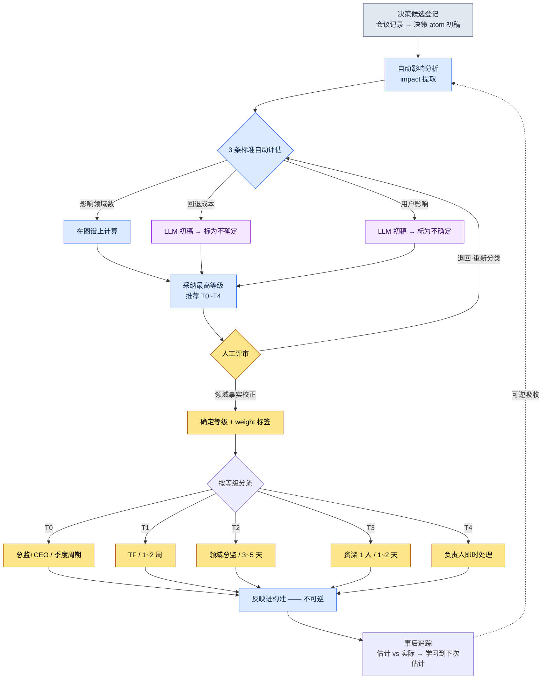
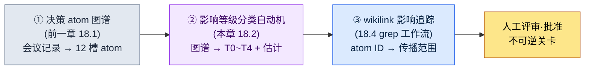

# 18.2 影响传播·等级分类

会议结束后,我正在整理会议记录。上面写着一条决策。"全局冷却统一为 0.5 秒。"这在会上不到 30 秒就达成了一致。所有人点头,便转向了下一个议题。

那一行字吃掉了接下来的两个月。战斗数据中的 277 个技能全部受到影响,UI 的冷却进度条演出被重画,数值表被推翻重做了两次。同一份会议记录里写着的另一条决策"修正新手引导提示文案的错别字",只花了 5 分钟就完成了。

两条决策在会议记录上同样都是一行,字数也差不多。然而一条是 5 分钟,一条是两个月。让这一差异在写下会议记录的那一刻就变得可见——这就是影响等级分类。等级若不可见,两个月的决策就会被埋没在与 5 分钟决策相同的一行里。

本章讨论如何将决策的波及自动分为五个等级,并在决策 atom 图谱上追踪这波及蔓延到何处。所用工具是前一章积累的决策 atom 与 `impact` 提取,以及 `portal_layer_change_impact_check` atom。

---

## 等级不可见时会发生什么

先来看看没有等级分类的状态是什么样子。当决策全部放在同一行上,两类事故会交替发生。

一是**处理不足**。像全局冷却这样撼动整个季度的决策,被当作"5 分钟的活儿"未经验证就进入了构建。直到两个月后波及才显现,而那时回退成本已如山堆积。

另一是**处理过度**。为改一个错别字而召集 TF(专项组),还要获得游戏总监的审批。决策周期暴增,而总监本该用在 T0 决策上的时间,却被吸进了错别字会议里。

两类事故看似截然相反,根子却相同。**决策的分量不可见。**分量不可见,于是把力气花在轻的上面,把重的放任流走。等级分类就是给决策贴上分量标签的工作,标签一旦贴上,处理方式便自动分流。

---

## 18.2.1 影响的 5 个等级 —— 从 T0 到 T4

在笔者所在的 MMORPG 开发商项目A,决策的影响被分为五个等级。越往上越重,处理需要更多的人力与时间。

| 等级 | 定义 | 示例 | 决策者 | 周期 |
|---|---|---|---|---|
| T0 | 游戏愿景·核心系统 | 移动端优先决策、核心机制变更 | 游戏总监 + CEO | 季度 |
| T1 | 系统·跨领域 | 全局冷却统一、新增职业 | TF 组长 + 总监 | 1\~2 周 |
| T2 | 领域·中等 | 特定技能数值调整、新增 UI 组件 | 领域总监 | 3\~5 天 |
| T3 | 单次·小型 | 修改单个 NPC 台词、颜色微调 | 资深人员 1 人 | 1\~2 天 |
| T4 | 即时·热修复 | 修复 Bug、文本错别字 | 负责人 | 小时级 |

只看表格,它像教科书一样清晰。然而实务的难点不在于背表,而在于**判断眼前的一条决策该放进哪一格**。"全局冷却统一"是 T1 这一点,不能等会议结束之后才知道,而要在写下会议记录的那一刻就知道。因此下一节的 3 条标准才是关键。

---

## 18.2.2 划分等级的 3 条标准

等级不靠直觉来定。评估三条标准,采纳其中最高的等级。

<svg viewBox="0 0 720 300" xmlns="http://www.w3.org/2000/svg" font-family="sans-serif" font-size="13">
  <rect x="0" y="0" width="720" height="300" fill="#fafafa" stroke="#ddd"/>
  <text x="20" y="30" font-size="15" font-weight="bold">等级判定矩阵 —— 3 标准 × 5 等级</text>
  <!-- header row -->
  <rect x="20" y="50" width="160" height="40" fill="#2c3e50"/>
  <text x="30" y="75" fill="#fff" font-weight="bold">标准 \ 等级</text>
  <rect x="180" y="50" width="100" height="40" fill="#c0392b"/><text x="215" y="75" fill="#fff" font-weight="bold">T0</text>
  <rect x="280" y="50" width="100" height="40" fill="#e67e22"/><text x="315" y="75" fill="#fff" font-weight="bold">T1</text>
  <rect x="380" y="50" width="100" height="40" fill="#f1c40f"/><text x="415" y="75" font-weight="bold">T2</text>
  <rect x="480" y="50" width="100" height="40" fill="#2ecc71"/><text x="515" y="75" fill="#fff" font-weight="bold">T3</text>
  <rect x="580" y="50" width="120" height="40" fill="#95a5a6"/><text x="625" y="75" fill="#fff" font-weight="bold">T4</text>
  <!-- row 1: 影响领域数 -->
  <rect x="20" y="90" width="160" height="60" fill="#ecf0f1" stroke="#bbb"/><text x="30" y="125">影响领域数</text>
  <rect x="180" y="90" width="100" height="60" fill="#fff" stroke="#bbb"/><text x="220" y="125">5+</text>
  <rect x="280" y="90" width="100" height="60" fill="#fff" stroke="#bbb"/><text x="315" y="125">2~4</text>
  <rect x="380" y="90" width="100" height="60" fill="#fff" stroke="#bbb"/><text x="425" y="125">1</text>
  <rect x="480" y="90" width="100" height="60" fill="#fff" stroke="#bbb"/><text x="525" y="125">1</text>
  <rect x="580" y="90" width="120" height="60" fill="#fff" stroke="#bbb"/><text x="635" y="125">1</text>
  <!-- row 2: 回退成本 -->
  <rect x="20" y="150" width="160" height="60" fill="#ecf0f1" stroke="#bbb"/><text x="30" y="185">回退成本</text>
  <rect x="180" y="150" width="100" height="60" fill="#fff" stroke="#bbb"/><text x="200" y="185">非常大</text>
  <rect x="280" y="150" width="100" height="60" fill="#fff" stroke="#bbb"/><text x="315" y="185">大</text>
  <rect x="380" y="150" width="100" height="60" fill="#fff" stroke="#bbb"/><text x="415" y="185">中等</text>
  <rect x="480" y="150" width="100" height="60" fill="#fff" stroke="#bbb"/><text x="515" y="185">小</text>
  <rect x="580" y="150" width="120" height="60" fill="#fff" stroke="#bbb"/><text x="600" y="185">非常小</text>
  <!-- row 3: 用户影响范围 -->
  <rect x="20" y="210" width="160" height="60" fill="#ecf0f1" stroke="#bbb"/><text x="30" y="245">用户影响范围</text>
  <rect x="180" y="210" width="100" height="60" fill="#fff" stroke="#bbb"/><text x="215" y="245">全部</text>
  <rect x="280" y="210" width="100" height="60" fill="#fff" stroke="#bbb"/><text x="320" y="245">大</text>
  <rect x="380" y="210" width="100" height="60" fill="#fff" stroke="#bbb"/><text x="415" y="245">中等</text>
  <rect x="480" y="210" width="100" height="60" fill="#fff" stroke="#bbb"/><text x="515" y="245">小</text>
  <rect x="580" y="210" width="120" height="60" fill="#fff" stroke="#bbb"/><text x="600" y="245">非常小</text>
</svg>

三条标准中,**影响领域数**可以在决策 atom 图谱上机械地数出来。把决策所触及的 atom 归属于哪个领域(战斗·UI·数据·叙事等)的标签汇总起来即可。

问题在剩下的两条。**回退成本**与**用户影响范围**无法换算成图谱上的数字。"要在两个月后回退这条决策,得花多少代价"是一种自然语言判断。恰恰是这一点,在 2023 年之前一直是影响自动分类的最后一堵墙。影响领域数已经自动化,但两格自然语言判断空着,结果还是要人从头重新评定。随着 LLM 读取决策 atom 的正文、为这两格填写初稿,这堵墙降低了。

这里要如实说明。LLM 填写的是**初稿**,而非定论。即便 LLM 把回退成本估为"大",领域总监也可以判定"按我们的表结构,这个是中等"。自动分类并不替代人的判断,而是**让人不必从空格开始**。

---

## 18.2.3 实操记录(worked transcript)—— 让 LLM 对一条决策分类

这是把前一章制作的一条决策 atom 原样交给 LLM、让它评定等级的真实过程。实操记录即完整保留的真实操作过程记录:不作摘要,原样搬录全过程,连否决与再次请求也一并收录。

### 输入 —— 决策 atom 原文

```yaml
# decisions/D2026_Q2_017.md (前一章 18.1 中登记的 atom)
id: D2026_Q2_017
title: 全局冷却统一为 0.5 秒
date: 2026-04-18
proposer: teammate_a
decider: 李旼洙    # Design Director (与 18.1 的 approved_by 相同)
context: 各职业的冷却标准各不相同,每次新增职业都会累积
         数值重算成本。提议以 0.5 秒全局标准统一。
affected_atoms: [combat_cooldown_rule, skill_table, ui_cooldown_gauge]
reversible: ?
status: proposed
```

### 提示词全文

```
请把下面这条决策 atom 的影响等级评定为 T0~T4 中的一个。
分别看影响领域数 / 回退成本 / 用户影响范围这三条标准,
取其中最高的等级。没把握的格子就写"不确定",
并说明需要人来看。
// (意图:T0=领域 5+·成本非常大·全部,T1=2~4·大·大,T2=1·中等,T3=1·小,T4=1·非常小)

[附上 atom 原文]
```

### Claude 原始输出(未经编辑)

```
3 条标准评估:

1. 影响领域数
   看 affected_atoms:
   - combat_cooldown_rule → 战斗领域
   - skill_table → 数据领域
   - ui_cooldown_gauge → UI 领域
   明确写出的领域是 3 个。
   不过看 context 中"每次新增职业都要重算数值"这句
   话,数值领域也很可能受到间接影响。
   直接 3 + 间接 1 = 实际按 2~4 个范围来看。→ T1 信号

2. 回退成本
   把全局冷却统一之后若要回退,就得把 skill_table 中
   所有技能的冷却时间按各职业标准重新分叉。
   由于不知道 skill_table 的行数,确切成本尚不确定,
   但"统一 → 恢复分叉"通常成本很大。→ 大(T1 信号)
   ※ 这一格若不知道 skill_table 的规模就无法确定。标为不确定。

3. 用户影响范围
   冷却时间适用于所有战斗情形,因此几乎所有用户都
   能体感到。→ 大(T1 信号)

采纳等级:T1
依据:3 条标准都指向 T1。不是 T0 ——
因为还谈不上"核心机制变更",而是对既有机制的参数
统一。

需要人工确认:
- 回退成本格:需确认 skill_table 的实际行数
- reversible 槽以"?"留空 → 本次分类以将 reversible
  填为"困难"为前提。
```

### 人工验证与否决

这里没有原样接受。我对输出的第 1 项动了手。LLM 把数值领域看作"间接影响",但在项目A的实际结构中,冷却统一会**直接**推翻数值表——因为新增职业的数值测算公式本身就把冷却值作为输入。所以数值不是间接,而是直接的第 4 个领域。影响领域数为 4 个。即便如此,采纳等级 T1 并未改变。

还有一点,回退成本格里的"不确定"标记是准确的。`skill_table` 实际上有 277 行技能,若回退统一,就得把全部 277 行的冷却时间重新分叉。成本更接近"非常大"而不是"大"。不过,一格往上升并不会让采纳等级变成 T0 —— 因为影响领域数与用户影响都在 T1 范围,最高等级仍然是 T1。

### 再次请求

```
更正。请在 affected_atoms 里加上 balance_sheet(数值公式把冷却值
作为输入,是直接影响)。那么影响领域就是 4 个,skill_table 是 277 行。
把这些反映进去,填好 reversible 并确定最终等级。
```

```
已反映。

影响领域:战斗·数据·UI·数值 = 4 个
回退成本:非常大(skill_table 全部 277 行重新分叉)
用户影响:大

reversible:困难(实质上接近不可逆 —— 277 行重新分叉需要
1~2 次构建外加一轮数值重新验证)

最终等级:T1
注意:仅看回退成本一格是 T0 信号,但
影响领域 4 个·用户影响"大"处于 T1 范围。
3 条标准中有 2 条指向 T1,所以 T1 是对的。
不过建议把这条决策标注为"T1 中偏重的一类" ——
因为回退成本达到了 T0 级。
```

最后这句比人还谨慎。等级虽是 T1,但回退成本达 T0 级,于是提议将其标注为"T1 中偏重的一类"——这是最初提示词里没有的判断。我采纳了。我给这条决策额外贴上了 `weight: heavy` 标签,并提高了事后追踪的优先级。

这份实操记录展示的核心只有一个。**LLM 生成分类的初稿与理由,人用领域事实(数值是直接影响、277 行)来校正。**只靠其中之一都不行。只靠人,就得从空格开始,慢;只靠 LLM,就会在不知道 277 行的情况下写下"大"。

---

## 18.2.4 自动追踪影响传播的代码

等级确定之后,接下来是"波及到何处"。把前一章的 `impact` 提取 —— 入边、本体中的 `affects` 关系、wikilink 反向引用 —— 应用到决策 atom 上。

```python
# impact_propagation.py —— 追踪决策 atom 的传播范围

def trace_impact(decision):
    # 一级:决策直接触及的 atom·文件
    direct = decision.affected_atoms + decision.affected_files

    # 二级:以 wikilink 反向引用一级 atom 的 atom(impact 入边)
    secondary = []
    for atom in direct:
        secondary.extend(find_inbound_refs(atom))   # [[atom]] 反向引用
        secondary.extend(find_affects_edges(atom))   # 本体 affects

    secondary = dedup(secondary) - set(direct)

    return {
        "direct": direct,
        "secondary": secondary,
        "affected_fields": determine_fields(direct + secondary),
        "estimated_hours": estimate_hours(direct, secondary),
    }
```

核心是 `find_inbound_refs` —— 一个在 atom 图谱中收集用 `[[...]]` 指向该 atom 的**入向**箭头的函数。决策自身触及什么(出向箭头)写在 atom 里,但谁依赖该 atom(入向箭头)必须反向扫描整个图谱才能看到。两个月的波及,几乎总是藏在这**入边**一侧。

在此如实记下对 D2026_Q2_017 跑这一追踪的结果。direct 是上面确定的 4 个 atom。secondary 是反向引用 `skill_table` 的那些 atom —— 技能说明文本、技能图标映射、各职业技能树等 —— 一连串地被牵了出来。**数字因时点而异,故不下定论。**追踪抓住的事实是"secondary 为 direct 的数十倍"这一方向,准确的 atom 数会随图谱状态而变。仅凭方向就够了 —— secondary 比 direct 大一个数量级,那就是 T1 信号,意味着它是事后追踪的对象。

---

## 18.2.5 等级分类嵌在何处 —— mermaid

分类不是独立的步骤,而是作为关卡固定在决策流程的正中央。决策候选一经登记,自动分析就推荐等级,只有在人评审、调整之后,才进入决策会议。



在这一流程中,**不可逆的步骤只有一个,就是反映进构建(I)**。它之前的全都是可逆的 —— 即便等级推荐错了,人退回即可,weight 标签也可以撕掉。只有在进入构建、传播到其他文档之后才变得不可逆。因此关卡(F 的人工评审)设在构建之前。在跨过不可逆这条线之前,人先拦一次。

最后那条虚线 —— 事后追踪(J)返回下一次决策的自动分析(B)的箭头 —— 让这套系统成为一个学习循环。不可逆步骤中产出的实测数据(例如:QA 时间比估计更长)被吸收进下一次决策的可逆步骤。

---

## 18.2.6 事后追踪 —— 把估计与实际的落差转为学习

决策进入构建后 1 周\~1 个月,把估计与实际对照。这是 D2026_Q2_017 的事后追踪表单。

```
决策 D2026_Q2_017 事后追踪  (表单示例 · 数字为虚构输入)
─────────────────────────────────
工作时间 (估计 → 实际)
  代码:    16h → 22h  (+38%)
  数据:     8h →  6h  (-25%)
  UI:       4h →  4h  (=)
  QA:       8h → 12h  (+50%)
  total:   36h → 44h  (+22%)

影响 atom (估计 → 实际)
  direct:    4 →  4   (准确)
  secondary: 估计数十 → 实际数十  (方向一致,准确数值不公开)

事故发生: 0 起
误差模式: QA 每次都超出估计 (本次 +50%)
下次决策应用: 对 QA 估计默认加 +20% 余量
```

上面这个块是展示事后追踪**长什么样**的表单示例。时间·百分比数值并非实际项目数据,而是填入表单的虚构输入,在你自己的项目里换成你自己的数字填写即可 —— 正如本书的承诺,我们展示结构,数字由你自己测量。与表单无关、真正为真的只有一件事。**"QA 每次都超出估计"这一误差的方向**,以及把这一方向反馈进下一次决策的流程。于是就有了从一开始就给下次估计加上 QA 余量(例如 +20%)的处方。

事后追踪的价值不在于猜中准确的数字,而在于把误差的方向反馈回去。估计越准确,等级分类的可信度就越高,可信度越高,委派就越有可能。

---

## 18.2.7 各等级的事故模式与处方

各等级反复出现的事故各不相同,处方也不同。

| 等级 | 事故模式 | 处方 |
|---|---|---|
| T0 | 愿景模糊 → 整个季度都混乱 | 强制在决策文中写明一行愿景 |
| T1 | 领域间冲突 → 进度延误 | 让全部受影响领域的代表出席 TF |
| T2 | 遗漏相邻系统的影响 → 后续决策暴增 | 必须做 secondary 追踪 |
| T3 | 小决策累积 → 一致性受损 | 在季度复盘中成批检查 T3 |
| T4 | 验证不足 → 二次热修复 | 热修复也至少经 1 人评审 |

这张表里的处方全都由前面各节给出的工具来执行。T2 的"必须做 secondary 追踪"就是 §18.2.4 的 `find_inbound_refs`,T1 的"全部受影响领域代表出席"则由 §18.2.4 抓出的 `affected_fields` 来确定谁该到场。

最昂贵的事故不在表中任何一处。那就是**把等级本身弄错**。T0 若由资深人员一人决定,愿景就会受损;T4 若由总监亲自处理,就会产生瓶颈。等级一旦弄错,其下所有处方都会在错误的位置运作。因此 §18.2.3 的人工评审关卡不是单纯的形式。

---

## 18.2.8 度量 —— 等级运营的效果

比较项目A引入等级分类前后的情况。下面数值中的绝对值是加工过的示例,而**方向(不等号)是实际趋势**。

| 对比项 | 无等级 | 等级运营 |
|---|---|---|
| 决策周期 | 全部统一为 1\~2 周 | 从 T0 季度到 T4 小时级分化 |
| 处理错误的决策 | 每季度多起 | 每季度少数 |
| 总监的每周决策负担 | 大(所有决策都汇到总监) | 小(T2\~T4 委派出去) |
| 热修复周期 | 1\~2 天 | 4\~24 小时 |
| 季度复盘的决策分析 | 难以归类 | 按等级统计汇总 |

把表写成方向而非确定数字,原因由第 3 项就能说明。**总监时间的回收是等级分类最大的效果。**没有等级时,从错别字到愿景,所有决策都涌向总监一个人。有了等级,T2 及以下就分流给领域总监·资深人员·负责人,总监则专注于 T0·T1。委派成为可能,也就意味着总监夺回了真正用于重大决策的时间。

---

## 18.2.9 本章在进取式应用骨架中的位置

前一章制作了决策 atom 图谱,本章在这张图谱之上叠加了等级分类自动机。两者不是各自为政的工具,而是同一骨架中相连的位置。



三个要素是串联的。图谱制造输入(①),分类器评定分量(②),影响追踪铺开传播范围(③)。本章处在中间的位置。

三个要素都是在 LLM 发展之后才进入可实现的领域。最晚被攻破的墙是②的两格自然语言评估 —— 回退成本与用户影响范围(§18.2.2 的"最后一堵墙")—— LLM 填补其初稿之后,①→②→③才终于开始串联运转。

可逆·不可逆的排布也与这一骨架相扣。正如 §18.2.5 的流程图,不可逆的线只有反映进构建这一条,反映进构建本身无法回退,但其实测结果会作为让下一次决策更准确的可逆学习返回来。

---

## 18.2.10 常见的失败

| 模式 | 处方 |
|---|---|
| 用同一周期处理所有决策 | 按等级分化周期 |
| 没有等级分类,各自自行判断 | 3 条标准分类关卡 |
| 无视等级(T0 由资深人员决定) | 强制执行决策者表 |
| 省略事前的影响度评估 | 把自动分析设为决策会议前的关卡 |
| 把自然语言格按 LLM 输出原样定稿 | 由人用领域事实校正 |
| 不做事后追踪就结束决策 | 1 周\~1 个月做估计 vs 实际的比较 |
| 不把估计误差反映到下次决策 | 把误差方向应用到下次估计的余量 |

---

> **游戏之外的应用。** 影响等级是一个把"一行字的请求究竟是 5 分钟还是两个月"提前显现出来的标签,因此在任何决策纷至沓来的职场都适用。公司维基上一行文案的修改,与"全部门休假政策变更",若同样作为"一件议题"进来、走同一条审批线,轻的事就会被过度处理,重的事则未经验证便流走。举例来说,在接到运营团队的工作请求时,只要按影响部门数·回退成本·客户影响范围这三条标准贴上 T0\~T4,负责人可即时处理的事与需要主管审批的事就会自动分开,管理者的时间也会被回收到真正重大的决策上。

## 动手试试 —— 给一条决策分类等级

**setup.** 请准备一条前一章制作的决策 atom。`affected_atoms` 槽必须已填好。若为空,就无法计算影响领域数。

**prompt.** 请原样使用 §18.2.3 的提示词全文。别漏掉关键的三行 ——(1) 分别评估 3 条标准,(2) 采纳最高的等级,(3) 没把握的格子标为"不确定"并请求人工确认。少了第三行,LLM 就会连不知道的也一并断定。

**verify.** 收到 LLM 输出后,请亲自确认两点。第一,即便 LLM 数过了影响领域数,也要在 atom 图谱上亲自重数一遍 —— 它可能把间接影响当成直接,或有所遗漏(实操记录中的数值案例)。第二,标了"不确定"的格子用领域事实来填(如 skill_table 277 行这样的实际规模)。完成这两项确认之后,才确定等级并交给构建关卡。

## 单人精简版

如果是既没有团队也没有 TF、独自开发的项目,5 个等级就太多了。请缩减为 3 个等级。

- **重**:改变游戏方向或多个系统的决策。睡前先放一放,睡醒后再重新审视。禁止即兴决定。
- **中**:在单个系统内闭合的决策。当场处理,但留下一行决策 atom。
- **即时**:错别字·Bug。立刻修改。记录也可以省略。

工具也请从零行代码开始。记录决策时,只在前面加上 `[重]` `[中]` `[即时]` 标签。仅凭这一点,你就会在贴了"重"标签的决策前多停一次 —— 等级分类的本质说到底就是在重大决策前停下的习惯,而自动化不过是让这份停顿在团队规模上也能运作的装置。

---

### 本章要点
- 同样一行字的决策,也会因影响等级而分成 5 分钟与两个月,等级若不可见,处理不足与处理过度就会交替发生
- 3 条标准中两格自然语言(回退成本·用户影响)曾是自动化的最后一堵墙,LLM 填补初稿后这堵墙降低了
- 等级分类最大的效果是回收总监的时间,并使委派成为可能
