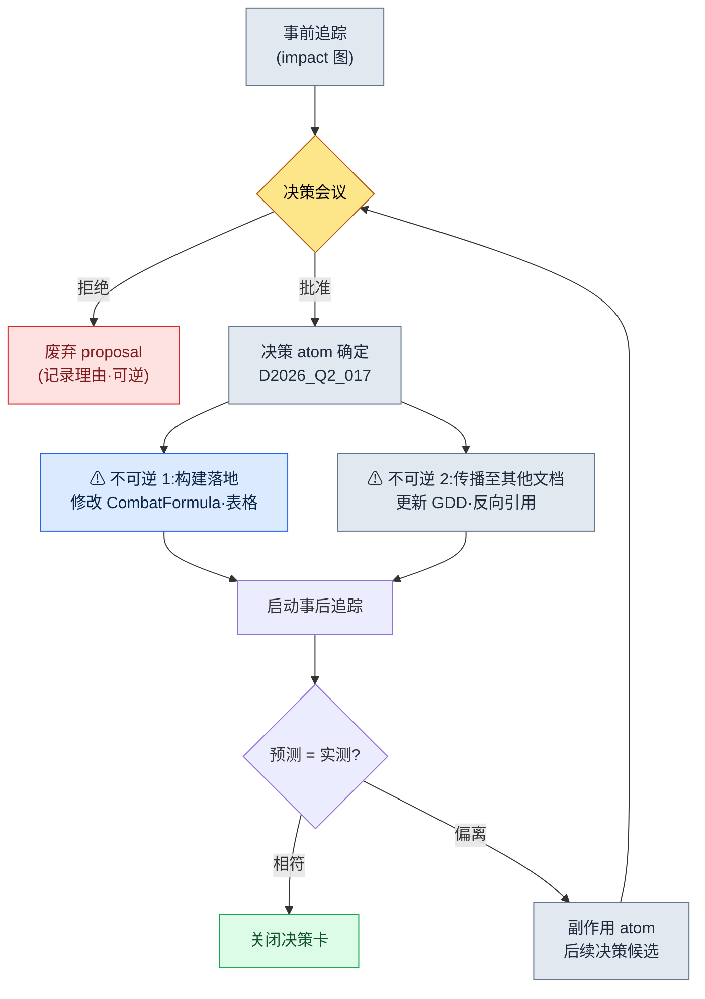

# 18.3 决策前后影响追踪工作流

上线三周后,那是一场复盘会议,用来回溯 PvP 平衡崩坏的原因。在白板上一路倒推,最终到达的起点,是一个月前的一条决策。"将全局冷却从 0.3 上调到 0.5。"它是因为收到"看不到连招"的反馈、在两小时内就达成一致的、合理的提案。然而那个改动把坦克职业的生存率比预期又拉高了 14%,正是它让 PvP 崩溃了。在做决策的现场,没有任何人指出那条决策会波及到坦克。决策本身并没有错。事故的原因在于,没能在**做出决策之前**看清这条决策会波及到哪里。

影响追踪必须发生在两处。在**按下决策之前**(pre)看清它会波及到哪里,在**决策落地之后**(post)确认它是否真的只波及到了那里。本章把这两次追踪合并为一个工作流。

---

## 18.3.1 事前追踪与事后追踪是把同一张图读两遍

决策影响分析的核心出乎意料地简单。把一个决策 atom 看作一个节点,读取**流入该节点的边**与**流出该节点的边**。事前追踪问的是"改动这条决策会影响到哪里"(出向 + 反向引用),事后追踪问的是"那些影响是否真的按意图发生了"(把同一批边与实测值比对)。

在作者的项目A中,决策以 atom 的形式留存在 `decisions/` 文件夹里。目前已累积 26 个,每个 atom 都以 frontmatter 携带日期、当事人、依据、影响范围。抽取影响范围的工具是 `impact`,而把这套抽取规则按决策单元强制执行的 atom 是 `portal_layer_change_impact_check`。这三者就是事前、事后追踪的实际资产。

<svg viewBox="0 0 720 300" xmlns="http://www.w3.org/2000/svg" font-family="sans-serif" font-size="13">
  <rect x="0" y="0" width="720" height="300" fill="#fbfbfd"/>
  <!-- center decision node -->
  <rect x="300" y="120" width="120" height="60" rx="8" fill="#2b6cb0" stroke="#1a4971"/>
  <text x="360" y="146" text-anchor="middle" fill="#fff" font-weight="bold">决策 atom</text>
  <text x="360" y="164" text-anchor="middle" fill="#cfe2f3" font-size="11">D2026_Q2_017</text>
  <!-- inbound (left) -->
  <rect x="40" y="40" width="150" height="38" rx="6" fill="#e6f0fa" stroke="#2b6cb0"/>
  <text x="115" y="64" text-anchor="middle" fill="#1a4971">依据：用户反馈</text>
  <rect x="40" y="130" width="150" height="38" rx="6" fill="#e6f0fa" stroke="#2b6cb0"/>
  <text x="115" y="154" text-anchor="middle" fill="#1a4971">上级决策 D_011</text>
  <rect x="40" y="220" width="150" height="38" rx="6" fill="#e6f0fa" stroke="#2b6cb0"/>
  <text x="115" y="244" text-anchor="middle" fill="#1a4971">反向引用：GDD 链接</text>
  <!-- outbound (right) -->
  <rect x="540" y="40" width="150" height="38" rx="6" fill="#fdeee6" stroke="#c05621"/>
  <text x="615" y="64" text-anchor="middle" fill="#7b3d12">CombatFormula.md</text>
  <rect x="540" y="130" width="150" height="38" rx="6" fill="#fdeee6" stroke="#c05621"/>
  <text x="615" y="154" text-anchor="middle" fill="#7b3d12">CombatBalance 表</text>
  <rect x="540" y="220" width="150" height="38" rx="6" fill="#fdeee6" stroke="#c05621"/>
  <text x="615" y="244" text-anchor="middle" fill="#7b3d12">UI 连招显示</text>
  <!-- inbound arrows -->
  <line x1="190" y1="59" x2="300" y2="135" stroke="#2b6cb0" stroke-width="1.5" marker-end="url(#a)"/>
  <line x1="190" y1="149" x2="300" y2="150" stroke="#2b6cb0" stroke-width="1.5" marker-end="url(#a)"/>
  <line x1="190" y1="239" x2="300" y2="165" stroke="#2b6cb0" stroke-width="1.5" marker-end="url(#a)"/>
  <!-- outbound arrows -->
  <line x1="420" y1="135" x2="540" y2="59" stroke="#c05621" stroke-width="1.5" marker-end="url(#b)"/>
  <line x1="420" y1="150" x2="540" y2="149" stroke="#c05621" stroke-width="1.5" marker-end="url(#b)"/>
  <line x1="420" y1="165" x2="540" y2="239" stroke="#c05621" stroke-width="1.5" marker-end="url(#b)"/>
  <text x="115" y="22" text-anchor="middle" fill="#1a4971" font-weight="bold" font-size="12">入向(为何做此决策)</text>
  <text x="615" y="22" text-anchor="middle" fill="#7b3d12" font-weight="bold" font-size="12">出向(波及何处)</text>
  <defs>
    <marker id="a" markerWidth="8" markerHeight="8" refX="6" refY="3" orient="auto"><path d="M0,0 L6,3 L0,6 Z" fill="#2b6cb0"/></marker>
    <marker id="b" markerWidth="8" markerHeight="8" refX="6" refY="3" orient="auto"><path d="M0,0 L6,3 L0,6 Z" fill="#c05621"/></marker>
  </defs>
</svg>

事前追踪读取右侧(出向),来预测"会波及到这里";事后追踪则取来右侧各节点的实测值,与预测比对。这是把同一张图以不同目的读两遍。

---

## 18.3.2 事前追踪 —— 在按下决策之前读图

从这里开始是真实的会话。不做概括,而是原样刊出提示词全文、Claude 的原始输出,以及人如何拒绝它并重新提出要求。

`impact` 是一个接收决策 atom 的 ID、抽取影响图的小型管线。它把入向边(这条决策的依据)、出向边(这条决策将修改的文件)、本体中的 `affects` 关系,以及维基链接反向引用(通过 `[[D2026_Q2_017]]` 指向这条决策的其他文档)合并起来,生成影响候选清单。

### 提示词(全文)

```
评估 decisions/D2026_Q2_017.md 在 proposal 阶段的事前影响度。
- 这条决策将修改的文件(出向)
- 通过 [[D2026_Q2_017]] 反向引用这条决策的文档(入向 wikilink)
- 通过本体 affects 关系连接的系统
把这三者合并给出影响候选,并为每个候选区分它是需要我确认的项(T1),
还是可以自动确定的项。不要用猜测来填补,若没有依据文件
就标注为"无依据"。
```

### Claude 的原始输出

> 已读取 `decisions/D2026_Q2_017.md`。以下是从 frontmatter 抽取的影响图。
>
> **出向(这条决策直接修改)**
> - `data/CombatFormula.md` —— `global_cooldown` 字段(atom 中已明示)
> - `sheets/CombatBalance` —— 回复技能例外行(atom 中已明示)
> - `ui/ComboIndicator` —— 依据 atom 的 `affected_teams: [ui]` 推定。**但具体文件不在 atom 中 → 无依据(推定)**
>
> **入向 wikilink(反向引用这条决策)**
> - 用 `grep` 以 `[[D2026_Q2_017]]` 检索,但当前索引中**反向引用为 0 条**。这是一条新决策,看来还没有任何人引用它。
>
> **本体 affects 关系**
> - 本体中存在 `CombatFormula → affects → TankSurvival` 关系。
> - 因此这条决策会对 `TankSurvival` 指标产生间接影响。推定影响 +12%。

此处人叫停了。问题出在最后一行"推定影响 +12%"。

### 人的验证·拒绝

> 拒绝。"推定影响 +12%"这个数字是从哪来的?atom 里、本体里都没有这个数值吧。如果是你编造的就删掉。只需报告 affects 关系**存在**这一事实,影响的大小要跑模拟才能得出。还有,ui 推定项你既然归类为"无依据",为什么又把它以 T1 放进了候选清单?

### Claude 的再次响应

> 指正得对。我更正两处。
>
> 1. **撤回"+12%"。** atom 与本体中都没有这个数值的依据。这是我生成的值。只应报告 `TankSurvival` **存在影响这一关系**,大小要用模拟(Layer 2)的结果来填充。当前值为 `未测量`。
> 2. **ui 项重新分类。** 由于找不到具体文件,在候选清单中不应作为 T1(需确认),而应降级为 `依据不足 —— 需由人指定文件`。更正后的表如下。

| 影响候选 | 边类型 | 依据 | 分类 |
|---|---|---|---|
| `CombatFormula.md` global_cooldown | 出向 | atom 明示 | 自动确定 |
| `CombatBalance` 回复例外行 | 出向 | atom 明示 | 自动确定 |
| `TankSurvival` 指标 | affects | 本体关系 | 有影响 / 大小未测量 |
| ui 连招显示(文件未知) | 推定 | 无依据 | 需由人指定文件 |
| 入向反向引用 | wikilink | grep 0 条 | 不适用 |

这张表就是事前追踪的产出。核心是 `TankSurvival` 那一行。开篇中让 PvP 崩溃的那个影响,在事前追踪里已经以**"有影响 / 大小未测量"**浮现了出来。如果在会议现场看到这一行,就会变成"那就用模拟测出大小再做决定"。若放任 AI 编造出 +12%,反而更危险。因为虚假的精确度会让人跳过验证。

---

## 18.3.3 决策与不可逆阶段

事前追踪结束后就在会议上做决策。决策以 atom 形式确定的那一刻,两个**不可逆阶段**就开始了。



不可逆的原因很简单。落地到构建的数值,用户已经玩过了;传播到其他文档的内容,团队成员已经据此开始了下一步工作。因此在这两个阶段的**紧前**,`portal_layer_change_impact_check` atom 会作为关卡拦在前面。这个 atom 的规则可以用一句话概括:"若决策包含跨 Layer 的变更(数据 → 公式 → UI),则在落地前必须由人对影响候选清单批准一次。"只有自动确定项时放行,只要出现一个"需由人指定文件"就拦截。18.3.2 中的 ui 项就成了拦截理由。

---

## 18.3.4 事后追踪 —— 给同一张图附上实测

在构建落地后 1 周\~1 个月运行事后追踪。这是给事前追踪生成的影响候选表的每一行附上**实测值**的工作。

### 提示词(全文)

```
D2026_Q2_017 事后追踪。给事前追踪表(18.3.2)的每个候选附上实测。
实测来源:
- CombatBalance 表 git diff(用于确认落地)
- 模拟 1000 次日志 sim_2026q2_017.json
- 上线 1 周 KPI export kpi_w1.csv
计算意图值与实测值的差异,只单独汇总偏差超出 10% 范围的行。
缺失的数据标为"未收集"。
```

### Claude 的原始输出

> 已将实测与事前追踪表结合。

| 候选 | 意图 | 实测 | 差异 | 判定 |
|---|---|---|---|---|
| global_cooldown 0.3→0.5 | 落地 | git diff 确认 | — | 已落地 |
| 回复例外行 | 落地 | 表格确认 | — | 已落地 |
| 战斗时间 | +15% | +14.2% | -0.8%p | 范围内 |
| TankSurvival | (未测量) | +44% | 无基准 | **无法判定** |
| 5:5 PvP 胜率 | +15%p | +29%p | +14%p | **偏离** |
| ui 连招可读性 | 改善 | 用户正面 65% | — | 相符 |

> 超出误差范围(±10%)的行:**PvP 胜率 +29%p(意图 +15%p)**。`TankSurvival` 因事前未测量大小、没有意图值,故无法判定。
>
> 把这两行联系起来看,`TankSurvival +44%` 看来是 PvP 胜率偏离的原因。事前追踪中把 `TankSurvival` 留作"大小未测量",预示了这次偏离。

### 人的验证

> 准确。没有用模拟测量 `TankSurvival` 就是事故的根源。做一个后续决策 atom。方案是通过坦克职业组的 dmg 修正,把 PvP 胜率拉回意图范围。

### Claude 的再次响应

> 已生成 `decisions/D2026_Q2_025.md` 草案。在入向挂上 `[[D2026_Q2_017]]`,用反向引用明示这次决策是对 17 号的**副作用修正**。现在再用 `impact` 查询 17 号 atom,就会捕获到 1 条入向反向引用(25 号)—— 这正是 18.3.2 中为 0 条的那个位置。

至此图闭合了。在事前追踪中还是"有影响 / 大小未测量"的节点,在事后追踪中被确认为偏离,而后续决策以指向该节点的反向引用进来了。决策的整个周期在同一张图上转了一圈。

---

## 18.3.5 运行追踪的实际命令 —— grep 工作流

`impact` 的入向反向引用抽取不是什么花哨的工具,而是一行 `grep`。它在全部文档中查找指向决策 atom 的维基链接。

```bash
# 反向引用 D2026_Q2_017 的所有文档(入向 wikilink)
grep -rln "\[\[D2026_Q2_017\]\]" decisions/ manuscript/ gdd/

# 决策 atom 的出向 —— 抽取 frontmatter 中的 affected_files
grep -A20 "affected_files:" decisions/D2026_Q2_017.md

# 事后追踪:仅意图对比中偏离的行(判定列)
grep -E "이탈|판정 불가" tracking/D2026_Q2_017_post.md
```

三行命令就能让事前、事后追踪的骨架运转起来。LLM 的位置是**读取并解读**这些结果,而不是替代检索本身。grep 给出事实(哪些文件指向这条决策),LLM 把这些事实编织成影响候选表,人对影响的大小与判定负责。正是这种分离,才让 §18.3.2 中"不要编造 +12%"得以成立。

---

## 18.3.6 测量 —— 当把前后追踪合并时

这是作者的项目A中,把决策周期标准化前后比较得到的数值。绝对时间数值取决于团队规模(中等规模,10\~50 人),属**作者推定(未验证)**;而比率与方向是在实际运营中观察到的。

| 对比项 | 前后追踪分离 | 前后追踪合并 |
|---|---|---|
| 实际运行了事后追踪的决策比例 | 约 30% | 90% 以上 |
| 事前浮现却在事后酿成事故的影响 | 常见 | 几乎没有(事前设关卡) |
| 副作用 → 后续决策的连接率 | 低(口头传达) | 通过反向引用自动候选化 |
| 决策图的入向反向引用完整性 | 稀疏零散 | 闭合回路 |

核心只有一点。当事前追踪与事后追踪共享**同一张候选表**时,事前留作"大小未测量"的那个缺口,会在事后恰好在同一位置被确认。若二者分离,事前所见与事后所测是不同的格式,无法比对,于是追踪率停留在 30%。不过若一开始就把反向引用完整性定为 100% 的目标,只会徒增运营负担。现实的做法是,先养成在决策 atom 中写 `affected_files` 的习惯,再把反向引用 grep 嵌入复盘周期,逐步扩大。

---

## 18.3.7 常见的失败

| 模式 | 处方 |
|---|---|
| 事前看到了影响却没测大小就做决策 | "大小未测量"的行在模拟前暂缓决策 |
| LLM 编造影响数值 | 没有依据文件就标"无依据",大小只用模拟得出 |
| 事后追踪与事前表格式不同 | 只在同一张候选表上追加实测列 |
| 副作用以口头方式传递 | 强制后续决策 atom + 反向引用 wikilink |
| 跨 Layer 变更未经关卡就落地 | 强制通过 `portal_layer_change_impact_check` |

---

### 本章要点
- 事前、事后追踪是把决策图读两遍的同一个工作流。
- 没能测出大小的影响,必须以"未测量"浮现出来,才不会酿成事故。
- LLM 解读影响,数值由模拟与 grep 负责。

---

> **游戏之外的应用。** 在按下决策之前看清"会波及到哪里"(事前),在落地之后确认"是否真的只波及到了那里"(事后),这种读两遍的做法,不只是游戏,而是一切变更管理的基本动作。当公司调整价格政策时,若事前把受影响的部门(销售·客服·结算)以候选表浮现出来,并留作"大小在模拟前未测量",就能预先防止上线后"为什么结算部门不知道这件事"的事故。例如,在引入新的会员等级之前,若在事前表里把客服咨询量·流失率这类事后指标的格子留空,一个月后就能把实测填进那些格子,在同一张表里直接比对意图与实际的差异。

## 动手试试

**setup** —— 创建决策文件夹与追踪文件夹。
```bash
mkdir decisions tracking
# 在 1 个决策 atom 中用 frontmatter 填写 affected_files、affected_teams
```

**prompt** —— 事前追踪后,把事后追踪接到同一张表上。
```
评估 decisions/<ID>.md 的事前影响度:把出向(将修改的文件)·
入向 wikilink·本体 affects 合并成影响候选表,
无依据的项标为"无依据",大小标为"未测量"。不要编造数值。

(构建落地后)
在同一张候选表上只追加实测列,只汇总相对意图偏差超出 10% 的行。
偏离的行做成后续决策 atom 草案,并挂上 [[<ID>]] 反向引用。
```

**verify** —— 用 grep 确认图是否闭合。
```bash
grep -rln "\[\[<ID>\]\]" decisions/   # 捕获到后续决策的反向引用即闭环
grep -E "이탈|미측정" tracking/<ID>_post.md   # 确认剩余的缺口
```

## 单人精简版

如果你是独自作业的个人游戏开发者,会议·负责人·期限都可以全部去掉。在 `decisions/` 的 Markdown 里写下一行决策时,**只填两格**即可:`affected_files:`(这条决策会触及的文件)与 `expected:`(意图的变化)。构建之后打开那些文件,用眼睛看是否如意图所愿,若有偏差就在同一文件里加上一行 `actual:`。工具只需 `grep -rln "[[决策ID]]"` 一个就够了。事前一格,事后一格 —— 这就是前后追踪的最小形态。
