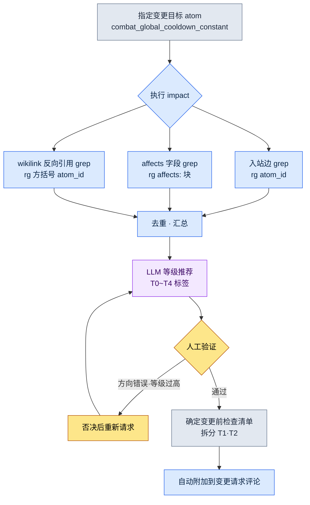

# 18.4 文档影响面 grep 工作流 —— 用 impact 提取影响范围

周一上午 10 点。负责战斗的团队成员 A 在团队即时通讯工具里丢下一句话:"全局冷却从 0.5 秒下调到 0.4 秒可以吗?"这是改一个数字的事。表面上是。我读到这句话,手停住了。这个数字被录入了几份文档、以这个常量为前提搭建的技能平衡 atom 有几个、改动它会让哪张表格的公式失效——我脑子里浮现不出来。若自以为浮现出来了,那就是事故。每个季度都会爆出 8 到 12 起的"没看到那份文档"式遗漏,其真身正是这种错觉。

所以我决定不去背答案。而是敲一行命令。

```
impact combat_global_cooldown_constant
```

本章原原本本地看这一行命令吐出了什么。它要展示的是:提取影响范围不是抽象的说法,而是用 grep 把入站边、本体 affects、wikilink 反向引用这三条路径搜罗到一起的具体动作。

---

## 18.4.1 影响范围从三条路径进来

"改动这个 atom 会影响到什么"这个问题,其实是三个问题。混在一起答案就模糊,拆开来每一个都能落成一行 grep。

第一,**入站边(inbound edge)**——谁指向我。atom A 引用 atom B,就是 A→B 方向的边。改动 B 时危险的是那些指向 B 的 A,也就是进入 B 的箭头。所以看的不是出站(我看向谁)而是入站。变更的冲击波沿着箭头逆流而上。

第二,**本体 affects**——在语义上影响到什么。这是 atom 的 frontmatter 中写明的 `affects:` 字段。即使名字没有直接出现,它也是设计者预先声明的"这个会影响那边"的语义连接。它把 grep 抓不到的别名、同义词问题,由人预先录入了进来。

第三,**wikilink 反向引用**——以 `[[atom_id]]` 形式显式链接到我的文档。可信度最高。因为这不是偶然的词语匹配,而是作者有意建立的链接。

把这三条路径的关系画成图,如下。

<svg viewBox="0 0 640 300" xmlns="http://www.w3.org/2000/svg" font-family="sans-serif" font-size="13">
  <rect x="250" y="125" width="140" height="50" rx="8" fill="#2d3142" />
  <text x="320" y="148" fill="#ffffff" text-anchor="middle" font-weight="bold">combat_global</text>
  <text x="320" y="165" fill="#ffffff" text-anchor="middle" font-weight="bold">_cooldown_constant</text>

  <rect x="20" y="20" width="170" height="44" rx="6" fill="#e8eaf0" stroke="#5b6178" />
  <text x="105" y="40" text-anchor="middle" font-weight="bold">入站边</text>
  <text x="105" y="56" text-anchor="middle" font-size="11">谁在引用我</text>

  <rect x="20" y="128" width="170" height="44" rx="6" fill="#e8eaf0" stroke="#5b6178" />
  <text x="105" y="148" text-anchor="middle" font-weight="bold">本体 affects</text>
  <text x="105" y="164" text-anchor="middle" font-size="11">affects: 字段声明</text>

  <rect x="20" y="236" width="170" height="44" rx="6" fill="#e8eaf0" stroke="#5b6178" />
  <text x="105" y="256" text-anchor="middle" font-weight="bold">wikilink 反向引用</text>
  <text x="105" y="272" text-anchor="middle" font-size="11">[[atom_id]] 显式链接</text>

  <line x1="190" y1="42" x2="252" y2="135" stroke="#5b6178" stroke-width="2" marker-end="url(#arr)" />
  <line x1="190" y1="150" x2="248" y2="150" stroke="#5b6178" stroke-width="2" marker-end="url(#arr)" />
  <line x1="190" y1="258" x2="252" y2="165" stroke="#5b6178" stroke-width="2" marker-end="url(#arr)" />

  <rect x="450" y="125" width="170" height="50" rx="8" fill="#3d5a3d" />
  <text x="535" y="148" fill="#ffffff" text-anchor="middle" font-weight="bold">影响范围列表</text>
  <text x="535" y="165" fill="#ffffff" text-anchor="middle" font-size="11">去重 · 附加等级</text>
  <line x1="390" y1="150" x2="448" y2="150" stroke="#3d5a3d" stroke-width="2.5" marker-end="url(#arr2)" />

  <defs>
    <marker id="arr" markerWidth="8" markerHeight="8" refX="6" refY="3" orient="auto"><path d="M0,0 L6,3 L0,6 Z" fill="#5b6178"/></marker>
    <marker id="arr2" markerWidth="8" markerHeight="8" refX="6" refY="3" orient="auto"><path d="M0,0 L6,3 L0,6 Z" fill="#3d5a3d"/></marker>
  </defs>
</svg>

把三条路径捆进一个工具,就是 `impact`。下一节我们完整地看这个工具实际吐出的输出。

---

## 18.4.2 实操记录(worked transcript)—— 跑一次 impact

与其用话解释,不如从头到尾跟完一个真实的循环——把真实操作过程原样记录下来。它包含提示词全文、工具的原始输出(未加修饰)、我验证并否决的部分,直到重新请求为止,全部收录。

### 提示词(全文)

我请 Claude 跑一遍 `impact` 工作流。工作流本体是调用 ripgrep 的 shell,但结果解读和等级推荐由 Claude 负责。

```
请对 combat_global_cooldown_constant 运行 impact 工作流。
分别用 grep 提取三条路径(入站边 / affects / wikilink 反向引用),
合并重复项后,为每个影响对象附上影响等级推荐。
变更内容为"全局冷却 0.5 秒 → 0.4 秒"。
```

### Claude 原始输出(不作摘要,原样呈现)

```
我将按顺序执行这三条路径。

[1/3] 入站边 —— 引用该 atom 的位置
$ rg -n "combat_global_cooldown_constant" --type md docs/ atoms/

atoms/combat/combat_skill_cooldown_rule.md:34:  base: combat_global_cooldown_constant
atoms/combat/combat_gcd_ui_feedback.md:12:  depends_on: combat_global_cooldown_constant
docs/spec/combat_v3.md:42:  以全局冷却(combat_global_cooldown_constant)为基准
docs/spec/skill_design.md:18:  冷却时间按 combat_global_cooldown_constant 的倍数设计
docs/balance/refgame_comparison.md:77:  refgame 为 0.5 秒,我们的 combat_global_cooldown_constant 也相同

→ 发现 5 处直接引用。

[2/3] 本体 affects —— 通过 affects 字段指向该 atom 的位置
$ rg -n "^\s*-?\s*combat_global_cooldown_constant" -B3 atoms/ | rg -B3 "affects:"

atoms/combat/combat_dps_curve.md:
  affects:
    - combat_global_cooldown_constant   ← (注意:需确认方向)

→ 1 处。不过这是 dps_curve 声明"施加影响"的记录,
  方向可能相反。需人工审核 —— 参见下方验证项。

[3/3] wikilink 反向引用 —— [[...]] 形式的链接
$ rg -n "\[\[combat_global_cooldown_constant" --type md

docs/spec/combat_v3.md:42:  ...[[combat_global_cooldown_constant]]...
atoms/combat/combat_skill_cooldown_rule.md:34: ...[[combat_global_cooldown_constant]]...

→ 2 处。两处都是 [1/3] 中已捕获的位置(重复)。

[汇总 —— 去重后的唯一影响对象]
1. atoms/combat/combat_skill_cooldown_rule.md   (入站边+wikilink)
2. atoms/combat/combat_gcd_ui_feedback.md       (入站边)
3. docs/spec/combat_v3.md                        (入站边+wikilink)
4. docs/spec/skill_design.md                     (入站边)
5. docs/balance/refgame_comparison.md            (入站边)
6. atoms/combat/combat_dps_curve.md              (affects —— 方向未定)

[等级推荐 —— 依据 18.2 影响 5 级标准]
1. combat_skill_cooldown_rule    → T1(所有技能冷却时间都是该常量的倍数)
2. combat_gcd_ui_feedback        → T2(UI 反馈时机,需视觉校正)
3. combat_v3.md                  → T3(规格文档数值更新)
4. skill_design.md               → T3(设计文档数值更新)
5. refgame_comparison.md         → T2(基准对比表,需重算与 refgame 的差距)
6. combat_dps_curve.md           → 待定(确认方向后再定等级)
```

### 人工验证 / 否决

这里我停下来的地方有两处。

否决 1 —— **affects 方向**。`combat_dps_curve.md` 在 `affects:` 字段里写下我们的常量,意思是 dps_curve *施加影响*给这个常量的声明。可现在我们要改的是常量这一侧。也就是说,箭头方向相反。不是 dps_curve 改动常量,而是常量一改,dps_curve 的计算前提就会动摇。Claude 老实地以"需确认方向"挂起,这是对的。我把这一项**保留为影响对象**,但重新归类为"反向语义依赖"而非 affects。确定为 T2。

否决 2 —— **把 refgame 对比表看作 T2**是高估了。`refgame_comparison.md` 是与外部游戏做的单纯数值对比表。我们的数字一变,只需把表里一格从 0.5 改成 0.4 就完事,没有任何系统以这张表为输入。下调为 T3(文档数值更新)。

### 重新请求

```
请做两处修改后重新整理影响表。
1) combat_dps_curve.md 保留为影响对象,标签改为"反向语义依赖",
   等级确定为 T2。
2) refgame_comparison.md 从 T2 下调到 T3(没有系统以它为输入,只改表中一格)。
另外,只汇总 T1·T2,拆分为"变更前必须检查"清单。
```

Claude 整理的最终结果如下。

```
[变更前必须检查 —— T1·T2]
T1  combat_skill_cooldown_rule.md   所有技能冷却时间都是该常量的倍数
T2  combat_gcd_ui_feedback.md       UI 反馈时机重新校正
T2  combat_dps_curve.md             反向语义依赖 —— 重新确认 DPS 曲线前提

[仅文档数值更新 —— T3]
T3  combat_v3.md / skill_design.md / refgame_comparison.md
```

起初在脑子里"浮现不出来"的 6 个影响对象,经过一次 grep 循环和两次人工判断,变成了一份带优先级的清单。这就是影响范围提取的实质:工具把候选全量搜罗,人来定方向和等级。

---

## 18.4.3 提取流水线 —— 哪些是自动,哪些是人工

把上一节的一个循环概括成流程,如下。关键在于自动环节和人工环节在哪里分道。



自动的部分是三条路径的 grep 与汇总,以及等级*初稿*。人工的部分只有一个,**方向与等级的最终判断**。上一个循环里看到的 affects 反向和 refgame 下调,正是在这个位置发生的。如果 100% 信任工具,就会出两种事故:要么把 affects 反向从影响对象里剔除,要么过度保护对比表,每次都跑一遍不必要的评审。把自动与人工的边界放在这一个点上,正是这套工作流的设计意图。

---

## 18.4.4 三条路径 grep 模式参考

把 impact 内部调用的 ripgrep 模式原样写下来。这就是这个工具的真身——不是华丽的基础设施,而是三行经过验证的正则表达式。

入站边。atom ID 在文档正文中出现的所有位置。搜罗得最宽。

```bash
rg -n "combat_global_cooldown_constant" --type md docs/ atoms/
```

affects 字段。只看 atom ID 落在 `affects:` 块内的情形。用 `-B3` 一并带出前 3 行,由人用眼睛确认那是 affects 块还是别的字段。

```bash
rg -n "combat_global_cooldown_constant" -B3 atoms/ | rg -B3 "affects:"
```

wikilink 反向引用。只看用两个方括号包起来的显式链接。可信度最高,是优先检查的对象。

```bash
rg -n "\[\[combat_global_cooldown_constant" --type md atoms/ docs/
```

这三个模式的可信度与召回率恰好成反比。wikilink 几乎 100% 准确,但作者不建链接就抓不到。入站边全都搜罗,却混进偶然的词语匹配(噪声)。affects 抓得住语义,方向却容易搞混。三者合起来才能补上窟窿。只用一个,就一定会有漏的地方。

---

## 18.4.5 与决策卡绑定 —— portal_layer_change_impact_check

影响范围提取是决策周期(§18.3)中的一步。决策卡登记的那一刻,impact 便以该卡的 `affected_atoms` 槽为输入运行。验证这一连接的 atom 就是 `portal_layer_change_impact_check`。

这个 atom 的职责是"当变更跨越 Layer 时,不让影响检查被跳过"。冷却常量的变更只是 L1(系统)里的一个数字,但其影响会蔓延到 L3(数据表公式)和 L4(构建 QA 项)。portal_layer_change_impact_check 判定变更是否越过 Layer 边界,越过就强制执行 impact。

```yaml
---
name: portal_layer_change_impact_check
type: gate
description: 跨越 Layer 边界的变更,在影响检查通过前禁止纳入构建
trigger:
  - 决策卡登记时 affected_atoms 非空
  - 变更 atom 的 layer != 影响 atom 的 layer
action:
  - 执行 impact(三条路径 grep)
  - 若存在 T1·T2 影响对象,在勾选"检查完成"前阻止合并
---
```

在冷却时间这个案例里,这道关卡抓到的不是 `combat_skill_cooldown_rule`(L1),而是以该 rule 为输入的 CombatBalance 表格(L3)。表格里的冷却倍数列是以常量为前提搭建公式的。grep 从文档中搜罗 atom,关卡则推着你"这个越过了 Layer,连表格一起看"。两者不绑定,就会出现文档更新了、表格却停留在旧前提的典型遗漏。

---

## 18.4.6 度量 —— 工作流回收了什么

这是作者在项目A运营中观察到的变化。时间数值为作者估算(未经验证),而遗漏事故的件数是季度复盘中实际统计的值。

| 条目 | 无工作流 | 运行 impact |
|---|---|---|
| 掌握影响 atom 的时间 | 依赖记忆(不完整) | 1\~2 分钟(全量 grep) |
| 变更遗漏事故 | 每季度 8\~12 起(统计实测) | 每季度 1\~2 起(统计实测) |
| 变更请求附带影响清单 | 偶尔靠人 | 由关卡强制 |
| 新成员掌握影响 | 数天(口头逐一传达) | 30 分钟(工具 + 卡片) |
| 基础设施成本 | 考虑引入图数据库 | 只用 ripgrep + shell |

最后一行就是整章的结论。项目A 曾考虑过图数据库和搜索索引,最终落定在 ripgrep 和一个小 shell 上。精密测量仪器确实比卷尺准。但每天都要拿出来用的工具,会收敛到不会坏、无需基础设施的卷尺那一侧。遗漏事故从 8\~12 起降到 1\~2 起,不是因为工具精巧,而是因为每次都毫无遗漏地跑一遍。

---

## 18.4.7 局限 —— grep 抓不到的东西

即便捆起三条路径,也还有漏的地方。知道局限而用它,与不知情而盲信它,是两回事。

别名与缩写。如果正文只写"GCD(Global Cooldown,全局冷却)",就不会被 `combat_global_cooldown_constant` 的 grep 捕获。补救办法是把检索词扩展成正则——`(combat_global_cooldown_constant|GCD|전역\s?쿨다운)`。另外维护一份团队缩写词典,检索时自动合成。

不可逆领域。grep 是可逆阶段的工具。纳入构建之前,文档、atom 与表格之间的影响全都能用 grep 看到。但构建发布出去、用户体感到 0.4 秒冷却之后的反应——社区不满、体感节奏变化——不是 grep 的对象。所以原则很简单。**所有 grep 检查都在纳入构建之前完成。**一旦进入不可逆阶段,grep 能知道的东西就急剧减少。

LLM 审核的位置。就像上一个循环里由人来定 affects 方向和等级那样,在 grep 候选的适配性判定中插入 LLM,噪声就会被滤掉。不过 LLM 也不是 100%,所以最终批准由人来做。在工具、LLM、人各过滤一道的结构里,准确度才能达到可运营的水平。哪怕少一道,那一道原本会漏掉的那类事故就会重新进来。

---

> **游戏之外的应用。**把"改动这一项会牵动哪里"用全量检索而非记忆去搜罗,这个习惯对任何用文档、电子表格工作的白领都能带来同样的效果。修改某一条条款时,若想靠脑子回忆写明了该条款编号的合同、通知邮件、客户 FAQ 分布在几处,一定会遗漏;但用关键词把整个文件夹 grep 一遍全量搜罗,再由人分类为"必须改 / 仅标记 / 无关",遗漏就消失了。举例来说,会计人员变更某个科目代码时,把引用该代码的结算表格、报表模板、宏做全量检索,整理成变更前检查清单,就能从结构上杜绝"漏看了那一张表"式的季度结算事故。

## 18.4.8 动手试试

### setup

只要文档和 atom 以纯文本(.md)管理、并装好了 ripgrep(`rg`),准备就绪。若有 atom ID 命名规范(蛇形命名、唯一 ID),grep 的准确度会大幅提升。

```bash
# 验证:某个 atom ID 在全部文档中出现了多少次
rg -c "combat_global_cooldown_constant" docs/ atoms/
```

### prompt

给出变更目标 atom 和变更内容,请求三条路径提取 + 等级推荐。

```
请对 <atom_id> 运行 impact。
分别用 grep 提取入站边 / affects / wikilink 反向引用三条路径,
去重汇总后,推荐 18.2 的影响等级(T0~T4)。
变更内容:<把什么改成什么>。
只把 T1·T2 拆分为"变更前检查"清单。
```

### verify

别原样相信工具输出,手动确认两点。

1. **affects 方向** —— 看被 affects 抓到的项,是"我施加影响的一侧"还是"我被影响的一侧"。方向相反就改标签。
2. **等级过高/过低** —— 若表格或用于对比的文档被列进 T1·T2,就问"有没有系统以这份文档为输入"。没有就下调到 T3。

确认后,只把 T1·T2 清单贴到变更请求评论里,一个循环就闭合了。

### 单人精简版

如果是既没有工具也没有 atom 图谱的个人作业,用一行命令和一格备注也能取得同样的效果。

```bash
# 用要改的概念名称在全部文件夹中做全量搜索
rg -n "전역쿨다운|GCD|global_cooldown" .
```

把检索结果原样贴进记事本,在每一行旁边手动写上"必须改 / 仅标记 / 无关"三者之一。这就是单人版的 impact。关键不在工具的精巧,而在"不依赖记忆、全量搜罗后由人分类"这个流程本身。有流程,遗漏就减少;没有流程,周一上午那份茫然就每次重演。

---

### 本章要点
- 影响范围分为入站边、affects、wikilink 反向引用三条路径,impact 把三者全量搜罗
- 自动做到 grep 汇总与等级初稿为止,人只负责 affects 方向与等级判断这一个点
- grep 是可逆阶段的卷尺,检查必须在纳入构建前完成,而它比图数据库更耐用

### 下一章预告
- 19.1 团队负责人的运营 —— 决策·影响追踪如何以团队为单位运转
