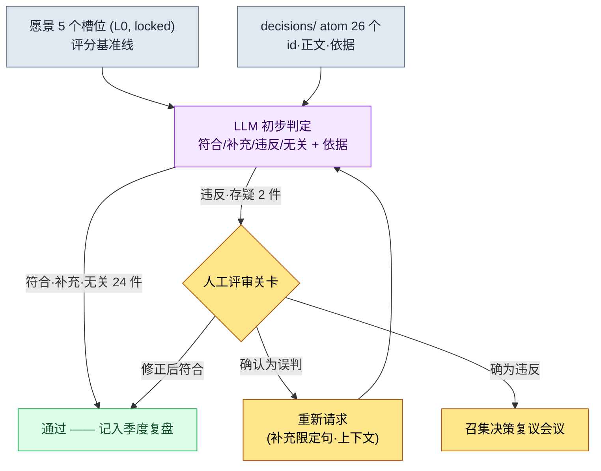

# 19.1 把愿景用作决策的评分表 —— 将 decisions/ 中的 26 个决策交给 LLM 检验

> 主要读者:带领中等规模(10\~50 人)团队的设计总监·主策划
> 面向单人/业余读者的精简版:§19.1.8「一个人的话,做到这些就够」

即便是把愿景文档在一页内写得很好的团队,也会反复出现同一种事故。愿景挂在墙上,可每周不断堆积的决策是否与这份愿景相符,却没有人去确认。季度复盘时会翻出来看一次,但那时早已在偏离的决策之上又叠了三个左右的后续决策。要让愿景成为“争议的基准点”,比起撰写,更重要的是每做一个决策就拿去与愿景对照。而这项对照工作,若由人手工去做既枯燥又容易遗漏——正是适合交给 AI 的事。

本章把两件事合在一起讲。前半部分是把已经写好的愿景当作决策评分表来运转的工作流——把作者项目中实际的 26 个决策 atom 放到 LLM 上,得到“违反愿景槽位”的判定,并由人抓出其中一处误判的一整个循环。后半部分回答的是这张评分表能覆盖到谁的决策这一问题,也就是授权委派。领导力的一般论(愿景为何重要、委派为何是成长的工具)在其他书里已经讲得够多,本章只专注于把这些原则放到 AI 工作流中运转的那一环。

---

## 19.1.1 愿景·路线图·排期 —— 只点明三层为何不同

先要理清“愿景筛选决策”这句话。愿景、路线图、排期并不是一回事。它们的时间单位与变更频率不同,而当这种区别崩塌时,排期压力就会动摇愿景。

| 层 | 周期 | 变更频率 | 与愿景对照的意义 |
|---|---|---|---|
| 愿景 | 5\~10 年 | 几乎不变 | 决策必须符合的基准线 |
| 路线图 | 1\~3 年 | 每季度 | 把愿景翻译成排期的中间层 |
| 排期 | 1\~3 个月 | 每周 | 不与愿景直接对照 |

关键在于:**决策所要对照检验的对象是愿景(最不易变的那一层)**。不是因为排期紧张就去改愿景,而是当排期与愿景相冲突时去调整排期。只有这一层级关系清晰,下一节的自动检查才有意义。因为如果检查的基准线每周都在摇动,检查本身就毫无意义。

愿景用一页、5 个槽位就写完。作者项目的愿景文档是下面这副骨架。这些槽位将成为 §19.1.3 中 LLM 检查的评分标准,所以先把它的形态看一遍。

```markdown
---
title: 项目A 愿景 v2
layer: L0
locked: true   # 变更时需游戏总监 + CEO 达成一致
---

## 槽位 1. 我们要做的东西
韩国奇幻世界观的移动优先 MMORPG。

## 槽位 2. 为谁而做
30~50 多岁、以移动端为主、喜欢厚重叙事的用户。

## 槽位 3. 为什么(差异化)
- 以多层叙事实现深度叙事(重深度而非量产)
- 东南亚 + 韩国同时运营

## 槽位 4. 怎么做(价值)
- 尊重用户的时间(最小化无谓消耗的内容)
- 数据 + 人的平衡决策
- 团队共识优先于决策速度

## 槽位 5. 不是什么
- 不是 F2P 激进付费模式
- 不以 PvP 为中心
- 不强制每天在线 N 小时
```

槽位 5(“不是什么”)在检查中出力最多。因为违反往往不是出在“决定要做的事”上,而是出在悄悄去做“决定不做的事”的地方。

---

## 19.1.2 决策早已以 atom 形式积累

拿愿景去检验什么?作者团队把所有重要决策都以一张 atom 的形式固化到 `decisions/` 文件夹中。这是标明了日期、当事方、依据的事实记录,目前已积累 26 个。检查的输入就是这 26 个——不是新造,而是把已有的拿去检验。

一张决策 atom 的实际形态如下(已匿名化)。

```markdown
---
type: decision
id: D0019
date: 2026-05-12
deciders: [游戏总监, 数据总监]
tier: T1
---
# refgame_selective_adoption_for_mobile
将参考 MMORPG 的部分战斗数据选择性地采用到移动端构建中。
依据:6 英寸移动端上已有经过验证的战斗节奏,若从 0
重新设计,Alpha 排期会推迟一个季度。但付费、签到诱导
结构不予采用。
```

从 26 个中挑出若干个用作检查输入的代表(实际 atom 名,§A.3.3)。

| atom id | atom 名(匿名化) | tier | 一句话要点 |
|---|---|---|---|
| D0007 | `claude_role_transition_phase2` | T1 | 将 Claude 从被动辅助提升为主动伙伴 |
| D0014 | `dataset_scope_alpha_split` | T2 | 确定 Alpha 数据集的拆分标准 |
| D0019 | `refgame_selective_adoption_for_mobile` | T1 | 选择性采用参考游戏的战斗数据 |
| D0021 | `procedural_capability_frontier_5stage` | T1 | 定义程序化生成能力的 5 个阶段 |
| D0023 | `class_keyword_world_only` | T2 | 将职业关键词限定在世界观之内 |

这张表就是下一节提示词的输入数据。一次性把 26 个都拿去检验是关键所在,而如果人在复盘时手工把 26 个逐一与愿景对照,要花上半天,并且从中途开始注意力下降,就会漏掉违反项。这项枯燥的初步对照交给 LLM。

---

## 19.1.3 [实操记录] 把 26 个决策放到愿景上检验

下面把一个完整循环从头看到尾。输入的提示词可以原样复制使用,输出则是对真实会话的重现。

### 第 1 步 —— 提示词:把愿景作为评分表给出,并强制判定格式

```
请把 26 个决策 atom 逐一放到下面的愿景 5 个槽位上检验,判定每个决策相对于
愿景属于符合/补充/违反/无关中的哪一种。若为违反或无关,请用一行注明是哪个
槽位以及原因(尤其要仔细看槽位 5“不是什么”),存疑的用“存疑”标出交给我。
符合的可以不写依据。
只给表格(id | 判定 | 冲突槽位 | 依据 | 存疑),不要总评。

[愿景 5 个槽位 —— 粘贴 §19.1.1 全文]
[26 个决策 atom —— id·正文·依据]
```

提示词有一半是在“强制判定格式”。若给它自由,LLM 会把 26 个全都含糊成“大体符合”。**设定 4 级判定标签、只对违反·无关强制附依据,以及留一个“存疑就交给人”的出口**,才是这条提示词的核心。在依据句中明确点名槽位 5,也是有意为之——因为违反出在“决定不做的事”上。

### 第 2 步 —— Claude 的输出(重现,节选)

```
| id    | 判定 | 冲突槽位 | 依据                                     | 存疑 |
|-------|------|----------|------------------------------------------|------|
| D0007 | 无关 | —        | Claude 运营决策。与游戏愿景的评价维度不同   |      |
| D0014 | 无关 | —        | 数据集拆分。属内部基础设施决策             |      |
| D0019 | 违反 | 槽位 5   | 采用参考游戏战斗数据 → 与“不是 F2P 激进     | ★    |
|       |      |          | 付费模式”存在冲突之嫌                     |      |
| D0021 | 符合 | 槽位 3   |                                          |      |
| D0023 | 符合 | 槽位 1   |                                          |      |
| ...   |      |          |                                          |      |

(26 个中:符合 18 · 补充 3 · 无关 3 · 违反 2)
违反/存疑判定待确认:D0019、D0026 —— 需人工评审
```

输出中最有价值的部分不是表格,而是**最下方的 2 处违反与存疑标记**。LLM 自动过滤掉 26 个中的 24 个,只把该由人来看的 2 处呈上来。半天的对照缩减为 2 处的评审。然而这 2 处里有一处是误判。

### 第 3 步 —— 验证与否决(人的位置)

人再读一遍 D0019(`refgame_selective_adoption_for_mobile`)的判定。LLM 看到“采用参考游戏的战斗数据”,便判定它与槽位 5 的“不是 F2P 激进付费模式”相冲突。表面上的字眼看起来说得通——因为参考游戏以激进付费而闻名。

然而,如果把 atom 正文读到最后,会看到最后一句。**“但付费、签到诱导结构不予采用。”** 这个决策只取用战斗节奏数据,而把付费结构明确排除在外。它反而是一个维护槽位 5 的决策。LLM 没能把 atom 正文最后这句限定句纳入判定权重,被“参考游戏”这个出处字眼牵着走,把它归为违反。这不是违反槽位 5,而是**符合**。

出现这种误判的原因很清楚。LLM 把决策的*出处*(从哪款游戏取来)与决策的*内容*(取来什么、舍弃什么)看得同等重要。而人知道“但……不做”这样的限定分句才是决策的核心。于是人否决它,并重新请求。

```
请重新看一下 D0019。正文最后一句“但付费、签到诱导结构不予采用”才是核心。
请把采用的部分(战斗节奏数据)和排除的部分(付费、签到结构)分开,
分别判定各自落在哪个槽位上。
```

LLM 重新作答:“采用的对象(战斗数据)符合槽位 1·2,排除的对象(付费结构)积极支持槽位 5。综合判定:符合。上一次的违反判定是对出处字眼过度反应的错误。”经过这一次往返,D0019 就从违反更正为符合。剩下真正需要评审的只有 D0026 一处。

这个循环就是本章的核心。**LLM 会把 26 个缩减为 2 处,但这 2 处里可能有一处是误判。** 自动检查并不是取消人的评审,而是让人把精力从 26 个转到 2 处上的工具。如果人不把这 2 处读到最后,好端端的决策就会以“违反愿景”的名义被搬上会议,制造出无谓的争执。

---

## 19.1.4 一图看懂检查流程

把上面的循环画成图留存下来,之后每个季度就能重复同一套流程。关键在于:LLM 的判定不会自动推翻决策。只把违反·存疑上报到人工关卡,而废弃·更正·批准由人来做。



人经手的地方只有两处。一处是干净地录入愿景与决策(最上方),另一处是把 LLM 判为违反·存疑的少数条目读到最后并作出判定(中间的关卡)。中间那段枯燥的 26 个对照由 LLM 来跑。这与 §6.2 城市生成器中 lint 不自动废弃违规、而只向作者关卡发出 alert(警报)的设计相同——机器挑出可疑候选,而杀还是留由人来定。

---

## 19.1.5 愿景检查覆盖到谁的决策 —— 授权委派

这里自然会冒出一个问题。这 26 个决策都是游戏总监一个人做的吗?那样可不行。主管若亲自做所有决策就会成为瓶颈,若全部授权下放又会削弱愿景。愿景检查同时也是一张安全网——**用来把授权下放的决策也纳入同一张评分表来筛选**。

决策是有等级的,而等级就意味着权限。下面是作者团队的权限矩阵。

| 等级 | 决策者 | 评审者 | 通知 | 是否纳入愿景检查? |
|---|---|---|---|---|
| T0 愿景·核心 | 游戏总监 + CEO | 全体组长 | 全团队 | 愿景本身(检查基准线) |
| T1 系统·跨领域 | TF 组长 + 游戏总监 | TF 成员 | 相关领域团队 | ✅ 必须 |
| T2 领域·中等 | 领域总监 | 资深人员 | 相关领域团队 | ✅ 必须 |
| T3 单次·小型 | 资深人员 | 负责人 | 直接相关方 | 抽样检查 |
| T4 即时·热修复 | 负责人 | 资深人员(事后) | 游戏总监(事后) | 不纳入检查 |

`decisions/` 里的 26 个大多是 T1·T2——都是授权下放的决策。游戏总监并不亲自过目所有 T2。取而代之的是,愿景检查(§19.1.3)每季度把授权下放的 T1·T2 决策拿到愿景上检验一次。**可以说,授权的安全网就是愿景检查。** T0 不是检查对象,而是检查的基准线;T4 热修复数量多、对愿景几乎无影响,因此排除在外。

授权本身不是一步到位,而是分 4 个阶段渐进推进。

| 阶段 | 权限 | 与 LLM 检查的关系 |
|---|---|---|
| 1. 信息传达 | “照这样做” | 由授权者决定,无需检查 |
| 2. 建议 + 上报决策 | “考虑 X 后再决定” | 上报时一并对照愿景 |
| 3. 事后上报 | “决定后告知结果” | 固化为 atom → 纳入季度检查 |
| 4. 自主决策 | 无上报义务(在等级限度内) | 只要留下 atom,检查便可事后覆盖 |

第 4 阶段的自主决策与愿景相偏离的风险最大,而正是这种风险由 §19.1.3 的检查在事后抓住。自主做出的 T2 决策,只要固化成 atom,就会自动进入季度检查。授权的自由与愿景的一致性之所以不冲突,原因就在这里——自由地做决策,但决策要留成 atom,而 atom 每季度都会被拿去与愿景对照。

---

## 19.1.6 如何诚实地对待数字

写愿景·授权这一章,很容易忍不住想放进“引入愿景后会议时间从 90 分钟减到 45 分钟”“授权后总监的决策负担从每周 30 件降到 5 件”这类表格。这类数字若未经验证,反而会削弱本书的可信度。本章的数字只按以下三种方式之一来处理。

第一,**能数的就按实测来写。** `decisions/` 的 atom 目前是 26 个(以 2026 年 5 月的实测为准)。从 LLM 初步判定上报到人工关卡的件数、其中被更正为误判的件数,都是可由会话日志计数的实测值。上面的实操记录中,2 件违反判定里有 1 件(D0019)是误判,这也是真实会话的结果。

第二,**效果只谈方向。** “半天的对照缩减为少数几处的评审”讲的是结构的方向,而不是绝对时间。确切能省下多少时间会随决策数量、团队规模、atom 正文长度而变,所以应把它当作“手工过 26 个”与“LLM 初步判定 + 人工关卡”之间的结构差异来读。会议时间、士气分数这类结果指标不会由愿景一项决定,因此不对因果下定论。

第三,**只承诺可测量的东西。** 这套工作流实际可测量的是——每季度纳入愿景检查的决策数、通过人工关卡的件数、误判率(LLM 判为违反、被人更正为符合的比例)、atom 固化遗漏件数(已授权下放却因没有 atom 而漏出检查的决策)。这四项在会议上可以用数字而非“感觉”来讲。尤其是**误判率**,它每个季度都用数字证明为什么不能照单全信 LLM 的判定。

---

## 19.1.7 常见的失败

| 模式 | 为何失败 | 对策 |
|---|---|---|
| 只写愿景,不拿去检验决策 | 愿景沦为墙上装饰,决策各行其是 | 每季度把 26 个 atom 放到愿景上检验的 §19.1.3 |
| 把 LLM 的违反判定直接搬上会议 | 误判(如 D0019)引发无谓的争执 | 违反·存疑的条目由人把 atom 正文读到最后 |
| 决策不留成 atom | 授权下放的决策整个漏出检查之外 | 在事后上报(授权第 3 阶段)中强制固化为 atom |
| 连 T4 热修复也全部检查 | 只增加数量,对愿景几乎无影响 | 把检查范围限定在 T1·T2 |
| 授权跳过 1→4 阶段 | 自主决策在偏离愿景的情况下不断累积 | 分阶段授权 + 季度检查来事后覆盖 |

第三项最常被忽略。越是能自主顺畅运转的团队,越容易只在口头上达成决策而不留下 atom。这样一来,§19.1.3 的检查只看得到已固化的决策,于是最自由做出的决策反而落入检查的盲区。授权的自由,只有以固化 atom 为前提才安全。

---

> **游戏之外的应用。** 把愿景拿去逐一检验每个决策,以及授权委派,并不只是游戏团队的功课,而是每一位管理者的工作。如果把部门的使命用一页 5 个槽位(“我们做什么 / 为谁 / 为什么 / 怎么做 / 不是什么”)钉死下来,就能每季度用 LLM 对每周堆积的实务决策是否偏离这份使命做一次初步对照——尤其容易抓出悄悄去做“决定不做的事”这类违反。举例来说,把团队负责人授权下放的决策每季度拿到部门使命上检验,就能成为一张安全网,事后抓出自主做出的决策是否偏离了方向。不过,LLM 判为“违反”的条目不要直接搬上会议,其中一处可能是误判,所以必须由人读到最后。

## 19.1.8 动手试试 —— 今天就能做的一步

> **一个人的话,做到这些就够**:没有决策 atom 文件夹也没关系。先把你自己项目(或业余游戏)的愿景,用 §19.1.1 的 5 个槽位写满一页就好。接着把最近做的 5\~10 个决策各用一行记成便签,再把 §19.1.3 的提示词原样贴上,交给 LLM 过一遍。只要出现哪怕一个“违反”判定,就把那个决策的便签重新读到最后,亲自反驳一下 LLM 是否正确。这样一来,你就能亲身体会到愿景检查究竟是一组怎样的判断,以及为什么不能照单全信 LLM 的判定。

如果是团队,就从下面这一步开始。先把愿景固定为 5 个槽位、一页纸(L0, locked),再从把最近一个季度做出的 T1·T2 决策以一张 atom 的形式固化到 `decisions/` 文件夹做起。哪怕只积累了 10 个 atom,也可以把 §19.1.3 的提示词跑一遍;只要在这第一个循环里抓出授权下放的决策中一处偏离愿景的,这套工作流的价值就会立刻显现。

---

### 本章要点
- 比起撰写,把愿景拿去检验决策更重要——每季度把 decisions/ 的 26 个放到愿景 5 个槽位上检验。
- LLM 会把 26 个缩减为少数几处,但其中一处可能是误判(D0019)。
- 把授权下放的 T1·T2 决策留成 atom,愿景检查便成为授权的事后安全网。

### 下一章预告
- 19.2 冲突管理·团队文化 + 会议领导力 —— 权限一旦分散,冲突随之而来。如何用 AI 支撑冲突分类与会议运营
