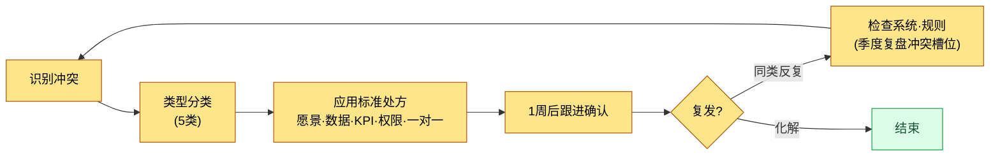
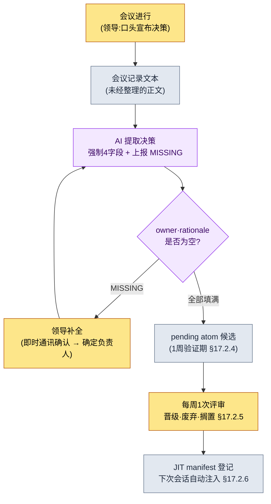

# 19.2 对冲突分类,不让会议中的决策流失——会议领导力的 AI 辅助

> 主要读者:每季度在会议上作出50件以上决策的总监·团队负责人(中等规模(10\~50人)团队)
> 面向个人/爱好者读者的精简版:§19.2.8「如果只有你一个人,做到这些就够了」

我曾把一场会议顺利开了90分钟,一周之后,同一个议题却又摆回了会议桌上。明明已经拍板,可是谁负责什么却哪里都没记下来。会议记录里只留下了"讨论了全局冷却",而"定为0.5秒,负责人团队成员A"这句,在当时在场者的脑海里只过了一周就挥发殆尽。领导的会议崩掉的地方,大多不在会议进行中,而是在**会议刚结束、决策尚未固化为记录之前的那道短暂缝隙**。

本章处理团队负责人工作的两大块。前半部分是**不必每次都从零开始解决冲突,而是把它送往按类型划分的标准处方的方法**;后半部分则是本章的脊柱——**让 AI 提取会议中产出的决策,但一旦缺少负责人(owner)或依据(rationale)就强制不予通过的实操记录(worked transcript)**。领导力的一般论(提出愿景·倾听·共情)在别的书里已经讲得够多,因此本章只聚焦于*把这套一般论跑成 AI 工作流、从而防止决策遗漏的环节*。

---

## 19.2.1 冲突的目标不是归零,而是分类

以为零冲突的团队才是健康团队,这是一种误解。一个中等规模(10\~50人)的团队每季度作出50件以上决策,却一次摩擦都看不见,那不是没有冲突,而是冲突沉到了水面之下,而沉下去的冲突更危险。

领导要做的不是消灭冲突,而是**尽快对类型分类,把它送往标准处方**。若同样的冲突每次都以不同方式解决,那么解决所花的时间每次都要从零重新累积。

| 冲突类型 | 冲突的本质 | 标准处方 |
|---|---|---|
| 价值冲突 | 对愿景的不同解读(营收 vs 用户时间) | 引用愿景槽位 |
| 事实冲突 | 对同一数据的不同解读 | 核对数据(元游戏报告) |
| 优先级冲突 | "我的领域更重要" | 比较影响等级·KPI 影响 |
| 权限冲突 | "这是我的决定" | 重新确认权限矩阵 |
| 个人冲突 | 人际关系·沟通风格 | 一对一,事实/情绪分离(系统之外) |

前四种,处方都是**引用系统**。愿景·数据·KPI·权限矩阵一旦被明文化,决策的分量就从人的嘴转移到系统一侧,讨论随之变短。只有第五种个人冲突在系统之外——一对一,以及事实·情绪的分离,除了时间与真心之外的工具几乎都不起作用。不过,"系统解不了"并不是领导可以撒手的借口。系统解不了的领域,归根结底也是领导的活儿,这正是此处的棘手之处。

分类不是每次从头解一遍,而是转成一条流程。



关键在右侧的分岔点。若同一类冲突反复出现,那就不是人的问题,而是系统的问题。那时,不去调解人,而是去修整愿景·权限矩阵这类规则。这将成为 §19.2.7 要讲的季度复盘冲突槽位的输入。

---

## 19.2.2 会议是产出决策的地方,而决策不能流失

正如冲突处方的四种全都是"引用系统",会议归根结底也是一台**产出决策、并把该决策固化为记录的装置**。领导在会议中要守的五条原则彼此相扣。哪怕只缺其中一条,其余的也会跟着动摇。

1. 议题在会议24小时前共享。(没有准备就聚在一起,会议就会滑向辩论场)
2. 为每个议题强制设定时限。(信息共享5分钟·决策15\~20分钟·讨论30\~45分钟,超时则顺延)
3. 在会议结束时明确"今日决策"。(不作决策就结束,下次会议会再次打开同一议题)
4. 会议记录在结束后立即生成。(若指望人事后再整理,就会挥发)
5. 每条决策都追踪负责人·依据·后续行动。(没有追踪的行动,不到下周就会消失)

这五条里,第3·4·5条崩掉,就是开头那起事故。决策用嘴说了(原则3部分满足),却没有固化为记录(原则4失败),负责人也没有录入(原则5失败)。于是一周之后,同一议题又摆了上来。

问题在于,若把原则3·4·5交给人的意志,它们会在繁忙的一周里最先崩塌。会议一结束,领导就已经奔向下一场会议。因此,要把这三条原则**搬到 AI 辅助流水线上。** 也就是从会议记录文本中自动提取决策,而一旦负责人或依据为空,就不让它通过。这条流水线,是从领导视角再看一遍第17部分中建立的会议→会议记录→atom 提取流程(§17.2)。

---

## 19.2.3 [实操记录] 从会议记录中提取决策,但缺少负责人就拦下

下面把实际怎么跑的完整走一遍。舞台设在作者项目(移动优先的 MMORPG,以下简称"项目A")的战斗 TF 会议刚结束之时。输入提示词可以照抄使用,输出则是对真实会话的还原。

### 第1步——输入:直接把未经整理的会议记录正文扔进去

不把会议记录整理得漂漂亮亮。发言彼此夹杂,是否算决策存疑的行也原样保留——这样粗糙的文本就是输入。整理是 AI 该做的事,不是人先要做的事。

```text
[2026-06-05 战斗 TF 会议记录正文——摘录,未经整理]

团队成员A:全局冷却设为0.5秒的模拟结果很稳定。
团队成员B:如果把恢复技能也一起绑进0.5秒,恢复循环可能会被打乱。
团队成员A:那就单独拿出来。恢复作为全局冷却的例外。
李旼洙:好,全局冷却统一为0.5秒,恢复作为例外。A 帮忙把数据表
        cooldown 列统一过一遍。
团队成员C:目标选取优先级规则,下周再看看再定……
团队成员B:小地图缩小切换得和 UI 组一起看才行。先搁置。
李旼洙:好,那个放到下次会议。
```

这里混着两条决策(全局冷却0.5秒、恢复例外)和两条搁置(目标选取、小地图)。靠人用眼睛挑,总会漏掉一件。那就是开头那起事故。

### 第2步——提示词:让它提取,但不许把负责人·依据留成空栏

```text
从附上的会议记录中只提取"决策"。讨论·搁置·信息共享都不算决策。
每条决策填写 decision(一句话)/ owner / rationale / follow_up 四栏,
如果在正文中找不到 owner 或 rationale,不要猜测,
写上"[MISSING——会议中未确定]"。搁置·顺延到下次会议的记为 deferred,
是否算决策存疑的行记为 ambiguous 交给我。输出
只用 decisions / deferred / ambiguous 三个区块。
```

请注意,这段提示词有一半都在"强制空栏"。给 AI 自由,它就会把 owner 编得像模像样,或把搁置项晋级为决策。**留下一个"找不到就别猜、上报 [MISSING]"的出口**,正是这套工作流的核心。决策要由人明确宣布才有价值(§17.6.3 的原则),AI 只做到把"此处为空"这一事实*暴露*出来为止。

### 第3步——Claude 的输出(对真实会话的还原)

```text
decisions:
  - decision: 将战斗全局冷却统一为0.5秒。
    owner: 团队成员A("A 帮忙把数据表 cooldown 列统一过一遍"——李旼洙)
    rationale: "全局冷却设为0.5秒的模拟结果很稳定"(团队成员A)
    follow_up: 统一检查 cooldown 列

  - decision: 恢复技能不适用全局冷却。
    owner: [MISSING——会议中未确定]
    rationale: "如果把恢复也一起绑进0.5秒,恢复循环可能会被打乱"(团队成员B)
    follow_up: 将恢复技能 cooldown 例外处理写入数据

deferred:
  - 目标选取优先级规则(团队成员C,下周追加评估)
  - 小地图缩小切换(需与 UI 组协商,搁置)

ambiguous:(无)
```

输出中最有价值的部分,不是第一条决策那张干净的表,而是**第二条决策的 `owner: [MISSING]`**。恢复例外分明已经拍板,可会议记录里哪儿都没写"由谁写入数据"。AI 没有用猜测去填那个窟窿,而是诚实地上报了。好的提示词,能让 AI 说得出"这个位置是空的"。

### 第4步——验证与拒绝(领导的位置)

不能就这么把这份输出照单全收。冒出 `[MISSING]`,意味着**会议只把决策做完了一半**。此处领导要做的,不是去改 AI 的输出,而是把会议上落下的决策补齐。

作者在这一步,用内部即时通讯向团队成员A问了一句:"恢复例外的数据写入,也是 A 一起来看,对吧?"A 回了"是"。这一句话就把缺失的负责人确定了下来。接着再次请求。

```text
第二条决策(恢复例外)的 owner 已确定为团队成员A(通过内部即时通讯本人确认)。
把这个反映进去,重新给出 decisions,并把两条决策也
转成 pending atom 候选格式。
// (意图:包含 status: pending、source_meeting、owner、related_atoms——§17.2.4 格式)
```

AI 把两条已填好 owner 的决策,转换成两个 pending atom 候选后再次作答。这些候选不会立刻成为正式决策,而是**以 pending 状态经过1周验证期**(§17.2.4)。因为会议上定下的东西,也可能在运营一周后被推翻。相当于给墨水留出晾干的时间。输入 → 提取 → 上报 MISSING → 人补全决策 → 再次请求的一个循环,到这里闭合。

这一圈,从结构上堵住了开头那起事故。当决策只做了一半时,这个事实不是在会议结束一周之后,而是**在会议刚结束的当场**就暴露出来。

---

## 19.2.4 完整流水线——人手只落在两处

把上面的实操记录叠到第17部分的会议记录流水线之上,整幅图景就是这样。领导的手能触及的只有两处:在会议上*宣布*决策之处(最前),以及*补全* AI 上报的 `[MISSING]` 之处(中间)。两者之间的提取·转换·登记都是自动的。



在这条流水线里,AI **不做**的事更重要。AI 不制造决策。不编造负责人。不把搁置项晋级为决策。AI 所做的,仅止于从会议记录里挑出决策候选、并把空栏*暴露*出来。决策的宣布与空栏的补全由人来做。这正是 §17.6.3 所说"决策槽位禁止 AI 自动生成"原则在领导视角下的应用——因为决策一旦传播到别的文档·会话·构建中就会留下不可逆的痕迹,所以在入口关卡处,要保留由人明确宣布的环节。

---

## 19.2.5 [MISSING] 强制支撑起平等决策文化

在公司 PC 的团队共享 atom 中,有一个名为 `team_equal_decision_culture` 的概念 atom。它把复盘中反复引用的措辞固化下来,用一个词指代"决策靠依据而非职位"的团队文化。这种文化不是总监一句"我定了,就这样"压下去,而是每条决策都留下谁·为何,从而**让日后任何人都能以该决策的依据去回溯**。

§19.2.3 的 `[MISSING]` 强制,正是这种文化的技术支撑。不让负责人和依据以空栏通过,意味着决策的权威落在"因为它出自正文的某句发言",而非"因为总监说了"。依据引用一旦为空,决策就会被拦下,于是靠职位压出来的决策,在结构上无法成为 atom。

这种文化,与 §19.2.1 的冲突处方也一线相连。用引用愿景解价值冲突、用数据解事实冲突、用矩阵解权限冲突,全都是**以记录下来的依据、而非人的一张嘴来解决**这同一条原理。平等决策文化是冲突处方的土壤,而 `[MISSING]` 强制,则是每逢一次会议就把这片土壤夯实、不让它松动的工具。

在此之上,还叠加着团队文化的另一根轴——公开与封闭的边界。会议记录·决策卡·KPI 数据·事故报告放在公开区域,而一对一谈话·人事评价·薪资·个人情况放在封闭区域。决策提取流水线所处理的,全都在公开区域。个人冲突(§19.2.1 的第五种)之所以在系统之外,原因也一样——它属于封闭区域,不固化为 atom。

---

## 19.2.6 诚实对待数字的方法

领导力这一章,很容易被诱惑去放一张"引入会议流水线后,会议时间减半"之类的表。这样的数字若未经验证,就会削弱本书的可信度。本书的原则有以下三条。

第一,**只把可测量的东西承诺为指标。** 会议流水线真正能数的是这些——每条决策的 `owner`·`rationale` 缺失件数(目标为0)、从会议记录中提取的决策里晋级为 pending atom 的比例、"这个之前不是没定过吗?"的重开会议件数。这三项,在会议中能用数字而非"感觉"来说话。

第二,**作者的推测就写明是推测。** 会议刚结束时提取决策所花的时间——"手工整理会议记录20\~30分钟 → AI 起草 + 补全5分钟以内"——是作者基于经验的推测,是未经验证的假设。不必去记绝对值,而应把它读作*结构差异*("人从头开始挑拣" vs "AI 提取 + 只补空栏")。准确的节省时间,会随会议规模·决策数量而变化。

第三,**不对因果下断言。** 不把"重开会议变少了"完全归功于这条流水线。团队成熟度·项目阶段也在同时起作用。只说方向(决策遗漏若在会议刚结束时暴露,就会朝着重开会议减少的方向起作用),而不编造倍数。

---

## 19.2.7 季度复盘的冲突·决策槽位

冲突处方与决策流水线,会在季度复盘中走一遍检查循环。复盘中设有"冲突槽位"和"决策遗漏槽位"。

```text
2026 Q2 季度复盘——冲突·决策槽位
─────────────────────────────────
[冲突] 本季度主要3件
1. 全局冷却(价值冲突)→ 以引用愿景结束。
   学习:再次确认愿景5槽位可作为决策依据发挥作用。
2. 新副本优先级(优先级冲突)→ 比较 KPI 影响。
   学习:因缺少优先级表,每次都临时比较 → 下季度引入表格。
3. 角色设计权限(权限冲突)→ 重新确认权限矩阵。
   学习:矩阵需增加"视觉 vs 功能"分工项。

[决策遗漏] 本季度发生的 [MISSING]
- 恢复例外决策 owner 未记录(2026-06-05)→ 通过内部即时通讯补全。
  学习:TF 会议宣布决策时,把立即点名 owner 加入进行检查表。
```

冲突也好,决策遗漏也好,都是复盘的输入。若同一类冲突反复出现,就修整系统(愿景·权限表);若 `[MISSING]` 经常以相同模式冒出,就修整会议的进行方式。§19.2.1 流程图中向右岔出的"检查系统·规则",在这里被具体化。

---

> **游戏之外的应用。** "分明已经拍板,一周后同一议题却又摆上来"这种会议事故,不挑行业。把会议记录正文不加整理、原样喂给 LLM 只提取决策,而一旦负责人或依据为空,就不用猜测去填、而让它以 `[MISSING]` 上报,那么决策只做了一半这一事实,就会在会议刚结束的当场暴露出来。比如在销售周会上,"这个客户由 A 负责"若只是口头说说、没有记录,下周就会悬在半空;而当 AI 提取冒出 `owner: [MISSING]` 时,就能当场用一句即时通讯确定负责人,消掉一场重开的会议。决策宣布与空栏补全由人、提取由 AI 承担,这样的分工是关键。

## 19.2.8 动手试试——今天就能做的一步

> **如果只有你一个人,做到这些就够了**:没有团队、没有会议记录流水线也无妨。把你最近参加过的会议(读书会·社团·一人项目的商议都可以)的笔记,原样贴进 §19.2.3 的提示词里跑一次。只要 AI 冒出哪怕一条 `owner: [MISSING]` 的决策,那就是你的团队(或你自己)一周之后会再拿出来的议题。仅仅现在就把那个空栏填上,就能少掉一场重开的会议。

如果有团队,就从下面这一步开始。把下一份会议记录不加整理、原样放进 §19.2.3 的提取提示词,只启用规则2(`[MISSING]` 强制)。pending atom·JIT 登记(§17.2)是之后的事。哪怕只有"强制空栏"这一行,也能在会议刚结束时抓住"以为定了、其实没记"这个最昂贵的遗漏。

---

## 19.2.9 常见的失败

| 模式 | 为何失败 | 处方 |
|---|---|---|
| 用同一种方法解决所有冲突 | 哪一类都无法彻底解决 | 5类分类 → 按类型处方(§19.2.1) |
| 满足于零冲突的团队 | 冲突沉入水面之下(更危险) | 冲突是健康信号,设季度复盘槽位 |
| 决策只用嘴说、不记录 | 一周后同一议题重开会议 | AI 提取 + pending 固化(§19.2.3) |
| AI 用猜测填负责人 | 错误的负责人固化为 atom | `[MISSING]` 强制,禁止猜测(§19.2.2) |
| AI 自动生成决策 | 决策的权威脱离依据 | 决策由人宣布,AI 只做增补(§17.6.3) |
| 把搁置项晋级为决策 | 未确定的议题被不可逆地传播 | 用 deferred 区块分离(§19.2.3) |

第三条和第四条最常捆在一起爆发。不记录决策的团队,会把整摊事甩给 AI——"你看着整理吧",AI 则很贴心地把负责人编出来。那个编出来的负责人一旦固化为 atom,一周之后就会冒出"我没答应过要负责啊"这种更昂贵的冲突。`[MISSING]` 强制,用一行就堵住这两个失败。

---

### 本章要点

- 冲突的目标不是归零,而是5类分类的对象,其中四类以引用系统来解决。
- 让 AI 提取会议决策,而一旦负责人·依据为空,就以 `[MISSING]` 拦下。
- 决策的宣布与空栏的补全由人负责,提取·转换·登记由 AI 负责。

### 下一章预告

- 19.3 AI 引入策略·向上沟通——把 AI 引入团队的顺序,以及把同一份决策数据转换给上层受众的方法
