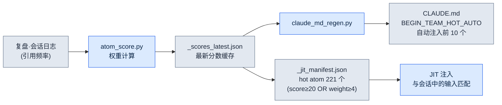
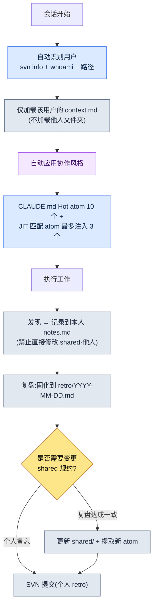

# 20.1 单人 DD(Design Director,设计总监)运营五人份的协作记忆 —— team_memory 系统

> 本章中的「DD」指设计总监(Design Director)。

> 首要读者:在小型团队中独自扛起协作上下文的总监·主管(中等规模(10\~50 人)团队)
> 面向单人/业余读者的精简版:§20.1.7「一个人的话,做到这些就够了」

周一早上,我曾在同一间会议室里,把同一个决定向三个人解释了三遍。我对一个人说「改冷却时间前先 SVN update,再改 xlsm」;两小时后,另一个人没 update 就覆盖了同一个文件,引发了冲突;下午又有一个人问了同样的问题。三个人都是好同事。问题不在他们,而在于那个决定只存在于我的脑子里。一名中等规模团队的总监,想靠人脑一致地维系四个人份的协作上下文——谁知道哪条规则、谁经常在什么地方出错、哪些决定已经拍板——是不可能的。只要过上一个月,「那个我们之前不是定过吗?」就会吃掉一半的会议时间。

本章讲的是终结了这个问题的系统。核心资产有两项。第一,全团队共享的**决策卡 304 个**(atom)。第二,在其之上搭建的**五人 team_memory**——它是一个按用户划分的上下文存储库,分为本人(leeminsoo)、团队成员 A·B·C(化名)以及 shared 文件夹。Claude 会在会话开始时自行识别「此刻坐在键盘前的是谁」,并只挑出那个人的协作风格来「穿上」。关于协作记忆的一般论述,别的书里也有。本章只聚焦于 *AI 自动分支并注入这份记忆的环节*。

本章的数字全部是 2026 年 5 月盘点时的实测值。

---

## 20.1.1 决定若只在脑子里,团队就会重复同样的错误

用「共享 wiki」来解决协作记忆的书很多。就是在 Notion 上建一个决定页面,大家一起看。话是没错,但 wiki 做不到两件事:只有人录入时它才出现,只有人去找时它才被读到。开会开到一半,没人会专门跑去问「那个我们记进 wiki 了吗?」。

所以我们把决定固化成**可检索、可引用、可自动注入的原子级文件**。这就是所谓的 atom(最小知识单元)。一个 atom 就是一个决定。文件名即标识符,所以用 `rg` 就能找到;frontmatter 是标准格式,所以脚本能处理;正文很短,所以能整个塞进上下文。公司 PC 的 `workspace/team_memory/atoms/` 下,已经堆了 304 个这样的 atom。

| 文件夹 | 数量 | 性质 |
|---|---|---|
| `rules/` | 304 | 防止复发的规则(xlsm·SVN·文档·技能等) |
| `concepts/` | 19 | 在复盘中反复出现的领域词汇 |
| `decisions/` | 26 | 明确标注日期·当事人·依据的决定 |
| `feedback/` | 11 | 协作纠偏循环(失误 → 教训) |
| `rnd/` | 4 | 工具打补丁时可能失效的未确定观察 |

合计 304 个。这五个文件夹就是团队的「长期记忆」。关键在于:文件夹名称本身就是 atom 的可信度等级。`rules/` 是经多次复发验证过的规则,`rnd/` 则是 UE 版本一变就可能作废的临时观察。即便在同一份记忆里,「已确定」与「假设」也按文件夹分开。这样就从结构上杜绝了新成员把 `rnd/` 里的绕行做法误当成永久规则的事故。

> atom 的五个属性定义(单决策原则·显式命名·frontmatter 标准·关系显式化·可追溯)已在第 5 部分讲过。本章讲的不是定义,而是 *五个人共同运营这 304 个 atom 的现场*。

---

## 20.1.2 Hot atom —— 常用的决定会自己浮上来

不可能每个会话都把 304 个全部读一遍。所以给每个 atom 打上 **score**(权重),只自动露出 score 高的。score 由 `atom_score.py` 依据使用频率·手动权重·时效性计算。下面是以 2026 年 5 月实测为准的前 10 个的实测 score。

| score | atom | 强制什么 |
|---|---|---|
| 356.53 | `view_html_filename_convention` | View_*.html 命名规范(Phase/Status → Domain → Topic) |
| 349.26 | `xlsm_svn_update_before_edit` | 修改 xlsm 前先 SVN update + 保留已有行 |
| 341.03 | `claude_role_transition_phase2` | 将 Claude 从 passive trainee 提升为 active partner(决策) |
| 340.26 | `skill_audit_score` | 基于 SVN 日志测量技能(Skill)使用频率 |
| 329.26 | `docs_is_source_of_truth` | 以 workspace/docs 为正本 |
| 326.84 | `claudeskills_naming_separation` | ClaudeSkills 与游戏内角色技能的命名分离 |
| 324.36 | `draft_doc_body_verify_before_skip` | 禁止仅凭位置就 skip,先 grep 正文再评估 |
| 309.43 | `json_over_schema_doc_as_source_of_truth` | 实际 JSON 输出比 schema 文档更权威(为正本) |
| 294.93 | `integrity_check_clickup_notify` | 完整性校验失败时立即通知 ClickUp |
| 293.26 | `data_entry_schema_first` | 数据录入顺序($schema → Enum → proto) |

开头那个解释了三遍的事故——「改 xlsm 前先 SVN update」——看到了吗?那就是 `xlsm_svn_update_before_edit`,score 349.26,排全体第 2。分数高,意味着它被引用得越频繁,也就是越经常被搞错的规则。我再也不用亲口说三遍了。score 前 10 个会自动注入 `CLAUDE.md` 的 `<!-- BEGIN_TEAM_HOT_AUTO -->` 区域,无论谁在哪个文件夹开启会话,第一屏都会带出它们。

到这里为止,不过是「把常看的规则置顶」而已。真正的差异在于:score 不是靠人手,而是**系统对自身进行测量**后打出来的。



这个循环是闭合的。atom 在复盘中被引用得越频繁,score 就越高;score 越高,就越容易出现在 CLAUDE.md 顶部和 JIT 清单里;越容易出现,就越会被再次引用。这是一个常用的决定会 *自己* 浮上来的结构。反过来,六个月内引用为 0 的 atom,score 会沉下去,自然从视野里消失。不需要人来判断「这个现在不用了,撤下来吧」。

---

## 20.1.3 JIT 注入 —— 一行输入拉来 3 个相关决定

score 决定「始终可见的东西」,而 JIT(Just-In-Time,即时)注入拉来「与刚说的话相匹配的东西」。用户输入提示词的那一刻,hook 就把这段文本与 atom 清单(manifest)里的正则对比,把相关 atom 塞进上下文。

这个 hook 的核心逻辑,完全沿用了公司 PC 上 `inject_atom.py` 的模式。下面是为个人 PC 重写的同一模式 `inject_memory.py` 的实际核心部分——按 score 降序排序 → 正则匹配 → 最多 3 个 → 截断到 6000 字,而且无论发生什么都 exit 0。

```python
# 按 score 降序排序后匹配
atoms_sorted = sorted(atoms, key=lambda a: a.get("score", 0), reverse=True)

matches = []
for atom in atoms_sorted:
    if len(matches) >= max_matches:          # max_matches = 3
        break
    try:
        if re.search(atom["regex"], prompt, re.IGNORECASE):
            matches.append(atom)
    except re.error:
        continue                              # 跳过错误的 regex 后继续

if not matches:
    emit_empty()                              # 无匹配则返回空(正常)
    return

chunks = []
for atom in matches:
    body = atom_path.read_text(encoding="utf-8")
    if len(body) > max_body:                  # max_body = 6000
        body = body[:max_body] + "\n\n[...truncated]\n"
    chunks.append(f"\n\n=== [JIT Inject] {name} (score {score}) ===\n\n{body}\n...")
```

重要的是这套设计很保守。匹配不到,就返回空并结束(正常)。正则坏了,就只跳过那个 atom 继续跑。正文超过 6000 字就截断。而且整个 hook 在任何异常下都以 `exit 0` 结束——即便记忆注入失败,用户的工作流也绝不会停下。「有就帮忙,没有或坏了就悄悄退出」,这是这套系统的第一原则。

---

## 20.1.4 [实操记录(worked transcript)] 一开会话,Claude 先弄清「你是谁」

如果说到这里为止是 atom(长期记忆),那么接下来就是五人 team_memory(按人区分的短期·协作记忆)。我们把真实一个会话的开端,按输入 → 动作 → 结果从头跟到尾。舞台是公司 PC,场景是团队成员 C(化名,文件夹 `팀원 C/`)在自己座位上打开了项目A的工作文件夹。

### 第 1 步 —— 输入:一行平平无奇的首个提示词

团队成员 C 像平常一样开始工作。

```text
继续检查昨天定的目标选择系统初稿。
```

他一个字都没写自己是谁、该遵守哪些规则。因为根本不需要写。

### 第 2 步 —— 动作:Claude 自动识别用户

按照 `CLAUDE.md` 里「会话开始时自动识别」的流程,Claude 在给出回答之前,会先弄清键盘前的人是谁。它执行的命令有三条。

```bash
svn info --show-item last-changed-author   # SVN 工作副本的最近提交 author
whoami                                      # OS 登录账户
# 以及当前工作路径(哪台 PC 的哪个用户文件夹)
```

这三个信号与 `team_memory/users.md` 里的映射对比后,确定为 `팀원 C`。接着 Claude **只加载那一个用户文件夹**。

```text
team_memory/
├── atoms/                       ← 共享(304 个,score 靠前的已在 CLAUDE.md 中)
├── leeminsoo/    context.md     ← (不加载 —— 不是我)
├── teammate_a/   context.md     ← (不加载)
├── teammate_b/   context.md     ← (不加载)
├── teammate_c/   context.md     ← ★ 只加载这个
│                 notes.md       ← ★ 用于记录本人的发现
│                 retro/
└── shared/       conventions.md  commit_rules.md  ...  ← 仅参考规约,禁止修改
```

### 第 3 步 —— 结果:那个人的协作风格被自动「穿上」

`팀원 C/context.md` 里记录的协作风格,只应用于本次会话。于是 Claude 的回答这样开头。

```text
已识别为团队成员 C(svn author:teammate_c / 路径已确认)。
teammate_c/context.md 协作风格加载完成。

继续检查昨天的工作(Draft_Targeting_System_v0.1.md)。
注入的相关决策卡(JIT,3 个):
  - docs_is_source_of_truth (329.26)
  - draft_doc_body_verify_before_skip (324.36) —— 禁止仅凭位置就 skip,先 grep 正文再评估
  - decision_summary_not_clickup_mirror

我会先用 grep 确认正文,然后开始检查。检查中发现的事项只
记录到 teammate_c/notes.md,不会直接修改 shared/。
```

### 第 4 步 —— 人工验证与边界确认

这里我(作为总监,或者团队成员 C 本人)要确认两件事:识别是否正确,以及是否守住了边界。在 Claude 的下一个提议里,我抓到了一次越界。

```text
[Claude 提议]
检查中发现了命名规则冲突。要不要现在就修改 shared/conventions.md 里的
目标选择术语条目?

[人工拒绝]
不。shared/ 只在复盘达成一致后才修改。现在只在 teammate_c/notes.md 里
记一句「conventions.md 目标选择术语冲突 —— 复盘议题」。

[Claude 重新请求后的结果]
明白了。取消直接修改 shared/。
已在 teammate_c/notes.md 中记为复盘议题:
  - 2026-06-06 conventions.md 目标选择术语 'lock-on' vs 'target-lock' 冲突
    → 需在下次团队复盘中达成一致(暂缓修改 shared)
```

这就是五人运营的安全阀。每个用户**只写自己的 notes.md**。他人文件夹和 shared 都不能直接碰。shared 只在复盘达成一致后才改。所以哪怕四个人在同一份记忆上工作,也不会互相覆盖对方的上下文。发现先汇集到个人笔记里,只有通过复盘这道关卡,才能升格为团队共享规约。

---

## 20.1.5 五人运营的完整流程一图看尽

用一张图看完一个会话运转的完整路径。这是一个从识别开始、到在复盘中固化收尾的循环。



右下角的分叉点是这套系统的心脏。个人发现的东西流向个人 notes,而影响整个团队的规约·新 atom,只有通过复盘关卡之后才能上升到 shared。一个人运营五个人份却不冲突,原因就在这一道关卡上。而最后一步一定是 SVN 提交——因为没有被固化的发现,会在下一个会话里重新退回脑子里。

---

## 20.1.6 常见的失败与对策

这些是运营五人 team_memory 时实际踩过的雷。

| 失败 | 症状 | 对策 |
|---|---|---|
| 识别失败 | svn author 是公用账户,无法确定用户 | 在 `users.md` 里映射路径·账户等多重信号,无法确定时提问 |
| shared 被擅自修改 | Claude 出于好意改了共享规约 | 「shared 只在复盘达成一致后」atom + 实操拒绝模式 |
| notes 未提交 | 发现只留在本地,到下个会话就蒸发 | 在复盘收尾时强制 SVN 提交(`feedback-svn-zero-red`) |
| Hot atom 僵化 | score 停滞,旧规则被钉在顶部 | 定期运行 `atom_score.py` → 更新 `_scores_latest.json` |
| 把 rnd 误当规则 | 新成员把临时绕行做法当永久规则来用 | 隔离 `rnd/` 文件夹 + 在 frontmatter 中写明失效条件 |

这里代价最高的失败是第二行「shared 被擅自修改」。AI 帮忙的本能很强,一发现冲突就想立刻去改。§20.1.4 里的实操拒绝必须固化成 atom、而不是一次性的纠正,下次在别的用户会话里才会划出同一条线。

---

## 20.1.7 一个人的话,做到这些就够了

就算没有团队,这套结构的八成也能由一个人原样使用。把五个用户缩减为一个文件夹即可。

- **只要两个 atom 文件夹。** 只分 `rules/`(已确定)和 `rnd/`(假设)。光是把经常搞错的 5\~10 条规则固化成 atom,「之前不是定过吗?」就会消失。
- **JIT 可以不带 score 就开始。** 清单里只写正则,score 全部设成一样。光是注入 3 个匹配的 atom 就已见效。
- **notes 就一个文件。** 不做用户分支,只有一个 `notes.md`。只要保留复盘关卡就好——即兴备忘写进 notes,确定的规则经过复盘再进 `rules/`。

核心是「把决定从脑子里搬到文件里」,无论五个人还是一个人,这个动作都一样。

---

### 动手试试 —— 今天就能做的一步

把一条经常搞错的规则固化成 atom,并让它通过 JIT 自动注入,试试看。

1. **setup** —— 建一个 `atoms/rules/` 文件夹,把最常重复解释的 1 条规则写成文件。例:`atoms/rules/xlsm_svn_update_before_edit.md`。
2. **prompt** —— 在这个 atom 的正文里写「何时·做什么·为什么」三行。(「修改 xlsm 前务必 SVN update —— 不然会覆盖他人的行。」)
3. **verify** —— 在 JIT 清单里加上 `{"name":..., "regex":"xlsm|쿨타임", "score":100, "path":...}`,然后在提示词里输入「쿨타임 수정」,确认 `_injection_log.txt` 里该 atom 是否被记为 hit。

如果被记上了,那条规则现在就不在你脑子里,而在系统里了。

---

### 本章要点

- 把决定从脑子里搬到 atom 文件里。
- score·JIT 会自动把常用的决定浮上来。
- shared 只有通过复盘关卡才会改变。

### 下一章预告

- 20.2 按成员的记忆 —— 用工具把用户区和共享区分开,防止实验值伪装成决定的事故
