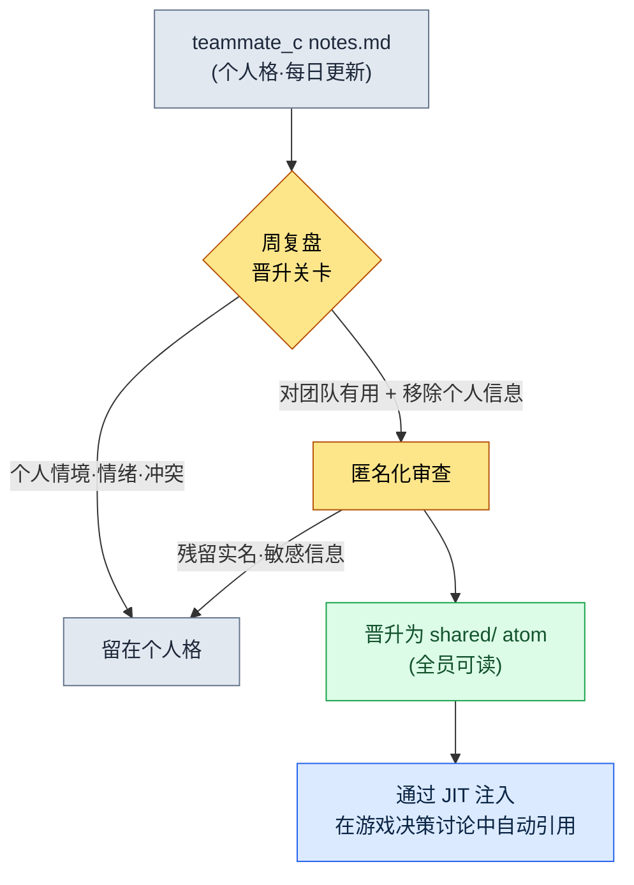

# 20.2 团队成员各自的记忆 —— 用户格与共享格的分离

周三午饭前后,团队成员 B 通过团队即时通讯工具发来一条消息:"上周总监把战斗冷却时间定为 0.8 秒,可我的笔记里记的是 0.6 秒,到底哪个对?"我一时愣住了。0.8 秒是共享决策,0.6 秒是团队成员 B 在自己的测试构建里临时试跑的值。两者都记在"记忆"里。问题在于,这两个值混在了同一个格子里。团队成员 B 把自己的实验值误当成了公司决策,差一点就用错误的值去更新数据表了。

这起事故并非因为记忆里没有数据。恰恰相反,数据积累得很充分,却因为没有划清哪个格子是共享格、哪个格子是个人格的边界而出事。§20.1 铺垫的卖点是五个人看到同一份事实(shared atom),而本章讲的则是它的反面——**五个人各自拥有独立的格子**。同一个柜子,格子却分两种。而且,如果不用工具强制区分这两种格子,上面那起 0.6 秒事故就一定会发生。

---

## 20.2.1 五个格子的柜子

项目A 的 `team_memory/` 分成五个人的格子。包括本人(leeminsoo)在内的团队成员 A、团队成员 B、团队成员 C,以及 `shared`。前四个是各用户的个人格,最后一个是所有人都打开的共享格。

<svg viewBox="0 0 720 250" xmlns="http://www.w3.org/2000/svg" font-family="sans-serif" font-size="13">
  <rect x="10" y="10" width="700" height="230" fill="#fafafa" stroke="#ccc" rx="6"/>
  <text x="30" y="38" font-weight="bold" font-size="15">team_memory/  (1 个柜子)</text>
  <!-- 개인 칸 4 -->
  <g>
    <rect x="30" y="60" width="150" height="160" fill="#eef4ff" stroke="#5a7fbf" rx="4"/>
    <text x="105" y="84" text-anchor="middle" font-weight="bold">leeminsoo/</text>
    <text x="105" y="106" text-anchor="middle" font-size="11" fill="#555">总监(本人)</text>
    <line x1="42" y1="118" x2="168" y2="118" stroke="#cdd" />
    <text x="105" y="140" text-anchor="middle" font-size="11">context.md</text>
    <text x="105" y="160" text-anchor="middle" font-size="11">notes.md</text>
    <text x="105" y="180" text-anchor="middle" font-size="11">+ 战略/评估</text>
    <text x="105" y="205" text-anchor="middle" font-size="10" fill="#a33">最高保护级别</text>
  </g>
  <g>
    <rect x="195" y="60" width="120" height="160" fill="#eef4ff" stroke="#5a7fbf" rx="4"/>
    <text x="255" y="84" text-anchor="middle" font-weight="bold">团队成员 A/</text>
    <line x1="207" y1="118" x2="303" y2="118" stroke="#cdd" />
    <text x="255" y="140" text-anchor="middle" font-size="11">context.md</text>
    <text x="255" y="160" text-anchor="middle" font-size="11">notes.md</text>
  </g>
  <g>
    <rect x="330" y="60" width="120" height="160" fill="#eef4ff" stroke="#5a7fbf" rx="4"/>
    <text x="390" y="84" text-anchor="middle" font-weight="bold">团队成员 B/</text>
    <line x1="342" y1="118" x2="438" y2="118" stroke="#cdd" />
    <text x="390" y="140" text-anchor="middle" font-size="11">context.md</text>
    <text x="390" y="160" text-anchor="middle" font-size="11">notes.md</text>
  </g>
  <g>
    <rect x="465" y="60" width="120" height="160" fill="#eef4ff" stroke="#5a7fbf" rx="4"/>
    <text x="525" y="84" text-anchor="middle" font-weight="bold">团队成员 C/</text>
    <line x1="477" y1="118" x2="573" y2="118" stroke="#cdd" />
    <text x="525" y="140" text-anchor="middle" font-size="11">context.md</text>
    <text x="525" y="160" text-anchor="middle" font-size="11">notes.md</text>
  </g>
  <!-- 공유 칸 -->
  <g>
    <rect x="600" y="60" width="90" height="160" fill="#fff2e0" stroke="#c98a3a" rx="4"/>
    <text x="645" y="84" text-anchor="middle" font-weight="bold">shared/</text>
    <line x1="612" y1="118" x2="678" y2="118" stroke="#e3c">  </line>
    <text x="645" y="142" text-anchor="middle" font-size="11">atom</text>
    <text x="645" y="162" text-anchor="middle" font-size="11">(共享)</text>
    <text x="645" y="205" text-anchor="middle" font-size="10" fill="#a33">全员可读</text>
  </g>
</svg>

四个个人格涂成蓝色,一个共享格涂成橙色。颜色不同,是因为访问规则不同。蓝色格子只有本人和总监能打开,橙色格子则由全员打开。0.6 秒事故的根源在于:团队成员 B 本该写进自己蓝色格子的实验值,却不加区分地统称为"记忆",当成共享决策来对待。把格子从物理上分开——也就是分成不同目录——至少能凭"写在了哪里"这一点,得到区分两者的线索。

这里的关键不是有两个文件夹,而是**每个格子都附带各自的规则**。放进 `shared/` 的是公司决策,人人都读。放进 `团队成员 B/` 的是那个人的工作情境,只有本人和我读。同样是 0.6 秒,放在哪个格子里,就决定了它是"实验中"还是"已决策"。

---

## 20.2.2 一个人的格子里有两个文件

打开某个用户的格子,会看到两个文件:`context.md` 和 `notes.md`。名字很简单,角色却正好相反。

`context.md` 记录的是**这个人现在是谁**:角色、负责的系统、正在进行的工作、工作风格。它相对稳定,是身为总监的我在 1:1 之前 5 分钟翻开来看的文件。打开团队成员 A 的 `context.md`,会看到诸如"负责战斗系统,当前正在做技能冷却时间的数值平衡,是那种先要数据依据的风格"之类的内容。不看它就进 1:1,头 10 分钟就会耗在"最近在忙什么?"上。

`notes.md` 记录的是**这个人现在正在经历什么**:每天的实验值、卡住的地方、小决策、失误记录、与其他成员的协商备忘。它易失性高,更新频繁。团队成员 B 的 0.6 秒本该记在这里。就像这样:"用 0.6 秒测试过,太快了,输入被挤掉——决定遵从 0.8 秒的共享决策"。

把这两个文件分开,是因为它们的更新周期不同。`context.md` 每季度动一次就够了,`notes.md` 却每天累积。混在一起,稳定的信息就会被每天的噪声淹没。如果是一个人工作,这种分离可能显得过度——那就只运营一个 `notes.md`,把 `context.md` 放在脑子里也行。但只要人数超过两个,能在 5 分钟内读完别人的 `context.md` 来准备 1:1,就是很大的差别。

---

## 20.2.3 复盘晋升到 shared 的关卡

把个人格和共享格分开,并不算完。最棘手的是**个人格里的某些内容必须晋升到共享格**。假设团队成员 C 把这样一条失误记在了自己的 `notes.md` 里:"数据表 import 时,如果 enum 顺序错乱,就会在运行时悄然出错"。这虽是那个人的个人记录,但只要团队全体都知道,就能避免同样的失误。可也不能把整个个人 `notes.md` 都共享出去——那里面还混着工作风格、卡壳时的情绪、与其他成员的冲突之类的东西。

所以在个人 → 共享之间,必须有一道**关卡**。复盘就是那道关卡。写复盘时,先过滤一遍"这周我经历的事情里,有哪些是团队该知道的",只把过滤出来的内容晋升为 `shared/` atom。流程如下。

关卡的判断标准有两条。**第一,是否对团队有用。**不是个人喜好,也不是那天的状态。第二,**是否移除了个人信息。**不是"团队成员 C 又在 enum 上出错了",而是"给数据表 import 时的 enum 顺序加一道校验",只留下事实。只有通过这两道关口的内容才会进 `shared/`。没通过的,就原样留在个人格里。

没有这道关卡,就会以两种方式之一崩掉。关卡太松,个人信息就会漏进共享格,发生 0.6 秒事故的反面——私人备忘被暴露给全员——的事故。关卡干脆没有,团队成员 C 的 enum 教训就会被困在他自己的格子里,团队成员 A 重复同样的失误。把复盘当作关卡,就能把"个人信息泄露"和"学习资产化"这两件正好相反的事,用一个动作分开。

我实际使用的晋升提示词很短。复盘一结束,我就抛出这样一句。

> "从我这周的 notes.md 里,只挑出对团队全体有用的条目。每条都去掉人名和具体的失败情形,重写成只保留'做什么、怎么做'的 atom 候选句。个人情绪、风格、冲突类的备忘从候选中排除,并用一行标注排除的理由。"

最后一句——让它写出排除理由——很重要。AI 展示出自己没有上报什么,人就能检查这道关卡是不是太严,以至于连真正的教训都挡住了。

---

## 20.2.4 实操记录(worked transcript）—— 晋升关卡被拒的瞬间

关卡并不总是干净利落地运作。实际上,AI 一次答不对、人拒绝、再让它重做,这样的来回是会发生的。下面原样搬来一次真实的来回——把团队成员 B 一周的 `notes.md` 往 shared 上晋升的过程。

**[提示词 —— 第 1 次]**

> "下面是团队成员 B 这周的 notes.md。只把对团队全体有用的条目挑成 shared atom 候选。去掉人名和具体的失败情形,只留下'做什么、怎么做'。
> ---
> - 周二/0.6 秒冷却时间测试,输入被挤掉。遵从 0.8 秒共享决策
> - 周三/团队成员 A 写的技能 enum 和我的 import 冲突。直接跟团队成员 A 说有点别扭,就通过总监转达
> - 周四/门户网站 View_skill_table.html 一刷新筛选器就被重置。烦
> - 周五/状态不好,下午请半天假"

**[Claude 原始输出 —— 第 1 次]**

> 已提取以下 4 个条目作为 shared atom 候选。
> 1. 战斗冷却时间在 0.6 秒会发生输入被挤掉的情况,因此以 0.8 秒为准。
> 2. 团队成员 A 编写的技能 enum 与 import 冲突,因此变更 enum 时需要事先共享。
> 3. View_skill_table.html 刷新时筛选状态会重置,因此需要状态保留功能。
> 4.(排除)周五下午半天假 —— 判断为个人日程,已排除。

这里我**拒绝了第 2 条**。"团队成员 A 编写的"原封不动地留着。人名是去掉了,但"是谁写的 enum"仍被特定出来,而且"直接说别扭就通过总监转达"这一*个人冲突情境*,摇身变成了一条事实项。这不是学习资产,而是该在 1:1 里另行处理的关系问题。就这样上到 shared,团队成员 A 就会在共享格里看到一条明确写有自己名字的冲突记录。

**[人工验证/拒绝 —— 重新要求]**

> "第 2 条拒绝。enum 冲突作为事实值得留下,但"由特定某人编写"这一信息和转达路径(经由谁去说的)属于个人关系范畴。去掉这两点,只重写成'防止数据冲突的流程'。另外,第 3 条门户网站的 bug 不是 atom,而是该进门户问题追踪器的条目,把它从候选中去掉,并写明理由。"

**[Claude 原始输出 —— 第 2 次]**

> 已修改。
> 2.(修订)变更技能 enum 时,须与 import 数据表的其他协作者事先共享。enum 顺序、值的变更可能在 import 一侧悄然出错。
> 3.(排除)View_skill_table.html 筛选器重置 —— 属于工具 bug,比起 shared atom 更适合作为门户问题条目,已从候选中排除。
> 最终 shared 晋升候选:第 1 条(冷却时间 0.8 秒)、第 2 条(变更 enum 前先共享)。共 2 项。

第 2 次我放行了。第 2 条里,人和转达路径都消失了,只剩下流程。以 4 项开始,2 项上到了 shared,1 项留在个人格里(半天假),1 项被分流到门户 issue(筛选器 bug)。这就是关卡实际运作的样子——不是一次到位,而是人拒绝一次,什么被拿掉、为什么被拿掉都留下记录。总结出来看似干净,但只看干净的总结,就会抹掉第 2 条一开始差点带着人名上到共享格这个事实。而那份风险,正是这道关卡存在的理由。

---

## 20.2.5 JIT 注入 —— 展开哪个格子,就是接口本身

即便分好了格子、立起了关卡,如果每次对话都要手动展开某个格子,运营就会很重。所以最后一块拼图是**让契合对话情境的格子自动展开**。在本人的 PC 上,这件事由 UserPromptSubmit 钩子(`inject_memory.py`)来做。它只挑出与输入语句匹配的格子,注入到上下文里。

规则很简单。讨论游戏决策时,`shared/` atom 会展开。准备与某位团队成员的 1:1 时,那个人的 `context.md` + shared 会一起展开。写季度复盘时,项目记忆 + 总监本人的格子会展开。写对外报告时,总监的格子 + 部分 shared 会展开。展开哪个格子,就是记忆的接口。

这里,格子的分离再次显效。准备 1:1 时,团队成员 B 的个人格会展开,而团队成员 C 的个人格不会——因为与当下对话无关。格子若不分开,每次就会全部展开、淹没在噪声里,更糟的是,在 1:1 的场合会牵扯出无关人员的个人备忘。分离既是安全,也是注入的准确度。

---

## 20.2.6 同一份数据、多台 PC —— 阻止同步事故的位置

就算格子的结构立起来了,还剩最后一个陷阱。我在家里的 PC 和公司的 PC 之间往返,记忆通过云端文件夹同步。这时,如果两台 PC 同时修改同一个格子,就会发生冲突。一方把另一方整个覆盖掉,那一天的 `notes.md` 就没了。

处方按格子单位而不同。频繁更新的个人 `notes.md` 放进 git 这类可合并的仓库,冲突时把两边合并。稳定的 `context.md` 或 `shared/` atom 更新频率低,用加锁或每日备份就够了。关键是把"同步覆盖掉一方"这个动作从默认值里去掉。因文件夹权限设错,个人格混进共享文件夹被同步出去——那才是最安静也最致命的事故。为每个格子标明它属于哪个同步区域,就能在入口处挡住与 0.6 秒事故同类的"混淆"事故。

---

## 动手试试

**setup**
1. 在 `team_memory/` 下为每个人建立文件夹。本人 + 每位团队成员各一个,再加一个 `shared/`。文件夹名用化名(leeminsoo、团队成员 A ……)。
2. 在每个个人文件夹里放两个文件:`context.md`(稳定 —— 角色·负责·风格)和 `notes.md`(易失 —— 每天的实验·失误·决策)。
3. 明确文件夹权限:`shared/` 为全员读取权限,个人文件夹为本人 + 总监读取权限。

**prompt**(周复盘之后,个人 → shared 晋升关卡)—— 直接使用 §20.2.3 的晋升提示词(去掉人名·失败情形 + 只留'做什么、怎么做' + 标注排除理由)。

**verify**
1. 亲自读一遍输出的候选句,看是否残留人名·转达路径·情绪描写。哪怕有一处,就拒绝,并以"去掉那条信息,只留流程"重新要求。
2. 只把通过的候选移入 `shared/` atom,拿掉的条目原样留在个人格里。
3. 确认同步文件夹的权限——查看个人格是否被放进了共享文件夹的路径里。

**单人精简版**
如果是一个人,五个文件夹就太多了。每天只写一个 `notes.md`,把 `context.md` 放在脑子里。但关卡还是要保留——每周一次,用"从这份 notes 里,只挑出下次还值得再看的一行"来过滤自己的笔记,易失的备忘和已资产化的教训就会分开。等人数增加到两个的那一刻,再把格子拆开就行。

---

### 本章要点

- 记忆柜子分为各用户的个人格和所有人共用的共享格;若不用工具强制区分这两个颜色不同的格子,实验值就会摇身变成决策。
- 把个人格里的教训上升到共享的路上,有复盘这道关卡,它把学习资产化和个人信息泄露用一个动作分开。
- JIT 注入只展开契合对话情境的格子,让格子的分离同时作为安全与注入准确度发挥作用。

### 下一章预告

- 20.3 门户网站搭建 —— 在同一屏幕上访问分散的工具与格子的统一接口
