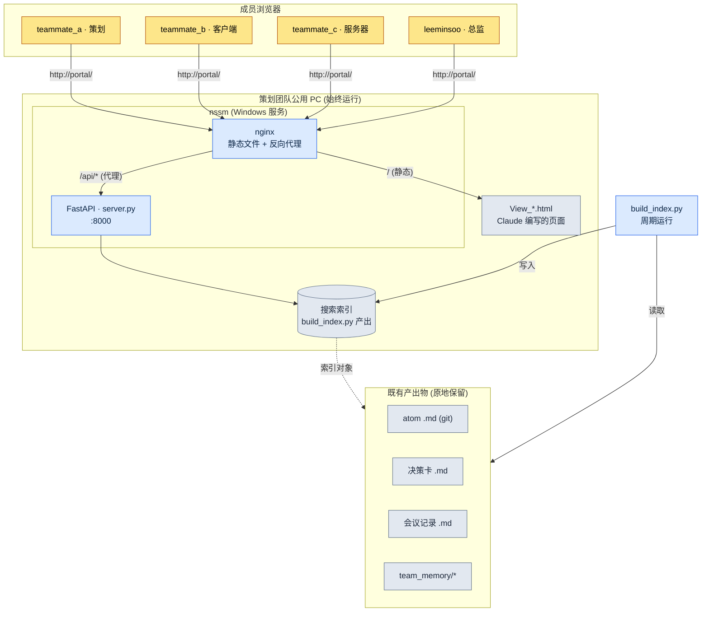

# 20.3 策划门户 —— 团队通过浏览器进入的入口

周四傍晚,在提交构建之前,客户端程序员成员 B 在公司内部聊天里发了一条消息:"上周战斗 TF 上,我们把全局冷却常量定为 0.8 秒,对吧?记在哪份文档里了?"5 分钟后,策划成员 A 回复:"会议记录里应该有……我在找。"又过了 7 分钟。"git 的哪个文件夹来着。"

这段 12 分钟的往返,并不是因为信息缺失。信息确实存在。它写在 atom 文件里、会议记录里,也写在决策卡里。只是这三者被放进了不同的抽屉,而打开每个抽屉的方式各不相同。问题不在抽屉,而在打开抽屉的把手。

本章讲的就是把这些把手合并成一个。它不是从零自研全栈,而是在已经堆积在文件夹里的策划产出物之上覆盖薄薄一层 Web,让成员在浏览器地址栏里只敲 `portal` 一个词就能进入。核心工具只有三个:用 Python 启动搜索 API 的 FastAPI、架在它前面的 nginx,以及让服务在无人关闭、PC 开着的整段时间里持续存活的 nssm。

---

## 20.3.1 分散的产出物,统一的入口

策划产出物本来就是分散的。这不是有意打散,而是因为每份产出物都落在最自然的位置上。atom 落到 git 仓库的 Markdown 里,日程落到任务管理工具里,实时对话落到聊天里,KPI 落到独立的仪表盘里。各自待在各自的位置上,这没有错。问题在于,这些位置需要人在脑子里存成一张地图。

对新入职者来说,这张地图本身就是进入的门槛。要找"全局冷却值",就得(1)判断它到底是决策卡、atom 还是会议记录,(2)打开对应的工具,(3)再用那个工具的搜索语法去查询。这三步都是从经验中来的隐性知识。

门户的想法很简单。产出物仍旧留在现在的位置。只是在它之上叠一层用于搜索的索引,再把索引通过浏览器暴露出来。不是摆七张桌子,而是摆一张带七个抽屉的桌子。抽屉照旧,但人只需坐下一次。

下面是笔者在项目A中实际运营的门户结构。它不需要额外的服务器设备,在策划团队的一台公用 PC 上以始终开启的状态运行。



图中用灰色框起来的下半部分,是原本就已存在的产出物;门户新增的,只是上半部分薄薄的三层——索引、FastAPI、nginx。这是一种不触碰产出物、只新开一个入口的结构。

---

## 20.3.2 四个部件:build_index.py · server.py · nginx · nssm

门户的实体,由五个小文件就能构成。逐个来看,它们各自只做一件事。

**build_index.py —— 把产出物转换成可搜索的形态。** 它扫过 git 仓库,读取 atom、决策卡、会议记录以及 `team_memory/` 之下的所有 Markdown,提取标题、正文、标签,落成一个索引文件。这个脚本做的事,只是"把分散的文件平铺成一行一条的记录"而已。它不碰文件本身,所以即使索引损坏,原件也是安全的。周期性地(例如每 30 分钟,或通过 git 提交钩子)重新运行,就能保持最新状态。

**server.py —— 用 FastAPI 启动搜索 API。** 它把索引加载到内存里,当 `/api/search?q=...` 请求到来时,就把匹配的记录以 JSON 返回。代码不超过一屏。

```python
# server.py (节选 —— 搜索端点骨架)
from fastapi import FastAPI
import json, pathlib

app = FastAPI()
INDEX = json.loads(pathlib.Path("index.json").read_text(encoding="utf-8"))

@app.get("/api/search")
def search(q: str):
    q = q.strip().lower()
    hits = [r for r in INDEX
            if q in r["title"].lower() or q in r["body"].lower()]
    # 按种类归组后返回 → atom / 决策 / 会议记录 / 记忆
    by_kind = {}
    for r in hits:
        by_kind.setdefault(r["kind"], []).append(
            {"id": r["id"], "title": r["title"], "path": r["path"]})
    return {"query": q, "count": len(hits), "results": by_kind}
```

搜索算法特意从简单的子串匹配起步。当团队是中等规模(10\~50 人)、文档在数千份量级时,这份简单反而降低了维护成本。形态素分析或向量检索,等到"搜索太弱"的抱怨真的出现之后再叠上去也不迟。

**nginx —— 服务静态页面并代理到 API。** 它把请 Claude 生成的 `View_*.html` 文件(搜索页面、结果页面、仪表盘页面)作为静态资源下发,只把进入 `/api/` 的请求转交给后端的 FastAPI(:8000)。站在成员的角度,页面也好、搜索也好,全都发生在同一个 `http://portal/` 地址上。因为页面由 Claude 直接用 HTML 画出,所以策划需要新页面时,只要请求"做一个只汇总决策卡的页面",拿到 `View_decisions.html` 放进文件夹里就完事了。没有前端构建流水线,这一点在中等规模团队里是明显的优势。

**nssm —— 无人开启也能让它存活。** 门户的核心需求是"即使我不在座位上,成员也要能搜索"。在终端里启动 server.py,关掉那个终端的瞬间它就会死,PC 重启后它也会消失。nssm(Non-Sucking Service Manager)把这个 Python 进程注册为 Windows 服务,PC 一开机它就自动启动,进程一旦死掉就自动重启。注册一次即可。

```powershell
# 用 nssm 把 FastAPI 注册为 Windows 服务 (一次)
nssm install Portal "C:\Python\python.exe" "C:\portal\portal_run.py"
nssm set Portal AppDirectory "C:\portal"
nssm start Portal
```

这里的 `portal_run.py` 是一个五行的启动器。用 uvicorn 启动 server.py 的那一行,再加上让服务不至于死掉的最小骨架,就是全部。人需要记住的命令只有 `nssm start` 一个,而且它一旦注册好,就再没机会重敲。

把这四个部件的分工一眼看下来,是这样的。

<svg xmlns="http://www.w3.org/2000/svg" viewBox="0 0 720 250" font-family="sans-serif" font-size="13">
  <rect x="0" y="0" width="720" height="250" fill="#fbfbfd"/>
  <!-- columns -->
  <g>
    <rect x="20" y="40" width="150" height="170" rx="8" fill="#eef4ff" stroke="#5b8def"/>
    <text x="95" y="65" text-anchor="middle" font-weight="bold" fill="#244">build_index.py</text>
    <text x="95" y="92" text-anchor="middle" fill="#345">产出物 → 索引</text>
    <text x="95" y="112" text-anchor="middle" fill="#345">平铺·打标签</text>
    <text x="95" y="148" text-anchor="middle" fill="#789" font-size="11">原件不变</text>
    <text x="95" y="168" text-anchor="middle" fill="#789" font-size="11">周期重跑</text>
  </g>
  <g>
    <rect x="200" y="40" width="150" height="170" rx="8" fill="#eafaf0" stroke="#3aa76d"/>
    <text x="275" y="65" text-anchor="middle" font-weight="bold" fill="#244">server.py</text>
    <text x="275" y="92" text-anchor="middle" fill="#345">FastAPI :8000</text>
    <text x="275" y="112" text-anchor="middle" fill="#345">/api/search</text>
    <text x="275" y="148" text-anchor="middle" fill="#789" font-size="11">按种类分组</text>
    <text x="275" y="168" text-anchor="middle" fill="#789" font-size="11">JSON 返回</text>
  </g>
  <g>
    <rect x="380" y="40" width="150" height="170" rx="8" fill="#fff5e9" stroke="#e08a3c"/>
    <text x="455" y="65" text-anchor="middle" font-weight="bold" fill="#244">nginx</text>
    <text x="455" y="92" text-anchor="middle" fill="#345">View_*.html 托管</text>
    <text x="455" y="112" text-anchor="middle" fill="#345">/api/ 代理</text>
    <text x="455" y="148" text-anchor="middle" fill="#789" font-size="11">单一地址</text>
    <text x="455" y="168" text-anchor="middle" fill="#789" font-size="11">无构建流水线</text>
  </g>
  <g>
    <rect x="560" y="40" width="150" height="170" rx="8" fill="#f6eefe" stroke="#8a5be0"/>
    <text x="635" y="65" text-anchor="middle" font-weight="bold" fill="#244">nssm</text>
    <text x="635" y="92" text-anchor="middle" fill="#345">Windows 服务</text>
    <text x="635" y="112" text-anchor="middle" fill="#345">开机自动启动</text>
    <text x="635" y="148" text-anchor="middle" fill="#789" font-size="11">死掉即复活</text>
    <text x="635" y="168" text-anchor="middle" fill="#789" font-size="11">保证始终运行</text>
  </g>
  <text x="360" y="232" text-anchor="middle" fill="#456" font-size="12">数据流:产出物 → 索引 → API → 页面 → 浏览器 (从左到右)</text>
</svg>

---

## 20.3.3 团队实际搜索的一个场景

光靠部件说明,门户的价值还不够真切。让我们把前面吃掉 12 分钟的那个问题,在门户上重新抛一次。下面把笔者制作搜索页面时抛给 Claude 的提示词、拿到的输出,以及验证过程,不作压缩地照搬过来。

笔者的提示词:

> 做一个 fetch `index.json` 来搜索的单页 HTML。在输入框里敲关键词就调用 `/api/search?q=`,把结果分成 atom / 决策卡 / 会议记录 / 记忆 四组,以卡片形式展示。点击每条结果就跳转到原始路径(`path`)。不要用外部 CSS·JS 框架,用一个文件搞定。文件名为 `View_search.html`。

Claude 的原始输出(节选,与实际收到的一模一样):

```html
<!-- View_search.html -->
<input id="q" placeholder="atom 或关键词">
<div id="out"></div>
<script>
document.getElementById('q').addEventListener('keydown', async e => {
  if (e.key !== 'Enter') return;
  const r = await fetch('/api/search?q=' + encodeURIComponent(e.target.value));
  const d = await r.json();
  const order = ['atom','decision','meeting','memory'];
  const label = {atom:'atom', decision:'决策卡',
                 meeting:'会议记录', memory:'记忆'};
  out.innerHTML = order.filter(k => d.results[k]).map(k =>
    `<h3>${label[k]} (${d.results[k].length})</h3>` +
    d.results[k].map(x =>
      `<a href="${x.path}">${x.title}</a>`).join('<br>')
  ).join('') || '无结果';
});
</script>
```

这份输出并不是成品。笔者没有原样接受,而是否决了两处。

第一,把 `out` 不经 `getElementById` 就当全局变量来用,这是一段依赖浏览器惯用行为的危险代码——在某些环境下它不会工作。第二,`path` 是 git 内部路径,直接放进 `href` 的话,浏览器打不开文件。必须改成让门户把这个路径重新路由到自己的页面,也就是经过 `/view?path=`。

笔者的再次请求:

> 改两处。(1)把 `out` 明确地用 `document.getElementById` 接收。(2)结果链接不要直接跳到原始路径,而要经过 `/view?path=` 查看器端点。查看器我会加到 server.py 里,前端只改链接。

这一次往返正是关键。Claude 的第一份输出对了 80%,但剩下的 20%,是只有当人知道"这个门户叠在 git 产出物之上"这一背景时才能揪出的缺陷。验证,始终留给人来做。

执行一次搜索,成员的页面上就会浮现出这样分组的结果。

| 分组 | 搜索词"全局冷却"的结果 |
|---|---|
| atom | `combat_global_cooldown_constant` |
| 决策卡 | `D2026_Q2_017` (确定为 0.8 秒) |
| 会议记录 | `95_BattleTF` 第 2 次 |
| 记忆 | 成员 B 一对一笔记 1 条 |

周四下午那段 12 分钟的往返,缩短为在搜索框里敲一个词的 20 秒。而更重要的是,这 20 秒成了成员 B 一个人就能完成的事,于是成员 A 的 12 分钟根本不必再花。

---

## 20.3.4 成本与效果 —— 做到哪一步才值得

做门户的方式大致有三种。从零自研全栈,或引入 Notion·Coda 这类外部一体化工具,或像现在这样在基础工具上叠一层薄薄的自动化。笔者选了第三种,而这个选择的依据在于中等规模团队这一规模。

全栈自研的自由度最高,但做完之后必须持续维护这个 Web 的负担,会比效果更早到来。认证、部署、DB 迁移之类的运维劳动,会落到策划团队头上。外部一体化工具很快,却要按月订阅,而且最要紧的是,还得把堆在 git 里的 Markdown 产出物再迁移成那个工具的格式,这笔迁移成本躲不掉。相比之下,FastAPI+nginx+nssm 的组合,把产出物留在原地、只叠一层索引,因此几天就能运行,维护也不过是偶尔修一修 build_index.py 的程度。

下面是笔者在项目A中,门户引入前后所感受到的变化。表中的数字并非精密计量,而是笔者的估算(未经验证),应当读方向与比例,而非绝对值。

| 条目 | 无门户 | 运营门户 | 方向 |
|---|---|---|---|
| 单次信息检索耗时 | 数分钟 | 不足 1 分钟 | 大幅缩短 |
| "这个在哪"的提问频率 | 频繁 | 稀少 | 减少 |
| 新成员适应工具 | 两周上下 | 几天 | 缩短 |
| 会议记录·决策卡的登记率 | 半数左右 | 大多数 | 上升 |

最后一行最为本质。信息一旦变得易于查找,快起来的就不只是搜索,连留下资料这一行为本身的动机也会提升。"反正也搜不到,写会议记录干嘛"这样的冷嘲,会转变为"写了就能被搜到,所以写"。门户既是搜索工具,同时也是诱导记录的装置。这一良性循环,创造出超过把一两个工具拼起来的价值。

不过这份平衡取决于团队规模。当团队超过 50 人、产出物膨胀到数万份时,子串搜索的局限与单台 PC 服务的局限会同时显现。到那个时点,全栈自研或引入搜索引擎才被证明为正当。眼下这套结构是"适合中等规模团队的解",而非所有规模的正解。

---

## 20.3.5 动手试试

**setup.** 定下一台策划团队公用 PC(或一台始终开着的 PC)。安装 Python、nginx 和 nssm。确认待索引的产出物文件夹(atom·决策卡·会议记录·team_memory)的位置。

**prompt.** 按顺序向 Claude 请求三件事。

> (1)"做一个 build_index.py,读取这个文件夹的 Markdown,提取标题·正文·标签·种类,落成 `index.json`。种类用路径规则来判别。"
> (2)"做一个 FastAPI server.py,把那个 index.json 加载到内存,用 `/api/search?q=` 搜索。结果按种类分组后返回。"
> (3)"做一个 fetch index.json 来搜索的单页 HTML(View_search.html)。不用外部框架,用一个文件搞定。"

**verify.** 亲自确认三件事。(1)运行 build_index.py 之后,看 index.json 里产出物的条数是否正确——有没有遗漏的文件夹。(2)启动 server.py,在浏览器里直接调用 `/api/search?q=测试关键词`,看 JSON 是否分组返回。(3)读 Claude 生成的页面代码,揪出链接路径是否原样暴露了 git 内部路径、有没有依赖全局变量的代码——前一节看到的两处缺陷,正是在这里被筛掉的。最后用 nssm 注册服务后重启 PC,确认在无人开启任何东西时门户是否仍然存活。

## 20.3.6 单人精简版

即使没有团队,这套结构照样有用。因为独自工作的人,自己的产出物也一样会分散。在 setup 里用本人 PC 代替公用 PC,nssm 注册也可以省略(只在需要时用 `python portal_run.py` 启动)。prompt 同样拿到 build_index.py、server.py 和 View_search.html 三样,只是去掉 team_memory 部分,只索引 atom·决策·会议记录。verify 有确认 index.json 条数和搜索一次就足够。核心是一样的——产出物留在原地,只新开一个搜索入口。

---

### 本章要点

- 产出物留在原地,只叠一层索引,统一搜索入口
- 有 FastAPI·nginx·nssm 三个部件,中等规模团队的门户几天就能运行
- 搜索一旦变容易,留下记录的动机也会随之提升

### 下一章预告

- 20.4 MCP 项目管理 —— 把公司已在用的工具连接到 LLM·门户
