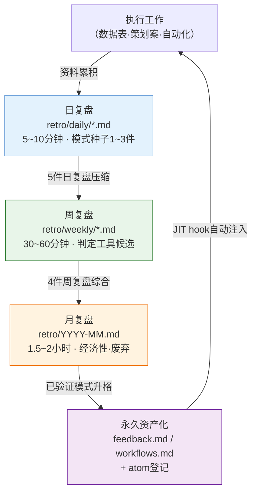

# Part 21 · 第1章 复盘是一切的起点

周五傍晚6点40分。正准备下班合上笔记本电脑时,我发觉那天做的工作有些似曾相识。我找出并修好了数据表里断掉的enum引用,可上周分明也修过同样的东西。再上一周也修过。每次都要重新敲一遍相同的提示词,每次都要在Claude的输出里核对相同的条目。直到合上笔记本电脑之前,我才意识到这已经是第三次了。

这种"有些似曾相识"的感觉,是全书中最重要的一刻。若放任这种感觉溜走,下周就会第四次重复同样的工作。若抓住这种感觉并写成一行字,这一行字下周就会变成一个skill,这个skill一个月后又会变成一个atom(最小知识单元)被自动注入。而抓住它的地方,正是复盘。

本书的其他部分讲的是"有这样的工具""有这样的模式"。而本章讲的是,所有这些工具与模式究竟从何处萌发。新的斜杠命令在哪里诞生,新的atom如何被固化,一个月都用不上一次的工具由谁来剔除。答案总是汇聚到同一个地方。在复盘中。

---

## 1.1 把熟悉感写成一行 —— 实操记录(worked transcript)

复盘并不是什么隆重的仪式。我们直接打开作者的一份日复盘文件来看。实际路径是`retro/daily/YYYY-MM-DD.md`,过了一个月,这些文件会被压缩为周复盘(`retro/weekly/YYYY-Www.md`),再压缩为月复盘(`retro/YYYY-MM.md`)。规则写在`retro/README.md`里。

作者实际采用的流程,不是亲手手写复盘文件,而是把当天的工作日志丢给AI,让它从中提炼模式。下面是对某个周五傍晚真实往返过程的还原——这正是本书所说的实操记录(worked transcript),即完整保留下来的真实操作过程记录:先完整给出提示词,再把Claude的原始输出原样呈现——不作摘要,连偏差之处也照登不误。

**[提示词 —— 人工输入]**

> 把我今天做的工作整理成复盘。今天做的事:① 修复了角色数据表里断掉的enum引用（grade列和enum表对不上）② 统一了NPC对白的语气 ③ 重新跑了一遍relation-map。
> 其中如果有**本周重复过2次以上的工作**就标出来,如果有**值得做成工具的候选**就单独挑出来。没有就说没有。不要硬凑。

**[Claude原始输出 —— 未经摘要与改写]**

> 以下是今天的工作复盘。
>
> **重复模式检测**
> - ① 修复enum引用断裂 → 这一项在本周周二的复盘里也出现过同样的条目。标记为**重复2次以上**。
> - ② 统一NPC对白语气 → 本周首次出现。非重复。
> - ③ 重新运行relation-map → 您已经在使用relation-map-gen这个skill了,所以这是一项已经完成工具化的工作。不作为新增候选。
>
> **工具候选**
> - enum引用校验**似乎可以做成一个skill。** 形式上是:比对数据表的列值与enum表,报告其中的不一致。
> - 不过由于我并不清楚这两张表的确切结构,很难断定这是否真是一个可复用的模式。需要确认:周二修复的断裂与今天的断裂**是否属于同一类断裂**。如果是在同一列、因同样的原因断裂,那就是很有力的skill候选;如果每次都是不同的列因不同的原因断裂,就难以归并为一个skill。

这里的最后一段才是关键。AI并没有断言"就做一个skill吧"。它反问的是:**请人来确认是否属于同一类断裂**。这正是复盘之所以不是全自动的原因。

**[人工验证 —— 采纳AI的建议但加以筛选]**

作者打开周二的复盘做了比对。周二的断裂在`grade`列,今天的断裂也在`grade`列。**属于同一类**。AI的候选建议通过了验证。于是在日复盘里留下一行。

> 重复工作:enum-grade引用校验（周二·周五2次）→ **skill候选**。下次周复盘时判断是否升格。

这一行就是全部。花了不到5分钟。而这一行,正是self-improving（自我改进）循环的第一环。假如把AI已经点明"早已完成工具化"的第③项也一并列为候选,一个月后就会又多出一个没人用的重复工具在四处漂浮。正因为AI的筛选与人的筛选双双起了作用,最终只留下了一个真正的候选。

---

## 1.2 复盘之所以是起点

哪项工作在重复,哪件工具用得频繁,哪个atom还欠缺——这些靠单次工作是看不出来的。在上面的实操记录里,enum断裂之所以浮现为候选,并不是因为"今天",而是因为把"周二和今天"叠在一起看。只有把1周、1个月、1个季度累积下来的痕迹叠起来,模式才会浮现。复盘,就是刻意制造这种叠合的时间。

复盘中发现的模式会分成两支。

- 重复的模式 + 有价值的结果 → 固化为工具(skill·atom·hook)
- 重复但没有价值的模式 → 废弃或简化

这种分野的判断,在工作进行途中是做不了的。因为它会打断工作的连贯性。在修复enum断裂的那一刻,根本没有余裕去琢磨"这是不是第三次了"。单独腾出来的复盘时间,才是做这种判断的地方。

工具做出来之后是否真的产生价值,也在同一个地方衡量。一个月才用一次的工具,和能省下一个小时的工具,价值是不一样的。衡量也好,废弃决定也好,都在复盘里做。没有复盘,工具就只会不断累积而得不到整理。几年下来,几十个没人用的工具会妨碍检索与运营。

用抽屉来打比方,复盘就是定期清空书桌抽屉的时间。如果每天都用的笔,和一年都没拿出来过一次的便签,混在同一个格子里,那么每次找笔都要多花几秒钟。工具也是一样。

---

## 1.3 日·周·月复盘的压缩流

作者的复盘按三个层级运转。日复盘收集模式的种子,周复盘把种子归拢、压缩为工具候选,月复盘则评估工具的经济性,或将其固化为资产,或将其废弃。每一层都把其下层的输出作为输入。

最后一根箭头闭合了这个循环。被永久资产化的模式,会通过JIT（Just-In-Time,即时）钩子(hook)自动注入到下一次工作中。在作者的环境里,有一个名为`inject_memory.py`的hook,每当接收到用户输入时,就挑选相关的atom塞进去。一旦enum-grade校验被固化为atom,下次输入"数据表校验"这类内容时,那个atom就会自动跟上来。人不必每次都去记"对了,还有那条校验规则"。

一旦缺了复盘,就只剩下自上而下的箭头,而资产回流到工作的那根最后的箭头会断掉。循环无法闭合。所谓自我改进(self-improving),它的含义正是这个循环仍在转动。工具改进工具自身,atom增生出atom。而它的动力,就是人特意腾出来的那一个小时的复盘。

---

## 1.4 复盘中萌发的五样东西

以作者在某个MMORPG项目上把复盘运转约半年的体会来看,一次复盘会萌发出以下五类产出。下面的频率并非精确统计,而是作者运营中的体感（作者估算·未经验证）,并非每次复盘都会产出全部五类。若以季度为单位来看,这五类都会各出现一次。

把这五类展开来说是这样。如果本周把同一个决定重复了两次以上,那就是**新atom候选**。如果一周内多次重新输入同一种提示词模式,那就是**新skill候选**（上一节的enum-grade校验就属于这种情况）。本周用过的skill里,如果有结果不尽如人意的,那就是**改进现有skill**——调整提示词·增加校验·标准化输入。上个季度做的atom里,若某个在一个月内匹配次数为0,那就是**废弃候选**。不用它,就只是白占token。最后,**经济性评估**是指:按工具逐一权衡使用频率与所节省的人工,来决定保留·改进·废弃。

这五类在同一个画面里如何排布,用一个矩阵来看是这样。横轴是"是否重复",纵轴是"是否有价值"。

<svg viewBox="0 0 520 320" xmlns="http://www.w3.org/2000/svg" font-family="sans-serif" font-size="13">
  <rect x="0" y="0" width="520" height="320" fill="#ffffff"/>
  <!-- axes -->
  <line x1="90" y1="40" x2="90" y2="280" stroke="#333" stroke-width="1.5"/>
  <line x1="90" y1="280" x2="500" y2="280" stroke="#333" stroke-width="1.5"/>
  <text x="295" y="305" text-anchor="middle" fill="#333">重复频率  →  高</text>
  <text x="30" y="160" text-anchor="middle" fill="#333" transform="rotate(-90 30 160)">结果价值  →  高</text>
  <!-- quadrants -->
  <rect x="92" y="42" width="200" height="118" fill="#fdecea"/>
  <rect x="294" y="42" width="204" height="118" fill="#e8f5e9"/>
  <rect x="92" y="162" width="200" height="116" fill="#f5f5f5"/>
  <rect x="294" y="162" width="204" height="116" fill="#fff8e1"/>
  <!-- labels -->
  <text x="192" y="95" text-anchor="middle" fill="#b71c1c" font-weight="bold">价值高·重复低</text>
  <text x="192" y="118" text-anchor="middle" fill="#444">→ 原样保留（暂不工具化）</text>
  <text x="396" y="80" text-anchor="middle" fill="#1b5e20" font-weight="bold">价值高·重复高</text>
  <text x="396" y="103" text-anchor="middle" fill="#444">→ 新skill / 新atom候选</text>
  <text x="396" y="126" text-anchor="middle" fill="#444">（enum-grade校验在此）</text>
  <text x="192" y="215" text-anchor="middle" fill="#666" font-weight="bold">价值低·重复低</text>
  <text x="192" y="238" text-anchor="middle" fill="#444">→ 忽略</text>
  <text x="396" y="215" text-anchor="middle" fill="#e65100" font-weight="bold">价值低·重复高</text>
  <text x="396" y="238" text-anchor="middle" fill="#444">→ 废弃 / 简化候选</text>
</svg>

复盘所做的,归根结底就是把这一周的工作撒进这四个象限。落在右上的会变成工具,落在右下的会被剔除。这种分类,就是self-improving的实际运作方式。

---

## 1.5 atom被固化的位置

我们接着走完这样一段过程:上一节的enum-grade校验候选升格为skill,再从skill固化为atom。atom是复盘中被粗略发现的模式,经过验证之后成为永久资产的形态。

作者的记忆库里,已经有一些这样被固化的atom。其中之一是`retro_atom_natural_invitation`。正如其名,这是一个承载了"在复盘中,atom不是以命令、而是以自然的邀请出现"这一原则的atom。这个atom本身,就是把复盘反复运转多次才发现的元模式(meta pattern)——只有在多次亲历"如果在复盘途中强迫症般地非要把某样东西固化成atom,反而会让复盘沦为形式"之后,它才凝固成这一行字。

固化是否真的产生效果,也用分数来管理。作者的环境里有一个名为`atom_score.py`的脚本,给每个atom实际被匹配、被使用的程度打分。结果保存在`_scores_latest.json`里,分数超过一定水平的atom会被自动注入到`CLAUDE.md`中。也就是说,越是常用的atom越会频繁地出现在眼前,不常用的atom则会被扣分,流向废弃候选。这个打分—注入的循环,正是把§1.4的四象限自动化的那一部分。

这里有一点需要诚实地点明。这个分数,并不会直接换算成"一个月省下了30个小时"这类定量指标。atom所节省的时间很难测量。所以,与其用数字去断定ROI（Return on Investment,投资回报）,不如只用方向与比例来讲会更诚实——"越是常用的atom分数越高,分数越高的atom被注入得越频繁、越能减少人工";是方向,而不是倍数。

---

## 1.6 没有复盘的地方会发生什么

没有专门腾出复盘时间的团队,常见的景象是这样。

- 同样的会议每个季度都要重开一遍（"这个我们以前不是也定过结论吗……"）。
- atom·skill只存在于某一个人的脑子里。那个人一走,它们也随之消失。
- 工具只会不断累积。没人用的工具妨碍检索与运营。
- 就算来了新的策划,学习资料也四散各处,只能从头再把同样的试错经历一遍。

这种景象,只要有一个小时的复盘就几乎会消失。回想§1.1里那个周五傍晚,差别不过在于:把"有些似曾相识"写成一行,还是任它溜走。写下来只要5分钟;不写而损失的时间,则会以第四次·第五次重复的形式累积起来。这是典型的因舍不得花小时间而损失更大时间的情形。

当然,没必要一开始就搭建一套隆重的复盘系统。在大团队里,从每天5分钟的复盘起步,或许会让人觉得憋闷。但若一上来就把日·周·月三层系统一次性铺开,又容易只顾追着形式走而丢掉本质。让在最小的阶段亲身体会到复盘价值的人,再把它拉升到下一个阶段——这样的顺序才稳妥。

本书中遇到的所有工具·atom·模式,归根结底都是从某个人的复盘中萌发出来的。说这本书本身就是作者半年间累积的复盘的产物,也毫不夸张。说复盘是起点,并不是一句比喻——它指的是,本书的目录本身,就是从复盘里长出来的这一事实。

---

> **游戏之外的应用。** 用一行字抓住"有些似曾相识——这个我上周不是也做过吗"这种感觉的复盘,不只对游戏开发,而是对任何有重复性工作的职场,都是自我改进的入口。在结束一天时,只写一行"今天我用手做了两遍的是什么事",到了周五再把这一周的五行叠在一起看,那些每天都藏着的模式,就会在一周的尺度上显现出来。比如,行政总务人员如果在复盘里抓住"每周都要重新敲一遍同一格式的邮件",那么这一行下周就会变成邮件模板,一个月后就会变成自动发送规则。关键不在于工具有多精巧,而在于把痕迹叠起来看这一行为本身,以及:让AI挑出候选,但同时挂上"不要硬凑、已经自动化的就排除掉"这道筛网。

## 1.7 动手试试

这是首次引入复盘循环的最小版本。几乎不用安装任何工具就能开始。

**setup**

1. 在工作文件夹里创建一个`retro/daily/`文件夹。
2. 以今天的日期新建并打开一个空文件`retro/daily/2026-06-06.md`。除此之外不需要任何准备。

**prompt**

每天结束工作时,把当天的工作日志交给AI,像下面这样发问。

> 我今天做的事是[工作1·2·3]。其中如果有**本周重复过2次以上的工作**就标出来,如果有**值得做成工具(skill)的重复模式**就单独挑出来。已经完成工具化的工作请从候选中剔除。没有就请说没有。不要硬凑。

最后两句("已经工具化的要排除""不要硬凑")就是筛网。少了这个,AI每次都会过量生成看似合理的候选,一个月后就会堆起一批没人用的工具。

**verify**

1. **亲自逐条比对**一件,确认AI点出的重复项是否真的是同一类重复（就像前面周二·周五对`grade`列的比对那样)。同类就确定为候选,不同类就废弃。
2. 把确定的候选在日复盘里留下一行:`重复: [工作] (N次) → skill候选,周复盘时判断`。
3. 一周之后,把五份日复盘再次交给AI,请它"筛出可以升格为skill的候选"。这时,只把存活两次以上的候选做成工具。

**单人精简版**

如果既没有团队、也没有额外工具,一个人起步,那就这样精简。

- 连文件夹都不建,只在记事应用里按日期写一行。
- 每天只写一句:"今天有一件有些似曾相识的工作"。没有就留空。
- 周五时,把这一周的五行一眼看完。如果同一句话出现了两次以上,就只把那一句在下周做成工具。

关键不在于工具有多精巧,而在于**把痕迹叠起来看这个行为**。一天会藏起模式,一周会显露模式。抓住这份显露的5分钟,就是自我改进循环的入口。

---

### 本章要点
- 复盘是把重复用一行字抓住、再固化为工具的自我改进循环的入口。
- 日复盘筛种子·周复盘筛候选·月复盘筛经济性,层层过滤出资产。
- 效果用方向而非倍数来讲——越是常用的atom,被注入得越频繁。
