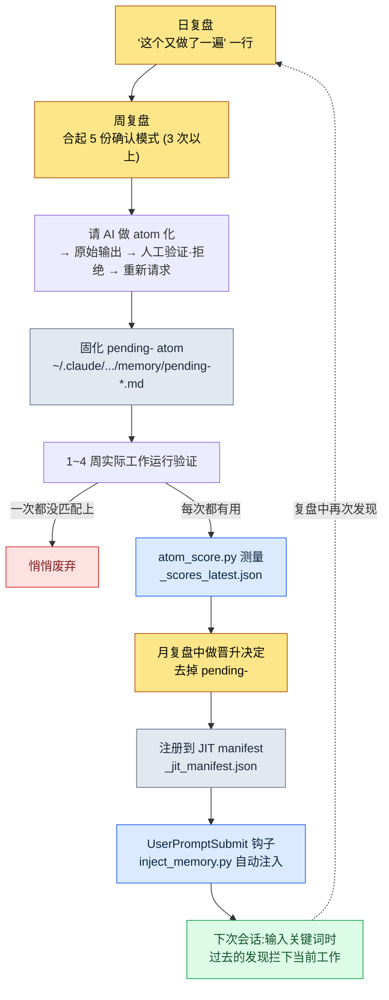

# Part 21 · 第2章. 复盘系统与 atom 晋升 —— 让发现成为永久资产

周一早晨,我把上周的五份日复盘一并显示在同一屏幕上,正准备开始新的一周。周二的复盘里写着"数据表 export 之前忘了做一致性检查"。周四的复盘里也有几乎一模一样的一句。而就在那个周一上午,我又在做同一件事。我把 FK 已损坏的表原样提交到客户端/服务器构建里,然后又撤了回来。这已经是第三次了。

这一刻正是复盘系统的核心。你正在第三次做同一件事——这个事实,在你做那件事的当下绝对看不出来。因为手在熟练地动作,脑子里则低声说着"这本来就是我一直在做的事"。重复只有把痕迹攒起来、事后回看时才显现。复盘是收集这些痕迹的装置,而 atom 晋升则是把在其中发现的重复固化下来、让你再也不必用手去做的装置。

本章将完整追踪这两个装置如何相互咬合运转,以及一份真实的日复盘文件如何变成 JIT manifest 中的一行 atom。

---

## 21.2.1 发现只诞生于痕迹堆中

首先有一个必须点明的前提:重复无法被实时察觉。

游戏策划的一天是决策的连续。某个数据表列该用哪种 enum、技能冷却时间该以秒为单位还是以帧为单位、会议上得出的含糊共识该记在文档的哪个位置。这些决策每一个都太小,留不下记忆。可是如果同一个决策一周要做三次,那它就不再是决策,而是规则了。既然是规则却每次都重新做一遍,那就是浪费。

问题在于,这种浪费看不见。所以要留下痕迹。每天 5 分钟,把今天做过的事、今天重复了两次以上的事,各写下一行。一周过去,五份痕迹积累起来,到那时才会看见"咦,这个写了三次啊"。

这正是复盘与单纯日记的分界点。日记记录感想,复盘则为提取模式而记录痕迹。因此复盘的格式必须固定。格式每次都不一样,就无法把五份并排比较;无法比较,就看不出模式。

---

## 21.2.2 三个周期不是以时间划分,而是以角色划分

把复盘分成日、周、月三个周期,原因不在于时间的流逝,而在于每个周期所做的事在根本上不同。

<svg viewBox="0 0 720 300" xmlns="http://www.w3.org/2000/svg" font-family="sans-serif">
  <rect x="0" y="0" width="720" height="300" fill="#fbfbfd"/>
  <!-- Daily -->
  <rect x="30" y="40" width="190" height="220" rx="10" fill="#eaf2fb" stroke="#3b6fb0" stroke-width="1.5"/>
  <text x="125" y="70" text-anchor="middle" font-size="17" font-weight="bold" fill="#1f3d63">日复盘 · 5~10 分钟</text>
  <text x="125" y="100" text-anchor="middle" font-size="13" fill="#33475b">角色:固化痕迹</text>
  <line x1="50" y1="115" x2="200" y2="115" stroke="#c2d4e8" stroke-width="1"/>
  <text x="125" y="142" text-anchor="middle" font-size="12" fill="#4a5b6b">今天做的事</text>
  <text x="125" y="166" text-anchor="middle" font-size="12" fill="#4a5b6b">做了两次的决策</text>
  <text x="125" y="190" text-anchor="middle" font-size="12" fill="#4a5b6b">没用到的工具</text>
  <text x="125" y="214" text-anchor="middle" font-size="12" fill="#4a5b6b">交接给下一次会话</text>
  <text x="125" y="244" text-anchor="middle" font-size="11" font-style="italic" fill="#7a8a99">产出:5 份/周</text>
  <!-- arrow 1 -->
  <polygon points="225,150 255,135 255,165" fill="#9bb3cc"/>
  <!-- Weekly -->
  <rect x="265" y="40" width="190" height="220" rx="10" fill="#eef6ee" stroke="#3f8a4f" stroke-width="1.5"/>
  <text x="360" y="70" text-anchor="middle" font-size="17" font-weight="bold" fill="#1f4a2a">周复盘 · 30~60 分钟</text>
  <text x="360" y="100" text-anchor="middle" font-size="13" fill="#33475b">角色:提取模式</text>
  <line x1="285" y1="115" x2="435" y2="115" stroke="#c8e0c8" stroke-width="1"/>
  <text x="360" y="142" text-anchor="middle" font-size="12" fill="#4a5b6b">把 5 份日复盘合起来看</text>
  <text x="360" y="166" text-anchor="middle" font-size="12" fill="#4a5b6b">3 次以上重复 → 候选</text>
  <text x="360" y="190" text-anchor="middle" font-size="12" fill="#4a5b6b">固化 pending- atom</text>
  <text x="360" y="244" text-anchor="middle" font-size="11" font-style="italic" fill="#7a8a99">产出:1~3 个候选</text>
  <!-- arrow 2 -->
  <polygon points="460,150 490,135 490,165" fill="#9bb3cc"/>
  <!-- Monthly -->
  <rect x="500" y="40" width="190" height="220" rx="10" fill="#fbf2ea" stroke="#b07b3b" stroke-width="1.5"/>
  <text x="595" y="70" text-anchor="middle" font-size="17" font-weight="bold" fill="#634021">月复盘 · 1.5~2h</text>
  <text x="595" y="100" text-anchor="middle" font-size="13" fill="#33475b">角色:经济性·晋升</text>
  <line x1="520" y1="115" x2="670" y2="115" stroke="#e8d4c2" stroke-width="1"/>
  <text x="595" y="142" text-anchor="middle" font-size="12" fill="#4a5b6b">工具经济性评估</text>
  <text x="595" y="166" text-anchor="middle" font-size="12" fill="#4a5b6b">晋升 / 废弃决定</text>
  <text x="595" y="190" text-anchor="middle" font-size="12" fill="#4a5b6b">季度规划</text>
  <text x="595" y="244" text-anchor="middle" font-size="11" font-style="italic" fill="#7a8a99">产出:正式 atom</text>
</svg>

日复盘固化痕迹。不做判断,只是记录。周复盘把五份痕迹合起来观察模式。在这里,"这是重复"这样的判断第一次介入。月复盘则纵观积累下来的全部工具,评估其经济性,决定留下什么、舍弃什么。

缺了任何一个周期,其余的都会崩塌。没有日复盘只做周复盘,一周前的事已记不清,痕迹就空了。没有周复盘只做月复盘,就要一次性面对一整月的日复盘,而把 22 份放在一处比较几乎是不可能的。模式看不出来,只会徒增疲惫。

用工作间来比喻很贴切。日复盘是每天傍晚整理桌面的 5 分钟。周复盘是周末重新归置一格抽屉的 30 分钟。月复盘是每个季度审视整个工作间动线的两个小时。每天不收拾桌面,周末就没法归置抽屉;抽屉一团乱,再看动线也理不出头绪。

---

## 21.2.3 日复盘 —— 5 分钟内完成的固化

我实际使用的日复盘文件,会按日期堆放在 `retro/daily/2026-05-30.md` 这样的路径下。模板由 `/retro` 斜杠命令自动铺好。

```markdown
# 日复盘 2026-05-30

## 今天做的事 (3~5 行)
- 在新技能数据表中新增 12 种 enum + 重排冷却时间列
- 数值模拟第 1 轮 (调整掉落表权重)
- 数据 export 构建同时更新客户端/服务器

## 重复发现 (若有)
- export 构建前又忘了做一致性检查 → FK 损坏状态下构建 → 第 3 次
- 数值模拟未固定种子就运行,无法复现 (第二次)

## 废弃候选
- 今天一次都没用到的工具:(仅记录用于月度累计测量)

## 交接给下一次会话
- 先补上两处损坏的 FK (技能→特效引用),再重新构建
- 候选:考虑把模拟种子固定选项设为默认值
```

5 分钟就能填完。因为格式固定,不必每次重新纠结"该写什么"。栏目是定好的,只要把栏目填满就行。

这里最关键的是"重复发现"栏。这一栏留空也无妨,大多数日子都是空的。可一旦意识到今天把同一件事做了两次,就写下一行。上面示例中的"export 构建前又忘了做一致性检查 → 第 3 次"就是如此。这一行会在几天后的周复盘里被归为一个模式,再过几周就固化成 atom 或 skill。

自动捕获能减少人工。当 git 提交日志、atom 变更历史、skill 使用日志自动汇入日复盘时,"今天做的事"栏就已经填好了一半。人只需补上 git 日志看不到的那部分——"这个又做了一遍"的自觉。

最后的"交接给下一次会话"栏,是写给明天的自己的便条。有了这一栏,开始新会话时上下文加载能在 1\~2 分钟内完成;没有它,就要费时去摸索"昨天我做到哪儿停下的"。实际上,我的 MEMORY.md 里单独维护着"下一次会话优先确认"这一条目,它正是日交接累积而成的上层版本。

---

## 21.2.4 周复盘 —— 模式第一次显露的场合

周复盘从把五份日复盘放上同一屏幕开始。文件堆放在 `retro/weekly/2026-W21.md` 这样的路径下。

```markdown
# 周复盘 2026-W22 (5/25~5/31)

## 本周工作摘要
- 更新技能/数值数据表,掉落表模拟 2 次
- 数据 export 构建 4 次 (其中 2 次在 FK·enum 损坏状态下构建)

## 模式发现
- 3 份日复盘中"export 前忘做一致性检查"重复 → atom 候选
- 2 份日复盘中"数值模拟种子未固定"重复 → 检讨模拟默认值

## atom 候选
- pending-data-check-before-export (强制在 export 构建前做一致性验证的规则)

## skill 候选
- (无 —— 本周用 atom 即可)

## 现有工具检查
- 未使用:relation-map-gen (本周 0 次)
- 使用最多:check(一致性 cascade)、excel-reader、/retro

## 下周计划
- pending-data-check-before-export 再运行 1 周后判断是否晋升
```

在这里,判断第一次介入。"3 份日复盘中 export 前检查遗漏重复"是算术上的事实,而"这值得固化为 atom"则是判断。把 3 次重复作为基准线的理由很简单:一次是偶然,两次也可能是偶然,三次就是模式。

判断一旦确立,就立即固化。不过不是作为正式 atom,而是加上 `pending-` 前缀的临时 atom。它会这样落到我的项目记忆文件夹里。

```
~/.claude/projects/<project>/memory/
  pending-data-check-before-export.md
```

`pending-` 前缀是"这个还在验证中"的标记。这个标记之所以重要,是因为若把未经验证的直觉直接变成全团队的规则,会有两样东西被破坏。一是信任——未经验证的规则老是出错,人们就会连规则本身也不再相信。二是累积——没有验证关卡(verification gate,即由人或检查器把关的验证环节,类似质量门禁 quality gate),直觉就原样堆积,记忆库最终变成垃圾桶。

所以 `pending-` 会在实际工作中运行一周、长则一个月。真的每次都有用就存活下来,一次都没用上就悄悄删除。

---

## 21.2.5 月复盘 —— 衡量工具的健康,挑出该留下的

月复盘是把一整月的累积摊开、检查全部工具健康状态的场合。文件按月堆放,如 `retro/2026-05.md`。

```markdown
# 月复盘 2026-05

## 本月累计
- 日复盘:22 篇,周复盘:4 篇
- 新 atom:4 个 (data-check-before-export、sim-seed-pinning 等)
- 新 skill:1 个 (relation-map-gen 选项增强)
- 废弃 atom:1 个

## 工具经济性评估
- 各 skill 每月使用次数 + 节省体感 (定性)
- 每月使用不足 1 次的 skill → 废弃候选
- 价值最大的工具:check(一致性 cascade)、excel-reader、/retro

## atom 分布
- 按 prefix 累计 (data: X, sim: Y, meeting: Z ...)
- 废弃候选:一个月匹配 0 次的 atom

## 季度计划
- 下月引入:impact(影响度追踪)、schema-doc 自动更新

## 书稿素材 (若有)
- 本月案例中值得在书中引用的:atom 晋升实操 1 例
```

月复盘的核心是经济性评估。工具在做出来时看着都有价值,可一个月过去,一半都不会再去碰。要用五把尺子把它们筛出来。

评估标准有五个:使用频率、时间节省、认知负担、维护成本、可替代性。使用频率若每月 1 次以上就先留下,不足则转入废弃候选。时间节省是把每次节省的体感乘以频率——这里不去断言以分钟为单位的数字。"一次感觉省几分钟,一个月用十次,累计起来就很可观"这种程度的定性判断才诚实。认知负担方面,若要记的斜杠命令超过十二个,就视为该整理的信号。人脑能同时扛着的命令数是有上限的。维护成本要看这个工具是否在数据表变动时得跟着一起改。可替代性要看是否新出现了更简单的方法。

把五把尺子合起来,决定留下、舍弃还是修改。一个小时就能把三十到五十个工具过一遍。不过开始头一两个月工具还少,评估用不了一小时。那个阶段,与其评估,不如把更多时间花在催生新工具上。经济性评估是要等工具积累起来之后才真正发挥作用的安全装置。

---

## 21.2.6 实操记录(worked transcript):日复盘一行到 JIT manifest 一行 atom 的全过程

从这里开始是本章的脊柱。所谓实操记录,就是完整保留的真实操作过程记录;下面从复盘时点起,一路追踪前面散落的碎片如何真正从一行开始,直到在所有会话中自动注入。途中我拒绝的瞬间、AI 含糊作答的瞬间,都原样保留。

**第 1 步 —— 在日复盘中自觉。** 写 5 月 30 日的日复盘时,我在"重复发现"栏写下了一行。

```
- export 构建前又忘了做一致性检查 → FK 损坏状态下构建 → 第 3 次
```

这时并没有做任何工具。只是留下了痕迹。

**第 2 步 —— 在周复盘中确认模式,并请 AI 将其 atom 化。** 几天后的周复盘里摊开五份日复盘,发现同一行出现在三处。于是我抛给 Claude 的提示词全文如下。

> 本周 3 份日复盘中反复出现"数据 export 构建前用手工做一致性检查时忘了做"。我想把它做成 pending atom。请写一份 atom 正文草稿。格式和我们记忆库里其他 atom 一样,用 frontmatter(name、status、trigger)加一段规则。

Claude 的原始输出如下(未经删减,原样呈现)。

> ```markdown
> ---
> name: data-check-before-export
> status: pending
> trigger: ["数据", "export", "构建前", "一致性"]
> ---
> 在把游戏数据表 export 构建到客户端/服务器之前,始终先运行一致性检查
> (check cascade),确认 FK·enum·引用违规 0 处之后才 export。若发现违规,
> 则中止 export,并把失败明细通过 ClickUp 通知发送给负责人。
> ```
>
> 把这个 atom 保存为 `pending-data-check-before-export.md` 即可。不过 trigger 关键词中"数据"太宽泛,可能会匹配到与 export 无关的场景(数据表阅览、数据会议等)。建议去掉。

**第 3 步 —— 人工验证与部分拒绝。** AI 自己怀疑其中一个 trigger,这个指摘是对的。但我又往前走了一步。规则正文里把"一致性验证"和"失败时 ClickUp 通知"两件事捆在一起,这一点我不满意。失败通知已经由 `integrity_check_clickup_notify` 这个独立 atom 负责。把两项职责捆在一个 atom 里,日后只想改通知规则时,就会连验证规则一起动到。于是我拒绝并重新提出请求。

> 好,把"数据"trigger 去掉。另外失败时的 ClickUp 通知已经由 integrity_check_clickup_notify 负责,所以从这个 atom 里去掉。把这个 atom 收窄成只负责 export 前的一致性验证。

重新请求后,Claude 收窄的正文如下。

> ```markdown
> ---
> name: data-check-before-export
> status: pending
> trigger: ["数据构建", "export", "构建前验证"]
> ---
> 在把游戏数据表 export 构建到客户端/服务器之前,先运行一致性检查
> (check cascade)。检查对象:FK 引用完整性、enum 值有效性、
> 表间引用一致性。确认 0 处违规之后才 export。失败时的通知
> 由 integrity_check_clickup_notify 负责,本规则不予介入。
> ```

这就是我采纳的版本。只承担一项职责,trigger 也收窄到只在 export 语境下。我把这个文件保存为 `pending-data-check-before-export.md`。这里的关键在于,我没有原样采用 AI 的第一版输出。AI 帮忙搭好了格式、怀疑了一个 trigger,但"把职责收窄为一项"这一设计判断是由人做出的。

**第 4 步 —— 1 周运行验证。** 接下来的一周里,每次做数据 export 构建时都会想起这个 pending atom,实际上有两次在构建前一刻抓到了 enum 损坏。没有一次落空。它有了存活下来的资格。

**第 5 步 —— 在月复盘中做晋升决定并测量 score。** 月复盘里我把这个 pending atom 列入晋升候选。是否晋升不靠直觉,而靠测量来判断。我的环境里有一个把 atom 的匹配频率和有用性打分的脚本。

```bash
python ~/.claude/scripts/atom_score.py
# → 更新 ~/.claude/projects/<project>/memory/_scores_latest.json
```

这个脚本会统计每个 atom 在过去一段时间里被 trigger 匹配了多少次、当时是否真的被引用到工作中,并把结果落到 `_scores_latest.json`。分数超过一定基准的 atom,会被接上自动注入到 CLAUDE.md 的通路。`pending-data-check-before-export` 按 2026 年 5 月的实测,一周内每次 export 构建都被匹配,分数足够。晋升确定。

**第 6 步 —— 去掉 `pending-`,注册到 JIT manifest。** 摘掉前缀、换成正式 atom 后,我在 JIT manifest 里加了一行。

```
~/.claude/projects/<project>/memory/_jit_manifest.json
```

这个 manifest 由 UserPromptSubmit 钩子(`~/.claude/hooks/inject_memory.py`)在每次输入时读取。输入中若含有"数据构建"或"export",这个 atom 的正文就会自动插入上下文。

**第 7 步 —— 闭环。** 之后想做构建,输入"帮我跑一下数据 export 构建"的那一刻,我什么都没吩咐,Claude 却先开口了。

> 要不要先在 export 前跑一遍一致性检查(check cascade)?我会检查 FK 引用、enum 值、表间引用的一致性,确认 0 处违规之后再 export。

三周前写在日复盘里的"这个又做了一遍"那一行,如今变成了会自动拦下当前工作的规则回到了我面前。曾经用手做的验证,再也不必用手去做。所谓闭环,说的正是这一幕。

---

## 21.2.7 从发现到自动注入:晋升循环的全貌

把上面的实操记录压缩成一张流程图,就是下面这样。发现发生在日复盘,验证由运行期完成,晋升由测量决定,而资产化则由 manifest 收尾。



最后那条虚线就是这张图的全部。被自动注入的 atom 又暴露出新的重复,那重复再次进入复盘,催生下一个 atom。每转一圈,要用手做的事就少一件。这个循环累积上半年到一年,复盘就不再是日记,而成了工作系统的大脑。

---

## 21.2.8 让复盘自然而然地召唤出 atom

晋升循环里最脆弱的一环是第 1 步——写下"这个又做了一遍"的那一刻。忙的时候,人会把复盘栏留空就跳过。这样就不留痕迹,没有痕迹周复盘里就看不出模式,没有模式就诞生不了 atom。循环的入口被堵住了。

所以我的环境里有一个叫 `retro_atom_natural_invitation` 的 atom。它的规则是:写复盘时,不要把 atom 的催生当成强制义务,而要留作一种自然的邀请。也就是说,不是"今天必须挑出一个 atom 候选",而是把复盘模板里的"重复发现"栏当作可以留空的栏,只在那里确有值得写的一行时,才轻轻记下。做成义务,就会硬挤出假模式;留作邀请,就只有真正的重复才会自然被捕获。

这一线之差,决定了循环能否持续。义务化的复盘撑不过两周,就会被形式化的谎言填满。邀请式的复盘在没什么可写的日子里就留空,没有负担,因而能长久。长久才能积累痕迹,痕迹积累起来才看得见模式。

这个 atom 本身也诞生于复盘。把复盘当义务来运行,没几天就在日复盘里发现栏目被假内容填满,这个发现经过周复盘,晋升成了这条规则。改进复盘的规则,正是从复盘里长出来的。

---

## 21.2.9 常见的崩坏之处

把循环运转起来后会发现,它总在同样的地方崩塌。

跳过复盘最常见。以忙为由跳过三天,这三天的痕迹就永远消失了。防止的办法很简单——别的栏都留空也行,唯独"今天做的事"这一行一定要写。哪怕不是 5 分钟而是 1 分钟,痕迹也能留下。

每次都重新设计格式也很危险。用自由格式记录,就没法把五份并排比较。无法比较,提取模式这件周复盘的本职工作本身就变得不可能。所以 `/retro` 会强制铺好模板。

只增不弃也是陷阱。只顾增加 atom 和 skill 而不舍弃,认知负担就会累积。斜杠命令一旦超过十二个,脑子就记不全所有工具了。月复盘的经济性评估是阻止这种累积的唯一装置。

跳过晋升关卡也很危险。把直觉直接做成正式 atom,未经验证的规则就会堆积。经过 `pending-`、靠测量来晋升的关卡,必须存在于发现与资产化之间。

最后,以为单人工作没有团队共享就不必做复盘,这是一种误解。上面整个实操记录都是在单人环境里跑出来的案例。只是少了团队共享合并这一步,发现→pending→测量→晋升→JIT 注入的循环,一个人也照样转。反倒是在单人环境里,这个循环扮演着唯一的外部评审者角色。

---

> **游戏之外的应用。** 让日复盘的一行经过验证、成为永久规则的晋升循环,是一套与职业无关、能让人"把学到一次的教训再也不必用手去做"的流程。不把发现直接固定为团队规则,而是先以 `pending` 运行一周、只在实际每次都有用时才正式化——这道关卡是核心,因为把未经验证的直觉直接做成规则,人们就会连规则本身也不再相信。举例来说,运营团队可以把"提交报告前再核对一次数字合计是否正确"作为暂定检查清单,运行一周,当实际抓到两三次错误后再升为正式的标准流程;而"只承担一项职责"这一收窄的设计判断(不要把多项检查捆在一行里)也会自然而然随之而来。

## 动手试试

**setup.** 铺好复盘文件夹和模板。

```bash
mkdir -p ~/.claude/projects/<your-project>/memory/retro/daily
mkdir -p ~/.claude/projects/<your-project>/memory/retro/weekly
# 把一个日复盘模板文件保存为 retro/_template_daily.md
```

**prompt.** 累积一周的日复盘后,在周复盘的场合这样抛给 Claude。

> 我把本周 5 份日复盘贴给你。请找出重复 3 次以上的工作或决策,整理成 atom 候选。每个候选用 frontmatter(name、status: pending、trigger 关键词数组)加一段规则。trigger 太宽泛就收窄了再提议,一个 atom 承担两项职责就拆开来提议。

**verify.** 不要原样使用拿到的候选,而要验证三点。(1) 一个 atom 是否只承担一项职责——两项职责就拒绝并要求拆分。(2) trigger 关键词是否只匹配那一工作语境——太宽就拒绝。(3) 是否真的重复了 3 次,还是偶然的 2 次——若是偶然,连 pending 都不做。只有通过这三项验证的,才加上 `pending-` 保存,运行一周后每次都有用时才正式晋升。

---

## 21.2.10 单人精简版

如果既没有团队,也还没有 JIT 钩子和 score 脚本,那么用下面这一张文件就能模仿整个循环。

创建 `retro.md` 一个文件,只放三个栏。

```markdown
## 今天 (1 行)
- 

## 又做了一遍 (若有,1 行)
- 

## 固化候选 (「又做了一遍」攒够 3 次就移到这里)
- [ ] (规则一句话) —— 验证:有用 ___ 次
```

每天只填上面两栏。"又做了一遍"里同一行攒到三次,就移到第三栏,写成一句话的规则。数一数这条规则在接下来一周里实际有用的次数填进栏里,达到三次以上,就把这句话正式移入项目记忆(CLAUDE.md)。即便没有 JIT 钩子,写进 CLAUDE.md 的规则在下次会话里也总会跟着来,单凭这一点,"过去的发现帮助当前工作"这一循环的最小形态就完成了。

关键不在于工具是否华丽,而在于关卡是否存在。只要有"又做了一遍 3 次 → 固化 → 有用 3 次 → 永久化"这道关卡,哪怕只有一张文件,self-improving 循环也能转起来。

---

### 本章要点
- 重复在工作中看不见,只有把痕迹攒起来事后回看时才显现
- 没有 pending 关卡和测量,复盘就只停留在催生想法这一步,成不了资产
- 当日复盘的一行闭合为 JIT manifest 的一行,过去就在帮助现在

### 下一章预告
- 第 3 章. 闭合 self-improving 循环 —— 复盘·atom·JIT 合为一个系统的时刻
