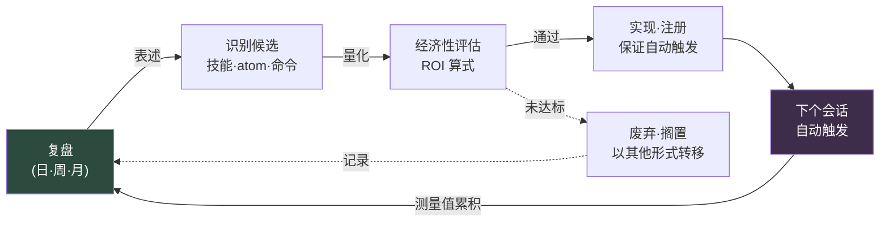

# Part 21 · 第3章. 闭合 self-improving 循环

> 从复盘开始的循环,是否又回到了复盘。若不闭合,它便只是笔记,而非系统。

---

翻开六个月前的复盘。"术语统一不了""文档难以查找""同样的问题又被问到。"翻开今天早上写的复盘。"术语统一不了""文档难以查找""同样的问题又被问到。"

连字句都一样。并不是没做复盘。这六个月一直认真地做。Notion 页面一页页地堆积,季度工作坊上便利贴铺满了白板。可写下的内容却在原地打转。不是复盘没有起作用,而是循环没有闭合。

本章是全书的最后一章。因此它探讨的也是最后一个问题。前面做出的所有工具 —— Part 6 的城市生成器、Part 14 的移动端评审 atom、Part 22 的成本标准 —— 要让它们不是做一次就结束的一次性产物,而是成为自我成长的系统,还需要什么。答案只有一个。复盘中产生的表述从下个会话起自动运作,而这一运作再度被测量并回到复盘的闭合环路。闭合这个环路的机制,就是 self-improving 循环。

---

## 21.3.1 未闭合循环的真面目

复盘中产生一句表述:"会议太多了。"这是好的表述。可这句表述只作为 Notion 页面上的一行留了下来。到了下周,会议依旧很多,下一次复盘里又写下同样的一行。因为在表述与改进之间夹着人的记忆。人会遗忘。所以链条断了。

要能称之为 self-improving,复盘的表述就必须不经过人的记忆,而直接连向下个会话的自动行为。满足这一点的条件有四个。

第一,复盘表述必须转化为可立即执行的形态。不是抽象的决心,而是落成技能·atom·manifest 条目·斜杠命令之一。第二,从下个会话起,即使人不记得也要自动触发。第三,在下一次复盘中,要实测它究竟改变了什么。第四,这一测量结果要再度作为下一轮改进的输入而循环。

当这四点全部自动衔接时,循环才闭合。哪怕只有一个环节用"下周我记得再应用吧"来填补,循环就会当场重新打开。然后在下一次复盘里,同样的表述又被写下。

用抽屉来比喻是这样。如果复盘止于"这支笔不用了,拿出来吧"的一句笔记,那么下周那支笔还在原处。不是笔记,而是动手拿出来,才算闭合。而且要到下个季度再检查一次,那个位置才不会又堆起不用的笔。笔记是表述,动手是自动触发,下季度的检查是测量。三者缺一,抽屉就又乱了。

---

## 21.3.2 循环的闭合形态

把整个流程画出来,就成了一个闭合的循环。起点与终点都是复盘。



箭头绕行一圈,又回到复盘。这个闭合正是核心。每个环节的产出物成为下个环节的输入,而最后的测量值又成为最初复盘的输入。若中间夹进人的记忆,那支箭头就会断裂,循环随之破裂。

请注意,ROI 未达标的候选被划入废弃·搁置的那条虚线箭头,最终也会回到复盘。"这个不值得做"的判断本身成为下一次复盘的记录,当同一候选再次被提出时,便成为快速筛除的依据。舍弃也在循环之内。

从复盘通向 self-improving 的表述,有固定的五种模式(在 §21.1.4 中讲过)。待创建技能、待改进技能、待创建 atom、待改进 atom、经济性再评估。只要把这五项作为槽位放进复盘模板本身,表述就不会遗漏。

```markdown
## 复盘(日)—— 2026-06-06

### 1. 今日工作
- (工作摘要)

### 2. self-improving 表述(5 个槽位)
- 待创建技能:<留空则填"无">
- 待改进技能:<>
- 待创建 atom:<>
- 待改进 atom:<>
- 经济性再评估:<>

### 3. 下次复盘要测量的项
- <>
```

槽位空着也没关系。空着这一事实本身,就是"今天没有新的改进"的记录。不过若连续几天五个槽位全空,那不是没有可改进之处,而是复盘正在僵化为形式的信号。这种时候就抛出触发提问:"本周同一件事手动做了两次的是什么。"

表述以模糊的状态冒出来。"会议记录太长了。"要把它培养成候选,就用一个产出物来量化。"会议记录太长了"换算为 `meeting_summary` 技能,即一个接收会议记录、只提取决策与行动项的工具。"术语容易混淆"换算为收纳 30 个领域词汇的 `glossary_lookup` atom;"同样的问题每次都被问到"换算为将新人第一天引导自动化的 `/onboarding` 斜杠命令。"同步遗漏频繁"则落成 manifest 更新与新增 JIT atom。

候选必须被定义为"某一个产出物",才能进入下一环节。"整体改进一下"不是候选。无法换算为一个产出物的表述,没法摆上 ROI 评估台,摆不上去就停在那里。

---

## 21.3.3 ROI 是数量级的问题

有了候选,并不都去做。制作之前先衡量投入与产出之比。算式很简单。

<svg viewBox="0 0 720 150" xmlns="http://www.w3.org/2000/svg" font-family="sans-serif">
  <rect x="0" y="0" width="720" height="150" fill="#1e1e28"/>
  <text x="360" y="38" fill="#9fe0b0" font-size="17" text-anchor="middle" font-weight="bold">ROI 算式</text>
  <line x1="180" y1="85" x2="540" y2="85" stroke="#666" stroke-width="2"/>
  <text x="360" y="72" fill="#e6e6e6" font-size="16" text-anchor="middle">节省时间 × 触发频率 × 运营周期</text>
  <text x="360" y="115" fill="#e6e6e6" font-size="16" text-anchor="middle">制作时间 + 维护负担</text>
  <text x="150" y="92" fill="#c89bf0" font-size="22" text-anchor="middle">ROI =</text>
</svg>

每个项目都有单位与通过线。节省时间是每次触发所减少的人力时间,以分钟为单位来估。触发频率是每周的估计次数,每周 1 次以上才划算。运营周期是到废弃为止的预计周数,撑不过 4 周的工具就没什么理由去做。制作时间是首次实现与验证所花的时间,维护是每月检查·修改所花的时间。

分子是累计节省,分母是累计成本。用算出的值来决策。

| ROI 值 | 决策 |
|---|---|
| 10 以上 | 立即制作 |
| 3\~10 | 一周内制作 |
| 1\~3 | pending 搁置,一个月后再评估 |
| 1 以下 | 以此形式废弃。考虑其他方式 |

ROI 低于 1,意思不是"这个想法没用",而是"不该以这种形态去做"。先检查能否用更轻的一行 atom 来替代,能否用只改变现有工具入口的 Wrapper 来解决。把本要做成笨重技能的事情降为一行 atom,分母缩到十分之一、ROI 因此起死回生的情况很常见。

代入一个真实数字试试。就来算算 2026 年 5 月 23 日在个人 PC 上搭建的 JIT atom 注入系统 —— 由 UserPromptSubmit 钩子读取用户输入、自动注入相关记忆片段(atom)的基础设施 —— 的 ROI。

```
节省时间:  每个会话约 3~5 分钟(省去手动查找并调用相关 atom 的时间)
触发频率:  每周 15~25 个会话(以个人 PC 为准)
运营周期:  预计 1 年以上(属于基础设施性质,废弃可能性低)
制作时间:  4 小时(hook + manifest + atom 验证)
维护:      每月 0.5 小时(atom 增补·修改)

ROI = (4分 × 20次/周 × 52周) / (4小时 × 60分 + 0.5小时 × 12个月 × 60分)
    = 4,160分 / (240分 + 360分)
    = 4,160分 / 600分
    ≈ 6.9  →  "立即制作"区间。决策由算式支撑
```

这里有必须坦诚的地方。上面这些数字 —— 每个会话 3\~5 分钟、每周 15\~25 个会话 —— 不是精密计量,而是基于作者运营经验的估计。不是用秒表测出的值。所以 ROI 6.9 也不是精确到小数点的可信值。

但这没关系。因为 ROI 算式是看数量级、而非看精度的工具。结果在 7 上下就做。在 0.3 上下就再想想。要划开这两者,并不需要小数点。重要的是,即便决定不做,其依据也要出自算式,而非脑中的直觉。数量级不够所以不做 —— 只要这一行留在复盘里,当同一候选再次被提出时,就不必再纠结。

---

## 21.3.4 做出来不等于结束 —— 注册与触发验证

候选通过了就做。可做出来只是一半。另一半是把它注册好,让它从下个会话起自动触发。若漏了这一注册,工具虽已做成,却留在无人触及的角落,循环就在那里断裂。

不同种类的产出物,注册的地方不同。全局技能放进 `~/.claude/skills/`,并一并做一个载有用法的指南 atom。项目技能放在该项目的 `.claude/skills/`。新增 atom 放进合适的文件夹,在 MEMORY.md 索引里加上一行,并在 JIT manifest 中注册触发词 —— 这三件都做齐,自动注入才成立。斜杠命令放进 `~/.claude/commands/`;Wrapper 则改变现有工具的入口,并附上指南 atom。

漏了注册,下一次复盘里又会冒出"这个明明做了,怎么没在用"的表述。那不是新的改进表述,而是一份缺陷报告。等于在复盘中重新发现了自己遗漏的注册。

即便注册完毕,还剩一步。那就是开一个新会话,用预期的触发词确认它是否真的触发。

```
1. 启动新会话
2. 输入触发词(例:"家人健康怎么样")
3. 检查 JIT 日志 → 预期的 atom 是否真的被注入
   (~/.claude/hooks/_injection_log.txt)
4. 若未触发 → 扩展 manifest 中的触发 regex
   或增加手动调用路径
```

缺了这一验证,"以为有,可真正需要时却没触发"的事故就会反复发生。注册与触发是两回事。注册是把文件放好,触发是触发词实际被命中。触发 regex 差一个字,注册了也永远不会触发。

---

## 21.3.5 测量 —— 回到复盘的箭头

把做好的工具运行一周到一个月左右,再测量。这一测量正是循环的最后一支箭头,也就是重新进入复盘的那支箭头。

实际触发次数从 JIT 日志或命令调用日志里数。实际节省时间以"以前要花 N 分钟的工作,这次 M 分钟就完成了"的方式记入复盘。副作用 —— 错误触发、不必要的上下文污染 —— 也一并查看。然后把最初估计的 ROI 与实测 ROI 并排放在一起。

若估计 ROI 是 6,而实测 ROI 是 0.8,就毫不留情地废弃。因为比起制作者的自尊,系统的整洁更优先。不用的工具堆积在 manifest 里,那份噪声会啃食下一次复盘的准确度。

不过在按下废弃键之前,先检查一次。可能是触发 regex 太窄,以至于根本没触发;也可能是没有手动调用路径,就这么被遗忘了。先分清:究竟是真的没有价值的工具,还是触发路径被堵住的好工具。前者就丢弃,后者就打通路径。

废弃同样在复盘中决定。"废弃这个工具"的决定本身就是 self-improving 的产出物。只做不清的循环是单调递增的循环,而单调递增的系统最终会被自身的重量压垮。

---

## 21.3.6 闭环的标志

循环是否闭合,可以从四个信号来判断。

第一,同样的表述不再重复。复盘中写过一次的条目若被写第二次,就意味着第一轮里,候选识别或实现的某处失败了。本章开头那句"术语统一不了"连续六个月反复出现 —— 那正是循环敞开的最鲜明的证据。

第二,manifest 与 atom 的数量不再只是单调递增。废弃会发生。每个季度整理掉 10\~20% 左右,才是健康的循环。从未减少过的系统,就像从未打扫过的抽屉。

第三,复盘时间缩短。系统运转良好时,苦想"昨天做了什么"的时间就消失了,填满五个表述槽位 5 分钟就够。

第四,新人能在一周之内参与复盘。只要复盘格式已标准化、atom·技能可视化,就能做到。

循环断裂的位置每次都是固定的。把失败模式收集起来,下次看到同样的症状时,就能立刻拿出处方。

| 断裂点 | 症状 | 处方 |
|---|---|---|
| 没有表述 | 5 个槽位每次都空 | 增加触发提问:"同一件事本周手动做了两次的是什么" |
| 落不成候选 | "整体改进"式的含糊 | 强制量化为一个产出物 |
| 跳过 ROI 评估 | 先做了再说 | 将 ROI 算式做成 5 分钟模板 |
| 做了却不触发 | 遗漏注册 | 强制执行注册检查清单 |
| 触发了却不用 | 触发词缺失·配置错误 | 扩展 regex + 同时提供手动路径 |
| 不做测量 | 复盘中没有测量槽位 | 增加"下次复盘要测量的项"槽位 |

每一种失败模式都在复盘中被表述,而这一表述又成为 self-improving 的输入。就连修复循环这件事,也发生在循环之内。这是元循环。

---

## 21.3.7 本书的最后一句

这本书很长。从信息架构开始,做出生成城市的工具,设计战斗系统,自动化移动端评审,标准化成本,又从复盘中打捞出 atom。所有这些章节的工具汇聚一处所回答的问题,就是这最后一章:做出来的东西,是否自我成长。

self-improving 最终可以浓缩为一句话。

> 在复盘中决定的事,从下个会话起自动运作,而这一运作再度被测量并回到复盘。

若不自动运作,复盘就是日记。写得好的日记能带来慰藉,却改变不了系统。若自动运作,复盘就成为系统的大脑。每天的表述改变每天的行动,而那行动的结果又让下一次表述更准确。

本书探讨的所有领域 —— 信息设计、系统、战斗、移动端、成本,以及作为程序化生成·自动化前提的 Layer 分解 —— 全都在这条 self-improving 循环之上进化。工具会陈旧,模型会更替,项目会结束。但只要循环闭合着,系统就比昨天的今天更好一点。这正是本书最后留下的一样东西:不是做工具的方法,而是让工具自我成长的方法。

愿你的下一次复盘,成为那循环的第一圈。

---

### 本章要点
- 循环中,只要把表述→候选→ROI→实现→自动触发→测量中的任何一格交给人的记忆,循环就会当场重新打开
- ROI 是看数量级而非看精度的工具,不去做的决定也要有出自算式的依据
- 废弃也是 self-improving 的产出物 —— 不清空的循环会被自身的重量压垮

---

> **游戏之外的应用。** 如果"术语统一不了 / 文档难以查找"连续六个月一字不差地被写进复盘,那不是没做复盘,而是循环没有闭合 —— 因为在表述与改进之间夹着人的记忆。无论哪个部门,闭环的条件都相同。表述要落成一个可立即执行的产出物(模板·检查清单·自动化规则),此后即使人不记得也能运作,而其效果要再度被测量并回传。例如"会议太长了"这一表述,可换算为"接收会议记录、只提取决定与待办事项的一个工具",在制作之前用(节省时间 × 触发频率 × 运营周期)÷(制作·维护时间)只核对数量级,来决定立即制作还是搁置。即便是决定不做,其依据也要出自算式而非直觉,这样当同一候选再次被提出时,才不必再纠结。

## 动手试试

### setup
1. 在复盘模板中放入 self-improving 5 个槽位与"下次复盘要测量的项"槽位。
2. 把 ROI 算式一行与决策区间表(10↑ 立即 / 3\~10 一周 / 1\~3 搁置 / 1↓ 废弃)固定在复盘文件顶部。
3. 事先做好注册检查清单(技能·atom·命令·Wrapper 各自的注册位置)。

### prompt
```
帮我填满今天复盘的 self-improving 5 个槽位。
把每条表述都量化为"一个产出物",并对每个候选,把 ROI 按
(节省分 × 每周触发 × 运营周) / (制作分 + 维护分)
来估算,并附上决策区间(立即/一周/搁置/废弃)。
估算数字要用一行注明依据,若非精密计量就标注"估算"。
```

### verify
1. 实现通过的候选后,开一个新会话,用预期的触发词输入。
2. 检查触发日志 —— 预期的 atom·命令是否实际触发。
3. 一周\~一个月后在复盘中把实测 ROI 与估计 ROI 比较,若低于 0.8,先分清是否路径被堵,再决定是否废弃。

### 单人精简版
没有团队也行。一个人的话就这样精简。一天结束时写一行笔记 —— "今天同一件事手动做了两次的是什么。"把这一行,在第二天换成一行自动化(atom·别名·代码片段)。一周后只看这一行有没有实际被用到。用到了就留下,没用到就删掉。一行表述 → 一行自动化 → 一行测量。循环的最小单位就是这三行。
