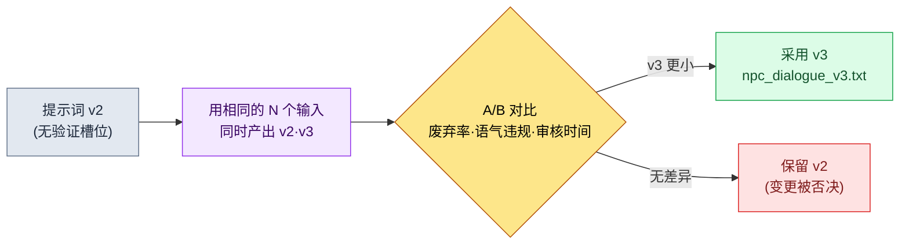

# 22.1 提示词工程 —— 游戏策划的一页作业指示书

> 第一读者:在实务中引入 LLM 的游戏策划(中等规模(10\~50 人)团队)
> 面向单人/业余读者的精简版:§22.1.7「一个人的话,只做这些就够」

为了拿到三行 NPC 台词,我曾输入过"给这个 NPC 写 5 句台词"。回来的,是那种放到任何一款奇幻游戏里都不违和、因而放到我们游戏里哪儿都不合适的五行台词。语气是空的,它不知道这个 NPC 是谁,也接不上旁边的台词。逐行来看,语法都没毛病。问题在于:接过那五行去审核,比我从头自己写还要花更长时间。

本章讲的是如何把那句一行指令,变成**一页作业指示书**。提示词的通论,其他书里已经足够多。这里要展示的,是游戏策划坐到 LLM 面前时手里应当握着的四样东西——上下文、输出格式、幻觉阻断、验证请求——不是抽象的碎片,而是一页**真实跑过的 npc_dialogue 提示词**。它往提示词里放了什么、产出了什么、拒绝了什么,我们会跟到一个完整周期的终点。

---

## 22.1.1 提示词就是作业指示书 —— 四条原则全都装进一页

好的作业指示书并不短。把活儿交给新人时,只说一句"好好干",每次拿回来的结果都不一样;同样,对 LLM 说"给我写台词",每次回来的都是一般 RPG 的平均水准。哪怕是同一个模型,指示书不同,结果也会分道扬镳——输出质量相差几倍是业界通识,而本书并不用数字去承诺那个倍数。但方向是明确的:加入了上下文与约束的提示词,其产出比赤手空拳的一行指令更省审核负担。

游戏策划的提示词需要同时满足的四点如下。

| 原则 | 一句定义 | 不遵守则 |
|---|---|---|
| ① 上下文 | 给出依据什么来作答(愿景·voice·邻接台词) | 得到一般奇幻的平均值 |
| ② 输出格式 | 钉死数量·长度·标签·禁止项 | 审核蔓延为对自由叙述的解读 |
| ③ 幻觉阻断 | 明示"给定资料之外的不要生成" | 编造不存在的设定 |
| ④ 验证请求 | 让其自行标示输出符合哪些标准 | 没有能让它通过验证关卡的依据 |

把这四条分开背,总会漏掉一两条。所以本章的做法是,把四条原则**当作槽位放进同一页提示词里**。槽位一旦空着,漏掉了哪条原则就一目了然。下一节,我们把这一页整个儿看一遍。

---

## 22.1.2 [实操记录] 一页 npc_dialogue 提示词

这一节是一份"实操记录"(worked transcript,完整保留真实操作全过程的记录):把笔者项目(移动优先的 MMORPG,以下称"项目A")中实际在用的 `prompts/narrative/npc_dialogue_v3.txt` 匿名化后原样搬来。城市与 NPC 名称、公司专有名称都为出版做了替换,输出则是真实会话的重现。输入提示词是可以直接复制就用的形态。

### 第 1 步 —— 输入上下文:先交代这个 NPC 是谁

先把提示词要参照的资料填进槽位。这三样都不是新写的,而是从既有资产里取出来的。

```yaml
# 槽位输入(附在提示词正文上方)
L0_愿景:        # 缓存 —— 不在每次调用时重新发送
  world_premise:  "魔力封印逐渐冷却的学者城邦联盟"
  tone_manifesto: "抑制感伤。人物不解释情感,而以行动·事物来呈现。"
voice_profile:    # 该 NPC 的身份(5 个项)
  id: npc_doren_vale
  年龄段: "50多岁"
  说话习惯: "只用数字说话。几乎不用形容词。"
  世界观_知识: "记录封印脉络的微弱振动 30 年。不了解学者公会外部的局势。"
  禁忌:  "禁用预言·命运·神之类的神秘主义词汇(城市语气为 scholarly_strict)"
  关系:  "将玩家视为'观测对象之外的变量',戒备与好感都很弱"
邻接_台词:        # 紧邻的上文 —— 同一场景中已出现的台词
  - (玩家) "钟塔的灯整夜亮着,出什么事了?"
```

这里,`voice_profile` 的 5 个项就是原则①的核心。年龄·说话习惯·知识范围·禁忌·关系——正是这五项,让"多伦·维尔"区别于其他 NPC。尤其**世界观_知识的范围**(不了解公会外部的局势)是原则③幻觉阻断的前置工作。只有把"不知道的东西"明示出来,AI 才不会越出那个范围。

### 第 2 步 —— 提示词正文:把格式·幻觉·验证钉死在一页里

```
[L0 上下文] world_premise + tone_manifesto                    (已缓存)
[voice_profile] npc_doren_vale 5 个项(上方 yaml)
[邻接台词] 玩家紧邻的上一句提问 1 行

请参照以上资料,写出 doren_vale 回答玩家提问的台词。

[输出格式 —— 原则②] 正好 3 条,每行一条,每条 40 字以内。行尾用(漠然|戒备|冷嘲)之一标注情感标签。去掉其他说明和引号。

[幻觉阻断 —— 原则③] 只写以上资料中有的内容,不要新编造封印·钟塔相关的事实。若需要资料中没有的内容,该行写为'[无资料:需要什么]'。禁用预言·命运·神之类的词汇。

[验证请求 —— 原则④] 在台词下方,逐行写出 voice_profile 5 个项各自的符合/违反,对没有把握的行标注 ★ 并附一行理由。
```

值得注意的是,这一页里装齐了四条原则。上方的槽位是①,`[输出格式]`块是②,`[幻觉阻断]`块是③,`[验证请求]`块是④。提示词的一半以上,不是"写什么",而是"怎么写、什么不要写、怎么自我验证"这样的约束。给了自由就出平均值,所以削减自由才是正事。

### 第 3 步 —— Claude 的输出(真实会话重现,原始输出)

```
脉在冷却。12.4。昨天是 12.1。(漠然)
算不上好事。不过我的职责只是记录。(冷嘲)
你为何发问,不在我的观测对象之内。(戒备)

[验证 —— voice_profile 5 个项]
- 年龄段(50多岁):符合。老年学者般克制的语气。
- 说话习惯(只用数字):符合。第 1 行有 2 个数值。但第 2·3 行没有数值 ★
- 世界观_知识(不了解公会外部):符合。未提及外部局势。
- 禁忌(禁止神秘主义):符合。预言·命运·神词汇 0 处。
- 关系(视为外部变量):符合。第 3 行把玩家推到了观测对象之外。

★ 注意:若将说话习惯一项严格解释为'只用数字说话',
   第 2·3 行可能算违反。是否强制每行都有数值,需人来判断。
```

这段输出里最有价值的,不是那三行台词,而是**最底下那一行 ★**。AI 把自己输出中模棱两可的地方主动上报,交给了人。好的提示词,能让 AI 说出"这一处我没有把握"——这正是加入原则④的直接效果。

### 第 4 步 —— 验证与拒绝(人的位置)

不照单全收。AI 报上来的 ★,由人来判定。实际上,这次会话里就有一行被卡住了。

第 2 行"算不上好事"里的*"好"*,与 voice_profile 的说话习惯("几乎不用形容词")相冲突。这正是 AI 用 ★ 标出来的那一处。多伦·维尔是个用数值、而非价值判断形容词来说话的人物,而"算不上好事"却滑向了常见老年 NPC 的腔调。这是一行让语气变浑浊的台词。

于是重新提出请求。

```
第 2 行"算不上好事"使用了形容词('好'),违反 voice_profile 的说话习惯。
只把这一行改用数值或观测类词汇重写。第 1·3 行保持不变。
格式·幻觉·验证规则照旧适用。
```

AI 把第 2 行重新答成了**"3年前是 9.0。这就是答案。(漠然)"**。它没用形容词,而是以数值的变化揭示危机,并再次通过了 voice_profile 的 5 个项。一次往返就闭合了。从头用手写出三行拿捏好语气的台词,与"填好槽位的一页提示词 + ★ 审核 + 一次往返"相比——后者的审核负担更小,这就是这次会话的结论(基于笔者经验;绝对耗时会随 NPC 语气难度而变,因此应当作方向来读)。

---

## 22.1.3 四层结构 —— 一页提示词如何层层堆叠

把上面那页提示词为什么按那个顺序堆叠记录成一页,从下一份提示词起,就能像填空一样把槽位补上。上下文自下而上,按由重(几乎不变)到轻(每次都变)的顺序堆叠。不变的层加以缓存,以节省成本(§22.1.5)。

<svg viewBox="0 0 560 360" xmlns="http://www.w3.org/2000/svg" role="img" aria-label="游戏策划提示词四层结构图">
  <rect x="0" y="0" width="560" height="360" fill="#0f1117"/>
  <!-- L0 -->
  <rect x="40" y="40" width="480" height="56" rx="6" fill="#1e3a5f" stroke="#3b82f6" stroke-width="1.5"/>
  <text x="56" y="64" fill="#bfdbfe" font-family="sans-serif" font-size="14" font-weight="bold">L0  愿景 · 语气 (world_premise · tone_manifesto)</text>
  <text x="56" y="84" fill="#93c5fd" font-family="sans-serif" font-size="11">几乎不变 → 缓存。原则① 上下文的基础。</text>
  <!-- L1 -->
  <rect x="40" y="106" width="480" height="56" rx="6" fill="#14532d" stroke="#22c55e" stroke-width="1.5"/>
  <text x="56" y="130" fill="#bbf7d0" font-family="sans-serif" font-size="14" font-weight="bold">L1  voice_profile · 命名规则 · 地区设定</text>
  <text x="56" y="150" fill="#86efac" font-family="sans-serif" font-size="11">区分该 NPC 的 5 个项 + 明示未知范围 → 原则③ 前置工作。</text>
  <!-- L2 -->
  <rect x="40" y="172" width="480" height="56" rx="6" fill="#854d0e" stroke="#f59e0b" stroke-width="1.5"/>
  <text x="56" y="196" fill="#fde68a" font-family="sans-serif" font-size="14" font-weight="bold">L2  邻接台词 · forbidden_names</text>
  <text x="56" y="216" fill="#fcd34d" font-family="sans-serif" font-size="11">场景紧邻的台词·禁止重复的名称 → 使其与旁边台词衔接。</text>
  <!-- L3 -->
  <rect x="40" y="238" width="480" height="82" rx="6" fill="#7f1d1d" stroke="#ef4444" stroke-width="1.5"/>
  <text x="56" y="262" fill="#fecaca" font-family="sans-serif" font-size="14" font-weight="bold">L3  作业指示(每次都变)</text>
  <text x="56" y="282" fill="#fca5a5" font-family="sans-serif" font-size="11">[输出格式]②  ·  [幻觉阻断]③  ·  [验证请求]④</text>
  <text x="56" y="302" fill="#fca5a5" font-family="sans-serif" font-size="11">"正好3条 · 40字 · (情感)标签 · 禁止资料外 · 5项自检"</text>
  <!-- 화살표 라벨 -->
  <text x="280" y="350" fill="#9ca3af" font-family="sans-serif" font-size="11" text-anchor="middle">从下(重·缓存) → 到上(轻·每次替换)层层堆叠</text>
</svg>

§22.1.2 的那一页,就跟这张图一模一样。L0·L1 从资料里取出、贴进槽位(原则①·③的基础),L3 里放入格式·幻觉·验证三个块(原则②·③·④)。下一次生成 NPC 台词时,变的只有 L1 的 voice_profile 和 L2 的邻接台词。L0 与 L3 的骨架可以复用——于是提示词就成了一座"库"。

---

## 22.1.4 把提示词当资产 —— 库与版本管理

上面的 npc_dialogue 提示词,不是用一次就扔的。按领域、按任务分门别类放进文件,每次不再重写,而是调用。项目A的提示词文件夹长这样。

```
prompts/
├── narrative/
│   ├── npc_dialogue_v3.txt        # ← §22.1.2 就是这个文件
│   ├── quest_synopsis_v2.txt
│   └── consistency_check_v1.txt
├── balance/
│   ├── change_proposal_v2.txt
│   └── outlier_analysis_v1.txt
├── content/
│   ├── city_npc_batch_v2.txt
│   └── side_quest_v3.txt
└── meta/
    ├── meeting_summary_v2.txt
    └── decision_card_v1.txt
```

文件名末尾的 `_v3` 是关键。提示词做一次并非就完事,而是**接近"决策"的资产**,所以每次改动都要测量结果的变化,再提升版本号。npc_dialogue 走到 v3 的路径正是如此。



从 v2 升到 v3 的实际改动,就是 §22.1.2 里的 `[验证请求]` 块。v2 里没有让 AI 逐项自我验证自己的输出、并打上 ★ 的槽位。加进这一个块后,就像 §22.1.2 第 4 步那样,AI 开始率先上报模棱两可的行,人从头到尾全读一遍去挑错的负担因而减轻。不做测量、只凭"感觉上变好了"是不升版本的。用同一组输入把 v2·v3 的输出并排放好,确认语气违规的件数和审核时间确实减少之后,才予以采用。

库带来的最大效果,体现在新成员身上。入职第一天调用 npc_dialogue_v3.txt,就能一上手用上资深成员往返几十次打磨出的四层槽位结构。在把"如何写好提示词"练成本能之前,他手里已经握着写得很好的一页。

---

## 22.1.5 诚实对待成本的方法 —— 缓存与 cap

提示词一长,token 成本就跟着来。本章不会写"靠标准化省下了 ×2 成本"这类未经验证的倍数,而只谈实际可测量的东西。

控制成本的结构性装置有两个。第一,**§22.1.3 里把 L0·L1 放在下层的理由就是缓存**。把几乎不变的愿景·语气层缓存起来,每次调用就不必重新发送、重新计费这一层。生成 100 次 NPC 台词时,把 L0 重发 100 次和只缓存一次,两者的差距会随调用累积而拉大。第二,设一个**每次调用的 token cap**,不把太多任务一次性硬塞进一份提示词。

这里重要的是:成本被测量的地方是真实存在的。项目A的 atom(最小知识单元)系统里,`_economy_log/`(token·时间的经济性日志)与 `_roi_report.md`(ROI(Return on Investment,投资回报)报告)作为运营元数据存在。提示词标准化的效果,是在这份日志里以实测来追踪的,而不是在正文的表格里写上一个像模像样的数字来主张。本书的原则,是以下三者之一。

- **公开标准照原样引用。**(本章这类项很少——提示词格式上少有公认的数值。)
- **笔者的推测就写明是推测。**"审核负担减轻"这个方向是基于经验的推测,绝不承诺具体倍数。
- **只把可测量的东西作为 KPI 来承诺。**提示词运营中真正被测量的,是语气违规件数、废弃率、每次调用的 token(缓存前后)、审核时间。这四项都能从 `_economy_log` 里得出数字。

---

## 22.1.6 常见的失败

| 模式 | 为何失败 | 处方 |
|---|---|---|
| "给我写 5 句台词"这样的一行指令 | 上下文为 0 → 一般 RPG 平均值 | §22.1.2 的四层槽位提示词 |
| voice_profile 里没写'未知范围' | AI 编造资料之外的设定 | 在世界观_知识槽位明示界限(原则③) |
| 没有验证槽位,只接收输出 | 人得从头全部读一遍 | 用 `[验证请求]` 块做自我验证 + ★(原则④) |
| 每次都重写提示词 | 同样的经验从 0 重新捏一遍 | `prompts/` 库 + 版本 |
| 凭感觉采用提示词的改动 | 无法确认是否变得更好 | 同一输入做 A/B 测量后再升版本 |
| 每次调用重发长上下文 | token 成本随调用次数累积 | 缓存 L0·L1 + 每次调用设 cap |

第六项发现得最晚。成本在单次调用时并不疼,量产累积之后才会在 `_economy_log` 里显形。

---

> **游戏之外的应用。**一句一行的指令,招来那种"放到哪儿都不违和、因而不合我这份活儿"的平均值结果,这并不只是游戏台词的问题。提示词就是把活儿交给新人的作业指示书——把四样东西装进一页:依据什么来作答(上下文),数量·长度·禁止项(输出格式),"资料之外不要编造"(幻觉阻断),"自己标示符合哪些标准"(验证请求)——产出就会更省审核负担。比如人事负责人拿到招聘启事的初稿时,若明示"只写职务要求资料里有的项,资料中没有的福利·薪资不要编造,用 [待确认] 标出",就能防止那些看似合理、实则捏造的条件混进启事的事故。把常用工作的指示书留成一页文件,它立刻就成了同事的起跑线。

## 22.1.7 动手试试 —— 今天就能做的一步

> **一个人的话,只做这些就够**:不需要库,也不需要缓存。挑一个你自己游戏(或你喜欢的游戏)里的 NPC,把 §22.1.2 第 1 步的 voice_profile 5 项(年龄·说话习惯·已知范围·禁忌·关系)用手写下来,再把第 2 步的提示词正文原样贴上,跑一次看看。在跑出的三行里,自己挑出与 voice_profile 相悖的一行,反驳它一句"这行违反了说话习惯这一项,只重写这一行",你就能亲身体会到提示词的四个槽位各自在做什么。

如果是团队,就从下面这一步开始。挑一件常用的工作(例如 NPC 台词),把一页 §22.1.2 形式的提示词作为文件放进 `prompts/narrative/`。先确认四个块(槽位·格式·幻觉·验证)是否都齐了,这一个文件立刻就成了团队新成员的起跑线。版本管理和缓存,是之后的事。

**网页聊天机器人的最小路径(无需终端)**——本章的四条原则,不需要文件·库·缓存,只用一个网页聊天机器人(ChatGPT 或 Claude 网页版)的输入框就能照样运作。因为提示词工程不是工具的问题,而是"一页里放什么"的问题。下面两步是主线。
1. 挑你自己的一件工作,把 §22.1.2 第 1 步的五个项(年龄·说话习惯·已知范围·禁忌·关系;游戏之外的话,可换读为'对象·语气·依据范围·禁止·关系')用手写下来。不需要 YAML,也不需要文件,写进聊天机器人的输入框就行。
2. 在其下方原样贴上 §22.1.2 第 2 步的提示词正文,只需确认四个块是否都齐了——`[输出格式]`(数量·长度·标签·禁止),`[幻觉阻断]`("资料之外不要编造,需要时写 [无资料]"),`[验证请求]`("逐项写出符合/违反,没把握就打 ★")。跑完之后,只对打了 ★ 的行由人来判定、反驳一次,一个周期就闭合了。库·版本·缓存,等到要反复使用同一份提示词时,再引入即可。

---

## 22.1.8 下一章预告

22.2 讲幻觉与安全性。如果说本章的原则③(幻觉阻断槽位)是一页提示词之内的第一道防线,那么 22.2 要看的,是在运营层面拦住那些突破防线的幻觉的多层防御。

---

### 本章要点
- 提示词就是作业指示书——把四条原则装进一页的槽位里。
- 一页 npc_dialogue:把上下文·格式·幻觉阻断·验证做成四层。
- 成本·效果以 `_economy_log` 实测为准,不写加工过的倍数。

### 下一章预告
- 22.2 AI 安全性·幻觉 —— 突破提示词的幻觉的多层防御
