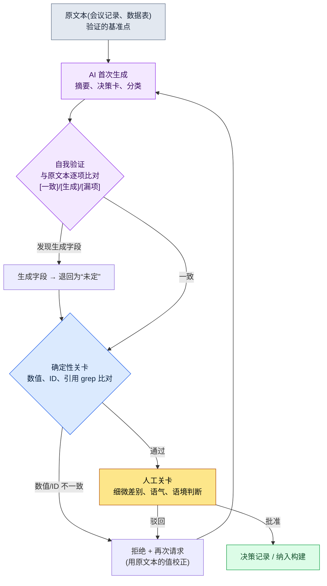

# 22.2 自信地说谎的同事 —— 用验证关卡拦住幻觉

> 主要读者:用 AI 大量产出文档、数据、决策记录的游戏策划(中等规模(10\~50 人)团队)
> 面向单人/业余读者的精简版:§22.2.7「独自一人的话,做到这些就够」

那天,我让 AI 把 17 份会议记录汇总成决策卡。输出很整洁。决策 ID、引用的会议日期、乃至一行依据,格式都完美无缺。其中一张卡片上写着“2026-04-18 战斗 TF 会议确定冷却时间策略”。问题在于,那天根本没有开过战斗 TF 会议。AI 把其他会议的议题和日期混在一起,编造出一张看似可信的卡片,而正因为格式完美,它险些就这样被写入了团队的决策记录。

这就是幻觉(hallucination)。LLM 越是不了解,反而答得越自信。用人来打比方,就像会议上一位同事斩钉截铁地说“哦那件事就是这么定的”,可事后一查,根本没有过这样的决定。这句话一旦流入数据表、客服回复、atom(最小知识单元)资产,就会酿成事故。本章讨论的不是如何封住这位同事的嘴——那是不可能的——而是如何建立**在放行他的话之前必经的验证关卡(verification gate,即由人或检查器把关验证的环节,类似质量门禁 quality gate)**。幻觉的一般论述在别的书里已有很多,本章只聚焦于*用 AI 工作流拦住它的那个环节*。

---

## 22.2.1 幻觉降不到 0 —— 所以要设“关卡”

没有哪条提示词能把幻觉降到 0。更大的模型、更好的提示词能降低频率,但不会归零。所以运营的出发点不该是“消除幻觉”,而应是“在幻觉触及决策与数据之前设一道拦住它的关卡”。

关卡的核心原理只有一条:**凡是 LLM 可能编造的东西(引用、数值、ID),都在 LLM 之外的地方来验证。**验证的来源不外乎三种:代码(确定性)、原始文档(grep)、或人的眼睛。再问 LLM 一句“帮我确认对不对”也可以算关卡的一环,但那只是辅助,不是最终裁决者。

这里先厘清游戏策划最常搞混的一点:幻觉易发的领域和不易发的领域,是有明显区别的。

| 任务 | 幻觉风险 | 原因 | 关卡 |
|---|---|---|---|
| 数值计算(奖励、概率) | 极高 | LLM 靠估算做算术 | 计算交给代码,禁止让 LLM 做 |
| 引用(会议、决策 ID) | 高 | 会把不存在的出处编得像模像样 | 与原始文本 grep 比对 |
| 分类(标签、类别) | 中等 | 会弄混标签 | 可做确定性比对 |
| 摘要、推理 | 中等 | 会多加或漏掉条目 | 自我验证 + 人工关卡 |
| 创作(风味文本) | 低 | 没有标准答案,“幻觉”概念本就模糊 | 语气评审关卡 |

第一行是最简单的处方:**数值别交给 LLM。**就像把乘法交给计算器一样,把它交给确定性工具。第二行(引用)才是本章的脊梁。在会议记录汇总、决策卡这类*原文本存在、而 LLM 去转述它*的任务里,幻觉最危险,也最容易被抓住——因为有原文本可供比对。

---

## 22.2.2 [实操记录] 用自我验证抓出会议记录汇总里的幻觉

只抽象地写“要验证”,根本看不出到底做什么、怎么做。本节完整地走一遍——从输入到再次请求——汇总一份会议记录、再抓出这份汇总里幻觉的整个循环(这类完整保留下来的真实操作过程记录,本书称为“实操记录”,worked transcript)。下面的提示词可以直接复制使用,输出则是对一次真实会话的还原。

### 第 1 步 —— 输入:把原始会议记录原样丢进去

首先要有待汇总的原文本。它就是验证的基准点。如果没有原文本、任由 LLM 凭“记忆”来汇总,就没有东西可供比对了。

```markdown
# 会议记录 —— 2026-04-15 战斗平衡评审

出席:李旼洙、成员 A、成员 B
议题:
1. 群体技能冷却时间 —— 有意见认为当前的 8 秒太短。考虑上调至 12 秒。
   结论:暂定为 12 秒,下个版本查看遥测数据后再最终确定。
2. Boss 阶段转换 HP —— 拟从 50% 下调至 30%。
   结论:搁置。与美术演出排期冲突,下周再议。
3. 新增异常状态“冰冻”的持续时间 —— 已讨论但数值未定。
```

### 第 2 步 —— 首次汇总提示词

```
将附上的会议记录汇总成决策卡。

规则:
1) 每个议题汇总为 1 张卡片。格式:[议题 | 结论 | 状态(确定/暂定/搁置) | 依据]
2) 禁止生成会议记录中没有的信息。不得推测数值、日期、出席者。
3) 未得出结论的议题,状态置为“未定”,不得擅自编造结论。

输出格式:仅表格。禁止解说。
```

### 第 3 步 —— Claude 的首次输出(还原,节选)

```
| 议题             | 结论              | 状态 | 依据                       |
|------------------|-------------------|------|----------------------------|
| 群体技能冷却时间  | 8 秒 → 12 秒      | 暂定 | 查看遥测数据后再确定         |
| Boss 阶段转换     | 50% → 30% 搁置    | 搁置 | 与美术演出排期冲突           |
| 冰冻持续时间      | 定为 3 秒         | 确定 | 套用标准异常状态持续时间基准   |
```

看第三张卡片。原文本里只写了“冰冻持续时间已讨论但数值未定”。可输出却写成了**“定为 3 秒 / 确定 / 套用标准基准”**。这三项全都是会议记录里没有的信息。是 LLM 用“异常状态一般大概持续几秒吧”这类常识把空白填上了。因为格式完美,光看是发现不了的。

### 第 4 步 —— 再次请求自我验证(关卡的核心)

这里不直接接受输出,而是**强制它逐行与原文本比对、做自我验证**。这正是本章的关键一招。

```
将刚才生成的 3 张决策卡,与附上的原始会议记录逐项比对。

对每张卡片的所有字段(结论、状态、依据、数值):
- 是原文本中直接写明的内容吗? → [一致]
- 是原文本中没有、而你添加的内容吗? → 标为[生成],并注明没有出处
- 有原文本中存在、却在卡片里漏掉的条目吗? → 报告为[漏项]

凡在原文本中无依据的[生成]字段,一律退回为“未定”。
```

### 第 5 步 —— Claude 的自我验证输出(还原,原样呈现)

```
比对结果:

卡片 1(群体技能冷却时间)
- 结论“8 秒→12 秒”:[一致] 议题 1“上调至 12 秒”
- 状态“暂定”:[一致] “暂定”
- 依据“查看遥测数据后再确定”:[一致]

卡片 2(Boss 阶段转换)
- 结论“50%→30% 搁置”:[一致]
- 状态“搁置”:[一致] “搁置。下周再议”
- 依据“与美术演出排期冲突”:[一致]
- [漏项] 原文本中“下周再议”的条件在卡片里漏掉了。需补入依据。

卡片 3(冰冻持续时间)
- 结论“定为 3 秒”:[生成] —— 原文本为“数值未定”。3 秒是我自己添加的值。
- 状态“确定”:[生成] —— 原文本并未得出结论。
- 依据“套用标准异常状态持续时间基准”:[生成] —— 原文本中没有提及这样的基准。
  → 依据规则,将卡片 3 退回如下:
  | 冰冻持续时间 | (数值未定) | 未定 | 会议上已讨论但无结论 |
```

这段输出是本章最有价值的部分。AI 把自己的输出与原文本比对,**自白“3 秒是我自己添加的值”**,并依规则把卡片 3 退回为“未定”。与此同时,它还抓出了卡片 2 里连人都漏看的漏项(“下周再议”的条件)。幻觉(多加了不存在的)与漏项(漏掉了存在的)是一枚硬币的两面,同一次比对就能把两者都抓住。

需要注意的地方也很明确:这套自我验证**并非万能。**如果 LLM 读错了原文本,也可能自信地给出错误的比对结果。所以自我验证只是关卡的*第一道*,原文本较短时,还要由人用 grep 再兜一层底。像卡片 3 那样明显的生成,自我验证几乎都能抓到;但细微的意译、语气上的失真,终究要由人工关卡来把最后一关。

---

## 22.2.3 验证关卡 —— 一张流程图

把上面的循环一般化,AI 输出在触及决策与数据之前所要经过的关卡如下。需要人动手的地方只有两处:把干净的原文本放进去的最前端,以及做出自动关卡抓不到的判断的最末端。



关卡之所以是三重,是因为每一道抓的东西不同。自我验证由 LLM 自己比对、抓*有没有多加不存在的内容*;确定性关卡用代码抓*数值、ID 与原文本是否逐字一致*;人工关卡抓*内容虽对、语境却错位*的情况。只开其中一道,另外两道原本把守的位置就会漏出事故。在 §22.2.2 中,卡片 3 的“3 秒”在第一道(自我验证)被抓,卡片 2 的漏项也在第一道被抓;而假如自我验证把“12 秒”误读成“21 秒”,就会在第二道(grep)被拦下。

---

## 22.2.4 关卡即便失败也不阻断流程 —— hook 的安全设计

把验证关卡放进自动化流水线时,新手最常酿成一种事故:**让关卡本身一崩溃,整个作业就停摆。**一旦 grep 因编码错误而挂掉,或清单文件损坏,本想帮忙验证的代码,反而把用户的作业整个堵死。于是团队不出一两周就会说“把那个验证关了吧”。

这里原样引用本书实际运营中的 JIT atom 注入钩子(hook,`inject_memory.py`)处理这一问题的方式。这个 hook 会在用户每次敲下提示词时介入、注入相关记忆,可以说是一道*常开的关卡*。它的设计原则注释里明确写着一行。

```python
设计原则:
- 始终 exit 0(即便失败也不得妨碍用户流程)
- 未匹配则返回空响应(正常)
```

而且这条原则在整段代码里都被一致地贯彻。哪怕 stdin 解析失败、哪怕清单 JSON 损坏、哪怕 atom 正文读取失败——全都落到 `emit_empty()`,并 `exit 0`。

```python
def emit_empty() -> None:
    sys.exit(0)

def main() -> None:
    try:
        ...
        payload = json.loads(raw)
    except Exception:
        emit_empty()        # 输入损坏也静默通过
        return
    ...
    try:
        manifest = json.loads(MANIFEST_PATH.read_text(encoding="utf-8"))
    except Exception:
        emit_empty()        # 清单损坏也不阻断作业
        return

if __name__ == "__main__":
    try:
        main()
    except Exception:
        emit_empty()        # 任何异常的最后一张网
```

设计的核心在于**把关卡的失败与内容的失败分离**开来。hook 注入记忆失败,在用户看来只是“一次没挂上记忆的普通会话”,并不是作业被堵死的事故。验证关卡也该如此。grep 关卡若因编码问题跑不起来,不是把那张卡片*放行*,而是标注“自动验证失败——转人工关卡”,移交给人工这一道。不能因为关卡挂了就自动批准未经验证的输出,同时也不能因为关卡挂了就让整条流水线停摆。同时满足这两点的安全默认值,就是“静默移交给人”。`inject_memory.py` 里的 `except: emit_empty()` 正是这一模式的最小实现。

---

## 22.2.5 如何诚实地对待幻觉率

很想在本章塞进一张“把幻觉率从 89% 降到 3%”之类的表。可这种数字若不交代测量方法,只会折损全书的可信度。本书遵循以下三条原则。

第一,**只把可测量的东西用数字说。**要承诺一个幻觉率,就得定义分母和分子。分母是“经评审的决策卡数”,分子是“在原文本比对中被抓出至少 1 处[生成]/[漏项]的卡片数”。没有这个定义,“幻觉率 5%”就是空话。笔者在引入初期评审会议记录汇总时,实际清点用的正是这套方法;而那批样本很小,不是精确的总体参数,而是一个*方向值*。

第二,**模型之间的比较只谈方向。**“大模型比小模型幻觉更少”这个方向,能够被稳定地观察到。但“Opus 3%、开源 7B 20%”这类绝对数值会随任务、提示词、领域而大幅波动,所以本书不主张绝对值。只取方向(模型越大幻觉越少,但与成本相互抵触)。

第三,**公开标准照原样引用。**本章几乎没有可供编造的标准数值,但像 temperature 这样的设置值,是模型 API 文档里的公开事实。验证、分析类任务把 temperature 调低(更接近确定性),创作类任务则调高——这不是推测,而是 API 行为的定义。

所以本章真正承诺的可测量指标有三个——[生成]检出数(自我验证抓到的幻觉数)、grep 关卡拒绝数(数值、ID 不一致数)、人工关卡驳回数。这三者每个季度都能靠日志清点,在会议上就能不靠“感觉”、而用数字说话。

---

## 22.2.6 常见的失败

| 模式 | 为何失败 | 处方 |
|---|---|---|
| 只看格式就接受 AI 汇总 | 幻觉在格式完美时最难被发现 | 与原文本比对的自我验证(§22.2.2 第 4 步) |
| 不放原文本、凭 LLM 记忆汇总 | 没有可比对的基准点,无法验证 | 先把原文本放进输入 |
| 把数值计算交给 LLM | 算术靠估算,每次都不同 | 计算交给确定性工具(§22.2.1) |
| 验证关卡一崩溃,整个作业停摆 | 团队会把关卡关掉 | exit 0 + 转交人工这一道(§22.2.4) |
| 关卡挂掉就自动批准未验证输出 | 幻觉原样通过 | 关卡失败 = 标注“未验证” |
| 把自我验证当作最终裁决 | LLM 误读原文本时,连误判也很自信 | 短原文本要并行人工 grep |

---

> **游戏之外的应用。**“自信地说谎的同事”——把不存在的会议日期或决定以完美格式编造出来的 AI——不只在游戏决策卡里危险,在一切文档汇总中同样危险。幻觉在格式完美时最难被发现,所以在有原文本的任务(会议记录汇总、合同摘录、报告整理)中,关键是不要直接接受输出,而要强制它做自我验证:“逐项与原文本比对,凡你添加的内容一律标为[生成]”。举例来说,让法务助理汇总一份合同后,再让它把金额、日期、条款编号与原文本逐字比对,AI 就会自白“这个违约金数值是我自己添加的值”,并把空白退回为“未定”。数值计算干脆别交给 AI,而交给计算器、公式;自动验证工具则要设计成即便失败也不阻断作业,而是转为“未验证——待人工确认”。

## 22.2.7 动手试试 —— 今天就能做的一步

> **独自一人的话,做到这些就够**:不需要代码,也不需要 hook。把你手头的一份短文档(会议便签、更新公告、一页策划)交给 AI 汇总,然后把 §22.2.2 第 4 步的自我验证提示词原样粘进去。只要“逐项与原文本比对,凡你添加的内容一律标为[生成]”这一行,AI 就会开始主动申报自己的幻觉。哪怕只拿到一次[生成]自白,你也会切身体会到:为什么不能对 AI 汇总照单全收。

如果是团队,就从下面这一步开始。把自我验证环节作为*基础提示词*,固定进 AI 生成的决策卡与汇总里(§22.2.2)。接着,只挑出数值、决策 ID、日期这类必须与原文本逐字一致的字段,用代码写出 grep 比对。这时那段验证代码务必像 `inject_memory.py` 一样,设计成**即便失败也不阻断作业**(exit 0 + 标注“未验证”)(§22.2.4)。哪怕只有自我验证和 grep 这两道,也能先挡住“格式完美的幻觉渗入决策记录”这个最常见的事故。

---

### 本章要点
- 幻觉降不到 0,所以要在触及决策之前用验证关卡拦住。
- 与原文本逐项比对,AI 就会主动申报自己的幻觉。
- 验证代码要设计成即便失败也不阻断流程(exit 0)。

### 下一章预告
- 22.3 AI 成本管理 —— 用真实日志运营各模型的 token、缓存与 cap
