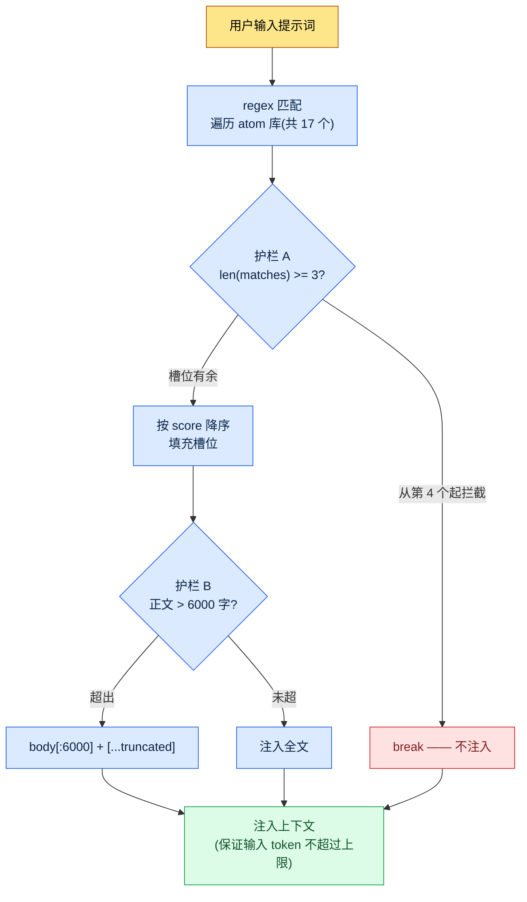

# 22.3 AI 成本管理 —— 用代码守住 token 预算

> 主要读者:在团队中引入 AI 工具并为成本负责的策划主管(中等规模(10\~50 人)团队)
> 面向单人/业余读者的精简版:§22.3.9「单人只需做到这些」

如果一章讲成本却举出虚假的成本,这本身就是自相矛盾。所以本章不会去做一张"我们团队每月省了多少"的漂亮表格。取而代之,只用两类数字。一类是任何人都能核实的**公开 token 单价**(各模型每 1M token 的费用),另一类是笔者亲自运营的 hook 代码中**写死的常量**(`max_atom_body = 6000`、`max_matches = 3`)。两者都不是编造,而是引用来的。

AI 成本可怕,不在于金额大,而在于**看不见**。引入的头一个月调用少,账单也小。可一旦上下文变长、调用变频繁,某个季度的账单就会突然多出一个数量级。先把本章的结论摆出来 —— 成本不是靠"省着点用"的决心,而是靠**在每次调用中强制削减 token 的代码**来控制。挡住它的不是人的意志,而是 wrapper 与 truncate。

---

## 22.3.1 LLM 成本实质上只有'输入 token'这一项

成本项有输入、输出、缓存命中、缓存写入四类,但在实务中主导账单的是**输入 token**。原因很简单。在游戏策划中使用 AI 的几乎所有工作,都是"塞进长上下文、拿回简短回答"的形态。把 L0 愿景文档、atom 库、相邻城市的正文、数据表摘录全部塞进去,输入就是数万 token,而输出只是一张表,不过几百 token。

因此,成本控制的第一要务不是"减少输出",而是**"在哪里削减输入 token"**。这一句话贯穿本章其余部分。

先把各模型的公开单价钉死。下面是 Anthropic 公开的每 1M(100 万)token 费用,是**照原样引用本书写作时那一代(Opus·Sonnet·Haiku 当时最新等级)公开单价的快照**(引自官方公开单价 —— 会随模型代际·时点变动,套用前务必核对当前价目表)。正如附录 K 所归纳的原则,这里不变的**不是单价的绝对值,而是三个等级之间的单价比例**。因此,下表不是用来看"今天的账单",而是用来读懂"等级越往下调,单价就成数量级下降"这一结构。

| 模型 | 输入 1M token | 输出 1M token | 备注 |
|---|---|---|---|
| Claude Opus | $15 | $75 | 顶级推理(公开单价) |
| Claude Sonnet | $3 | $15 | 中档 —— 输入价为 Opus 的 1/5 |
| Claude Haiku | $0.80 | $4 | 轻量 —— 输入价约为 Opus 的 1/19 |
| 缓存命中(read) | 约为标准输入价的 1/10 | — | 复用已缓存输入时(公开缓存政策) |

关键在最后两行。**同样的工作用 Haiku 而非 Opus 来跑,输入 token 单价约为 1/19**;**把同样的上下文放进缓存,那部分的输入价约为 1/10**。成本节省的两大支柱由此而来 —— 模型合理选型与缓存。两者都不是"少用",而是"用更低的单价处理同一件事"的结构。

> 节省来自单价差异,而非意志。把 Opus 降到 Haiku 约省 19 倍,放进缓存约省 10 倍,都是自动发生的。

---

## 22.3.2 最大的输入成本是'每次调用都注入的上下文'

有一种成本比单项工作的单价更悄无声息地累积 —— **每次调用都自动附加的上下文**。笔者的个人 PC 上运行着一个 hook,每当用户敲入提示词,它就自动把相关记忆(atom)塞进去(UserPromptSubmit hook,`inject_memory.py`)。这是个便利功能,但同时也是**成本泄漏的头号嫌疑**。每次输入都有很长的 atom 正文进入上下文,若放任不管,输入 token 会随每次调用膨胀。

所以这个 hook 里固定了三重削减成本的安全装置。它们不是抽象论,而是实际代码中的常量。

```python
# inject_memory.py —— UserPromptSubmit hook(实际运营代码,节选)
# 设计原则(docstring 原文):
#   - 始终 exit 0(即便失败也不打断用户流程)
#   - 按 score 降序注入最多 3 个 atom
#   - atom 正文超过 6000 字时 truncate

# (1) 从 manifest config 中读取预算常量
max_matches = cfg.get("max_matches", 3)      # 单次调用最多 atom 数
max_body    = cfg.get("max_atom_body", 6000) # 每个 atom 的正文上限(字)

# (2) 按 score 降序排序 —— 让昂贵的槽位按价值顺序填充
atoms_sorted = sorted(atoms, key=lambda a: a.get("score", 0), reverse=True)

matches = []
for atom in atoms_sorted:
    if len(matches) >= max_matches:   # (护栏 A)在最多 3 个处截断
        break
    if re.search(atom["regex"], prompt, re.IGNORECASE):
        matches.append(atom)

# (3) 注入正文时在 6000 字处截断
for atom in matches:
    body = atom_path.read_text(encoding="utf-8")
    if len(body) > max_body:          # (护栏 B) truncate
        body = body[:max_body] + "\n\n[...truncated]\n"
```

三重成本护栏都在这里。

- **护栏 A —— 数量上限(`max_matches = 3`)**:即便与输入匹配的 atom 有 10 个,最多也只附加 3 个。整座 17 个 atom 的库在每次调用都被塞进去的事故,由代码来阻止。
- **护栏 B —— 长度上限(`max_atom_body = 6000`)**:即便 atom 正文有 12,000 字,也在 6,000 字处截断。一条很长的复盘 atom 把调用成本翻倍这种事,在结构上就不可能发生。
- **护栏 C —— score 优先级**:3 个槽位按 score 从高到低填充。也就是说,"价值低的 atom"占不到昂贵的输入 token。

这三个常量就是**每次调用输入 token 的上限**。粗略估算,一个 6,000 字的 atom 在韩语中大约是数千 token 的规模(准确的 token 数会因分词器·语言而异,所以应把它当作"存在上限"这一结构来读,而不是绝对值)。3 个 × 6,000 字就是单次调用的注入预算,超出部分由代码切掉。人不需要用眼睛去发现"atom 附加得太多了"。

---

## 22.3.3 [实操记录(worked transcript)] 一行 6000 字 truncate 如何遏制成本

光说"truncate 能遏制成本"是空洞的。实际制定这个常量时,我和 AI 把一个完整循环从头跑到尾。下面是对那次会话的忠实再现。输入提示词可以原样复制使用,输出则是对真实会话的重现。

### 第 1 步 —— 输入:原样抛出问题情境

刚启用 hook 不久,`_injection_log.txt` 里就留下了一次调用中 atom 正文被整段注入的记录。当很长的 atom(复盘·健康上下文等)每次调用都以完整大小进入,越是高频使用的工作,输入 token 累积得越多。我问了 AI 该在哪里截断。

### 第 2 步 —— 提示词:强制限定与格式

```
我有一个每次调用都会把 atom 自动注入到上下文的 hook(inject_memory.py)。
我想设定一个能遏制输入 token 成本的 truncate 上限,请你提议每个 atom 的正文字数
上限,以及单次调用注入的 atom 数量上限。太短会切掉核心,
太长又会漏 token,所以也请一并点明其中的权衡;对没把握的地方
单独标记出来,交给人来定。(意图:上限值以 config 外部化为前提)以表格给出:
项目 | 建议值 | 依据 | 把握度。
```

请注意,提示词有一半都是"强制限定与格式"。在成本相关的问题上放任 AI 自由发挥,就会得到"视情况而定"这类不负责任的回答。**强制给出具体数值、要求明示权衡、并留一个'没把握就上报'的出口**,才是这条提示词的核心。

### 第 3 步 —— Claude 的输出(重现,节选)

```
| 项目            | 建议值  | 依据                                          | 把握度 |
|----------------|--------|-----------------------------------------------|-------|
| max_atom_body  | 6000 字 | 韩语单个 atom 的"核心+依据"大多在 4~6 千字     | 中    |
|                |        | 以内。6000 字时正文开头(要旨·规则)基本        |       |
|                |        | 保留,只切掉结尾(示例罗列)。                 |       |
| max_matches    | 3      | 单条输入同时强匹配的主题通常为                 | 高    |
|                |        | 1~3 个。4 个以上是 regex 过宽的信号            |       |
| 外部化位置      | _jit_manifest.json > config | 无需重新部署代码即可运行中调整 | 高    |
| truncate 标记   | 附加 [...truncated] 结尾    | 让模型·人知道此处被截断      | 中    |
| 没把握之处      | 6000 是否为精确值           | 各分词器的 token 换算因语言·  | ★低   |
|                | (字→token 换算不确定)      | 模型而异,字为单位只是近似值   |       |
```

输出里最有价值的不是表格,而是**最底下那行 ★**。AI 主动上报:"不确定 6000 是否为精确的最优值,字→token 的换算并不确定"。好的提示词能让 AI 说出'我不知道'。

### 第 4 步 —— 验证与否决(人的位置)

我没有原样接受这份输出。AI 把 6000 字提为"核心得以保留的界线",但实际在 6000 字处截断到底切掉了什么,必须亲自核实。我挑出最长的 atom(健康上下文、复盘累积本),用眼睛看了 6000 字那个位置。

核实结果发现一处问题。**6000 字那个位置从正文中间切断了一个表格行**,像 `| 维生素D | 1000IU |` 这样的行在一半处被截断。语义虽保留了,但被切断的表格行以残缺的 Markdown 形式进入模型,总归让人不放心。于是我再次发起请求。

### 第 5 步 —— 再次请求

```
在 6000 字处截断时,有时会把 Markdown 表格的某一行从中间切断。是否值得加一个
把截断位置吸附到前一个换行边界的修正?实现不能比 truncate 本身还复杂,
所以请权衡成本与收益,连做不做都一并下结论。
```

AI 这样回答 —— "吸附到行边界用 `body[:max_body].rsplit('\n', 1)[0]` 一行即可实现,但**truncate 的目的是 token 上限,而非表格完整性**,所以一行残缺的表格行对成本·行为的影响微乎其微。目前仅凭 `[...truncated]` 标记,模型就能识别'此处被截断',因此**建议不做**行边界吸附。若一定要做,一行修正就够了。"

这个回答是对的。若在成本控制代码里连表格完整性也贪求,护栏代码本身就会臃肿。**当前运营代码保持 `body[:max_body] + "[...truncated]"` 的简单截断。**这是一个由人验证 AI 的首个提议(6000 字)、再由 AI 压下过度修正的贪念,一次往返就闭合的循环。

---

## 22.3.4 成本护栏的结构 —— 一览

上面会话中定下的常量,在实际调用中如何削减输入 token,把整个流程用图示记录下来。



这张图的要点是:**无论用户输入什么,每次调用注入的 token 都有一个天花板**。天花板是 `3 × 6000 字`(+标记),超过部分代码一律切掉。成本不依赖用户的自制力。护栏 A·B 在每次调用中机械地运作。

同样的理念在工具层面也重复出现。笔者所在公司的系统有一条政策:把暴露在全局槽位的 wrapper 技能**精确固定为 12 个**(atom `skill_listing_budget_wrapper_only_policy`)。会话开始时,若全局 `*` wrapper 的数量不是 12,清理脚本就会自动运行。名义上是"整理槽位",本质却是**保护会话开始时的 token 预算** —— 把技能列表载入上下文的成本锁定在 12 个的量。atom 注入 3 个上限与技能暴露 12 个上限,是同一思想的不同应用。

---

## 22.3.5 按任务分配模型 —— 80% 交给更低的单价

如果说护栏遏制的是每次调用的 token,那么模型选择决定的就是这些 token 的单价。在 §22.3.1 的表中,输入价 Opus:Sonnet:Haiku ≈ 19:4:1。所以,把所有工作都用 Opus 来跑,等于连分类·替换这类简单工作也要付 19 倍的单价。

按工作的复杂度分配单价。

| 工作类型 | 推荐模型 | 理由 |
|---|---|---|
| 与验证·法务直接相关、决策分析 | Opus | 出错就闯大祸的工作 —— 不省这个单价 |
| 报告·摘要·自然语言加工 | Sonnet | 需要质量,但不必用到顶级推理 |
| 分类·打标签·关键词提取 | Haiku | 简单模式 —— 用 Opus 约 1/19 的单价就够 |
| 简单映射·替换 | Haiku 或确定性方法 | 很多情况下连 LLM 都不需要 |

以经验来看,大部分工作用 Sonnet·Haiku 就够。**昂贵的模型只用于"出错代价高的工作"。**不过有一个陷阱 —— 降到过于便宜的模型会导致幻觉增多,验证成本会把节省下来的金额吃掉(与上一章 §22.2 幻觉·安全性直接相关)。所以模型分配不是"一律便宜",而是"出错也无妨的工作用便宜的,出错代价高的工作用贵的"这样的分流。

最后一行"简单映射·替换 → 确定性方法"往往才是最大的节省。像名称替换、按既定规则映射这类答案唯一确定的工作,根本不需要调用 LLM。**把调用本身归零,才是最便宜的调用**。

---

## 22.3.6 缓存 —— 相同的输入按 1/10 单价

即便遏制了每次调用的 token(护栏)、压低了单价(模型分配),**只要每次调用都重新发送相同的上下文**,成本就会泄漏。像 L0 愿景文档、atom 库、领域风格指南这类几乎不变的长输入,就做缓存。缓存命中时,那部分输入按标准价的约 1/10 计费(§22.3.1 表)。

```python
# 不变的上下文用 cache_control 标记 —— 缓存命中时约为 1/10 单价
messages = [
    {"role": "system", "content": SYSTEM_PROMPT},
    {"role": "user", "content": [
        {"type": "text", "text": L0_VISION,    "cache_control": {"type": "ephemeral"}},
        {"type": "text", "text": ATOM_LIBRARY, "cache_control": {"type": "ephemeral"}},
        {"type": "text", "text": SPECIFIC_TASK},  # 只有每次变化的部分放在缓存之外
    ]},
]
```

关键在于**把会变的部分和不变的部分分开**。缓存要求输入的前段相同才会命中,所以把固定上下文(L0·atom)放在前面,把每次都变的工作指令放在后面。

把什么放进缓存,按变更频率来划分。

| 上下文 | 缓存 | 理由 |
|---|---|---|
| L0 愿景(几乎不变) | 适合 | 只以数天\~数周为单位变动 |
| atom 库 | 适合 | 仅在复盘时更新 |
| 领域风格指南 | 适合 | 以季度为单位变更 |
| 近期会议记录 | 不适合 | 每天变化 —— 缓存命中率低 |
| 用户输入 | 不适合 | 每次调用各不相同 |

缓存 TTL 短则以数分钟为单位,所以在**连续叩击相同上下文的工作**(如量产 30 座城市那样把同一个 L0 复用 30 次)中效果最大。对一次性问题,只会花掉缓存写入成本却命不中,反而可能吃亏 —— 所以只对"频繁·连续使用相同上下文的工作"有选择地应用。

---

## 22.3.7 诚实对待数字的方法

成本这一章,是最容易让人想放一张"把每月 $5,000 降到 $1,000"这类表格的地方。那种绝对节省额会因团队规模·工作量而千差万别,一旦编造,成本章就成了对成本撒谎的自相矛盾。本章只用了三类数字。

第一,**公开单价原样引用。**§22.3.1 的 Opus $15 / Sonnet $3 / Haiku $0.80(输入 1M token)、缓存命中约 1/10,都是 Anthropic 公开的费用。输入价比例 19:4:1、缓存约省 10 倍,是从这些公开单价用算术得出的值 —— 不是估测,而是计算。

第二,**代码常量引用代码。**`max_atom_body = 6000`、`max_matches = 3` 是实际记录在 `inject_memory.py` 和 `_jit_manifest.json` 中的值。不是比喻,而是真实文件。

第三,**不知道的就写不知道。**"6000 字是多少 token"会因分词器·语言·模型而异,字为单位只是近似值。§22.3.3 中 AI 也把这一点用 ★ 上报了。所以本章任何地方都没有"6000 字 = N 个 token = 省 $X"这类换算表。取代绝对节省额,只用**方向与比例**(19 倍·10 倍)来讲。

> 本章的成本数字,要么是公开单价(Anthropic 价目表),要么是写死在代码里的常量(`inject_memory.py`·`_jit_manifest.json`),要么是明确标注"不知道"的近似值。

---

## 22.3.8 常见失败

| 模式 | 为何失败 | 对策 |
|---|---|---|
| 所有工作都用顶级模型 | 连分类·替换都付约 19 倍单价 | 按任务分配模型(§22.3.5) |
| 每次调用重发相同上下文 | 白白丢掉缓存命中的 1/10 | 缓存固定上下文(§22.3.6) |
| 自动注入没有上限 | 整座 atom 库每次调用都被注入 | 数量·长度护栏(§22.3.2) |
| 靠"省着点用"的决心管理成本 | 人的自制力挡不住暴涨 | 把上限固定在代码里 |
| 连确定性方法能办的事也调用 LLM | 最便宜的调用是'不调用' | 把映射·替换分离到代码里 |

第四条是核心。把成本控制交给人的意志,一定会泄漏。意志在忙碌时最先崩塌,而成本在忙碌时增长得最快。所以控制必须是 `max_matches = 3` 这样的**代码常量**。

---

> **游戏之外的应用。**AI 成本可怕,不在于金额大,而在于看不见,这一点无论对游戏团队还是市场团队都一样。成本不是靠"省着点用"的决心,而是靠结构来管住。第一,按工作难度分配模型单价 —— 连简单的分类·打标签都用顶级模型来跑,就等于为同一件事付好几倍单价;而简单映射·替换干脆不调用(用规则·公式处理)才是最便宜的调用。第二,对几乎不变的长输入(公司介绍·政策文档·术语表)做缓存,减少重发成本。举例来说,给客户咨询分类这件事用轻量模型就够,只把复杂的合同审查交给更高档的模型,就能在保住质量的同时把单价分流。如果有某处会自动附加很长的上下文,那么事先定好"一次附加的数量·长度上限",就能从结构上防止某天账单突然多出一个数量级的事故。

## 22.3.9 动手试试 —— 今天就能做的一步

> **单人只需做到这些**:没有 hook、没有 manifest 也可以。在你常用的 AI 工具里,把下一件工作的模型下调一档试试(原来用 Opus 做的摘要改用 Sonnet,原来用 Sonnet 做的分类改用 Haiku)。只要输出质量足够,那件工作就永久固定在更低的单价上。哪怕只在每件工作上问一次"这件事真的需要顶级模型吗",节省的一半就出自这里。

如果是团队,就从下面这一步开始。找一个会自动注入上下文的地方(hook·系统提示词·RAG),在那里用代码放入 §22.3.2 的两道护栏(注入数量上限 1 个、正文长度上限 1 个)。像 `inject_memory.py` 那样把上限用 config 外部化,就能在运营途中无需重新部署代码、只调数字。两行护栏就能从结构上防止"某天账单多出一个数量级"的事故。

用 setup → prompt → verify 概括 —— **setup**:在自动注入点放入数量·长度上限常量,并抽到 config 里。**prompt**:以 §22.3.3 的格式让 AI 提议上限值,同时强制它给出权衡与把握度。**verify**:挑出最长的输入,亲自用眼睛确认在上限处切掉了什么。

---

### 本章要点
- 输入 token 占成本的大部分 —— 控制的第一要务是"在哪里削减输入"。
- 节省不靠意志,而靠代码常量(`max_matches=3`·`6000 字 truncate`)。
- 善用单价差异 —— 模型分配约 19 倍,缓存约 10 倍。

### 下一章预告
- 22.4 版权·许可与伦理 —— AI 工具使用中法务·共识层面的安全运营
