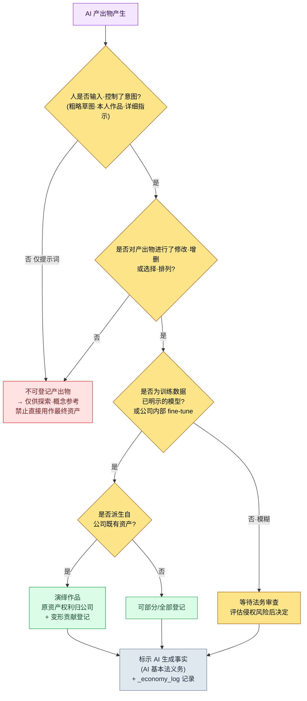

# 22.4 著作权与伦理 —— 用一套流程闭合产出物的权利、标示与共识

> 主要读者:负责引入 AI 的游戏总监与主管(中等规模(10\~50 人)团队)
> 面向单人/业余读者的精简版:§22.4.9「独自一人的话,做到这些就够了」

发售前两个月,我们曾因一张概念美术师绘制的城市插画而让整场会议陷入停滞。有人问:"这是用 AI 生成的吧?那著作权归我们,还是根本无法登记?"没有人能回答。当场出现了三种意见:"是 AI 做的,所以不归我们""是我们花钱跑出来的,所以归我们""反正还没有法律,直接用就是了"。三种都不对。而且这个问题并不只是一个法务议题。制作那张插画的美术师其角色究竟是什么、团队对 AI 的使用达成了怎样的共识,都在那一刻同时被牵扯了进来。

本章不会把著作权与伦理分开来讲。因为在实务中,二者是同一个问题的一体两面。"这份产出物的权利归谁"(著作权)会直接归结为"人在这份产出物中介入了多少"(伦理·角色)。韩国著作权委员会在 2025 年明确钉定的登记要件,恰恰就在这一点上。所以本章的脊柱是一份实操记录(worked transcript,完整保留的真实操作过程记录)—— 我们会实际判定一张 AI 概念美术图能否进行著作权登记,并从输入到决策一路追踪这一判定如何延伸为团队的角色共识。

> **作者实际运营备注**
> 本章引用的 `design_intent_vs_automation_boundary` atom 以及 `_economy_log`·`_roi_report.md`,是将作者在公司实际运营的治理资产做了匿名化处理后的产物。atom 名称与日志文件名原样保留了实际运营中使用的名称(仅为保护 IP 而替换了公司与项目的专有名词)。实操记录的输出是对真实判定会话的重现。

---

## 22.4.1 权威来自公开指南,而非"感觉"

很多书只把 AI 著作权写成"因为还没有法律,所以模糊不清"。这只对了一半。2025 年 6 月,文化体育观光部与韩国著作权委员会发布了《生成式 AI 利用作品的著作权登记指南》,至少在韩国,能否登记的界线已经清晰。无须编造。

指南的核心可以浓缩为一句话:**著作权登记的要件是"人类的创作性贡献"。** 由此分为两类。

| 分类 | 定义 | 登记 |
|---|---|---|
| GAI 产出物 | 没有人类创作性贡献、由 AI 生成的结果物 | 不可 |
| GAI 利用作品 | 人类将 AI 作为工具制作的成果中,被认定具有创作性贡献的部分 | 可 |

指南还给出了被认定为"利用作品"的三条路径。① 将使用者自身的作品作为提示词输入,使其创作性体现在产出物中;② 对产出物进行修改·增删的追加工作本身具有创作性;③ 对产出物进行选择·排列·构成时具有创作性。判断的两条轴线是**"可控性"与"可预测性"**。创作者必须能够明确决定自己想要表现的内容,并按照其意图导出结果物,才会被认定具有创作性。

这一处是决定性的。指南用法律语言所说的"可控性·可预测性",与本书自 §1.1 起反复强调的**"策划提供意图"**(`planner_provides_intent_not_recommendation` atom)是同一回事。完全交给 AI 的产出物没有可控性与可预测性,因而也没有著作权;而由人输入意图、经人审校·重构的产出物,权利便随之而来。著作权能否登记,与良好 AI 工作流的条件,处在同一条线上。

还有另一项公开标准。2026 年施行的《AI 基本法》对生成式 AI 产出物课以**确保透明性的义务(标示 AI 生成事实)**。登记(主张权利的一侧)与标示(公开使用事实的一侧)是彼此独立的义务。无论是否产生权利,使用了 AI 这一事实本身都必须公开。这两项公开标准,构成本章要交给 AI 的**规则手册(rulebook)的首批输入**。

---

## 22.4.2 [实操记录] 判定一张 AI 概念美术图能否登记

回到开头那张插画。我们不靠"感觉"来判断,而是把 §22.4.1 的指南标准作为规则手册输入,让 AI 先做一次分类。人只做最后的判定。下面的输入提示词可以直接复制使用,输出则是对真实判定会话的重现。

### 第 1 步 —— 输入:原样抛出产出物的生成历史

判定的输入不是插画本身,而是记录该插画如何被制作出来的日志。这些信息已经存在于资产元数据中,只需提取即可。

```yaml
# asset_concept_city021_v4.meta.yaml —— 判定对象产出物的生成历史
asset_id: concept_city021_v4
asset_type: concept_illustration
created_by: 团队成员 A(概念美术师)
generation_log:
  - step: 1
    actor: 团队成员 A
    action: "将亲手绘制的城市布局粗略草图作为输入图像附上"
  - step: 2
    actor: AI (image_model)
    action: "以粗略草图 + 提示词生成 4 种变体"
    prompt: "stone observatory tower over sealed magic core, cold arid, scholar guild, muted palette"
  - step: 3
    actor: 团队成员 A
    action: "从 4 种中选取 1 种,亲手对钟楼剪影·饱和度·构图进行精修(约 40% 区域重做)"
  - step: 4
    actor: 团队成员 A
    action: "亲手设计背景的封印阵纹样并合成"
ai_generated_disclosure: true   # 满足 AI 基本法的标示义务
```

### 第 2 步 —— 提示词:依指南标准分类,但强制给出依据

```
附上的 meta.yaml 是一张概念插画的生成历史。请依据韩国著作权委员会
《生成式 AI 利用作品的著作权登记指南》(2025)的标准,把它能否登记
分类为 可登记/部分登记/不可登记 三者之一。依据请用指南的两条轴线(可控
性·可预测性)各给出一行,并在 generation_log 中用编号指出哪个 step 属于
"创作性贡献"。法律上无法断定的,标为"需法务确认"交给人处理。
用表格呈现:分类 | 依据(可控) | 依据(预测) | 贡献 step | 法务确认。
```

请注意,这段提示词有一半是在做"强制依据"与"法务退路"。如果把法律判断整个交给 AI,它会吐出貌似可信的断言。给出分类标准(指南的三分法)、依据义务(两条轴线)、指定贡献 step,以及"无法断定就交给法务"这一退路——这才是这段提示词的核心。

### 第 3 步 —— Claude 的输出(真实会话重现)

> ```
> | 分类     | 依据(可控性)                 | 依据(可预测性)              | 贡献 step | 法务确认 |
> |---------|------------------------------|----------------------------|----------|---------|
> | 部分登记 | 粗略草图(step1)与 40% 精修    | 从 4 种中选择可预测,        | 1,3,4    | ★       |
> |         | (step3)直接控制表现意图        | 但 AI 的 4 种变体本身不可预测 |          |         |
>
> 分析:
> - step1(直接输入粗略草图):对应指南 ①"以本人作品输入体现创作性"。
> - step3(40% 精修):对应指南 ②"修改·增删的追加工作"。贡献最强。
> - step4(亲手设计封印阵纹样):合成独立作品,明显的人类创作。
> - step2(AI 的 4 种变体):无人类创作性贡献的纯 AI 产出物 → 这部分单独不属于登记对象。
>
> ★ 需法务确认:"40% 精修"是否达到"实质性改变",缺乏定量标准。
>   精修比例是否越过可登记的界线,建议由律师审查。
>   (AI 无法断定该比例在法律上是否充分。)
> ```

输出中最有价值的部分不是表格,而是最下面的**★ 法务确认**。AI 主动申报了自己的界限——"我无法断定 40% 精修在法律上是否充分"——并把它交给了人。好的提示词会让 AI 能够说出"我不知道"。这不是自动拒绝型,而是自动申报型。

### 第 4 步 —— 验证与否决(人的位置)

不能原样接受这份输出。总监用规则手册再核查一遍。AI 把 step4(封印阵纹样)分类为"独立作品",但重新查看生成历史后发现,那个纹样其实派生自 §6.2 中 `city_hunting_generator` 生成的城市 lore。也就是说,step4 未必是纯粹的原创,而可能是**叠加在公司内部资产之上的二次加工**。由于是公司资产,权利归属很明确;但 AI 所用的"独立作品"这一表述若原样写进登记申请书,会招致误解。

于是再次发出请求。

```
step4 的封印阵纹样是从公司内部城市 lore 资产派生的二次加工(并非独立的全新原创)。
请据此重新分类 step4 的贡献性质。
并用一行提议:登记申请时应如何注明"基于既有内部资产"。
```

这一次往返就闭合了。AI 把 step4 从"独立作品"改答为"公司内部 lore 资产的演绎作品——原资产权利归公司所有,变形贡献为登记对象",该判定随后交由法务审查。结论最终定为**部分登记 + 标示 AI 生成事实**。若全部手工进行,法务就得逐个资产追问生成历史;而有了 AI 初稿 + 规则手册审校 + 一次往返,法务只需把时间花在标了 ★ 的边界案例上。

这一整圈就是本章的 Show 标准。"AI 著作权很模糊"这句话,在你尚未依指南标准把一份产出物的生成历史彻底分类一遍之前,都是空洞的。

---

## 22.4.3 决策树 —— 这份产出物,能用吗

为了不必每次都从头做上面那种判断,我们把指南标准记录成一张流程图。每进来一个资产,顺着这棵树往下走即可。所有分叉点都出自 §22.4.1 的公开标准。



关键在于:这棵树的终点(J)在所有路径上都相同。无论能否登记、是公司资产还是演绎作品,**"使用了 AI"的事实标示与生成历史日志都无一例外地保留。** 标示是与权利无关的独立义务,而日志是出事时追溯责任的唯一依据。开头那场会议之所以停滞,正是因为没有这份日志,没有人能重现每个 step 由谁做了什么。

红色路径(C,不可登记)也并非直接丢弃。"仅输入提示词的纯 AI 产出物"在探索·概念阶段作为参考完全可用,只是不把它作为最终资产放进游戏而已。把 AI 输出原样推上线,是事后著作权事故最大的诱因。

---

## 22.4.4 把著作权规则手册变成运营日志 —— `design_intent_vs_automation_boundary`

树(§22.4.3)是判断的流程,而让这条流程每次都画在同一条线上的,是一个 atom。在公司的治理资产中,`design_intent_vs_automation_boundary` 就是本章整体的脊柱。

这个 atom 的一句话定义是:"设计意图由人负责,自动化由工具负责——每个资产都明示这条边界。"这不是抽象的口号。这个 atom 已注册进 JIT hook(`inject_memory.py`),因此当提示词中出现"著作权""AI 生成""资产登记"之类关键词时,它会被自动注入会话。hook 的设计原则直接支撑了这个 atom 的运营。

```python
# inject_memory.py —— 始终 exit 0,即使失败也不阻断用户流程(节选)
def main() -> None:
    ...
    # 按 score 降序排序后匹配 —— 最多只注入 3 个 atom
    atoms_sorted = sorted(atoms, key=lambda a: a.get("score", 0), reverse=True)
    matches = []
    for atom in atoms_sorted:
        if len(matches) >= max_matches:   # 防止过度注入
            break
        try:
            if re.search(atom["regex"], prompt, re.IGNORECASE):
                matches.append(atom)
        except re.error:
            continue
    if not matches:
        emit_empty()   # 无匹配则返回空响应(正常)
        return
```

这里在治理上有两处重要设计。第一,hook **始终 `exit 0`**(脚本 docstring 中已注明)。即便在注入著作权规则时失败,也绝不阻断用户的工作。一旦安全装置把工作扣为人质,团队会在一两个季度内把这个装置关掉。第二,**最多只注入 3 个**。若每次会话都把所有治理规则一股脑塞进来,上下文会爆掉,谁也不会读。只有 score 高的规则才会浮现。

这与 §6.2 中 lint 不自动废弃违规、而只向作者关卡(gate)发出 alert 的哲学如出一辙。**可疑候选由机器挑出,但要弃要留由人决定。** 著作权上也一样。atom 会自动弹出"这个资产的著作权确认了吗",但能否登记的最终判定由人和法务来做。

---

## 22.4.5 权利之后是人 —— 用共识闭合角色演进

开头那张插画的判定并未止于著作权。因为它意味着,制作该资产的团队成员 A,其工作已从"绘制"转移到了"从 AI 的 4 种中做选择、并精修其中 40%"。在著作权要求"人类创作性贡献"的那一刻,做出这份贡献的人,其角色定义也随之改变。二者是同一事件的一体两面。

这里最常见的事故,是把这种变化当作单方通知来处理。即便工具再好,半年后无人使用,多半不是工具不好,而是当初没有达成共识。角色从量产转向选择·审校·重构,这才是引入 AI 的本质;若不把这一点明示出来并以培训加以支撑,团队成员就会把它理解为"我的位置要没了"。

| 职群 | AI 之前 | AI 之后(角色演进) | 著作权上的意义 |
|---|---|---|---|
| 概念美术师 | 全部亲手作画 | 输入意图·选择·精修 | 精修即"创作性贡献" |
| 数值策划 | 手动模拟 | 解读模拟·做决策 | 决策日志即责任依据 |
| 策划 | 全部亲笔撰写规格 | 提供意图·审校 | 输入意图即可控性 |

这张表想说的一句话是:**让著作权登记成为可能的"人的贡献",正是角色演进之后人所做的事。** 一旦指南所要求的可控·可预测消失,著作权会消失,人的位置也会消失。所以,角色演进必须被解释为"把权利与责任留在人手中"的变化,而非"抢走岗位"的变化,才能达成共识。

共识不是无休止的开会,而是用流程闭合:引入提案(总监)→ 全团队事先共享(目的·受影响角色·衡量指标·风险)→ 共识会议(自由发言·收集顾虑)→ 与必要成员一对一 → 发布调整方案 → 达成共识或搁置。并不是必须得到所有成员的同意才能启动,而是通过流程听取并调整顾虑之后,由总监拍板。没有流程,共识每次都要从 0 重新开始,而这种成本会拖慢引入。

---

## 22.4.6 成本·ROI 也是伦理的一部分 —— 用 `_roi_report.md` 诚实以对

如果把伦理只收窄到岗位·共识,就会漏掉一条轴线。诚实地衡量并公开 AI 运营的成本与效果,本身就是治理。若不做衡量,只是嘴上说"用 AI 提升了效率",团队成员会怀疑这句话是在为削减自己的岗位找借口。

公司的治理基础设施中,为此配备了两项真实资产:atom 系统的 `_economy_log/`(token·时间经济性日志)与 `_roi_report.md`(ROI 报告)。前者由机器记录每次会话的 token·时间,后者则按周期汇总供人阅读。关键在于:这份日志追踪的不是"AI 替代了多少人",而是"把人的时间释放到了哪里"。

本书的数值原则有三条。第一,公开标准原样引用(指南的登记要件、AI 基本法的标示义务)。第二,作者的推测就写明是推测。第三,只把可衡量的东西作为 KPI 来承诺。在著作权·伦理领域,可衡量的不是结果指标,而是流程指标。

| 衡量项 | 衡量方法 | 能否承诺 |
|---|---|---|
| AI 生成事实标示的缺失数 | 对资产元数据 `ai_generated_disclosure` 做 grep | 可衡量(目标 0) |
| 生成历史日志的持有率 | 含 `generation_log` 的资产比例 | 可衡量 |
| 未经法务审查即上线的 AI 资产 | 上线构建 vs 法务通过清单比对 | 可衡量(目标 0) |
| "因为 AI,营收上升了" | —— | 不可衡量,不作承诺 |

最后一行是诚实性的核心。AI 引入对营收的影响无法作为单一变量分离出来,因此不对因果下断言。但"AI 生成资产中,通过了标示·日志·法务审查的比例",可以用 `_economy_log` 和资产元数据实际数出来。治理承诺的不是结果,而是流程的完整性。

---

## 22.4.7 用户生成内容(UGC)与数据保护

把资产权利·角色·成本理顺之后,还剩一个领域:用户用 AI 制作的内容上传到游戏的通道。公司制作的资产用内部流程闭合,而 UGC 则是控制之外的产出物源源涌入。

这里同样直接套用 §22.4.3 树的终点(标示·日志)。用户上传的时装·公会徽章要求标示 AI 生成,并以自动审校 + 人工关卡的组合来进行审核(moderation)。只运营其中一条轴线,下个季度的事故就会累积。另外,用户数据不能随意发送给 LLM。个人信息·支付信息禁止传输,行为日志则以匿名化后再传输为原则(遵守 GDPR·韩国国内个人信息保护法)。

管辖并不止于韩国一处。一旦接纳海外用户,该用户所属地区的数据法规也会一并适用。对 EU 用户,GDPR 对个人信息的跨境转移·同意·删除权设有专门要求;其他服务所在国家也各有其个人信息·数据本地化规定。因此,表格第三行的"个人信息·支付信息禁止传输给 LLM"在任何管辖区都是最安全的默认值;而把行为日志发送给外部模型时,匿名化·假名化处理的强度则应按服务所在地区另行核查。不过,本节只是流程设计的指引,并非法律咨询。一旦涉及全球发行·跨境转移,务必另行接受相应管辖区的法务审查。

| UGC/数据 | 政策 | 依据 |
|---|---|---|
| 用户上传的时装·徽章 | AI 标示 + 自动审校 + 人工关卡 | AI 基本法标示义务 |
| 角色昵称·发帖 | 通用条款 + 用户责任 | —— |
| 个人信息·支付信息 | 禁止传输给 LLM | 个人信息保护法 |
| 游戏行为日志 | 匿名化后传输 | 匿名化·假名化处理 |

UGC 越多,审核负担越重。自动审校先做一次筛除,只有边界案例才交由人来看。这正是把 §22.4.4 的 atom 哲学(机器挑候选、人来决定)搬到了用户内容层面。

---

## 22.4.8 常见的失败

| 模式 | 为何失败 | 处方 |
|---|---|---|
| 把 AI 产出物原样用作最终资产 | 人类贡献为 0 → 不可登记 + 侵权风险 | §22.4.3 树,仅限探索·概念 |
| 没有生成历史日志 | 出事时无法按 step 重现责任 | 强制资产元数据带 `generation_log` |
| 未标示 AI 生成事实 | 违反 AI 基本法透明性义务 | 树终点的标示步骤无一例外 |
| 把角色演进当作单方通知处理 | 工具引入半年后被弃用 | 共识流程(§22.4.5) |
| 只喊"用 AI 提升了效率" | 团队成员疑其威胁岗位 | 用 `_economy_log`·`_roi_report` 公开衡量 |
| 无批判地使用训练数据模糊的模型 | 遗漏侵权风险评估 | 优先选用已明示模型·公司内部 fine-tune(树的 E 分叉) |

第五条最常被忽略。正如开头那张插画的判定所示,让著作权登记成为可能的"人的贡献",正是这个人的新角色。若只衡量效率,而不衡量这个人的时间被释放到了哪里,治理会在 KPI 上成功,人却会离开。

---

> **游戏之外的应用。** "这个是用 AI 做的,著作权归我们吗"这类问题让会议停摆的情况,不只出现在游戏插画上,凡是用 AI 制作的报告·广告文案·提案书,处处都会发生。韩国著作权委员会 2025 年指南钉定的标准很简单——能否登记取决于"人的创作性贡献(可控性·可预测性)",而仅输入提示词的纯 AI 产出物没有权利。因此,无论哪个部门,给每一份 AI 产出物留下一张用 step 记录"哪一步是人、哪一步是 AI"的生成历史,就会成为一张安全网。举例来说,营销人员拿到 AI 文案初稿后亲手修改·重构,只要把这份贡献记录下来,就能成为主张权利的依据;而无论最终能否登记,"使用了 AI"这一事实标示(2026 年 AI 基本法义务)都无一例外地保留。权利之后是人,所以做出这份贡献的员工其角色变化,不能靠单方通知,而必须用共识来闭合。

## 22.4.9 动手试试 —— 今天就能迈出的一步

> **独自一人的话,做到这些就够了**:没有法务团队也没关系。挑一件你自己用 AI 制作的图像或文本产出物,按 §22.4.2 的格式亲手写一份 `generation_log`(用 step 区分哪一步是人、哪一步是 AI)。然后顺着 §22.4.3 的树,自己判定一遍"这个能登记吗",你就会亲身体会到韩国著作权委员会指南里"可控·可预测"标准究竟是怎样一组判断。哪怕是个人·业余项目,也最好留下一行 AI 生成事实标示(`ai_generated: true`)。

如果是团队,就从下面这一步开始。给所有 AI 资产元数据强制加上 `generation_log` 与 `ai_generated_disclosure` 两个槽位(用一行代码的 grep 就能抓出缺失),并把 §22.4.3 的决策树贴成一页维基。登记要件的判定自动化或 `_economy_log` 的运营,都是后话。哪怕只有生成历史日志和一页决策树,也足以避免像开头那样会议陷入停滞。

---

## 22.4.10 第 22 部分小结

第 22 部分讲的是治理的四条轴线。

| 章 | 核心 |
|---|---|
| 22.1 | 提示词工程 —— 强制格式·依据·退路 |
| 22.2 | 幻觉·安全性 —— 审校关卡·申报型验证 |
| 22.3 | 成本管理 —— 缓存·cap·`_economy_log` |
| 22.4 | 著作权·伦理 —— 登记要件·标示·角色共识 |

贯穿这四章的一句话是:**治理不是阻挡 AI 的装置,而是把人的意图与责任留在产出物中的流程。** `design_intent_vs_automation_boundary` atom 就是这套流程的名字。著作权登记所要求的"可控·可预测"、伦理所要求的"角色·共识"、成本所要求的"诚实衡量",都指向同一处——无论 AI 做什么,决策与责任的最后一席都属于人。

---

### 本章要点
- 著作权登记要件是"人的创作性贡献"(韩国著作权委员会 2025 指南)。
- 无论能否登记,AI 生成标示·生成历史日志都无一例外地保留。
- 著作权所要求的"人的贡献",正是角色演进之后人的工作。

### 下一章预告
- 第 23 部分扩展 —— 以单人·业余开发的方式,把同一套工作流精简套用

---


---

> **来源**
> - 韩国著作权委员会·文化体育观光部,《生成式 AI 利用作品的著作权登记指南》(2025)—— https://www.copyright.or.kr/information-materials/publication/research-report/view.do?brdctsno=54253
> - 韩国著作权委员会·文化体育观光部,《生成式 AI 著作权指南》(2023.12)—— https://www.copyright.or.kr/information-materials/publication/research-report/view.do?brdctsno=52591
> - 《人工智能基本法》(AI 基本法)生成式 AI 产出物的透明性·标示义务(2026 施行)—— https://www.shinkim.com/kor/media/newsletter/3142
