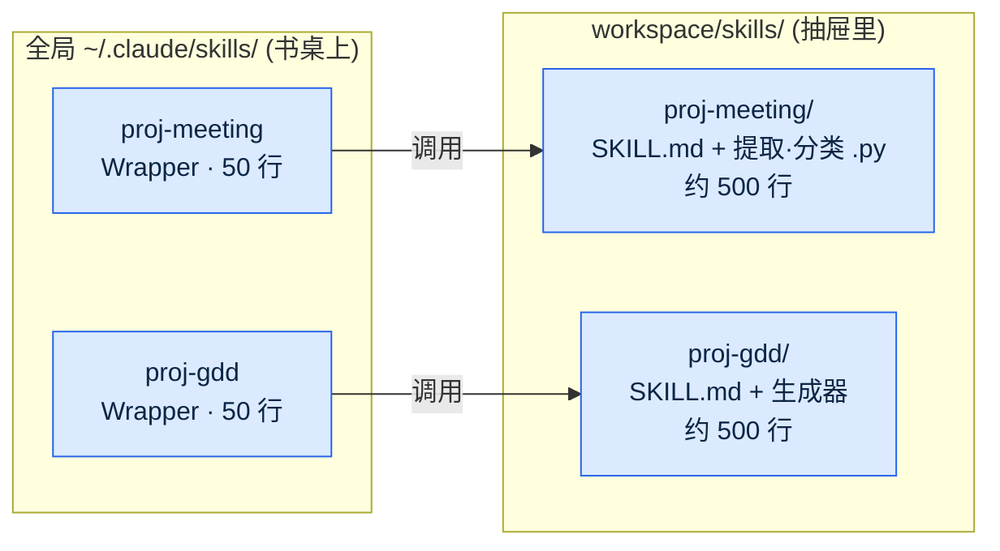
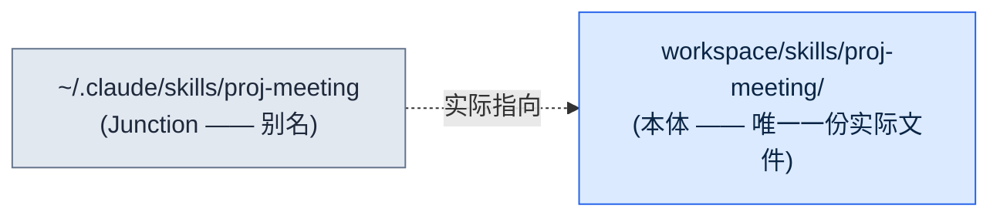
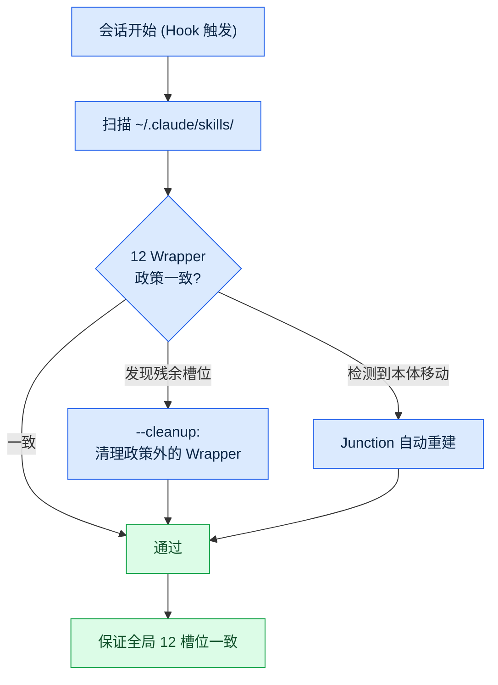
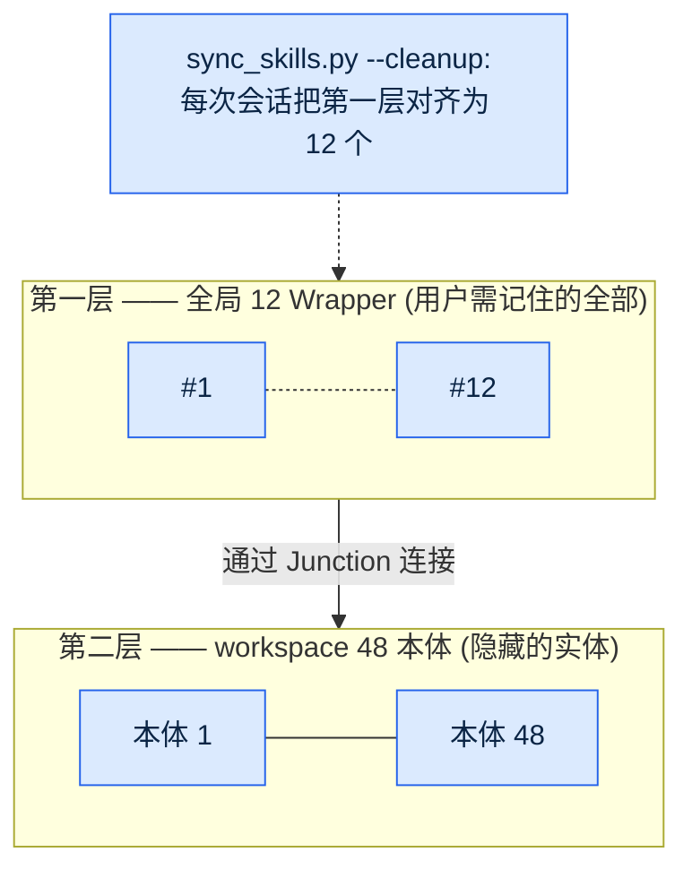
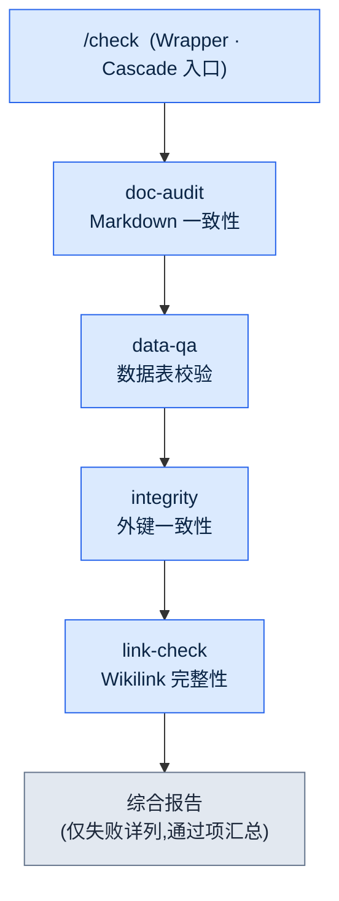
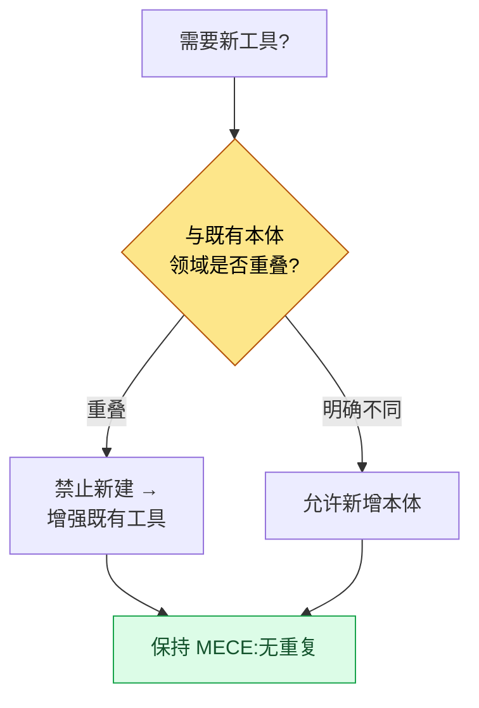

# Part 23 · 第1章. Wrapper·Cascade·Junction 模式

> 不要增加工具,而要制造工具的工具。这是关于一种两层结构——在全局 12 个入口背后隐藏 48 个本体——以及无需人工干预维持其一致性的自动化的故事。

---

某个跑月度复盘的傍晚,数着斜杠命令列表时,我的手停住了。有 40 个。明明半年前是从七八个起步的,可就这么做一个会议记录工具、加一个数据校验工具、再添一个 GDD(Game Design Document,详细规格文档)生成器,一周增加一两个,不知不觉就成了 40 个。而且其中将近一半,在过去一个月里一次都没被调用过。

问题在于,不用的工具并不是安静地待在那儿而已。每次开始会话,40 个斜杠命令的规格说明都会全部被加载。它蚕食了 token 预算,名称相近的命令(`skill-design`·`skill-design-new`·`skill-design-template`)容易混淆,而真正需要某个工具时,又要花时间才能想起它。工具不再是帮着干活,反倒是管理工具本身成了一项工作。

本章讲的,就是把这 40 个收敛为全局 12 个、却又一个本体都没舍弃的过程。核心是三种模式:制造轻量入口的 **Wrapper**、把多个工具收进一个入口的 **Cascade**、把入口与本体在物理上连起来的 **Junction**。还有替人守住这三者一致性的 `sync_skills.py`。

---

## 23.1.1 从复盘中发现的量化信号

工具太多这种印象人人都会有。但仅凭印象,无法决定该削减什么。让决策成为可能的,是月复盘对工具经济性的测量。

本项目把复盘作为自我改进机制来运营。日复盘累积成周复盘,周复盘汇聚成月复盘的过程中,月复盘会从 SVN 提交日志中反推"过去一个月各工具用了多少次"。用于这项测量的分数就是 `skill_audit_score`。它通过提交历史追踪每个斜杠命令在实际工作产出中出现了多少,从而给出使用频率。

那个月测量得到的分布如下。(使用量占比是基于 SVN 提交日志的实测,不是绝对调用次数,而是各工具的出现占比。)

<svg viewBox="0 0 640 220" xmlns="http://www.w3.org/2000/svg" font-family="sans-serif" font-size="13">
  <rect x="0" y="0" width="640" height="220" fill="#fafafa" stroke="#ddd"/>
  <text x="20" y="30" font-weight="bold" font-size="15">斜杠命令 40 个 —— 使用频率分布</text>

  <!-- TOP 12 bar -->
  <rect x="20" y="55" width="500" height="40" fill="#2c7be5"/>
  <text x="30" y="80" fill="#fff" font-weight="bold">TOP 12 命令</text>
  <text x="530" y="80" fill="#2c7be5" font-weight="bold">使用量的 92%</text>

  <!-- middle group -->
  <rect x="20" y="105" width="55" height="40" fill="#a6c8f0"/>
  <text x="85" y="130" fill="#555">中等使用 10 个 —— 约 8%</text>

  <!-- tail group -->
  <rect x="20" y="155" width="18" height="40" fill="#e0e0e0" stroke="#bbb"/>
  <text x="85" y="180" fill="#999">每月不足 1 次 18 个(占总数 45%) —— 几乎 0%</text>

  <text x="20" y="212" fill="#888" font-size="11">来源:月复盘 skill_audit_score,SVN 提交日志反推 / 占比为出现比重实测</text>
</svg>

排名前 12 的命令占了总使用量的 92%,而每月一次都用不到的命令有 18 个,占总数的 45%。答案已经定了一半:只把常用的 12 个暴露在全局,其余的整理归置。

问题在于,"整理"并不等于"删除"。那 28 个不常用的命令,每季度也总有一两次会用到——写半年报告时,建立新的数据模式时,或运行某项特定校验时。那时如果工具不在,工作就会当场停下。所以真正的问题是:**如何只让 12 个可见,同时把 28 个保留下来。**

书桌的比喻贯穿整章。没有人会把 40 支笔全摊在桌面上天天用。只把常用的 12 支放在桌上,其余收进抽屉。抽屉里,同类的笔再归到一个笔筒里。Wrapper 是放在桌面上的轻量入口,Junction 是连接抽屉与桌面的通道,Cascade 是捆在一个笔筒里的一束笔。

---

## 23.1.2 Wrapper 模式 —— 轻量入口,重量本体

Wrapper 是斜杠命令的一层薄壳。全局只放入口,实际逻辑放在 workspace 的本体里。全局目录里住着 50 行的说明,本体里住着 500 行的实现。



这一分离带来五点好处。会话开始时全局只加载 50 行,节省 token;本体即使每天修改也不影响全局槽位;本体可以放在 SVN、Git 或任何地方;本体放在团队共享文件夹、只把 Wrapper 放在个人全局,便于共享;统一 Wrapper 的格式后,用户体验保持一致。

Wrapper 的标准格式如下。所有 Wrapper 都共享这一骨架。

```markdown
---
name: proj-meeting
description: 会议记录分析·决策提取 (本体: workspace/skills/proj-meeting/)
---

# /proj-meeting —— Wrapper

本体位置:workspace/skills/proj-meeting/SKILL.md

## 工作方式
该 Wrapper 调用本体的入口脚本。详细逻辑定义在本体中。
本体变更时,只需更新该 Wrapper 的 description(建议自动同步)。
```

关键在于只有一行 description 和一个本体指针。逻辑一旦进来,Wrapper 就会变重,与本体的同步也开始失效。因此以规则强制 Wrapper 保持在 100 行以内。

本项目的全局斜杠命令槽位固定为 12 个。常用工具必须全部装进这 12 个,选择标准由月复盘来把关:每月使用 5 次以上、领域均衡(单一领域的工具不超过 6 个)、入口一致(命名规则统一)。一旦超过 12 个,就废弃使用最少的那一个,或将其并入其他命令。

12 这个数字并非绝对。关键在于"数字被固定下来"这件事本身。小规模(\~10 人)团队也许 10 个合适,领域繁多的团队也许 15 个更合适。只有存在既定上限,认知负担才会停留在一定水平。

---

## 23.1.3 Junction 模式 —— 本体与入口的物理连接

如果说 Wrapper 是"全局只放轻量入口"这条规则,那么 Junction 就是在操作系统层面实现这条规则的手段。Junction 是目录符号链接,也就是 OS 提供的别名。



用户查看全局位置时,看上去本体就在那里。但实际文件只有一份,存在于本体位置。全局那一侧,只是指向那里的一块路标而已。

这一结构带来的好处很清楚。修改本体会立即反映到全局(没有复制步骤)。文件只有一份,节省磁盘;全局只有 Junction,因而不会有 Git 冲突(本体在 SVN/Git 中另行管理)。即使移动本体,只要重新挂上 Junction,对用户来说也毫无变化。

不同 OS 的挂载方式不同。Windows 用 `mklink /J <link> <target>` 创建目录 junction,无需管理员权限。Linux 和 macOS 用 `ln -s <target> <link>`,WSL 直接沿用 Linux 命令。这一平台差异由后文将讲到的 `sync_skills.py` 自动处理,运维者无需亲自记住各 OS 的命令。

如果不用 Junction 而用复制来运营,一旦本体与全局副本产生分叉,就会出同步事故。比如在本体里修好了 bug,而全局副本还是旧版本,于是执行的还是旧行为。Junction 从根本上消除了这种事故的可能。路标不可能有两块,实体永远只有一个。

---

## 23.1.4 sync_skills.py —— 替人维持一致性的工具

手动管理 Wrapper 和 Junction,最终还是会回到 40 个。人会拖延整理、忘记政策、制造例外。因此把一致性维持自动化,那个工具就是 `sync_skills.py`。

每次会话开始时,Hook 都会触发这个脚本。脚本所做的事是以下流程。



核心功能有三个。第一,扫描全局目录,检查是否符合 12 Wrapper 政策。第二,用 `--cleanup` 标志清理不在政策内的残余 Wrapper。若有人临时添加的工具残留在槽位里,会在下次会话开始时被清理,槽位不会再次暴增。第三,若本体位置发生变化,就自动重新挂上 Junction:检测 OS,Windows 选用 `mklink /J`,其他则选 `ln -s` 调用。
重要的是,这三项功能都设计为 **幂等(idempotent)**。它是每次会话开始时自动运行的工具,因此在同一状态下反复运行多次,结果都应与运行一次相同。已经符合政策的 Wrapper 不去动,已经正确挂好的 Junction 不再重挂,没有需要清理的残余槽位就什么都不删。若不幂等,每次会话都会叠加同样的整理,从而出现重建好端端的 Junction、或误动本体的事故——对于每次会话都无人值守运行的工具而言,这会直接演变为同步事故。因此 `sync_skills.py` 把"只动改变过的,没改变就不动"作为不变式。

`--cleanup` 的效果直接关系到 token 预算的保护。把每次会话加载到全局的斜杠命令说明固定为 12 个,即使本体增加到 48 个,会话开始的成本也保持恒定。因为不靠人工管理,政策也不会走样。

这种自动一致性,就是两层结构的安全销。Wrapper 与 Junction 搭出结构,`sync_skills.py` 让这一结构随时间推移仍得以维持。

---

## 23.1.5 两层结构 —— 全局 12 wrapper → workspace 48 本体

三种模式与自动一致性结合起来,就完成了下面的两层结构。上层是用户需要记住的 12 个入口,下层是 48 个本体。



用户只需记住全局的 12 个。哪怕它们背后藏着 48 个本体,认知负担也停留在 12 个。Wrapper 让入口保持轻量,Junction 把入口与本体连起来,`sync_skills.py` 在每次会话中守住这 12 个的一致性。

按比例看,入口与本体是 1:4(12 比 48)。工具再增加,用户要记的也不会增加。本体增加到 60 个、80 个,第一层仍然是 12 个。这就是"不要增加工具,而要制造工具的工具"这句话的实际实现。增加的是第二层(本体),而用户面对的第一层(入口)始终恒定。

---

## 23.1.6 Cascade 模式 —— 用一个入口串起的连锁调用

如果说两层结构是"把众多工具收敛为少数入口"的模式,那么 Cascade 就是"把经常一起用的工具打包进一次调用"的模式。一个斜杠命令依次调用多个下级工具,再把结果汇成一份综合报告。

本项目最具代表性的 Cascade 是 `check`。它把每天早上检查策划数据完整性的四个工具整合成了一个。



过去每天早上要分别调用四个工具:文档检查一次、数据检查一次、外键检查一次、链接检查一次。每个工作周期要手动调用三四次。`check` 把这四个打包为一个命令,只需调用一次,四个阶段就会依次执行,结果合并为一份。

Cascade 的设计有原则。每个阶段都必须能够单独调用(必须能只调用 `data-qa`)。失败时中断还是继续,由各阶段分别设定。校验类作业即使某一阶段失败,也继续运行其余阶段以看到全局;变更类作业则一旦某一阶段失败便立即停止。结果会累积并成为下一阶段的输入,而综合报告在每个 Cascade 中都采用相同的格式。

`check` 的实际定义如下。(这是把 4 种校验整合为一个的配置。)

```yaml
cascade:
  - step: doc-audit
    purpose: Markdown 一致性 (YAML frontmatter·链接·atom 引用)
    fail_action: continue
  - step: data-qa
    purpose: Excel 数据表校验 (模式·取值范围·必填列)
    fail_action: continue
  - step: integrity
    purpose: 外键一致性 (表间引用)
    fail_action: continue
  - step: link-check
    purpose: Wikilink·外部链接完整性
    fail_action: continue

report:
  format: markdown
  include_pass: false   # 通过项仅汇总,失败项详列
  group_by: severity
```

四个阶段都挂着 `fail_action: continue`,是因为这是一个校验类 Cascade。即使一项检查失败,也把其余三项跑完,一次性看到当天的全部缺陷清单。报告把通过项折叠为汇总、只展开失败项,把注意力集中在早上真正该看的东西上。

Cascade 也有陷阱。阶段无限增加,复杂度就会爆炸。因此像 12 槽位政策一样,Cascade 也设阶段上限。大致超过五到七个阶段,就拆成两个,或把一部分分离为独立的 Cascade。

---

## 23.1.7 工具治理 —— MECE Wrapper 政策

两层结构和 Cascade 一旦稳定下来,增加本体就变得容易——因为不必动全局槽位,只要往 workspace 里添加本体即可。可正是在这里出现了新的陷阱:添加一旦变容易,相似的工具就会重复堆积。

因此在增加本体时强制一条政策:**MECE Wrapper 政策**。要添加新工具时,分两条路判断。若与既有工具领域重叠,就不新建,而是增强既有工具;只有领域明确不同时才新建。意思是让本体清单做到无重叠(Mutually Exclusive)、无遗漏(Collectively Exhaustive)。



这一判断由复盘来支撑。`skill_audit_score` 从 SVN 日志中测量各工具的使用频率,于是能捕捉到"这个工具其实和那个工具做的几乎是同一件事,而两者都几乎没人用"这样的信号。那就把两者合并,或把使用较少的一方从本体中撤下。治理中,整理与添加同样重要。

没有 MECE 政策,两层结构带来的"添加本体的自由"反而会变成毒药。即便本体不蚕食第一层槽位,本体本身因重复而臃肿起来,又会让人重新搞不清该用哪个本体。政策阻止这种臃肿。

---

## 23.1.8 复盘为何引燃了这一切

到这里,回到开头看看。Wrapper 也好,Junction 也好,Cascade、MECE 政策也好,没有一个是在书桌前预先设计出来的。它们全都是作为对复盘中发现的问题的回答而诞生的。

当月复盘的 `skill_audit_score` 用量化数据揭示出 40 个槽位与 92% 使用量的失衡时,"限制到 12 个"就此定下。那个决定之后,紧跟着"那 28 个又该如何保留"的问题,答案就是 Wrapper 与 Junction。下一次复盘中出现了"每天早上分别调用四个相似的校验工具太麻烦"的发现,答案就是 `check` Cascade。又一次复盘中捕捉到"添加本体变容易了,重复就堆积起来"的信号,答案就是 MECE 政策。

没有复盘,这些模式就不会诞生;就算做出来,也会沦为与真实问题无关的过度工程。先用测量发现问题,再引入模式——正是这个顺序,让工具真正被用起来。复盘是自我改进的起点,这一 Part 21 的信息,在工具层面就这样被具体化了。

---

## 23.1.9 运营案例 —— 6 个月累计

把六个月的测量值按引入前后作比较。关注的不是绝对调用次数,而是运营负担的变化。

| 项目 | 引入前 | 引入后 (Wrapper+Cascade+Junction) |
|---|---|---|
| 全局槽位数量 | 40 个(暴增) | 12 个(政策强制) |
| 本体数量 | 分散·大量重复 | 48 个(MECE 整理) |
| 会话开始时全局槽位占比 | 大(加载 40 个说明) | 小(仅加载 12 个说明) |
| 本体修改后同步到全局 | 需手动复制步骤 | 立即(Junction,无复制) |
| 相似校验工具的调用 | 每次作业手动 3\~4 次 | 1 次(check Cascade) |

引入首月的测量值参差不齐。在 Wrapper 格式定型之前,同步事故出过两三次;在 12 个政策被强制之前,槽位在 15 到 18 之间来回浮动。稳定是从第二个月开始的。自 `sync_skills.py --cleanup` 开始在每次会话中整理槽位之后,槽位暴增就再没发生过。

表中"占比"·"需要"·"立即"这类方向性表述是有意为之。因为每个环境的 token 成本与时间都不同,所以只写了变化的方向。可以确定的是,第一层从 40 固定到了 12,而本体同步中手动复制这一步已经消失。

---

## 23.1.10 常见错误与规避方法

把前面各节点到的陷阱汇总到一处。这五点,全都指向同一个教训:比起搭出结构,让它随时间推移仍能维持更难。

- **逻辑渗入 Wrapper。** 轻量入口一旦吸收本体的一部分,同步就会失效 → 以规则强制保持在 100 行以内(§23.1.2)。
- **用复制代替 Junction。** 本体与副本一旦分叉,旧版本就会执行旧行为 → Junction 不是可选项而是必需(§23.1.3)。
- **无限堆叠 Cascade 阶段。** 超过五\~七个,复杂度就会爆炸 → 设定阶段上限(§23.1.6)。
- **用手工管理 12 槽位。** 没有强制装置,就必定再次暴增 → `sync_skills.py --cleanup` 在每次会话中整理(§23.1.4)。
- **没有复盘就先引入模式。** 在测量之前搭结构,会留下没人用的骨架 → 测量 → 发现 → 模式 的顺序(§23.1.8)。

---

## 动手试试(setup → prompt → verify)

**setup.** 在 workspace 里建一个本体目录(例如 `workspace/skills/proj-meeting/`)。在里面放 `SKILL.md` 和实际脚本。全局 `~/.claude/skills/` 里只放 50 行的 Wrapper。

**prompt.** 向 Claude 提出以下请求。

```
扫描 ~/.claude/skills/ 中的斜杠命令列表。
把每个命令分类为 (a) 只有本体指针的轻量 Wrapper,
还是 (b) 含有逻辑的重量级命令,
对属于 (b) 的命令,把本体分离到 workspace,
并给出只在全局保留 50 行 Wrapper 的修改方案。
另外,输出为指向本体的 Junction 按 OS 匹配挂载的命令
(Windows 用 mklink /J,其他用 ln -s)。
```

**verify.** 确认三点。第一,全局目录中的每一项是否都在 100 行以内。第二,打开全局项时,是否只看到一行本体位置和 description。第三,把本体改动一行后从全局调用时,改动是否立即生效(只要 Junction 挂对了,就会无需复制而生效)。

## 单人精简版

如果是既没有团队也没有 SVN 的单人运营,就这样精简。不必设 workspace,一个个人 Git 仓库就够了。本体放在那个仓库里,全局只放 Wrapper。即使没有 `skill_audit_score` 这样的测量工具,只要在月末把"这个月实际调用过的命令"亲手记下来,失衡就会显现。只把排名前五到七的留在全局,其余的下放到本体。Cascade 只需在经常一起调用的工具出现两个以上时,把它们打包为一个命令即可。若嫌自动一致性脚本麻烦,可以用"开始新会话时用眼睛把全局目录扫一遍"的习惯来替代。规模一小,习惯就替代自动化做着同样的事。

---

### 本章要点
- 不要增加工具,而要制造工具的工具 —— 全局 12 个入口,本体 48 个实体。
- Wrapper·Junction·sync_skills 无需人工就守住两层一致性。
- 所有模式都从复盘的量化测量中引燃 —— 先测量,再谈结构。

### 下一章预告
- Part 23 · 第2章. Hermes Agent 引入记
