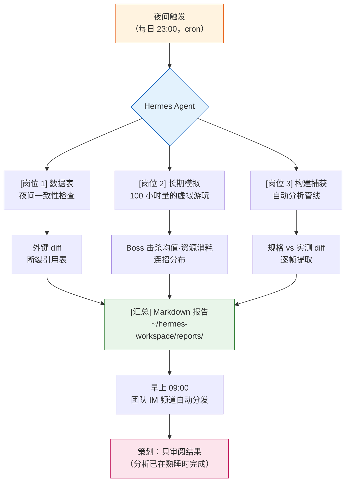

# Part 23 · 第2章 Hermes Agent 引入实录

晚上 11 点 47 分。我保存好最后一份数据表,合上了笔记本电脑。次日早上 9 点 10 分,冲咖啡时打开公司内部的即时通讯工具,发现频道顶部已经挂着一份报告。那是一份 Markdown——它以外键为基准,对昨夜更新过的三张数值表做了交叉校验,并用红色标出了两处断裂的引用。不是我写的。它是在我熟睡时生成的。

本章记录的,是把制作那份报告的工具——Hermes Agent——装到个人 PC 上,并叠加到 §23.1 讲过的 Wrapper·Cascade·Junction 运营之上的整个过程。最初引入时,Hermes 还是基于 Linux 的,要在 Windows 上使用就得先经过 WSL2;到了 2026 年,原生 Windows 构建发布,这道弯路就消失了。先把结论说在前面:智能体(Agent)并没有把 Claude Code 挤走,而是坐到了它旁边。

---

## 23.2.1 坐在同一张桌前的两个工具

到 §23.1 为止的运营,全部以 Claude Code 为中心。我输入一句话,工具就响应一次,我审阅完这次响应,再输入下一句。这种短周期对精细作业再好不过。如果是修改一个数值、每一步都需要确认的作业,那就该由人每次介入。

问题出在耗时长的作业上。"把过去一个月的 30 份会议记录全部读一遍,只把决策事项抽取成 atom 候选"这样的请求,若放在对话流里处理,需要 30 个来回。那 30 次里,我没法做别的事。对这类作业,输入与输出短促相连的工具,其长处反而成了短处。

智能体填补的正是相反的位置。只要抛出目标——"从 30 份会议记录里把决策事项挑成 atom 候选,汇成报告"——它就自己挑选工具、自行走完中间步骤,结束后只把结果拿回来。周期长而自主。代价是,每一步人看不到,这个短处也随之而来。

<svg viewBox="0 0 640 280" xmlns="http://www.w3.org/2000/svg" font-family="sans-serif" font-size="13">
  <rect x="0" y="0" width="640" height="280" fill="#fafafa" stroke="#ddd"/>
  <text x="320" y="28" text-anchor="middle" font-size="15" font-weight="bold">两个工具的作业周期对比</text>

  <!-- Claude Code lane -->
  <text x="20" y="70" font-weight="bold" fill="#1565c0">Claude Code</text>
  <text x="20" y="88" font-size="11" fill="#666">精细 · 单发 · 每步验证</text>
  <g fill="#bbdefb" stroke="#1565c0">
    <rect x="160" y="58" width="60" height="26"/>
    <rect x="260" y="58" width="60" height="26"/>
    <rect x="360" y="58" width="60" height="26"/>
    <rect x="460" y="58" width="60" height="26"/>
  </g>
  <g fill="#1565c0" font-size="10" text-anchor="middle">
    <text x="190" y="75">输入→输出</text>
    <text x="290" y="75">输入→输出</text>
    <text x="390" y="75">输入→输出</text>
    <text x="490" y="75">输入→输出</text>
  </g>
  <g stroke="#90caf9" stroke-width="2">
    <line x1="220" y1="71" x2="260" y2="71"/>
    <line x1="320" y1="71" x2="360" y2="71"/>
    <line x1="420" y1="71" x2="460" y2="71"/>
  </g>
  <text x="160" y="112" font-size="10" fill="#1565c0">↑ 每个箭头处都有人工审阅</text>

  <!-- divider -->
  <line x1="20" y1="140" x2="620" y2="140" stroke="#ddd" stroke-dasharray="4"/>

  <!-- Agent lane -->
  <text x="20" y="180" font-weight="bold" fill="#c62828">Hermes Agent</text>
  <text x="20" y="206" font-size="11" fill="#666">长时 · 自主 · 仅检查点</text>
  <rect x="160" y="168" width="360" height="26" fill="#ffcdd2" stroke="#c62828"/>
  <text x="340" y="185" text-anchor="middle" font-size="10" fill="#c62828">输入 1 个目标 →（自主执行：工具选择·反复·验证）→ 输出 1 个结果</text>
  <g fill="#c62828">
    <circle cx="250" cy="168" r="4"/>
    <circle cx="340" cy="168" r="4"/>
    <circle cx="430" cy="168" r="4"/>
  </g>
  <text x="160" y="222" font-size="10" fill="#c62828">● 检查点（可人工审阅的节点）—— 并非每一步</text>

  <text x="320" y="262" text-anchor="middle" font-size="12" fill="#555">精细决策走上方泳道,反复·长时走下方泳道。同一张桌子。</text>
</svg>

拿邻座同事来打比方就容易理解。Claude Code 是对我每一句话都一起细看的搭档,智能体则是主动请缨上夜班、在我上班前把报告放到桌上的助手。两者不是谁解雇谁的关系,而是共用同一张桌子。

---

## 23.2.2 为何还要再添一个工具

在 §23.1 中,我把全局斜杠命令槽收拢为 12 个,再用 Junction 把背后的 48 个本体藏起来,做成了这样一套运营。不增加工具,而是造出工具的工具——这就是那时的结论。可如今又要引入一个新工具,听上去与那个结论自相矛盾。

并不矛盾。§23.1 的 12 槽策略,处理的是"人直接调用的工具"的认知负担。而 Hermes 要填补的位置,是人不去调用的时间——熟睡的时间、开会的时间、被别的事拴住手的时间。它不是与 12 槽竞争,而是填补 12 槽够不到的时段。

引入决定的依据,是一项复盘测量值。用从 SVN 提交日志反推全局工具使用频率的 `skill_audit_score` 跑了一个月的数据,发现排名靠前的工具大多属于"在人清醒的时间、短促、频繁"使用的那一类。相反,那些使用频率低、但一旦跑起来就很耗时的作业——会议记录批量分类、数据表夜间一致性、构建捕获分析——却每每被"明天早上再做吧"地往后推。往后推的原因很明确:它们会长时间占用清醒的时间。

这类被往后推的作业群,正是智能体精准瞄准的目标。

---

## 23.2.3 安装 —— 原生 Windows 构建

最初装 Hermes 时它基于 Linux,要在 Windows 个人 PC 上使用,就得先装好 WSL2(Windows Subsystem for Linux 2),再把 Hermes 安置进去。如今有了原生 Windows 构建,这道弯路就不必了。安装和一般的 Windows 应用程序一样——下载安装器运行,在首次运行时设定好工作空间路径与权限白名单的初始值即可。

如果你已经在用 WSL2,或偏好 Linux 环境,那一侧的构建同样受支持。只是若从头开始,原生这一侧更简单。具体的安装器与版本因工具更新很快,请以官方文档为准。

无论装在哪儿,都有一个绕不开的坑。Hermes 工作空间必须放在**快速的本地磁盘**上。若把网络驱动器或 SVN 工作文件夹直接接为工作空间,一次夜间一致性检查,会把本该几分钟的作业拖成几十分钟。数据表放在工作空间之外,只在作业开始时复制进来,才是正道。若用 WSL2,出于同样的原因,要把工作空间放进 Linux 文件系统内,不要来回跨越 `/mnt/c` 这类 Windows 路径。

---

## 23.2.4 Hermes 安装与首次连接 —— 实操记录(worked transcript)

从这里开始,是真正要动手的部分。比起安装本身,"装好之后让它做什么"才是本章的核心;因此我们把第一个作业从头跟到尾——提示词全文、原始输出、人工验证、再请求——完整走一遍,如实保留操作全过程,这样一份记录即所谓实操记录(worked transcript)。这个作业,是我从 §23.2.2 中那些被往后推的作业群里挑出的最简单的一个:数据表夜间一致性检查。

> 注意:下面的部分命令只是为展示 Hermes 的表层形态而给出的示例形式。安装器 URL 与子命令随版本而变,请查阅官方文档。工作流的结构(目标 → 自主执行 → 验证 → 再请求)不因工具更换而改变。

若是原生 Windows,就在 PowerShell 里下载并运行官方的 `install.ps1`。不过,在直接执行一行式的 `iex (irm ...)` 之前,先把脚本(约 2,800 行)下载下来,用眼睛扫一遍其中的危险模式——这是信任来源的最起码步骤——然后把密钥配置分离出来:用 `-SkipSetup` 先只装本体,再单独跑 `hermes setup`,这样更安全。若用 WSL2·Linux,则遵循官方文档中对应的安装小节。

```powershell
# 原生 Windows —— 官方 install.ps1(先下载、审阅后再运行)
irm https://hermes-agent.nousresearch.com/install.ps1 -OutFile install.ps1
# (确认 install.ps1 内容之后)
.\install.ps1 -SkipSetup
# 一并获取 Python 3.11 · Node · Git · Playwright · 捆绑技能
# 安装位置:%LOCALAPPDATA%\hermes\  (将 hermes 命令注册到 PATH —— 从新终端起生效)
# 结束后:hermes setup
```

安装器会一并装好依赖(Python 3.11·Node 22·Git),把本体安装到 `%LOCALAPPDATA%\hermes\`,再将 `hermes` 命令注册到 PATH(从新终端起生效)。配置、日志、预约(cron)、检查点这类运营数据也都留在同一个 `%LOCALAPPDATA%\hermes\` 之下,重装也不会丢(这里有个坑——`~/.hermes\` 里只放了辅助脚本,很容易搞混。真正的 `config.yaml`·`logs\` 全都在 `%LOCALAPPDATA%\hermes\` 那一侧)。首次运行 `hermes setup` 时,会询问模型 API 密钥,并设定工作空间路径与权限白名单的初始值。

```powershell
hermes --version
hermes setup
```

现在把第一个作业交给它。抛给智能体的目标,比 Claude Code 的提示词要抽象一层。不是"把这个照这样做",而更接近"把这个结果给我做出来"。我实际输入的目标全文如下。

**[提示词全文]**

```
目标:数据表夜间一致性检查。

读取 ~/hermes-workspace/sheets/ 下的 item_master·drop_table·npc_shop 三个 xlsx,
检查 drop_table·npc_shop 所引用的 item_id 是否真的存在于 item_master 中,做外键
检查。把所有断裂的引用(指向不存在的 item_id 的行)都找出来,以日期为文件名,
用 Markdown 保存到 reports/。(意图:通过的只报数量,失败的用表格列出表名·行号·item_id)

约束:
- sheets/ 只读,绝对不要修改。
- 若读不了表,或列名与预期不同,就停下,报告哪里不一样。禁止臆测。
```

最后两行很重要。智能体是自主的,一旦卡住,就有"自作主张"去填补的倾向。列名不同时,它会挑一个相近的名字继续跑下去。所以要明确地输入"卡住就停下并报告,不要臆测"。这与 §23.1 里编排数据表验证 Cascade 时学到的教训是同一个道理。

**[Hermes 原始输出 —— 第 1 次]**

不做概括,原样照录。第一次尝试并没有顺顺当当地结束。

```
[hermes] goal accepted: 数据表夜间一致性检查
[hermes] step 1/4  reading sheets...
         item_master.xlsx   loaded (4,210 rows)
         drop_table.xlsx    loaded (1,880 rows)
         npc_shop.xlsx      ERROR

[hermes] npc_shop.xlsx: expected column 'item_id', found columns:
         ['shop_id', 'sell_item', 'price', 'stock']
[hermes] this conflicts with the constraint: "列名与预期不同就停下并报告".
[hermes] HALTING. reporting instead of guessing.

[hermes] partial result:
  - item_master ↔ drop_table 检查可行(item_id 列两侧都存在)
  - npc_shop 的 item_id 列名推定为 'sell_item',但无法确定,故未执行
[hermes] awaiting clarification on npc_shop column mapping.
```

这里正是第一次用智能体的人最吃惊的地方。工具停了下来。而且准确说出了停下的原因。`npc_shop.xlsx` 的道具引用列,不是我预期的 `item_id`,而是 `sell_item`。若没有事先输入约束,智能体就会自作主张把 `sell_item` 当成 `item_id` 继续跑,而我在早上只会收到一份"正常"的报告。停下,就是安全。

**[人工验证·驳回]**

我看着输出,做了两点判断。

第一,报告说 item_master ↔ drop_table 的检查已经可行,这部分值得信任。第二,npc_shop 的 `sell_item` 推定是对的——它确实是那张表的销售道具列名。只不过,不以"推定"就贸然推进的判断是正确的。于是我没有原样接受第 1 次输出(驳回),而是提交了一份明确写出列映射的再请求。

**[再请求提示词]**

```
已确认。明确列映射如下:
- npc_shop.xlsx 的道具引用列是 'sell_item'。把它当作 item_id 来检查。
- 其余约束不变。不要再额外臆测 'sell_item' 之外的列。
再执行一次。
```

**[Hermes 原始输出 —— 第 2 次]**

```
[hermes] resuming with column map: npc_shop.sell_item -> item_id
[hermes] step 2/4  foreign-key check...
         drop_table → item_master   : 1,880 refs, 2 broken
         npc_shop   → item_master   : 642 refs, 0 broken
[hermes] step 3/4  collecting broken refs...
[hermes] step 4/4  writing report...
         ~/hermes-workspace/reports/2026-05-25_sheet_integrity.md  written
[hermes] done. 2 broken references found. summary:
  | sheet      | row  | bad item_id |
  |------------|------|-------------|
  | drop_table | 417  | ITM_90412   |
  | drop_table | 1356 | ITM_90727   |
```

两处断裂的引用被抓了出来。`drop_table` 的第 417 行和第 1356 行,指向了 `item_master` 中不存在的 `item_id`。早上看到的那张红色表格,正是这个。

在这一个来回里,本章的信息几乎全部显现。智能体虽自主,却在约束面前停了下来;人把它停住的地方补上,它便走到了终点。自主与控制不是冲突,而是咬合。而只要把这整个周期预约成在我熟睡时再跑一次,那就成了 §23.2.5 的夜间自动化。

---

## 23.2.5 嵌入游戏策划工作流的三个岗位

第一个作业上手之后,就把被往后推的作业群一个个挪到夜间。我实际叠加上去的是三个岗位。三者的共同点很清楚——它们都把人无需清醒在场的时间,变成了干活的时间。



**岗位 1 —— 数据表夜间一致性。** 把 2.4 里从头跟到尾的那个作业预约到每晚 23 点。无论昨夜谁动过哪张表,一到早上,外键断裂的地方就以表格呈现出来。这与 §23.1 的 `/check` Cascade(doc-audit → data-qa → integrity → link-check 四合一)表面相似,但有一个决定性差异。`/check` 要我醒着去调用才会跑,夜间智能体则不需要我在场也照跑。两者并不竞争——白天的 Cascade 是即时验证,夜晚的智能体是无人验证,角色由此分开。

**岗位 2 —— 长期模拟。** 把 §4.4 讲过的战斗模拟沿时间轴深度拉长。这是一项跑 100 小时量的虚拟游玩、测量 Boss 击杀平均时间、资源消耗曲线、连招分布的作业。它本质上不适合 Claude Code 的对话流——跑一次要好几个小时,而那段时间里我不可能一直守着对话窗。让智能体在后台跑,结束后只把曲线图和汇总数值拿回来。

**岗位 3 —— 构建捕获自动分析。** QA 捕获的构建视频一落进文件夹,智能体就逐帧提取数据,做出规格数值与实测数值的 diff。策划无需把视频从头到尾看一遍,只看"规格是伤害 120,而构建实测为 108"这样的 diff 行。分析里枯燥的部分,整个都归智能体。

这三个岗位,看结果的人所花的时间都没有减少。减少的是投入到分析里的人力时间。判断,依然由人来做。

---

## 23.2.6 自主的代价 —— 五道安全装置

智能体的自主性,本身也就是风险。一件不经人每一步确认就读文件、跑命令的工具,一旦出岔子,人不在现场。§23.2.4 里明写"禁止臆测",并非偶然。五道安全装置不是可选项,而是引入第一天就要一起打开的一整套。

| 装置 | 作用(实际 Hermes 配置键) | 缺了会发生什么 |
|---|---|---|
| 权限白名单 | 破坏性命令须经人工批准(`approvals.mode: manual`),只把允许的命令列入白名单(`command_allowlist`),密钥值在日志中打码(`security.redact_secrets`) | 自作主张改掉原始数据表 |
| 检查点 | 文件操作前拍快照,便于回退(`checkpoints.enabled`,恢复用 `/rollback`) | 错误的假设一路滚到底,整个结果被污染 |
| 日志自动记录 | 把网关·智能体·错误日志留在 `%LOCALAPPDATA%\hermes\logs\` | 出事后无法追溯"为什么会这样" |
| 成本上限 | 单个作业的轮次上限(`agent.max_turns`)·终端超时(`terminal.timeout`)·死循环自动检测(`tool_loop_guardrails`)·上下文自动压缩(`compression`) | 陷入死循环的作业把 API 账单越滚越大 |
| 可废弃 | 随时中止(`/stop`)·预约暂停/删除(cron pause)·子作业超时(`delegation.child_timeout_seconds`)·不用的技能自动归档(`curator`) | 开始跑偏的夜间作业停不下来 |

这五道并非各自为政,而是作为一整套协同工作。只锁权限、不设成本上限,就会在权限范围内跑起死循环,把账单撑大。只开日志、没有废弃手段,就会眼看着出了事却停不下来。哪怕只缺一道,夜间无人运营的事故概率也会陡然上升。

实际把工具打开来看,这五个概念在若干处的实现,比书中所描绘的还要细密一层。权限一侧多出一层独立的策略引擎(`security.tirith_enabled`),用规则过滤命令。成本一侧的死循环检测并非单一上限,而是把"同一失败反复"·"毫无进展的反复"这类信号分别设为阈值。而夜间无人预约(cron)另有一个开关(`approvals.cron_mode: deny`),在无人时段一旦逮到破坏性命令,就不等批准直接拒绝——相当于把书里的"权限 + 检查点"合并进了一个配置。废弃一侧的 `curator`,正是 §21 的"不用的工具就废弃"落成实际功能的地方。五道套件的骨架照旧保持,只是工具做得更精细的地方,把那个键打开就好。

把这一整套写进 `config.yaml`,大致是下面这个样子。

```yaml
# %LOCALAPPDATA%\hermes\config.yaml (节选)
approvals:
  mode: manual              # ① 权限 —— 破坏性命令须经人工批准
  command_allowlist:        #    只列出无需批准即可放行的命令
    - "python *"
    - "rg *"
  cron_mode: deny           #    夜间无人 cron 遇到破坏性命令则自动拒绝
security:
  redact_secrets: true      #    在日志中打码密钥值
  tirith_enabled: true      #    再加一层策略引擎(基于规则的命令过滤)
checkpoints:
  enabled: true             # ② 检查点 —— 文件操作前拍快照(/rollback 恢复)
  max_snapshots: 20
  retention: 7d
logs:
  path: "%LOCALAPPDATA%\\hermes\\logs"   # ③ 日志 —— gateway/agent/errors
agent:
  max_turns: 60             # ④ 成本 —— 单个作业轮次上限
terminal:
  timeout: 180              #    终端命令超时(秒)
tool_loop_guardrails:       #    死循环自动检测(同一失败·毫无进展)
  enabled: true
compression:
  enabled: true             #    上下文自动压缩(节省 token)
delegation:
  child_timeout_seconds: 600  # ⑤ 废弃 —— 子作业超时(与 /stop·cron pause 配合)
curator:
  enabled: true             #    不用的技能自动归档
```

委派也不是一次全交出去。起初只把最窄、最容易回退的作业(像一致性检查这种只读的活儿)交给它,盯着结果看上几天,再拓展到下一个岗位。§23.2.4 里第一个作业选夜间一致性检查,也是同样的道理——只读,最坏也不过是一份错误的报告,原始数据不会受损。

---

## 23.2.7 引入进展与渐进阶段(2026-06 时点)

在更新本章的这个时点,引入已进入稳定期。原生 Windows 构建(v0.16.0)已安装完毕,也已用 `hermes setup` 登记好模型 API 密钥。启用了第一个岗位,把 5 道安全装置逐一对照实际配置键做了检查,如今正跑着真实的自主作业,一点点上手。老实说,是先在个人 PC 而非公司 PC 上验证——公司引入,被我推迟到个人 PC 上的安全装置足够纯熟之后。这与其说是谨慎,不如说更接近 PC 分离原则。未经验证的自主工具,不会直接放到团队数据上。

| 期间 | 活动 | 关卡(gate) |
|---|---|---|
| 1 个月 | Hermes 安装(原生 Windows v0.16.0)+ `hermes setup` + 首个作业 | 5 道安全装置是否全部打开 |
| 2\~3 个月 | 扩展到 2\~3 个岗位(会议记录分类·构建捕获分析) | 每个委派范围都查日志 |
| 3\~6 个月 | 公司评估 —— 以个人 PC 验证结果做决策 | 确认无人运营事故 0 起 |
| 6\~12 个月 | 团队层面引入 | 安全装置沉淀为团队规约 |

跳过阶段的诱惑最危险。若从 1 个月直接跳到 6 个月(团队引入),安全装置就还只是个人一人的习惯,尚未成为团队规约便被放开。在每个阶段的末尾停一次、检查这五道装置,才是正解。比起走得快,能保持随时回退地走,更重要。

---

## 23.2.8 五个常见误解

"智能体会取代人",是最常见的误解。§23.2.4 的实操记录展示了相反的一面——智能体在一个列映射处停了下来,而那个判断由人来补上。游戏策划的核心决策依然归人,智能体拿走的是反复与分析里枯燥的部分。

"装一次就全自动"的期待也危险。头一两个月反而更费手。列名映射、权限范围、成本上限都要按作业逐一调校,在这套调校纯熟之前,每一份输出都要人来审阅。

"Claude Code 如今过时了"这种断言是错的。两者所处的时段不同。白天的精细决策交给 Claude Code,夜晚的无人反复交给智能体。§23.1 的 `/check` Cascade 并没有消失,只是在它旁边又多出了一条夜间泳道。

"开源所以免费"的认知只对了一半。本体虽免费,模型 API 的调用费用照样要花。所以 `config.yaml` 里 `agent.max_turns`·`compression` 这类成本上限,既是安全装置,也是账本。

最后,"连复杂又危险的作业也交给智能体"这种期待最危险。作业的风险越大,越要置于人的控制之下。交给智能体的,从简单且易于回退的作业开始。委派只随信任的累积而拓展。

---

## 23.2.9 通向下一章

如果说 §23.1 的 Wrapper·Cascade·Junction 是 Claude Code 运营的顶点,那么本章的 Hermes,就是在那套运营之上又铺了一条夜间泳道。白天的工具与夜晚的工具共用同一张桌子的图景——这既是 2026 年这一时点的当下,也是不远将来的骨架。

下一章是面向游戏策划的工具策展。12 槽里该放什么,用 `skill_audit_score` 剔掉什么——本章一笔带过的策展标准,将化为具体的工具推荐逐一展开。

---

### 本章要点
- 智能体不取代 Claude Code,而是填补它够不到的时段
- 五道安全装置(权限·检查点·日志·成本·废弃)要作为一整套一起打开
- 委派从只读的窄作业开始,只随信任的累积而拓展

### 下一章预告
- Part 23 · 第3章 面向游戏策划的工具策展

---

## 动手试试

**setup**
1. 下载并安装 Hermes 原生 Windows 安装器(若偏好 Linux,`wsl --install` 之后在其中安装的路子也一样存在)。
2. 在快速的本地磁盘上建一个工作文件夹,把要检查的数据表复制过去(禁止把网络驱动器·SVN 工作文件夹直接接为工作空间)。
3. `hermes setup` → 输入模型 API 密钥 → 确认工作空间路径·权限初始值。
4. 在 `%LOCALAPPDATA%\hermes\config.yaml` 中打开 5 道安全装置:权限批准(`approvals.mode: manual`·`command_allowlist`·`cron_mode: deny`)、成本上限(`agent.max_turns`·`terminal.timeout`·`tool_loop_guardrails`)、检查点(`checkpoints.enabled`)、日志路径(`logs.path`),并熟悉中止流程(`/stop`·`/rollback`)。

**prompt**
- 把目标抛得抽象一层:不是"把这个做了",而是"把这个结果给我做出来"。
- 用编号写明对象·要做的事·保存位置,最后务必输入一行:"若卡住,或列/格式与预期不同,就停下并报告,禁止臆测。"
- 第一个作业,请挑像只读的一致性检查那样容易回退的。

**verify**
- 不要原样相信第 1 次输出,智能体停下的地方(列映射·格式不一致)要由人来确认。
- 若停得对,就写明映射再请求;若停错了,就重新输入约束。
- 把生成报告里的一两个失败项,在原始表中直接比对、验证智能体判断是否正确,之后才交给夜间预约(cron 23:00)。

## 单人精简版

若想先不装 Hermes、只抓一抓智能体的手感,可以在 Claude Code 内用后台执行跑一跑精简版。

- 准备一张要检查的数据表,以及一段话:"把外键断裂的行用表格挑出来 / 列名不同就停下并报告 / 结果保存到 reports 文件夹"。
- 把它作为后台作业跑起来,这段时间去做别的事。结束后只确认结果。
- 核心不是工具,而是周期——抛出目标、信任停下、补上停下的地方、只审阅结果,这四拍一旦上手,日后换到 Hermes 本体,也照同一节拍运转。
