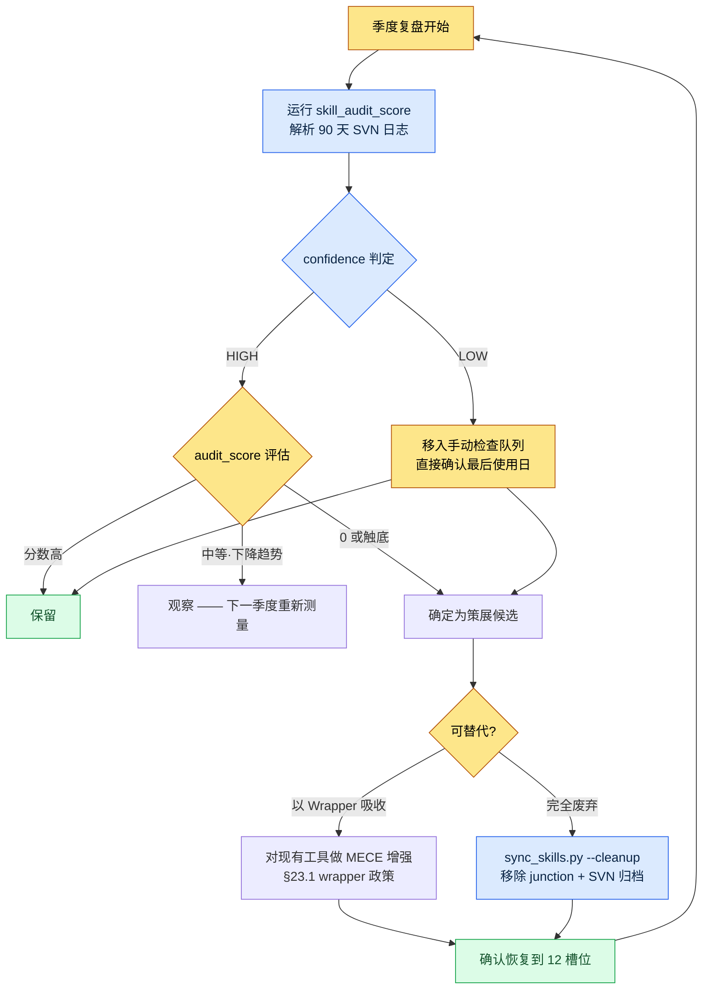

# Part 23 · 第3章. 工具策展 —— 用数据裁掉不用的工具

做季度复盘时,我打开了全局技能文件夹。一行一行数下来,wrapper 有 19 个。明明定好了只运营 12 个并这样跑了一年,不知不觉却又多出了 7 个。更离谱的是,其中一半光看名字根本想不起来是做什么的工具。`migrate-legacy-enum`。这是什么来着。上一次用它是什么时候来着。

想不起来。只要依赖记忆,这个问题就永远无法回答。于是我决定不看记忆,而是看日志。工具策展不应是凭喜好去裁剪的工作,而应是用"上个季度调用了这个工具几次"这样的数字来裁剪的工作。

本章记录的是:如何自动地把这个数字提取出来,如何用这个数字裁掉工具,以及如何从一开始就阻止工具暴增。

---

## 23.3.1 工具增多是一种自然现象

在谈策展之前,必须先承认一件事。工具只要不加阻拦就一定会增多。这不是因为意志力薄弱。而是因为每次任务中"就这一次,为了快点处理"而写一个小脚本,本身是合理的选择。而这种合理的选择累积几十次,就成了不合理的一堆废物。

项目A 中运营的结构,是全局的 12 个 wrapper 通过 junction 指向 workspace 中的 48 个本体。全局这一侧很轻,沉重的本体则放在用 SVN 管理的 workspace 里。这个结构本身已在 §23.1 中讲过。问题在于,这个 12 的数字并不会安分待着。

看看工具增多时还有什么一起增多,就能清楚为什么必须加以阻拦。

<svg viewBox="0 0 640 250" xmlns="http://www.w3.org/2000/svg" font-family="sans-serif" font-size="13">
  <rect x="0" y="0" width="640" height="250" fill="#fbfbfb"/>
  <text x="20" y="28" font-size="15" font-weight="bold" fill="#222">增加 1 个工具 → 随之增长的 4 项成本</text>
  <!-- center node -->
  <rect x="270" y="100" width="100" height="46" rx="8" fill="#2b6cb0"/>
  <text x="320" y="128" fill="#fff" text-anchor="middle" font-weight="bold">新工具 +1</text>
  <!-- four cost nodes -->
  <rect x="40" y="55" width="160" height="40" rx="6" fill="#fff" stroke="#c53030"/>
  <text x="120" y="80" text-anchor="middle" fill="#c53030">上下文 token 占用 ↑</text>
  <rect x="440" y="55" width="160" height="40" rx="6" fill="#fff" stroke="#c53030"/>
  <text x="520" y="80" text-anchor="middle" fill="#c53030">选择疲劳 ↑</text>
  <rect x="40" y="155" width="160" height="40" rx="6" fill="#fff" stroke="#c53030"/>
  <text x="120" y="180" text-anchor="middle" fill="#c53030">维护表面积 ↑</text>
  <rect x="440" y="155" width="160" height="40" rx="6" fill="#fff" stroke="#c53030"/>
  <text x="520" y="180" text-anchor="middle" fill="#c53030">功能重复风险 ↑</text>
  <!-- lines -->
  <line x1="270" y1="115" x2="200" y2="75" stroke="#a0a0a0"/>
  <line x1="370" y1="115" x2="440" y2="75" stroke="#a0a0a0"/>
  <line x1="270" y1="131" x2="200" y2="175" stroke="#a0a0a0"/>
  <line x1="370" y1="131" x2="440" y2="175" stroke="#a0a0a0"/>
  <text x="320" y="232" text-anchor="middle" fill="#555" font-size="12">工具是 +1,成本却是 +4。这正是策展属于"做减法"的原因。</text>
</svg>

尤其是第一项,上下文 token 占用,是进入 AI 工具时代后变得更为尖锐的成本。全局 wrapper 一多,每个会话中 AI 读取"我可用的工具清单"所需的 token 就会增多。为了读 19 个工具的说明,真正能用在任务上的上下文反而减少了。因此项目A 的 `sync_skills.py` 带有 `--cleanup` 选项,会自动清理 junction 已断裂或本体已消失的 wrapper。这更接近一种为守住 token 预算而做的卫生工作。

但 `--cleanup` 能抓到的只有"断裂"的工具。那些好端端活着、却没人用的工具,它抓不到。要抓这类工具,就需要使用频率数据。

---

## 23.3.2 skill_audit_score —— 用 SVN 日志测量使用频率

核心思路很简单。workspace 中的技能与工具全都在 SVN 里。而且每次使用工具,该工具产出的产物(表格、文档、关系图 HTML 等)都会提交到 SVN。也就是说,**只要看 SVN 日志,哪个工具实际干过活就会作为痕迹留下来。**

于是我写了一个叫 `skill_audit_score` 的小测量脚本。正如其名,它为每个技能打一个"审计分数"。做这个工具时,我并不是一开始就把代码全写好,而是向 AI 说明测量逻辑、拿到初稿。这里把那份实操记录(worked transcript,完整保留的真实操作过程记录)原样留下。不做摘要,连走弯路的部分也一并写下来。

### 提示词(全文)

> 全局技能 wrapper 定为 12 个,却不知不觉膨胀到了 19 个。我想在季度复盘时用数据挑出"不用的工具"。请按以下前提写一个测量脚本。
>
> - 每个技能工具都以子文件夹的形式存在于 workspace 文件夹中(例如 `tools/relation-map-gen/`)。
> - 这些工具产出的产物会提交到 SVN。提交信息里通常会带上工具名称或产物种类(例如 "relation-map regen"、"schema-doc update")。
> - 我想解析 SVN 日志,统计最近 90 天里每个工具参与的提交数。
> - 仅凭提交数还不够。(a) 越近的加权越高,(b) 最后使用日越久则扣分,把这两点合起来给出一个 0\~100 的 audit_score。
> - 输出为按分数降序的表格。分数低的工具就是"策展候选"。
> - 假设 SVN 命令以 `svn log --xml -l 2000` 的形式获取。只用 Python 标准库。绝对路径通过参数传入。

### Claude 的原始输出(原样)

> 好的。不过有一点要先说明。**并不能保证提交信息里一定带有工具名称。**如果人随意撰写提交信息,像"修改表格"这样的信息就无法判断是哪个工具参与的。因此我会并行采用两种匹配方式。
>
> 1. 在提交信息中匹配工具名称·别名关键词(宽松)
> 2. 匹配变更的**文件路径**是否属于对应工具的文件夹或该工具的产物模式(例如 `*_relation.html`)(严格)
>
> 第 2 种更可信,因此我会给它更高的权重。以下是初稿。

```python
# skill_audit_score.py  (Claude 初稿 —— 验证前)
import subprocess, sys, datetime, xml.etree.ElementTree as ET
from collections import defaultdict

def svn_log_xml(repo_path, limit=2000):
    out = subprocess.run(
        ["svn", "log", "--xml", "-v", "-l", str(limit), repo_path],
        capture_output=True, text=True, check=True)
    return ET.fromstring(out.stdout)

def score_skills(repo_path, skills, window_days=90):
    root = svn_log_xml(repo_path)
    now = datetime.datetime.now(datetime.timezone.utc)
    hits = defaultdict(list)   # skill -> [days_ago, ...]
    for entry in root.findall("logentry"):
        date = datetime.datetime.fromisoformat(
            entry.find("date").text.replace("Z", "+00:00"))
        days_ago = (now - date).days
        if days_ago > window_days:
            continue
        msg = (entry.find("msg").text or "").lower()
        paths = [p.text for p in entry.findall("paths/path")]
        for sk in skills:
            name = sk["name"].lower()
            in_msg = name in msg or any(a in msg for a in sk.get("alias", []))
            in_path = any(name in (pp or "").lower() for pp in paths) \
                      or any(pat in (pp or "") for pp in paths
                             for pat in sk.get("artifact", []))
            if in_path:
                hits[sk["name"]].append((days_ago, 2.0))   # 严格匹配加权
            elif in_msg:
                hits[sk["name"]].append((days_ago, 1.0))   # 宽松匹配

    rows = []
    for sk in skills:
        h = hits[sk["name"]]
        if not h:
            rows.append((sk["name"], 0, None, len(h)))
            continue
        # 时近加权:越近越接近 1.0,90 天前则为 0.1
        recency = sum(w * (1 - 0.9 * (d / window_days)) for d, w in h)
        last_used = min(d for d, _ in h)
        # 最后使用日扣分
        stale_penalty = max(0, (last_used - 14)) * 0.5
        score = max(0, min(100, recency * 8 - stale_penalty))
        rows.append((sk["name"], round(score, 1), last_used, len(h)))

    rows.sort(key=lambda r: r[1])   # 分数升序 = 候选优先
    return rows

if __name__ == "__main__":
    REPO = sys.argv[1]
    SKILLS = [
        {"name": "relation-map-gen", "alias": ["relation", "관계도"],
         "artifact": ["_relation.html"]},
        {"name": "schema-doc", "alias": ["schema", "명세서"],
         "artifact": ["_schema.md"]},
        {"name": "gdd-gen", "alias": ["gdd"], "artifact": ["_gdd.md"]},
        {"name": "table-creator", "alias": ["table", "테이블"], "artifact": []},
        {"name": "excel-reader", "alias": ["xlsm", "vba"], "artifact": []},
        {"name": "migrate-legacy-enum", "alias": ["enum", "migrate"],
         "artifact": []},
    ]
    print(f"{'skill':22}{'score':>7}{'last_used(d)':>14}{'hits':>6}")
    for name, score, last, hits_n in score_skills(REPO, SKILLS):
        print(f"{name:22}{score:>7}{str(last):>14}{hits_n:>6}")
```

### 人工验证 —— 运行后被否决的部分

我把脚本在实际的 SVN 工作副本上跑了一遍。第一次输出就很奇怪。`table-creator` 和 `excel-reader` 两者的 `artifact` 模式都是空的,因此只有在提交信息里出现 "table" / "xlsm" 这两个词时才会被抓到。可这两个工具的产物就是普通的 `.xlsm` 文件,无法用模式加以区分。结果两者的分数都异常地低 —— 尽管它们其实是每天都在用的工具。

这里我做了一个重要判断。**分数低并不意味着就可以一概裁掉。**分数低的原因,究竟是"真的没在用",还是"测量没能抓到这个工具",这要由人来区分。AI 给出的数字只能缩小候选范围,最终决定由人来做。

于是我又向 AI 提出了请求。

### 二次请求提示词

> artifact 模式为空的工具,其分数不可信,所以请在输出里增加一个 `confidence` 列。从未有过 artifact 匹配的工具标记为 `confidence=LOW`,并从自动策展候选中排除。把 LOW 的工具单独归为"无法测量 —— 手动检查"一组。

经过这次二次请求,输出被分成了两组。一组是可以凭可信分数裁掉的工具,另一组是因测量偏弱而需要人亲自查看的工具。实际跑出来的结果大致是这样(分数为作者工作副本上的实测值,部分工具名已做匿名化)。

| skill | audit_score | last_used(天前) | confidence | 判定 |
|---|---|---|---|---|
| relation-map-gen | 71.4 | 2 | HIGH | 保留 |
| schema-doc | 58.9 | 5 | HIGH | 保留 |
| gdd-gen | 22.1 | 31 | HIGH | 观察 |
| migrate-legacy-enum | 0.0 | 未测得 | HIGH | **策展候选** |
| table-creator | 4.2 | 1 | LOW | 手动检查 → 保留 |
| excel-reader | 6.0 | 1 | LOW | 手动检查 → 保留 |

`migrate-legacy-enum` 的分数为 0,confidence 为 HIGH。这意味着在 90 天里,这个工具的文件夹和产物一次都没有出现在提交中。回想起来,那是去年把遗留 enum 迁移了一次就结束的、本该是一次性的工作,却被我固化成了技能。这正是该裁掉的工具。反过来,`table-creator`·`excel-reader` 虽然分数低,但 confidence 是 LOW,而且最后使用日就在一天前。只是测量没能抓到,实际上每天都在用。这不能裁。

> 注意:上表的分数算式(时近加权 × 8、stale 扣分)是作者针对自己工作副本调校过的数值。SVN 提交习惯·产物模式不同,系数也会不同。比起绝对分数,"工具间的相对排名"与"confidence 区分"才是这个工具的本质。

---

## 23.3.3 策展周期 —— 从测量到废弃

`skill_audit_score` 只是一个测量工具。必须有一个把测量值嵌入季度复盘、转上一圈的周期,工具才会真正被整理。那个周期如下。



区分这个周期的两个出口很重要。分数为 0 的工具并不是一律删除。如果那项工作本身已经消失,就送去完全废弃(`--cleanup`);如果那项工作仍然需要、只是没有频繁到值得单设一个工具,就把它吸收进现有工具。后者正是 §23.3.4 的 MECE 增强。

即便废弃,SVN 历史里也会留下代码。收回的只是 junction 和全局暴露,并不是把代码本身永远抹掉。半年后那项工作再次出现,从 SVN 恢复即可。正因为有这张"可以撤回"的安全网,人才敢果断地裁。

---

## 23.3.4 抑制 MECE 增殖 —— 在创建前先发问

比起测量后再裁,更好的是一开始就不去创建。如果说 `skill_audit_score` 是事后整理,那么 MECE wrapper 政策就是事前抑制。

MECE 即 Mutually Exclusive, Collectively Exhaustive —— 彼此不重叠、无遗漏。每当想创建新工具,就把这个词抛出来。**新工具与现有工具是否重叠(违反 ME)?还是它真的填补了空白领域(贡献 CE)?**项目A 的 wrapper 政策在这里分成两条路。

| 情形 | 政策 | 结果 |
|---|---|---|
| 新工作与现有工具的领域重叠 | **优先增强现有工具** | 在现有 wrapper 本体上添加功能,不占用新槽位 |
| 新工作明确属于不同领域 | **允许新增 wrapper** | 把 12 个槽位中的一个分配给新工具(同时附带一个应裁掉的候选) |

关键在于"默认值是增强"。创建新工具是例外。要为这个例外正名,就得证明"现有任何工具都做不成这项工作"。正是这一个默认值,才是把膨胀到 19 个的工具重新拉回 12 个的真正原因。

这也与 §23.1 的 cascade 相连。像 check 这样的 cascade,是把原本 4 种的检查工具合并为一次调用的产物。它没有设置 4 个独立的 wrapper,而是从 MECE 的视角把"这些都属于检查这一个领域"看待、合并吸收为一个的例子。工具数量减少了,功能却原封不动。这就是增强的典范。

AI 助手在这里既是风险因素,也是解法。说它是风险,是因为只要对 AI 说"帮我写个处理这项工作的脚本",新工具就太容易冒出来。在点一下就生成一个工具的环境里,若没有 MECE 纪律,工具坟场转眼就会堆成。说它是解法,是因为只要先把政策交给 AI,AI 就会自行提议"这个不如作为选项加到现有的 `relation-map-gen` 上更好"。要把制造工具的 AI,连同策展纪律一起交到它手里。

---

## 23.3.5 不被分数欺骗的方法 —— 测量的局限

在运营本章这个工具的过程中,我学到最多的一点是:绝不能盲信测量值。`skill_audit_score` 只看 SVN 日志这一种信号。因此它在结构上有必然会漏掉的东西。

- **抓不到只读工具。**像 `excel-reader` 这种只读取表格、不产出产物的工具不会留下提交。因此把 confidence 降为 LOW、转入手动检查的机制是必不可少的。
- **低估低频高价值的工具。**有些工具一年只用两次,但每次用都能省下半天。只看频率是策展候选,论价值却该保留。因此周期的最后判定始终由人来做。
- **受提交习惯左右。**把一批工作塞进一个提交的人,与拆得很细的人,分数会不一样。因此不能读绝对分数,而要读同一个人的工具间相对排名。

概括来说,这个工具不是"做决定的工具",而是"缩小候选的工具"。它让你一眼看清 19 个工具,1 秒内告诉你"该怀疑哪一个"。而验证那份怀疑、并动手裁掉,则留给人来完成。测量并不取代人,只是指出人该去看的地方。

---

## 动手试试 —— skill_audit_score 一个周期

亲自把工具策展周期转上一圈的步骤。

**setup**
1. 确认工作区的技能与工具都在版本管理(SVN/Git)之内。产物也必须提交到同一个仓库。
2. 制作待测量的工具清单。为每个工具写上 `name`、`alias`(会出现在提交信息里的别名)、`artifact`(产物文件模式,若有)。没有 artifact 的只读工具留空。

**prompt**(给 AI)
> 请按以下前提写一个工具使用频率测量脚本。(1) 每个工具都以产物提交的形式在 [版本管理系统] 日志里留下痕迹。(2) 解析最近 90 天的日志,统计各工具参与的提交数。(3) 用时近加权 + 最后使用日扣分,给出 0\~100 的分数。(4) 从未有过产物模式(artifact)匹配的工具标记为 confidence=LOW,从自动候选中排除,分入手动检查。(5) 输出为按分数升序的表格 —— 低分即策展候选。只用标准库,仓库路径通过参数传入。

**verify**
1. 如果每天都用的工具排到了表格顶部(低分),那就是测量错了。请确认该工具的 confidence —— 若为 LOW 属正常(无法测量),若 HIGH 却分数低,就检查 alias·artifact 的设置。
2. 只把分数 0 + confidence HIGH 的工具确定为策展候选。把最后使用日与记忆对照,由人判断它是否真的已经死掉。
3. 把候选送往"完全废弃"与"吸收进现有工具"之一。废弃只收回 junction,代码留在仓库里。
4. 最后数一数 12 个槽位(或你自己设定的上限)是否已恢复。

### 单人精简版

如果你是工具只有 6\~8 个、也没有 SVN 的单人开发,就这样精简。版本管理用 Git 就够了。用 `git log --since="90 days ago" --name-only` 拉出变更的文件路径,再按工具文件夹名 grep 一次,"哪个工具最近干过活"就出来了。连打分脚本都不必写。关键不在于数字的精确,而在于**用看日志代替凭记忆**这一个习惯。每季度一次,用 git 日志拉出"过去 90 天一次都没碰过的工具",盯住那个工具。那 5 分钟就能挡住工具坟场。

---

### 本章要点
- 工具不加阻拦就会增多,策展不是做加法,而是做减法。
- skill_audit_score 用 SVN 日志测量使用频率,指出该裁掉的候选。
- 测量只能缩小候选,是否裁掉由人看 confidence 来决定。

### 下一章预告
- Part 23 · 第4章. 独自做的解谜游戏 —— 把同样的工具·复盘纪律应用到单人游戏开发的实战记(Critter Sort)。
