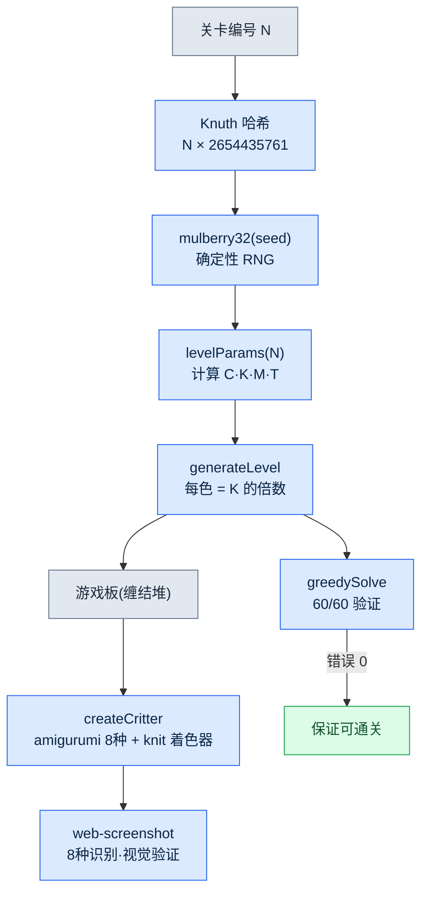

# Part 23 · 第4章. 独自开发的益智游戏 —— Critter Sort 实战记

周六下午,妻子正用手机玩一款颜色分类的益智游戏。那是一款名为 *Yarn Fever* 的游戏,把缠结的毛线团按颜色分类到相应的篮子里。一局结束,她就说"又是一样的",然后关掉。因为没有更新,很快就腻了。

那一刻的想法很简单。那个循环有着经过验证的上瘾性,而机制本身不受著作权保护。换成动物主题,再把关卡程序化地无限生成,"又是一样的"这个问题就消失了。一个人用直接在浏览器里运行的 HTML 3D 来做,连装到妻子手机上都不需要。

问题在于,我不是图形工程师。虽然是 24年资历的策划,却从没用 Three.js 写过着色器。所以这一章,是"和 AI 一起、独自在几天内让一款游戏跑起来"的真实记录。它同时也是一份分离的记录——使用与公司 MMORPG(以下称项目A)工作相同的工具,却一行领域内容都没有掺入。

实际的游戏在 `critter-sort/` 仓库里,git 标签 v0.1\~v0.3 记录着三天间的决策。这不是加工过的案例,而是直接引用那个仓库。

---

## 23.4.1 用提示词做逆向工程 —— 然后丢掉了标志性手感

最先做的事,是把原作用语言拆解开、抛给 AI。第一个提示词是这样的。

> **提示词（v0.1 启动）：**
> "我想把 Yarn Fever 这款休闲益智游戏的核心循环改编成动物主题,用 Three.js + Vite 来做。循环是这样的:把缠结的颜色团块按颜色分类到同色的桶里,临时槽位溢出就游戏结束。以动物作为分类对象,点击缠结的动物堆,就把它们送进同色的巢(nest)。逻辑要用与 Three.js 无关的纯 JS 状态机来写,以便进行 headless 测试。再加入程序化的无限关卡(基于种子)。"

AI 忠实地照做了。它把文件夹结构分成 `game/`(纯逻辑)和 `render/`(Three.js),先写好 `state.js`·`rules.js`·`generator.js`,再用上色的方块 placeholder 把游戏板显示出来。不是几天,而是一个会话就让 v0.1 跑了起来。

可是,为了给妻子看而亲自试玩的那一刻,违和感来了。它变成了一款常见的消除拼图——动物在画面上蹦跳着跳进篮子。原作的手感不见了。*Yarn Fever* 的核心特质不是"分类",而是**用手解开缠结毛线团的触感**,以及**旋转画面、确认被遮住的颜色的行为**。我在提示词里把它压平成了"点击动物就送进巢"这种普通的 sort,而 AI 只是忠实于我给出的定义罢了。

这就是逆向工程的第一个陷阱。一旦概括原作,标志性手感就会蒸发。因为概括留下的是表面,而非本质。

这里要说清楚一点。AI 并没有给出错误的答案。是我的提示词错了。所以下一个循环不是修改代码,而是**修正定义**。

---

## 23.4.2 脊梁 —— 让旋转与解开毛线复活的修正循环

看过 v0.1 之后,我分两次重新明确了核心。第一次修正针对行为,第二次修正针对触感。

> **提示词（第 1 次修正 —— 行为）：**
> "这个变成普通的消除拼图了。Yarn Fever 的核心特质是'旋转 3D 画面、确认被遮住的颜色,并决定解开的顺序'。不要把游戏板平铺开,而要在中间堆成高高的土丘,必须旋转才能看到背面被遮住的颜色。用 OrbitControls 加入旋转。可是旋转和点击会冲突啊——你打算怎么区分它们?"

> **Claude 的输出（原始,未经概括）：**
> "没错。旋转手势和点击是同一个指针事件,所以会冲突。我建议用距离·时间阈值来区分。在 `pointerdown` 时记录坐标·时刻,在 `pointerup` 时,如果移动距离超过 9px 或按住时间超过 400ms,就判定为旋转手势并忽略点击。只有在这以下,才用 raycaster 拾取动物并调用 `state.tap()`。OrbitControls 的 azimuth 我会限制在 ±54° 左右,避免堆块跑到画面之外。不过在移动端 9px 可能太敏感,需要在真机上确认。"

那个 9px/400ms 的阈值至今仍原样留在 `src/main.js` 里。没有多余部分、可以直接验证的代码。

```javascript
// src/main.js — 拖拽=旋转(OrbitControls) / 短按=解开毛线
canvas.addEventListener('pointerup', (ev) => {
  if (!down || state.status !== 'playing') { down = null; return }
  const dist = Math.hypot(ev.clientX - down.x, ev.clientY - down.y)
  const dt = performance.now() - down.t
  down = null
  if (dist > 9 || dt > 400) return // 判定为旋转手势
  const rect = canvas.getBoundingClientRect()
  const x = ((ev.clientX - rect.left) / rect.width) * 2 - 1
  const y = -((ev.clientY - rect.top) / rect.height) * 2 + 1
  const id = view.pick(x, y, camera)
  if (id !== null) state.tap(id)
})
```

行为回来了。可是第二次试玩后,依然没有"解开毛线团"的感觉。动物只是移动到巢里,没有解开的手感。第二次修正。

> **提示词（第 2 次修正 —— 触感）：**
> "旋转变好了。可是还没有'解开毛线'的感觉。加入这样的表现:点击时,缠在动物身上的乱线股解开、消失,那些线再缠绕着进入篮子。动物的外观也别用光滑的 GLB 鸟,而要用圆滚滚的针织毛绒玩偶(amigurumi)。加上惺忪的睡眼、腮红这类温馨的细节。外部素材不合适的话,去掉、改用程序化生成也可以。"

> **Claude 的输出（原始）：**
> "我会拆成两部分来实现。(1) 缠结的线:在每只动物的身体上缠两股略暗的同色 `TorusGeometry`,点击时把 scale 缩到 0.01,让它解开、消失。(2) 线的缠绕:用 `TubeGeometry` 画出动物→篮子路径上的线,做一个朝篮子方向缠绕进去的补间动画。毛绒玩偶外观走程序化路线——给 `MeshStandardMaterial` 程序化生成 knit bump 贴图,营造 niit 质感;惺忪的睡眼用扁平的 box,腮红用半透明的粉色 sphere。现有的 GLB 起始素材(3种鸟)和针织色调不搭,所以移除,但会把动物包的加载管线作为后备保留下来。有一点要说明:程序化生成的动物在物种多样性上不如 GLB——先用一个物种验证、再增加物种会比较稳妥。"

最后那句警告('物种多样性不如 GLB'——GLB 是 glTF Binary,一种从外部获取即用的现成 3D 模型文件格式)正是通向 v0.3 的种子。AI 先说出了下一个局限,而我把它接过来作为下一个里程碑。

验证每次都是两步。先用 headless 确认逻辑没有损坏(错误 0),然后在浏览器里亲自旋转·点击,体会手感。v0.2 的提交信息把这次验证固化了下来:"headless 验证:旋转·解开毛线·自动通关正常,错误 0。"

缠结的两股线如今这样留在 `src/render/pieces.js` 里。

```javascript
// src/render/pieces.js — 缠在身体上的两股松散的线(略暗的同色)
const strandMat = new THREE.MeshStandardMaterial({ color: darken(hex, 0.7), roughness: 1 })
const strands = []
const orient = [[0.5, 0.2, 0.0], [1.25, 0.0, 0.6]]
for (let i = 0; i < 2; i++) {
  const s = addMesh(g, G.torus, strandMat, [0, byo + 0.02, 0], Math.max(bx, bz) + 0.02, orient[i])
  strands.push(s)
}
g.userData.strands = strands  // 点击时 view.js 会解开这些线股使其消失
```

把这里得到的教训用一句话记下来。

- 逆向工程一旦概括,标志性手感就会消亡。
- 定义错了,就修改定义,而不是代码。
- AI 说出的下一个局限,就是下一个里程碑。

---

## 23.4.3 三天的决策历史 —— 用 git 标签读懂修正

光靠语言描述只是"改了两次",但 git 历史连同精确的时间,把那些修正是何时、以何种形态进入的都留了下来。这在单人开发中替代了复盘。即使没有同事,提交也能为"为什么会变成这样"作证。

| 提交 | 时间 (2026-05-30) | 改动内容 | 标志性手感状态 |
|---|---|---|---|
| `2b2e3bc` v0.1 | 14:43 | Yarn Fever 逆向工程,纯逻辑 + placeholder,60/60 求解器通过 | 缺失(被压平为普通 sort) |
| `70a0117` v0.2 | 15:11 | 旋转(OrbitControls ±54°)+ 点击/拖拽分离 + 解开毛线 + amigurumi | 复原(重新定义核心) |
| `160663c` 快照 | 15:31 | v0.2 画廊快照 5张 + README 画廊 | — |
| `59b0baf` v0.3 | 15:55 | 程序化 amigurumi 8种 + 鲜艳糖果色调色板 | 强化(确保物种多样性) |
| `c5b9a1b` 交接 | 16:20 | NEXT_SESSION 会话交接指针 | — |

v0.2 的提交信息正文把决策本身固化了下来。"将游戏的核心特质从'动物蹦跳'纠正为'旋转画面、解开可爱的毛线团(针织毛绒玩偶)送入同色篮子'。"这是一个半小时里,游戏的核心特质死了一次又被救活的记录。

值得注意的一个细节。查看 v0.2 的 `git show --stat` 会发现,起始的 3种 GLB 鸟(Flamingo·Parrot·Stork)被整个删除了。理由是"美术和针织色调不搭"。外部免费素材不是免费就全都用,而是色调不搭就删掉的决定。这是由人而非 AI 把守的审美关卡。

```
public/assets/animals/pack_starter/Flamingo.glb  | Bin 77428 -> 0 bytes
public/assets/animals/pack_starter/Parrot.glb    | Bin 97024 -> 0 bytes
public/assets/animals/pack_starter/Stork.glb     | Bin 76852 -> 0 bytes
```

---

## 23.4.4 程序化生成实证 —— 8种 amigurumi 与无限关卡

v0.2 留下的作业是"程序化动物的物种多样性不如 GLB"。v0.3 解决了这个问题。没有新增任何一个外部素材,用代码生成了 8种动物。

核心是 `src/render/pieces.js` 中的 `SPECIES` 表。为每个物种以参数定义身体比例·头部·耳朵类型·口鼻·眼睛形状,由一个函数读取这些参数来组装网格。

```javascript
// src/render/pieces.js — 各物种的轮廓参数
const SPECIES = {
  cat:      { body: [0.5,0.46,0.48,0.04], ears: 'cat',   snout: 0.13, tail: 'cat',  eyes: 'sleepy' },
  bear:     { body: [0.52,0.5,0.5,0.03],  ears: 'bear',  snout: 0.16, tail: 'none', eyes: 'round' },
  bunny:    { body: [0.46,0.5,0.46,0.02], ears: 'bunny', snout: 0.12, tail: 'puff', eyes: 'round' },
  fox:      { body: [0.5,0.44,0.48,0.04], ears: 'fox',   snout: 0.2,  tail: 'fox',  eyes: 'sleepy' },
  capybara: { body: [0.58,0.5,0.56,0.02], ears: 'tiny',  snout: 0.22, tail: 'none', eyes: 'sleepy' },
  pig:      { body: [0.54,0.5,0.52,0.03], ears: 'pig',   snout: 0.1,  nose: true,   eyes: 'round' },
  frog:     { body: [0.56,0.4,0.54,0.05], ears: 'none',  snout: 0.1,  topEyes: true, eyes: 'none' },
  chick:    { body: [0.42,0.44,0.42,0.05], ears: 'none', beak: true,  tail: 'none', eyes: 'round' },
}
export const SPECIES_IDS = Object.keys(SPECIES)  // 8种
```

仅凭耳朵形状,轮廓就分了开来。猫·狐狸是尖尖的 cone,熊是圆圆的 sphere,兔子是细长的 sphere,猪是向前弯折的 cone。青蛙是头顶凸出的眼睛(`topEyes`),小鸡是喙(`beak`)。这些细小的分支造就了 8种的辨识度。外部素材 0,代码一个文件。

不过程序化生成有个陷阱。"看起来像模像样"的代码是否真的能生成可辨识的 8种,光看代码是不知道的。所以验证再次分为两步。先用 headless 确认 8种是否无错误地生成,然后用 web-screenshot 技能(headless Chrome)捕获实际渲染,用眼睛确认 8种是否可区分。DEVLOG v0.3 里有那个结果:"以耳朵/口鼻/鼻子/喙/尾巴/眼睛区分轮廓。外部素材 0,针织色调完全统一。"

### 一个种子决定整个游戏板

关卡的无限性由种子 RNG 负责。`generator.js` 用 Knuth 乘法哈希对关卡编号进行种子化,再用 `mulberry32` 抽取确定性随机数。相同的关卡编号总是对应相同的游戏板。

```javascript
// src/game/generator.js
export function generateLevel(level, animalPool = null) {
  const seed = (level * 2654435761) >>> 0  // Knuth multiplicative hash
  const rng = makeRng(seed)
  const { C, K, groupsPerColor, M, T } = levelParams(level)
  const colors = rng.shuffle(COLORS).slice(0, C)
  // ...
  for (const color of colors) {
    const count = K * groupsPerColor  // 始终是 K 的倍数 → 精确分解到巢(保证可解)
    // ...
  }
}
```

这里的一行保证了游戏的公平性。因为把每种颜色的动物数量强制设为**始终是 K(完成一个巢所需的数量,3)的倍数**,所以无论哪个游戏板都能被巢精确整除。无法解开的关卡从根本上不会出现。

### 60 个关卡是否全部可解 —— greedySolve

设计上可解并不等于证明。在 `rules.js` 里放入用于验证的贪心求解器,用 `test-logic.mjs` 自动游玩 60 个关卡,每次都确认是否真的全部通关。这是刚才写这一章时重新运行的实测输出。

```
$ node scripts/test-logic.mjs
[求解器] 60/60 关卡通关

[难度曲线] (C=颜色, K=完成, groups, M=巢, T=托盘, 总数量)
  Lv 1: C=3 K=3 grp=2 M=3 T=7 总=18
  Lv 8: C=4 K=3 grp=3 M=4 T=6 总=36
  Lv12: C=5 K=3 grp=3 M=4 T=5 总=45
  Lv20: C=5 K=3 grp=3 M=4 T=4 总=45

[乱点游玩] 随机点击时的失败率 (确认难度存在)
  Lv 1: 随机失败率 0%
  Lv12: 随机失败率 1%
  Lv20: 随机失败率 3%
```

这个测试同时证明了两件事。贪心求解器能通关 60/60,意味着**所有关卡都可解**(难度并非不可能);而随机点击的失败率随关卡上升从 0% 升到 3%,意味着**难度真实存在**(随便乱按也全都能通关的话就不是游戏了)。托盘从 7 格收窄到 4 格的难度曲线,以失败率的形式被测量出来。

这里要诚实地指出。随机失败率 3% 是"胡乱按键的机器人"的失败率,而不是人对难度的体感。人会通过旋转事先确认颜色,所以失败率更低。这个数字是"难度不为 0"的方向性证明,并不意味着妻子有 3% 的概率会输。人的体感难度在 v0.3 这个时间点还未测量,已在 NEXT_SESSION 里记为"收集妻子的试玩反馈(最优先)"。

### 程序化生成管线



从种子出发,分岔为参数·游戏板·网格·验证的这条流程,正是从结构上解决"因没有更新而厌倦"这一最初问题的答案。

---

## 23.4.5 GLB 进来了怎么办? —— 自动缩放与后备

程序化的 8种动物是没有 GLB 时的后备。为了以后弄到真正的 amigurumi GLB 时能优先使用,保留了动物包管线。把 GLB 拖进文件夹、只跑一下 `npm run scan` 就完成了。

问题在于每个 GLB 的尺寸都各不相同。有的模型是 0.5单位,有的是 200单位。要靠手动调 scale,添加动物包就成了体力活。于是 `scan-packs.mjs` 读取 GLB 的包围盒,自动计算出符合目标高度(0.95单位)的 scale。

```javascript
// scripts/scan-packs.mjs — 从 GLB 包围盒自动计算 scale/yOffset
const maxDim = Math.max(max[0]-min[0], max[1]-min[1], max[2]-min[2])
const scale = +(TARGET_H / maxDim).toPrecision(3)        // TARGET_H = 0.95
const yOffset = +(-((min[1] + max[1]) / 2) * scale).toPrecision(3)
```

而 `assets.js` 在 packs.json 缺失或加载失败时,会悄悄回退到程序化动物。

```javascript
// src/render/assets.js
createAnimal(species, hex) {
  const entry = this.models.get(species)
  if (!entry) return createCritter(hex, species)  // 程序化 amigurumi 后备
  // ... GLB 克隆 + 颜色着色
}
```

这两行以不中断的方式保证了"有 GLB 就用 GLB,没有就用代码动物"。在妻子游玩期间,即使我丢进新的 GLB 包,游戏也不会停下。

---

## 23.4.6 一个人却像一支团队 —— 我是如何使用 AI 的

在这个项目里,我只是一名策划,但工作是靠多种角色运转起来的。AI 填补了那些角色。关键不在于"替我写代码",而在于**填补我薄弱的位置**。

| 我薄弱的位置 | AI 做的事 | 人(我)把守的关卡 |
|---|---|---|
| Three.js 着色器 | knit bump 程序化贴图、TubeGeometry 毛线表现 | 色调是否相配(删除 3种 GLB 鸟的决定) |
| 输入冲突的解决 | 提出 9px/400ms 阈值 | 移动端真机体感确认 |
| 回归安全性 | 用 greedySolve 做 60/60 自动验证 | "难度真实存在"由人来定义 |
| 预测下一个局限 | 警告"程序化动物的物种多样性偏弱" | 将其采纳为 v0.3 里程碑 |

尤其视觉验证是单人开发中薄弱的一环。代码能跑,和"8种在肉眼中可区分"是两回事。所以我把 web-screenshot 技能(用 headless Chrome 启动 dev 服务器、截图 + 报告控制台错误)原样从公司工作中借用了过来。即使没有 claude-in-chrome 扩展,也能用眼睛确认移动端视口(iPhone 15 Pro 竖屏,393×852)的渲染。

这里,一个最重要的原则在发挥作用。**工具从公司借用,但领域内容借用 0 件。**

- 借用的:web-screenshot 验证模式、git 提交信息的规范、headless 逻辑测试的习惯、JIT atom 注入 hook。
- 没借用的:项目A 的战斗·技能·世界观·数据表——一行都没有。

这种分离经由 grep 得到验证。记忆记录里留有"公司项目领域内容借用 0 件(验证 grep PASS)"。Critter Sort 的颜色是粉红·薄荷绿·黄色,动物是猫·熊·兔子。项目A(公司 MMORPG)的领域词汇在这个仓库里的任何地方都找不到。

为什么要分离到这种程度。是为了同时防止两种事故。公司 IP 泄漏到个人爱好中的法律事故,以及 MMORPG 领域 atom 被错误注入到益智游戏开发中、成为噪声的上下文污染。只让工具流动、把内容拦住——两者之间就是健康的分离。

---

## 23.4.7 小结 —— 一个人系统也照样运转

Critter Sort 是个小游戏。三天、5 个提交、8种动物、60 个关卡。然而在公司里用的那套方法,在 1/1000 的规模下也照样奏效。

- 逆向工程必须保留标志性手感。
- 定义错了就修改定义。
- 验证要分 headless + 肉眼两步走。

最大的收获是第一节的失败。在 v0.1 里把游戏的核心特质杀死了一次,又靠两次修正把它救活。在没有同事的单人开发中,为这场死亡与复活作证的,是 git 提交。如果没有复盘,一个月后就会忘掉"为什么在 v0.2 里全部推翻重来了?"。

接下来的 Part 24 将讨论如何把这样的决策历史,在大团队·长期运营中固化为治理。

这一章从妻子玩腻后关掉的益智游戏出发,记录了独自开发的游戏重新回到她手中的过程。它确认了:系统不是规模的问题,而是纪律的问题。

---

## 动手试试 —— 今天就能做的一步

这一步是和 AI 一起把你喜欢的一款休闲游戏的核心循环跑起来。但要注意,别丢掉标志性手感。

**setup** —— 在装好 Node 的环境里新建一个空文件夹。`mkdir my-puzzle && cd my-puzzle`。

**prompt** —— 像这样抛给 AI。关键是"不要概括,而要明确写出标志性手感"。

> "我想把 [游戏名] 的核心循环改编成 [主题]。这款游戏的标志性手感是 [用一句话写下手感——例如:'旋转画面、确认被遮住之物并解开的触感']。绝对不要把它压平成普通的消除拼图。逻辑要与渲染分离,写成能用 headless 测试的形式。"

**verify** —— 亲自试玩第一版结果。问一句"我写下的标志性手感还在吗?"。如果不在,就不要改代码,而要**重新写定义**再提出请求。那正是我在 v0.1→v0.2 里做的事。

### 面向单人·业余爱好者读者的精简版

既不需要引擎,也不需要程序化生成。在一张纸上写下"这款游戏的标志性手感一句话",让 AI 做出原型,然后亲自试玩,只看那一句话是否还活着。如果死了,就把那一句话写得更具体些再来一次。守住标志性手感这一句话的习惯,仅凭这一点,就能避开逆向工程的第一个陷阱。
