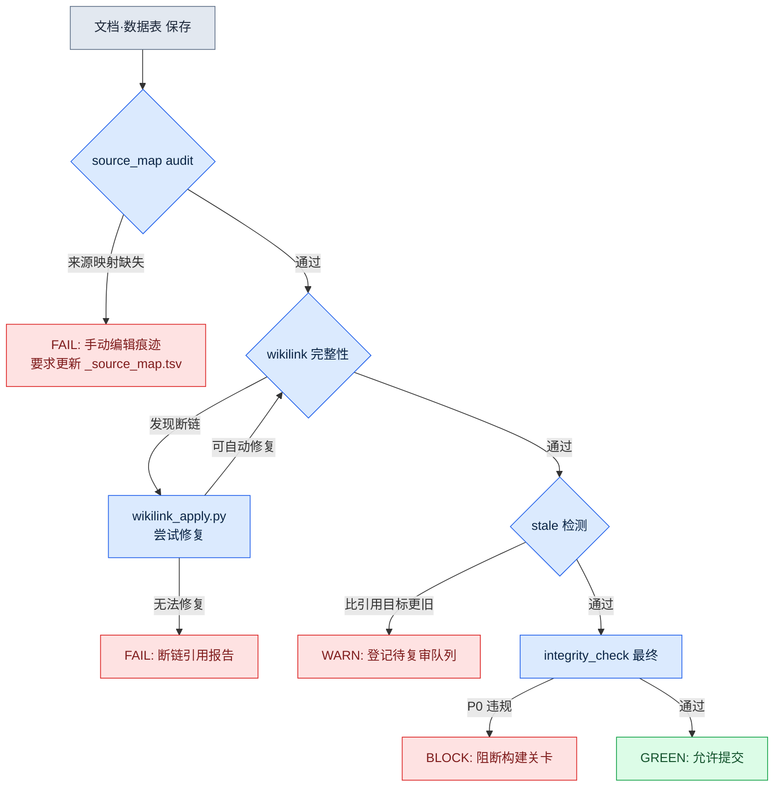

# 24.1 验证系统 —— 用代码揪出一致性、链接与 stale 问题

周一早上站会刚结束,数据团队的成员 A 用即时通讯工具发来一张截图。那是一份 QA 报告,说游戏内商店里某个材料道具的说明是空白的。追查原因 30 分钟后,真相浮出水面:两周前有人在策划文档里把那个道具改名为 `재료_목재_상`,而数据表中的引用仍然指向旧名 `재료_목재_A`。文档更新了,数据表没更新,连接二者的链接悄然断开。没有任何人说谎,游戏却在输出谎言。

这类事故会随着文档增多而以几何级数变得越来越频繁。人眼无法同时看清 50 份文档之间的相互引用。于是我们把验证委托给代码。本章讨论的系统,让文档、数据、链接的一致性由脚本而非人来检查。核心有三点 —— 来源一致性(`_source_map.tsv` audit)、链接完整性(wikilink),以及 stale 检测(揪出陈旧腐坏的引用)。

---

## 24.1.1 断链为什么是无声的

文档与数据相互指向、彼此依存地存活。策划案引用 enum,enum 引用数据表,数据表又引用另一份策划案里的决策。若由人手工管理这张网,一旦某个节点发生变化,就得靠人记住并逐一追踪所有指向该节点的引用。而记忆会失效。

断链之所以危险,是因为它**不会抛出错误**。若是代码,引用不存在的变量时编译器会拦住你。但在文档里写下的 `[[재료_목재_A]]` 这类 wikilink,即便目标消失,也只是留作一段普通文本。它不会变红。游戏照常构建、上线,直到玩家看到空白说明,才有人察觉。

因此,验证系统的第一项工作,是**让人眼看不见的东西显现出来**。把一致性违规拉成文本输出,再把这份输出绑定到构建关卡上,那么即便人忘了,脚本也不会忘。

---

## 24.1.2 三路验证的 cascade

验证不是一整块,而是分阶段的。先跑最廉价的检查,滤掉明显的违规,只让通过的进入下一阶段。因为如果对所有输入都跑昂贵的检查,会慢到没人愿意跑。下面是笔者实际运行的验证流程。



这个 cascade 的核心是**失败越早越便宜**。`source_map audit` 只是 TSV 单行比对,毫秒级就结束。相反,最后的 `integrity_check` 要加载整张数据表来检查 FK 关系,需要数秒。把廉价的检查放在前面,明显的错误就在那里被截断,昂贵的检查只对通过它的少数输入运行。

各阶段的输出不同,这一点也很重要。`audit` 给出 FAIL(编辑者手动改动过某处的证据),`wikilink` 在自动修复后给 FAIL,`stale` 给 WARN(不阻断,但需复审),`integrity_check` 给 BLOCK(直接拦住构建)。同样是「问题」,也要根据严重程度作出不同反应,人才能区分信号与噪声。

---

## 24.1.3 第一阶段 —— `_source_map.tsv` audit

最先运行的检查是来源一致性。笔者的文档生成管线,会把某份合成文档(例如 GDD,即游戏设计文档的正文)是从哪些源文件生成的,记录到 `_source_map.tsv` 里。每一行都钉死了「这一产出物的章节 = 这些源文件的合成」这样一条谱系(lineage)。

它之所以能成为验证工具,是因为**只要有人手工编辑产出物,映射就会破裂**。若有人直接改动自动生成的 GDD 章节,那一节就不再是源文件的忠实合成了。audit 脚本会把产出物各章节的哈希,与从源文件重新合成得到的哈希比对,不一致就给出 FAIL。「手动编辑即 audit FAIL」这条规则,就来自这里。

这并非要阻止人去编辑,而是要**让编辑显式化**。如果必须修改产出物,就该二选一:要么改源文件再重新生成,要么把那一节正式从映射中剥离出来(分离声明)。把无声的编辑变得吵闹,这就是 audit 的工作。

---

## 24.1.4 第二阶段 —— wikilink 完整性与自我修复

通过 audit 后,就进入链接检查。笔者的文档用 Obsidian 式的 wikilink `[[目标]]` 来连接节点。`wikilink_apply.py` 做两件事 —— 把 wikilink 解析为实际路径并应用,以及在可能的范围内修复断链。

能够修复的情形很明确:目标节点**只是改了名字、仍在原位存在**时。像前面 `재료_목재_A` → `재료_목재_상` 这样的重命名,只要别名映射(alias map)已更新,脚本就会把旧名自动纠正为新名。反之,若目标被整个删除、或无法追踪去向,就放弃修复,并报告这条断链引用。

这里有一个设计判断:**自动修复若过于激进则很危险。**如果去找「名字相似的」就擅自接上,链接会错接到语义不同的节点上,酿成更糟的事故。因此 `wikilink_apply.py` 的修复是保守的 —— 只对有显式别名映射的重命名做自动纠正,需要猜测的情形则交给人。自动化的美德在于克制:只把确定的事情自动做掉,而把含糊的事情诚实地交还给人。

---

## 24.1.5 第三阶段 —— stale 检测

即便链接活着,**引用也可能已经陈旧。**文档 A 引用数据表 B,若 B 比 A 更晚更新,那么 A 的说明就有可能与当前的 B 相抵触。链接本身完好无损 —— 因为指向的目标还在。可内容已经腐坏了。

stale 检测会比较引用两端的修改时间(或内容哈希版本)。若引用方比被引用目标更旧,就抛出 WARN,并把该节点登记到复审队列。之所以是 WARN 而非 BLOCK,是因为更新并不总意味着内容冲突。若只是改了一个错字的更新,引用依然完好。所以 stale 不是「拦截」,而是「标记出来让你去查看」。

来看这一阶段如何抓住前面那起断链事故。如果 `재료_목재` 数据表比文档更晚更新,那么在自动修复之前,stale WARN 就已经先亮起了。也就是说,三道检查是**相互重叠的安全网**。一张网漏掉的,由下一张网接住。cascade 之所以能抓住单一检查抓不到的事故,原因正在于此。

---

## 24.1.6 实操记录(worked transcript) —— 让 Claude 编写检查脚本

若让人从零把验证逻辑全部写出来,会很累。笔者用自然语言描述检查规则,执行脚本则先向 AI 要初稿。下面是制作 stale 检测脚本的真实会话 —— 这是一段实操记录(worked transcript,即完整保留的真实操作过程记录),输出不加修饰,失败与拒绝的过程都原样保留。

**[提示词全文]**

> 文档文件夹里的这些 Markdown 之间用 wikilink `[[目标]]` 相互连接。请写一个 Python 脚本,检查每份文档自身是否比它所引用的目标文件更旧(=stale)。条件:
> - 文件的修改时间以 git 最后一次提交时间为准(文件系统 mtime 会在 checkout 时被更新,不可信)
> - 断链(目标不存在)从 stale 检查中排除,单独报告
> - 输出为 TSV:`source<TAB>target<TAB>status`(status = OK / STALE / BROKEN)
> - WARN 不阻断,退出码保持为 0(不能挡住构建)

**[Claude 原始输出 —— 第 1 次]**

> 下面的脚本用 `git log -1 --format=%ct <file>` 取得每个文件的最后提交时间,并用正则 `\[\[([^\]]+)\]\]` 提取 wikilink 后进行比较。
>
> ```python
> import subprocess, re, sys, pathlib
>
> def git_mtime(path):
>     out = subprocess.run(
>         ["git", "log", "-1", "--format=%ct", str(path)],
>         capture_output=True, text=True)
>     return int(out.stdout.strip())
>
> def resolve(link, root):
>     # [[目标]] -> root/目标.md
>     return root / f"{link}.md"
>
> root = pathlib.Path(sys.argv[1])
> for md in root.glob("*.md"):
>     src_t = git_mtime(md)
>     for link in re.findall(r"\[\[([^\]]+)\]\]", md.read_text(encoding="utf-8")):
>         tgt = resolve(link, root)
>         if not tgt.exists():
>             print(f"{md.name}\t{link}\tBROKEN")
>             continue
>         tgt_t = git_mtime(tgt)
>         status = "STALE" if src_t < tgt_t else "OK"
>         print(f"{md.name}\t{link}\t{status}")
> ```
>
> 这样就能按你要求的 TSV 格式输出。

**[人工验证 / 拒绝]**

在这里停住了。我看到三处缺陷。

第一,`git_mtime` 若返回空字符串,就会在 `int("")` 处崩溃 —— 从未被提交过的新文件正是如此。第二,`glob("*.md")` 看不到子文件夹,而笔者的文档散落在 `part*/` 之下。第三,也是最重要的 —— wikilink 有时会带管道别名,例如 `[[目标|显示名]]`,而第 1 版代码会把 `目标|显示名` 整个误当成文件名。这样一来,完好的链接会全部被判为 BROKEN。照原样用,就是一颗误报炸弹。

我指出这三点,并重新提出了请求。

**[再次请求]**

> 请改三处:(1) 未提交的文件让 git_mtime 返回 None,这种情况暂缓 STALE 判定,status=UNTRACKED。(2) 不用 glob,改用 rglob 以包含子文件夹。(3) 处理 `[[目标|别名]]` 管道 —— 只取 `|` 前面的部分作为目标。另外,即使存在 BROKEN,退出码也保持为 0(WARN 不阻断原则)。

**[Claude 原始输出 —— 第 2 次]**

> ```python
> import subprocess, re, sys, pathlib
>
> def git_mtime(path):
>     out = subprocess.run(
>         ["git", "log", "-1", "--format=%ct", str(path)],
>         capture_output=True, text=True)
>     s = out.stdout.strip()
>     return int(s) if s else None   # 无提交历史则为 None
>
> def target_name(link):
>     return link.split("|", 1)[0].strip()   # [[目标|别名]] -> 目标
>
> root = pathlib.Path(sys.argv[1])
> for md in root.rglob("*.md"):
>     src_t = git_mtime(md)
>     text = md.read_text(encoding="utf-8")
>     for raw in re.findall(r"\[\[([^\]]+)\]\]", text):
>         name = target_name(raw)
>         hits = list(root.rglob(f"{name}.md"))
>         if not hits:
>             print(f"{md.name}\t{name}\tBROKEN")
>             continue
>         tgt_t = git_mtime(hits[0])
>         if src_t is None or tgt_t is None:
>             status = "UNTRACKED"
>         elif src_t < tgt_t:
>             status = "STALE"
>         else:
>             status = "OK"
>         print(f"{md.name}\t{name}\t{status}")
>
> sys.exit(0)   # WARN 不阻断:一律为 0
> ```

这第 2 版输出被采纳了。不过有一处是人有意留下的决定 —— `rglob(f"{name}.md")` 若在多个文件夹里找到同名文件,只会用 `hits[0]`。这是一处潜在的歧义,但按笔者的文档命名规则,文件名是全局唯一的,所以实务中不会冲突。这个 AI 没有点出的假设,由人有意识地接受下来,并写进了注释。**即便是自动化写出的代码,代码所依赖的假设也由人来负责。**

---

## 24.1.7 把检查结果绑定到构建关卡

就算有脚本,没人跑也是白搭。验证的最后一环设计,是**让它无法不被运行**。笔者把这三个阶段绑定到提交前钩子(pre-commit)或构建管线上。audit FAIL 与 integrity_check P0 违规属于 BLOCK,会挡住提交/构建;wikilink BROKEN 与 stale 属于 WARN,放行但留下报告。

这套 BLOCK/WARN 的二分,决定了系统能否存活。若把一切都设为 BLOCK,一个微不足道的 stale 就能卡住提交,人们便会开始绕过验证本身。被绕过的验证等于不存在的验证。反过来,若全设为 WARN,连真正该拦的数据完整性违规也会径直通过。**该拦什么、该只标记什么,这条界线才是验证系统真正的设计着力点。**

---

## 24.1.8 测量 —— 开启代码验证前后

这是笔者在自己所在的某 MMORPG 开发商 A 的项目A中,以约 90 份文档的规模为基准观察到的方向。部分绝对数值为笔者估算(未经验证),真正有意义的是趋势。

| 条目 | 手动检查时期 | 代码验证 cascade |
|---|---|---|
| 断链引用的发现时点 | 玩家·QA 报告之后 | 提交前(方向:事后 → 事前) |
| 单次一致性检查耗时 | 数小时(笔者估算) | 数十秒(脚本实测) |
| stale 累积潜伏 | 潜伏数周 | 下一次提交即 WARN |
| 错误自动修复导致的事故 | 不适用 | 靠保守修复,保持 0 起 |

与其照单全收这些数字,不如只相信「发现时点从事后被提前到了事前」这个方向。验证系统真正的价值,与其说在于节省时间,不如说在于**事故在到达玩家之前就被拦下这一「位置的移动」**。

---

## 24.1.9 常见的失败

| 模式 | 处方 |
|---|---|
| 把所有违规都设为 BLOCK,导致人们绕过验证 | BLOCK/WARN 二分,只对数据完整性 P0 做阻断 |
| 自动修复激进到连猜测也做 | 只对显式别名的重命名自动处理,含糊则交给人 |
| 只看断链而忽视 stale | 用修改时间比对,单独检测陈旧引用 |
| 默许对产出物的手动编辑 | 用 source_map audit 把编辑显现为 FAIL |
| 有脚本却没绑定到钩子 | 接入 pre-commit·构建关卡,使其无法不被运行 |

---

## 动手试试 —— 一套最小验证 cascade

**setup.** 用 git 管理文档文件夹(作为提交时间比较的基准)。wikilink 统一采用 `[[目标]]` 或 `[[目标|别名]]` 的写法。

**prompt.** 把上面实操记录里的提示词全文原样交给 AI,但绝不要直接采用它的第一次输出。务必验证并拒绝这三点后重新请求:(1) 未提交文件的处理、(2) 子文件夹遍历、(3) 管道别名解析。这是 AI 几乎每次都会在第一版里漏掉的地方。

**verify.** 运行脚本,拿到 TSV。手动抽查 5 个样本,确认 `BROKEN` 行是否真的是断链。若出现假 BROKEN,说明别名/子文件夹解析还没做到位。确认正常后,把它绑定到 pre-commit 钩子,并按退出码分流:WARN(STALE/BROKEN)放行、BLOCK(数据完整性 P0)阻断。

**单人精简版.** 如果你只是独自写一份小型 GDD,整套 cascade 就过头了。**只取 stale 检测这一步**即可。哪怕只用 git 时间比较文档是否比数据表更旧,也能抓住大多数「以为改了、其实没改」的事故。等文档超过 30 份、手工追不过来时,再加上自动修复与 source_map audit 就行。

---

### 本章要点
- 断链不会抛出错误,因此把验证移交给代码,让人眼看不见的违规以输出的形式显现出来。
- 用「先跑廉价检查」的 cascade 先切掉明显错误,昂贵检查只对少数运行。
- 划分 BLOCK 与 WARN 的界线才是验证系统真正的设计着力点;若全部拦截,就会被绕过。
