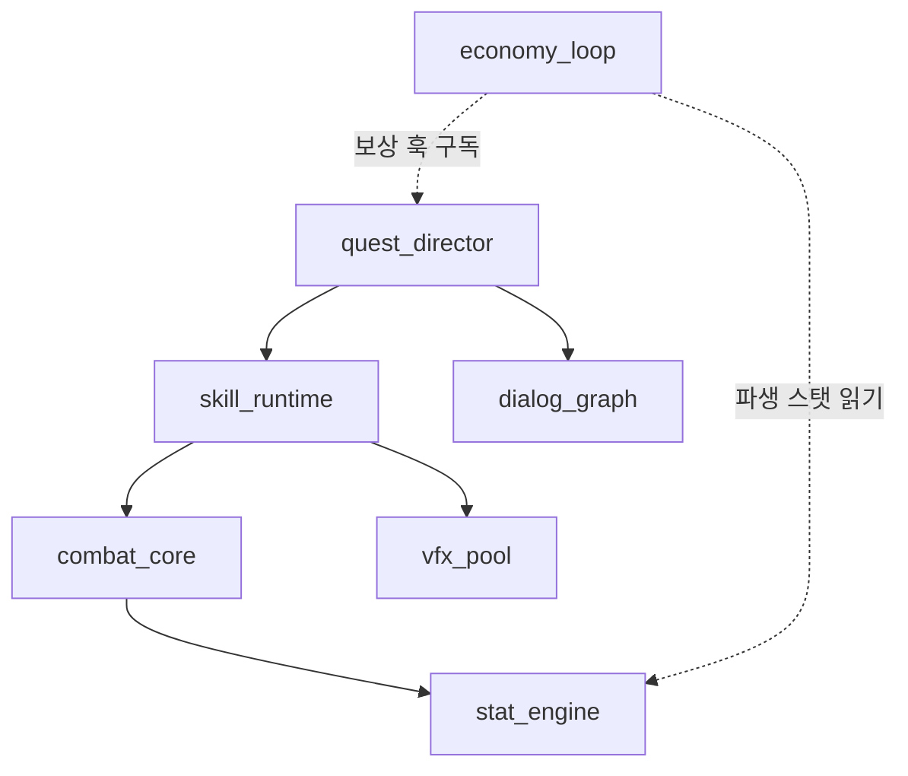
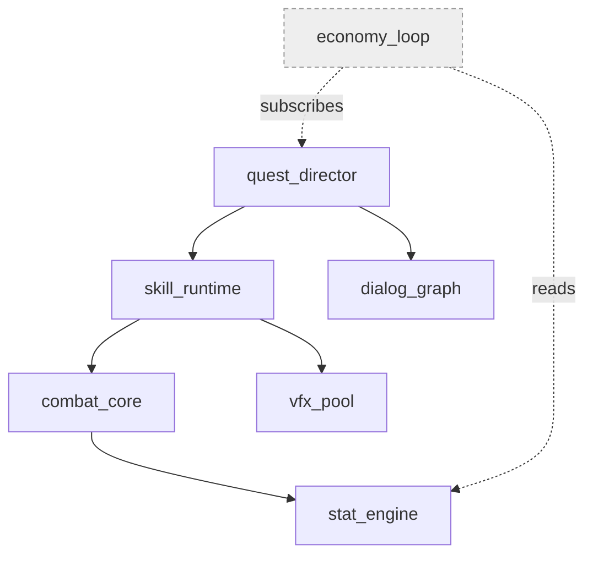
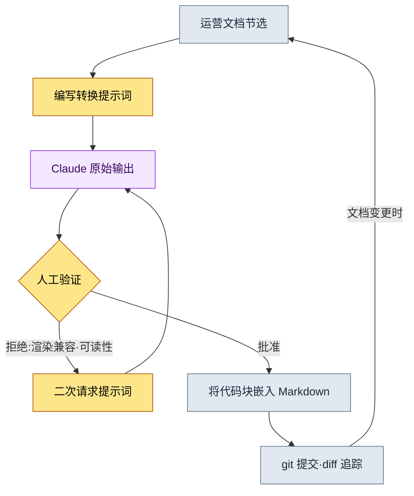
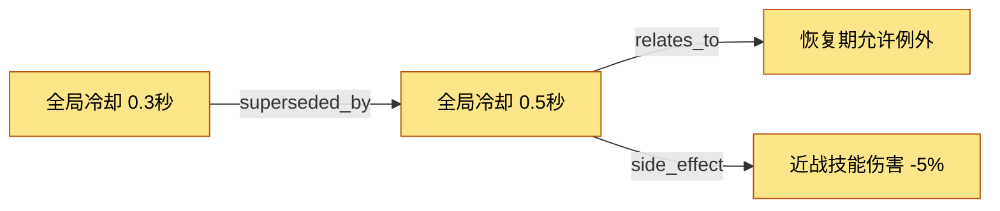

# 24.2 Mermaid 图表自动化 —— 让文档自己画出自己的图

一位新人策划入职第三天问我:"前辈,这些系统之间以怎样的顺序相互影响,有没有整理成图的地方?"我犹豫了。图是有的。半年前有人在白板上画的照片,存在维基的某个角落里。可那张图里,如今已经消失的两个系统还活着,而其后新增的三个核心循环却没有画进去。最终我答道:"别信图,去读文档。"这是个让人羞愧的回答。当图与文档不一致的那一刻,图就不再是信息,而成了错误信息。

先把本章的结论说在前面:人手绘制的图表,一两个月内必定腐坏。因此必须把画图这件事从人的手上剥离,让文档结构本身吐出自己的图。本文用一次真实的操作记录来展示这个过程。我把一段以文档为输入、生成 Mermaid 代码的实操记录(worked transcript,即完整保留的真实操作过程记录)整段收录,并在本页真实渲染由此产出的图表。也就是说,讲解某种技法的文字,用这种技法的产物来证明它自己。

---

## 24.2.1 为什么偏偏是 Mermaid

图表工具很多。draw.io、Figma、Visio,甚至白板照片。这些工具有一个共同的陷阱:产物是图片文件(图像)。图像无法在 git 中逐行追踪改动,处理文本的 LLM 无法直接生成或修改它,也无法以代码形式嵌入 Markdown 文档。从运营角度看,最致命的是第一点。一张无法追踪谁在何时、为何改动的图,时间一长就会变成无人负责的遗物。

Mermaid 一次解决这三点。把图表写成文本,渲染交给查看器自行完成。因为是文本,`git diff` 连新增一个节点都能捕捉到。因为是文本,LLM 能读能写。因为是文本,它可以原样放进 Markdown 代码块。本章的正文正是明证。此刻你正在读的这句话下面、即将出现的那些图表,全都是 Markdown 里的文本块,会在本书构建过程中渲染成图。

不过要防止误解。完全没有必要把所有运营资料都做成图表。罗列条目用项目符号更快,比较数值用表格更快。Mermaid 胜出的场合只有三种:关系(什么与什么相连)、流程(什么在什么之后)、时序(谁在何时向谁发送了什么)。在这三者之外的场合硬塞图表,反而会加重认知负担。

---

## 24.2.2 主干:从文档结构中抽取图表的一次操作

从这里开始,就是本章的主干。这里不做抽象讲解,而是从头到尾展示把一整块真实文档转换成 Mermaid 的过程。输入是项目A运营文档中记录系统依赖结构的一段 Markdown 片段(下面是经过匿名化的真实节选)。

````text
# 系统依赖备忘 (运营文档节选,匿名化)

- combat_core 依赖 stat_engine
- skill_runtime 依赖 combat_core
- skill_runtime 依赖 vfx_pool
- quest_director 依赖 skill_runtime
- quest_director 依赖 dialog_graph
- economy_loop 订阅 quest_director 的奖励钩子
- economy_loop 读取 stat_engine 的派生属性
````

把它手工画成图表,是七个节点、七条箭头。画一次是画得出来的。问题出在下周——当 `mail_box` 系统被加进来、`dialog_graph` 被拆成两个的时候。手绘图从那一刻起就开始说谎。所以,把这项转换交给 LLM,而不是人。

### 第1步 —— 提示词全文

下面是我实际投喂的提示词。一个字都未加修饰,原样收录。

````text
请把下面的系统依赖备忘转换成 Mermaid graph(自上而下,graph TB)。规则是:
1. 只把备忘中出现的系统作为节点,禁止新增系统。
2. "A 依赖 B" 写作 A --> B。
3. "订阅""读取" 这类弱耦合,用虚线 -.-> 并标上关系名。
4. 节点 id 照用备忘中的英文名,不要加中文标签。
只要代码块,去掉说明和注释。

[备忘]
- combat_core 依赖 stat_engine
- skill_runtime 依赖 combat_core
- skill_runtime 依赖 vfx_pool
- quest_director 依赖 skill_runtime
- quest_director 依赖 dialog_graph
- economy_loop 订阅 quest_director 的奖励钩子
- economy_loop 读取 stat_engine 的派生属性
````

规则 1 和 4 是关键。把图表交给 LLM 时,最常见的事故是"热心的幻觉"。它会加上没让它加的节点("一般都会有登录系统,所以我加上了"),擅自贴上中文标签,让 ID 与正文检索对不上。用规则来切断这份热心。

### 第2步 —— Claude 的原始输出(无摘要)

下面是模型第一次返回的响应。不加提炼,原样搬来。其中混着一个小问题,连这个问题一并收录。

````text

````

语法没问题,节点也正好七个。它没有编造新系统。规则 1、4 都遵守了。可有一处让我在意:虚线标签里用了韩文(`보상 훅 구독`、`파생 스탯 읽기`)。这并不算违反规则。规则 3 要求"标上关系名",模型忠实地照做了。只是我凭经验知道,在 Mermaid 中,韩文标签一旦含有空格,一些旧版渲染器就会渲染失败。而这一点,模型无从知晓。

### 第3步 —— 人工验证与拒绝

这一步在自动化中最常被省略,却最重要。我没有原样接受输出,而是拒绝了。拒绝理由有两条。

第一,要把虚线标签里带空格的韩文换成英文单词(token),以确保渲染兼容性。第二,弱耦合(虚线)和强耦合(实线)混在同一张图里,却没有颜色或样式上的区分,一眼看不出来。我带着这两点重新提出了请求。

### 第4步 —— 二次请求的提示词

````text
基本可以了。只改两处。

1. 把虚线箭头的标签换成一个英文单词(不含空格)。
   "보상 훅 구독" -> subscribes,"파생 스탯 읽기" -> reads
   原因:部分渲染器在韩文+空格的边标签上会渲染失败。
2. 为了在视觉上区分虚线(弱耦合)节点与实线(强耦合)节点,
   给像 economy_loop 这样只有弱耦合的节点,用 classDef 加上浅灰色样式。
3. 其余保持不变。
````

### 第5步 —— 二次请求得到的原始输出

````text

````

这次我接受了。标签换成了单个英文 token,只有 `economy_loop` 被单独标成灰色,"这个系统不是直接依赖,而是仅通过订阅、读取相连的边缘系统"这一信息由颜色传达了出来。如果我一行提示词都不碰、纯手工去画,很可能连这个 classDef 都想不到。

### 主干的产物 —— 就在此处真实渲染

上述实操记录的最终输出,不经手工誊抄,以代码块原样收进本书页面。本书构建会把它画成图。这就是"用自己的技法证明自己"的实物。

```mermaid
graph TB
    skill_runtime --> combat_core
    combat_core --> stat_engine
    skill_runtime --> vfx_pool
    quest_director --> skill_runtime
    quest_director --> dialog_graph
    economy_loop -.subscribes.-> quest_director
    economy_loop -.reads.-> stat_engine

    classDef weak fill:#eee,stroke:#999,stroke-dasharray:4 3;
    class economy_loop weak;
```



一段文档节选,经过五轮往返,变成了进入 git、可由 LLM 更新、并在本页渲染的运营资产。下周若加入 `mail_box`,只需在备忘里写一行,再投一次同样的提示词即可。用不着人动笔。

---

## 24.2.3 第二张图:画出这条自动化流水线本身

如果说前一张图是"转换的结果",这一张就是"转换的过程"。我把刚才分五步走完的实操流程做成了流程图。这张图同样是用相同方式交给 LLM 抽取的,并经过了相同的验证。我把结果原样收录。



这张流程图想说的有一点。我想强调的——不是用虚线,而是用粗箭头——是中间那个菱形,也就是 `人工验证`。若沉醉于"自动化"这个词而把这个节点删掉,第1步那种热心的幻觉就会原样写进运营文档。自动化把人从画图中解放出来,却不把人从判断中解放出来。循环里最后那条箭头(`文档变更时` → `运营文档节选`)是关键。有了这条反馈回路,图表才不是一次性资料,而是与文档一同、不衰老而共同成长的资产。

---

## 24.2.4 转换脚本:不用 LLM 也能跑的确定性路径

LLM 转换很灵活,但当关系已经以结构化数据形式存在时,就没必要专门去叫模型了。像项目A的决策卡这种字段固定的数据,一个小小的 Python 脚本更快也更诚实(幻觉从根源上就不可能发生)。下面是把决策卡列表转换成决策图 Mermaid 的实际脚本的核心部分。

````python
# decision_graph_to_mermaid.py
# 决策卡（结构化数据）-> 转换为 Mermaid graph。无需 LLM，确定性。

def to_mermaid(decisions):
    lines = ["graph LR"]
    # 1) 声明节点:id 与标题照搬。不编造。
    for d in decisions:
        safe_title = d.title.replace('"', "'")   # 只对引号做 escape
        lines.append(f'    {d.id}["{safe_title}"]')
    # 2) 边:把关系类型作为箭头标签。
    for d in decisions:
        for rel in d.relations:
            lines.append(f'    {d.id} -->|{rel.type}| {rel.target}')
    return "\n".join(lines)
````

关键在于只用两步就结束。声明节点,连接边。输入里没有的节点,绝不会出现在输出里。这个脚本接收三张决策卡,就会得到下面这样的图。



一个决策被另一个决策取代(superseded_by),连由此派生的副作用(side_effect)也用一条箭头呈现出来。不必读完几十行文本记录的决策日志,只要这一张图,"为什么现在冷却时间是 0.5秒"的来龙去脉五分钟内就能弄清。

何时用 LLM、何时用脚本?判断标准很简单。输入是结构化数据(字段固定的卡片、表格)就用脚本,输入是自由文本(会议记录、备忘、对话)就用 LLM。对结构化数据用 LLM,只会平白背上不必要的幻觉风险;对自由文本用脚本,解析规则会无止境地膨胀。

---

## 24.2.5 四个陷阱与对策

这些是在运营图表自动化的过程中实际踩过的雷。

第一,过于复杂的陷阱。节点超过五十个,图就不再帮助认知,反而妨碍认知。对策是把一屏限制在二十到三十个之间,再大就用 subgraph 把区域圈起来,或者干脆把图一分为二。

第二,更新中断的陷阱。人们容易以为这只发生在手绘图上,但即便做了自动化,只要不改输入文档,一样会腐坏。对策就是前面流程图里的那条反馈回路。让输入文档成为单一事实来源(single source of truth),图表始终从那里重新生成。

第三,过于抽象的陷阱。"系统大致是这样连在一起的"这种程度的图很好看,却没用。对策是在节点里填入真实 ID(`skill_runtime`、`D_B`),而不是抽象名词。正文检索与图表共享同一标识符,才能从图直接跳到代码。

第四,不经审核就直接使用 LLM 输出的陷阱。正如主干第3步所见,模型可以在遵守规则的同时,做出会导致渲染失败的标签。对策是绝不把人工验证节点从流水线中拿掉。

---

## 24.2.6 效果 —— 诚实地讲述变化

很想拿出数字,但这里只讲方向。下面的对比是作者在自己带过的团队里体感到的变化,并非精确测量值,而是作者的估计(未经验证)。

变化最鲜明的,是新人理解系统的速度。入职头几天才能搞清的"这些系统是怎么连在一起的",在一张自动生成的依赖图面前,缩短到了一小时上下。会议资料的准备也轻松了。以前开会前一天总得有人手工重画一遍,现在把文档转换一次就完事。最重要的是,过去当图表与实际不符时冒出的"这张图能信吗"这个问题本身,几乎消失了。输入文档即是图,文档对了,图也就对了。

反过来老实说,自动化并非万能。结构化程度还不高的早期阶段的想法草图,依然是白板更快。自动化要在结构大致定型之后才会发光。

---

## 本章要点

- 人手绘制的图表必定腐坏,所以把画图这件事甩给文档结构。
- 自由文本用 LLM、结构化数据用脚本来转换,而验证由人来做。
- 图表与正文共享同一 ID,才能从图跳到代码。

---

## 动手试试

**setup.** 一个保存文档的 Markdown 仓库,加上一个渲染 Mermaid 的查看器(大多数 Markdown 查看器和 git 托管都已内置),就够了。从待转换的文档中挑一段属于"关系、流程、时序"的片段(例如系统依赖备忘)。

**prompt.** 把这段片段套进正文主干第1步的提示词模板,投给 LLM。务必加入两条规则:"不要添加备忘里没有的节点""ID 照用原文英文名"。若是结构化数据,就别用 LLM,改用 `decision_graph_to_mermaid.py` 这类确定性脚本来转换。

**verify.** 把输出的代码块贴进 Markdown,实际渲染一遍。确认三点:(1) 有没有冒出输入里没有的节点,(2) 边标签有没有渲染失败,(3) 正文里用的 ID 与图表 ID 是否一致。只要有一处对不上,就用二次请求的提示词拒绝掉、重新获取。通过了就提交到 git —— 现在改动都会由 diff 追踪。

### 单人精简版

如果你是既没有团队也没有脚本的单人作业者,就这样精简。在笔记应用里,把系统、待办、想法之间的关系,用"A 依赖 B"格式的项目符号记下来。每周一次,把整份列表整个复制过去,丢一句"把这个转换成 Mermaid graph TB,不要添加列表里没有的节点"。把返回的代码块贴到笔记最上方。就这样。因为不用手画,没有更新负担;只要输入列表还活着,图就永远是最新的。
