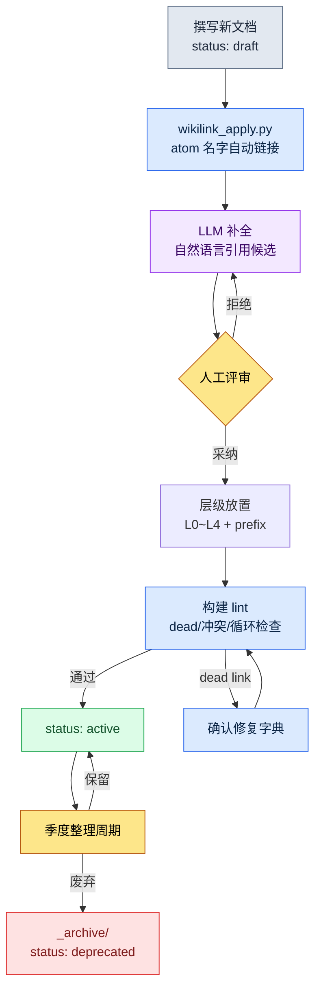

# 24.3 Wikilink 与文档层级 —— 连接与分类,检索的两个入口

> 连接(wikilink)与分类(层级)是同一个问题的两个入口。一个回答"这个决策会牵连到哪里",另一个回答"这份文档住在哪里"。

新加入的策划在第二天早上问道:"战斗的全局冷却值是 0.5 秒,对吗?依据在哪份文档里?"我答不上来。决策记录肯定在某个地方,可我记不清那是战斗规则手册、会议记录,还是季度报告了。我们三个人凑在一起,用 grep 把整个文件夹翻了个遍。同一个数字在六处出现,可其中哪个是"原始决策"、哪个是"引用副本",根本分不清。我们花了 40 分钟。最后找到的,是埋在会议记录里的一行字。

那天晚上,我意识到缺了两样东西。第一,文档之间没有**显式的连接**。同一个数字出现在六处,却没有任何地方写下"这个是从那里引用来的"这根线。第二,文档没有安身的**层级**。决策记录散落在规则手册、会议记录、报告里,没有"决策就住在这里"的约定。

这两样东西就是本章的主题。wikilink 把连接写成文本,层级把分类约定成文件夹。二者看似是分开的技法,实则是检索这一个问题的两面。

---

## 24.3.1 连接缺失时,什么会崩塌

文档只有 30 份时,靠脑子全能记住。一旦超过 100 份,人的记忆就当不了索引了。这时能依靠的只有两条路之一:用 grep 把全部扫一遍(慢且不准确),或者顺着文档里写下的显式连接走(快且准确)。

grep 不准确的原因很简单。检索 `combat_global_cooldown_constant` 这个字符串时,**决定**了这个值的文档,和只是**提到**这个值的文档,会被一视同仁地捞出来。哪个是原始的,grep 并不知道。反过来,如果约定在文档里写 `[[combat_global_cooldown_constant]]` 这样的双方括号表记,那么"这里是有意引用那个 atom"的信号就留在了字符串本身。用 `\[\[combat_global_cooldown` 模式缩小范围,偶然的提及就被排除,只剩下有意的引用。

这个一行的表记约定,就成了图的一条边(edge)。文档 A 写下 `[[atom_X]]`,就产生了 A→X 方向的边。200 份文档各自写下几条,不用谁去画,图就在文本里累积起来。

下面是我们项目里 atom、决策、文档被 wikilink 串联起来的一个片段。节点颜色表示种类,箭头表示引用方向。

<svg viewBox="0 0 720 360" xmlns="http://www.w3.org/2000/svg" font-family="sans-serif" font-size="12">
  <defs>
    <marker id="arrow" markerWidth="9" markerHeight="9" refX="8" refY="3" orient="auto" markerUnits="strokeWidth">
      <path d="M0,0 L8,3 L0,6 Z" fill="#555"/>
    </marker>
  </defs>
  <!-- edges -->
  <g stroke="#888" stroke-width="1.4" marker-end="url(#arrow)" fill="none">
    <line x1="180" y1="80" x2="350" y2="150"/>
    <line x1="180" y1="240" x2="350" y2="160"/>
    <line x1="430" y1="150" x2="560" y2="90"/>
    <line x1="430" y1="170" x2="560" y2="240"/>
    <line x1="180" y1="80" x2="180" y2="220"/>
  </g>
  <!-- doc nodes (blue) -->
  <g>
    <rect x="90" y="58" width="180" height="44" rx="6" fill="#dbeafe" stroke="#2563eb"/>
    <text x="180" y="84" text-anchor="middle" fill="#1e3a8a">[[CombatFormula_v3]]</text>
    <rect x="90" y="218" width="180" height="44" rx="6" fill="#dbeafe" stroke="#2563eb"/>
    <text x="180" y="244" text-anchor="middle" fill="#1e3a8a">[[Meeting_W21]]</text>
  </g>
  <!-- atom node (green) -->
  <g>
    <rect x="350" y="134" width="180" height="48" rx="6" fill="#dcfce7" stroke="#16a34a"/>
    <text x="440" y="155" text-anchor="middle" fill="#14532d">[[combat_global_</text>
    <text x="440" y="171" text-anchor="middle" fill="#14532d">cooldown_constant]]</text>
  </g>
  <!-- decision nodes (amber) -->
  <g>
    <rect x="560" y="68" width="150" height="44" rx="6" fill="#fef3c7" stroke="#d97706"/>
    <text x="635" y="94" text-anchor="middle" fill="#92400e">[[D2026_Q2_017]]</text>
    <rect x="560" y="218" width="150" height="44" rx="6" fill="#fef3c7" stroke="#d97706"/>
    <text x="635" y="244" text-anchor="middle" fill="#92400e">[[D2026_Q2_018]]</text>
  </g>
  <!-- legend -->
  <g font-size="11">
    <rect x="90" y="312" width="14" height="14" fill="#dbeafe" stroke="#2563eb"/>
    <text x="110" y="324" fill="#333">文档</text>
    <rect x="170" y="312" width="14" height="14" fill="#dcfce7" stroke="#16a34a"/>
    <text x="190" y="324" fill="#333">atom</text>
    <rect x="250" y="312" width="14" height="14" fill="#fef3c7" stroke="#d97706"/>
    <text x="270" y="324" fill="#333">决策</text>
  </g>
</svg>

这个小片段展示的是:新策划那个问题的答案,其实早已在图里。顺着进入 `combat_global_cooldown_constant` atom 的箭头反向追溯,就能找到决策 `D2026_Q2_017`。不是 40 分钟,而是一次反向引用。

---

## 24.3.2 表记约定 —— 四种类型,一种格式

我们把用 wikilink 串联的对象只定为四种。种类一多,格式就会松动;格式一松动,grep 又会变得不准确。

- **atom 引用** —— `[[combat_global_cooldown_constant]]`。指向单文档单决策单元的 atom。
- **决策引用** —— `[[D2026_Q2_017]]`。以季度和编号标识的决策记录。
- **文档引用** —— `[[CombatFormula_v3]]`。规则手册、规格文档等大型文档。
- **人员引用** —— `[[团队成员 A]]`。负责人、决策者。

四种全部是 `[[name]]` 一种格式。name 必须全局唯一。如果 atom 名字在两处冲突,就会在图里合并成同一个节点,酿成"战斗的 cooldown"和"UI 的 cooldown"变成一个节点的事故。所以在 atom 命名规则里,强制加上领域 prefix(`combat_`、`ui_`)。

---

## 24.3.3 wikilink_apply.py —— 应用与修复

只有表记约定还不够。让人手工给 200 份文档一个个加方括号是不现实的,就算加好了,只要 atom 名字一改就全断了。所以我们运行一个做两件事的脚本。第一是**应用**(apply)——把正文中出现的已知 atom 名字自动转成 wikilink。第二是**修复**(heal)——找出被改名或断掉的链接,加以更新和上报。

`wikilink_apply.py` 的核心部分长这样。

```python
# wikilink_apply.py — 将正文中的 atom 名字应用为 [[wikilink]],并修复断掉的链接
import re
from pathlib import Path

WIKILINK = re.compile(r"\[\[([A-Za-z0-9_]+)\]\]")
# 只捕获尚未成为链接、以裸名出现的 atom 名字(前面没有 [[ 的情况)
BARE_NAME = lambda name: re.compile(rf"(?<!\[\[)(?<![A-Za-z0-9_])({re.escape(name)})(?![A-Za-z0-9_])(?!\]\])")

def load_known_atoms(registry: Path) -> set[str]:
    # _atom_registry.tsv:第一列是当前有效的 atom name
    return {ln.split("\t")[0].strip()
            for ln in registry.read_text(encoding="utf-8").splitlines()
            if ln.strip() and not ln.startswith("#")}

def apply_links(text: str, known: set[str]) -> tuple[str, int]:
    applied = 0
    for name in sorted(known, key=len, reverse=True):  # 长名字优先:防止部分匹配污染
        text, n = BARE_NAME(name).subn(rf"[[{name}]]", text)
        applied += n
    return text, applied

def heal_links(text: str, known: set[str], aliases: dict[str, str]) -> tuple[str, list[str]]:
    dead = []
    def repl(m):
        ref = m.group(1)
        if ref in known:
            return m.group(0)              # 存活 → 原样保留
        if ref in aliases:                  # 已改名的 atom → 修复为新名字
            return f"[[{aliases[ref]}]]"
        dead.append(ref)                    # 真正的 dead link → 上报
        return m.group(0)
    return WIKILINK.sub(repl, text), dead
```

这里有两个设计选择,是正文的脊椎。

第一,`apply_links` **先替换长名字**。当存在 `combat_cooldown` 和 `combat_cooldown_global` 两个 atom 时,如果先替换短的那个,长的那个的前半部分就会被污染。按长度降序排序的这一行,挡住了这个事故。这是我第一次写的时候漏掉的地方,直到真的出现了 `[[combat_cooldown]]_global` 这样断掉的结果,才补上。

第二,`heal_links` **经由改名字典**(aliases)来修复。当 atom 名字从 `combat_gcd` 改成 `combat_global_cooldown_constant` 时,把旧名字自动替换成新名字,只有在字典里也找不到时,才作为 dead link 上报。名字每改一次,不用手工去改 200 份文档,只需加一行 alias。

---

## 24.3.4 实操记录 —— 把 wikilink 补全交给 Claude

自动 apply 只会给"已知的 atom 名字"加链接。但正文里不写 atom 名字、而是用自然语言展开的句子("战斗的全局冷却是 0.5 秒")它抓不到。把这类自然语言引用转成 wikilink 候选,LLM 比人快。下面是实际往来的完整实操记录(worked transcript,即完整保留的真实操作过程记录)——输出没有做摘要,连我拒绝的部分也原样保留。

**我的提示词(全文):**

```
我给你一段战斗规则手册和一份已登记的 atom 清单。请在正文中找出指向这些
atom 的自然语言表达,以表格形式提出 [[wikilink]] 候选。只在确定时提出,模糊
时只标注"模糊"即可。不要重写正文,只说哪个语句改成哪个链接。未登记的
概念请单独归入"新增 atom 候选"。

[已登记的 atom]
combat_global_cooldown_constant
combat_skill_cast_interrupt_rule
combat_resource_regen_rate

[正文]
战斗的全局冷却为 0.5 秒,对所有主动技能通用。
施法过程中被击中,施法会被打断。但恢复类技能除外。
资源再生只有在非战斗状态下才以正常速度恢复。
```

**Claude 输出(原始未加工):**

```
建议的 wikilink:

| 正文语句                          | 候选链接                                | 确信 |
|----------------------------------|----------------------------------------|------|
| "战斗的全局冷却为 0.5 秒"          | [[combat_global_cooldown_constant]]    | 高   |
| "施法过程中被击中,施法会被打断"    | [[combat_skill_cast_interrupt_rule]]   | 高   |
| "资源再生只有在非战斗状态下"        | [[combat_resource_regen_rate]]         | 中   |

新增 atom 候选:
- "恢复类技能除外" → 这条例外规则在已登记的 atom 中任何一处都
  没有明确写出。看来需要一个像 combat_skill_cast_interrupt_heal_exception
  这样的独立 atom。(模糊:它也可能是 interrupt_rule 的下位条款,
  无法判定是否为独立 atom)

注意:"资源再生"这一行,由于没看到 atom 定义,无法确定
combat_resource_regen_rate 指的是"再生速度"还是"非战斗条件",故确信为中。
```

**我的验证与拒绝:**

三行里我接受了两行。全局冷却和施法中断与 atom 定义完全一致。第三行"资源再生"这一行,Claude 自己把确信降到"中"是对的 —— `combat_resource_regen_rate` atom 只定义了**速度值**,而"只有在非战斗状态下"这个**条件**归另一个 atom 管辖。如果照样加链接,就会酿成把"条件"错误连到"速度" atom 上的事故。**我拒绝了。**

新增 atom 候选的指摘是准确的。"恢复类例外"确实在任何地方都没有 atom。只是 Claude 说模糊的那部分("是 interrupt_rule 的下位条款,还是独立 atom")属于人来判断的范畴,我决定把它拆分为独立 atom。

**再次请求:**

```
"资源再生"这一行不要加链接。改为把 [[combat_resource_regen_rate]] 只
限定为"速度","非战斗条件"拆分为新增 atom。请分别为这两个 atom 各写
一行定义。恢复例外也作为独立 atom 写一行定义。
```

在这一来一回中,LLM 做的不是"从 0 造出候选",而是"帮我挑选候选"。关键在于,**人有明确可以拒绝之处**。若是自动发布,一个错误的链接就会永久留在图里。

---

## 24.3.5 lint —— 在构建阶段挡住断掉的连接

链接随时间会断。atom 被废弃、名字被改、错别字混进来。所以每次构建都跑一遍 wikilink lint。检查项与处理如下。

- **dead link** —— `[[name]]` 的 name 不在注册表里 → 构建警告,确认修复字典
- **格式违规** —— 违反 snake_case、prefix 规则 → 阻断
- **名字冲突** —— 同一个 name 出现在两个 atom 上 → 阻断(全局唯一性被打破)
- **循环引用** —— A→B→A → 警告(有意为之则列入允许清单)
- **过度引用** —— 一份文档对同一个 atom 引用 10 次以上 → 警告(疑似噪声)

只把 dead link 设为警告而非阻断,是有意的。在给 atom 改名的中间状态会短暂出现 dead,如果把这个当成构建失败来挡,作业就停了。取而代之,让它先确认修复字典。格式违规和名字冲突则立即阻断 —— 这两者会污染整张图。

> 这个 lint 是自我证明的。wikilink_apply.py 造出的链接,由同一套系统的 lint 来检查,其结果又作为另一个 atom 决策留存。工具用自己的标准验证自己的产物,这个闭环是运营的基本骨架。

---

## 24.3.6 分类 —— 文档安身的层级

到这里是连接。现在是分类。如果说 wikilink 回答"这个决策会牵连到哪里",那么层级回答"这份文档住在哪里"。两者都缺,新策划的 40 分钟检索就会重演。

我们的文档文件夹分为四层。这个层级与信息架构的 Layer 统合共享同一套骨架 —— 愿景、系统、内容、元信息各占一层。

```
docs/
├── L0_vision/              愿景(5 份以下,几乎不变)
├── L1_systems/             各领域规则手册
│   ├── combat/
│   ├── narrative/
│   └── ui/
├── L2_content/             单个内容
│   ├── characters/
│   └── quests/
└── L4_meta/                运营·决策·会议·原子
    ├── decisions/
    ├── meetings/
    ├── reports/
    └── atoms/
```

L3 空着,是因为数据表和 DB 占了那个位置(是表格而非文档)。新策划要找的决策住在 `L4_meta/decisions/` —— 单单有这一个约定,40 分钟检索本可以用"决策就在那里"这一句话结束。

要让层级作为检索入口发挥作用,得同时守住五点。缺任何一点,分类都会崩。

1. **按语义分类,禁止按时间。** `combat/`、`narrative/` 能被检索到,但 `2026-Q1/`、`2026-Q2/` 六个月后没人会打开。时间由 git 记录,没理由再用文件夹分一遍。
2. **深度不超过 4。** `L1_systems/combat/skills/active/single_target/attack.md` 是 5 层。路径一超过一屏,人就没法把位置装进脑子。
3. **文件名 prefix。** 用 `spec_`、`report_`、`decision_`、`char_` 把种类放进文件名。不看文件夹也能看出种类。
4. **每个文件夹都有 README。** 每个文件夹的定义、内容、命名规则由 README 写下。这是新加入者的第一个入口。
5. **`_` prefix 元信息文件夹。** `_archive/`、`_TEMPLATES/`、`_NAMING/` 在自动排序中会排到上面,不与正式内容混在一起。

文档不会停在一个位置。撰写期间以 `status: draft` 住在正式文件夹里,激活后变成 `status: active`,废弃时**不是删除**而是移到 `_archive/` 并标上 `status: deprecated`。不删除废弃资料是铁律。六个月后有人问"那个决策为什么被推翻了?"时,答案只在废弃资料里。若是删掉了,就没有办法事后重新找回决策的依据。

大的变更不只交给 git,还在 frontmatter 里以 change_log 留存。

```yaml
---
title: combat_global_cooldown_rule
version: v3
last_modifier: teammate_a
change_log:
  - v1 (2025): 初稿
  - v2 (2025): cooldown 0.3 → 0.5  ([[D2026_Q2_017]])
  - v3 (2026): 新增恢复例外        ([[D2026_Q2_018]])
---
```

请注意,change_log 里的决策 ID 是用 wikilink 写的。连接与分类在这里相遇。文档住在层级中的一个位置(分类),但它的变更历史连向决策图(连接)。一份 frontmatter 同时打开两个入口。

---

## 24.3.7 每季度一次,整理周期

层级放着不管就会腐烂。空文件夹冒出来,搁了六个月的 draft 越堆越多,深度悄悄增加。所以每季度整理一次。删掉空文件夹,给超过六个月的 draft 决定激活还是废弃,把深度 5 以上的平摊,给没有 README 的文件夹补写或废弃,`_archive` 超过一半就压缩保存。没有这个周期,层级就会被噪声塞满,信号与噪声的区分随之消失。

把整个流程看成一张图就是这样。文档进来、被连接、被分类、被验证、直到被废弃,是一个闭环。



在这个闭环里,连接(B·C·D·F)与分类(E·I·J)交替运作。二者不是各转各的,而是在一份文档的生命周期里相互咬合。

---

## 24.3.8 效果 —— 什么发生了怎样的改变

这些数字是作者在自己项目里对比引入前后的**方向性**。不是精密测量值,而是同一件工作在两种环境下做时,体感到的差异大小(作者观察,未精密计量)。

在连接和层级立起来之前,新策划的决策追溯问题,像开头那个 40 分钟的例子一样,长的时候要花一两个小时。引入之后,一次 atom 反向引用 —— 是分钟量级。文档检索从 5\~10 分钟缩短到 30 秒上下,这是层级的语义分类与 prefix 一起作用的结果。因错误引用导致的事故(把已废弃的值误当作现行值那一类)从每季度好几件减到一两件 —— wikilink 明示了"这里引用的是那个 atom",复制的值和原始的值不再混淆。

变化最大的是**新加入者的适应**。没有层级,光是熟悉哪个文件夹里有什么就要花好几天;没有连接,就无从把握各系统之间如何交织。两者齐备之后,靠文件夹 README 熟悉位置,顺着 wikilink 图自行探索系统间的关系。"只有问才知道的东西"变成了"顺着走就看得见的东西"。

这个效果只有在两个入口**同时**存在时才出现。只有连接没有分类,图是有了,却不知道文档住在哪里;只有分类没有连接,文件夹是干净的,却不知道决策牵连向何处。

---

## 24.3.9 常见失败与处方

连接这一侧最常见的失败是**噪声链接**。以为 wikilink 好,就给所有名词都加方括号,图就会被无意义的边塞满,可视化工具随之失灵。原则是只留下能提出并回答"这份文档与那份文档是什么关系"的链接。其次是**自动发布** —— 把 LLM 造的链接不经评审就提交,就会像实操记录里"资源再生"那一行那样,把错误的连接永久留下。apply 是自动的,发布则由人来做。

分类这一侧的失败大多是五条原则的违反。按时间分文件夹、深度 5 以上、文件名无规则、缺 README。还有最难挽回的 —— **删除废弃资料**。被删掉的决策依据无法重建。送往 `_archive` 的那一行,守住了六个月后的学习资料。

---

### 本章要点

- 连接与分类是检索的两个入口,只有一个,新加入者的 40 分钟检索就会重演。
- wikilink 自动应用 atom 名字,但 LLM 候选必须给人留下拒绝的余地才安全。
- 废弃资料不是删除,而是保存到 `_archive`,决策的依据才能事后存活。

---

## 动手试试 —— wikilink + 层级的最小引入

**setup.** 在文档文件夹里建 `L0_vision/` `L1_systems/` `L2_content/` `L4_meta/` 四个文件夹,给每个文件夹放一行 README。把 atom 名字清单汇集到 `_atom_registry.tsv` 一个文件里(第一列 = atom name)。

**prompt.** 把正文一段和已登记的 atom 清单交给 LLM,这样请求 —— "在正文中找出指向这些 atom 的自然语言表达,以表格形式提出 `[[wikilink]]` 候选。只在确定时提出,模糊时只标注'模糊'。不要重写正文。未登记的概念归入'新增 atom 候选'。"

**verify.** 对每个被提议的链接,都与 atom 定义对照。只有当 atom 指向的对象与正文指向的对象**完全**相同时才采纳,条件、属性、例外一旦不符就拒绝。采纳后用 `grep "\[\[name\]\]"` 确认链接是否真的输入了、有没有 dead link。

**单人精简版.** 想不用脚本也不用 lint 就开始,两行规则就够。(1)决策一律放在 `decisions/` 一个文件夹里,以 `decision_*.md` 命名。(2)其他文档提到那个决策时,写作 `[[decision_id]]`。只守住这两行,"那个决策在哪儿?"这个问题就能用一次 `grep "\[\[decision_"` 回答。工具在文档超过 100 份之后再引入也不迟。
