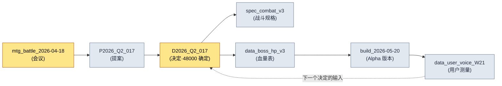

# 24.4 来源追踪·data lineage

> 怀疑数据的那一刻,总是来得太晚。往往要等到错误的数值已经录入线上构建之后,才会开始追问"这个数字到底是从哪儿来的"。

---

Alpha 版本发布前的那个周五傍晚,组员 B 走到我工位旁。他手里的笔记本电脑上开着一份战斗数值电子表格。"总监,Boss 第一阶段的血量,表里写的是 48,000,可进到构建里的值却是 52,000。这两个到底哪个对?"

我不知道。准确地说——在那个当下,没有人知道。表里的 52,000 可能是反映了几天前会议决定的最新值,也可能是有人把未经验证的值临时填了进去。48,000 也可能是那次会议之前的共识值。两个数字都很像那么回事。像那么回事并不等于有依据。

要回答这个问题,就得沿着来源一路回溯。是在哪次会议上决定的,那次会议的输入是什么,是谁把它誊进了表里。然而,一旦这条追踪的链条只存在于人的记忆里,答案就会变成"我明天去问一下组员 A"。运营(LiveOps)进行到第六个月时,这类悬而未决的问题会堆积如山。data lineage——数据的谱系——正是让这座山根本不会形成的基础设施。

核心只有一条:来源不能靠手写。由人事后补录的来源记录,撑不过一个月。只有在数据被创建的那一刻自动记录下来的来源,才能存活下来。

---

## 24.4.1 数据来源断裂的五种代价

自动记录 `_source_map.tsv` 中的一行,成本只是几毫秒。而当这一行缺失时,要付出的代价会朝五个方向蔓延开来。

<svg viewBox="0 0 720 300" xmlns="http://www.w3.org/2000/svg" font-family="sans-serif">
  <rect x="280" y="120" width="160" height="60" rx="8" fill="#1f2933" stroke="#0b3d2e"/>
  <text x="360" y="148" fill="#ffffff" font-size="15" text-anchor="middle">来源断裂</text>
  <text x="360" y="168" fill="#9fb3c8" font-size="12" text-anchor="middle">(未记录 source)</text>

  <rect x="20" y="20" width="170" height="44" rx="6" fill="#e8f0fe" stroke="#1967d2"/>
  <text x="105" y="40" fill="#1a1a1a" font-size="12.5" text-anchor="middle">无法验证</text>
  <text x="105" y="56" fill="#5f6368" font-size="11" text-anchor="middle">"这个数值从哪来?"</text>

  <rect x="530" y="20" width="170" height="44" rx="6" fill="#e8f0fe" stroke="#1967d2"/>
  <text x="615" y="40" fill="#1a1a1a" font-size="12.5" text-anchor="middle">变更遗漏</text>
  <text x="615" y="56" fill="#5f6368" font-size="11" text-anchor="middle">原始更新→衍生搁置</text>

  <rect x="20" y="236" width="170" height="44" rx="6" fill="#fce8e6" stroke="#c5221f"/>
  <text x="105" y="256" fill="#1a1a1a" font-size="12.5" text-anchor="middle">法务暴露</text>
  <text x="105" y="272" fill="#5f6368" font-size="11" text-anchor="middle">外部资产依据丢失</text>

  <rect x="530" y="236" width="170" height="44" rx="6" fill="#fce8e6" stroke="#c5221f"/>
  <text x="615" y="256" fill="#1a1a1a" font-size="12.5" text-anchor="middle">事故诊断延迟</text>
  <text x="615" y="272" fill="#5f6368" font-size="11" text-anchor="middle">无法反向追溯错误值</text>

  <rect x="275" y="236" width="170" height="44" rx="6" fill="#fef7e0" stroke="#f29900"/>
  <text x="360" y="256" fill="#1a1a1a" font-size="12.5" text-anchor="middle">交接损失</text>
  <text x="360" y="272" fill="#5f6368" font-size="11" text-anchor="middle">"为何如此决定?"无答案</text>

  <line x1="280" y1="135" x2="190" y2="55" stroke="#5f6368" stroke-width="1.5"/>
  <line x1="440" y1="135" x2="530" y2="55" stroke="#5f6368" stroke-width="1.5"/>
  <line x1="280" y1="165" x2="190" y2="245" stroke="#c5221f" stroke-width="1.5"/>
  <line x1="440" y1="165" x2="530" y2="245" stroke="#c5221f" stroke-width="1.5"/>
  <line x1="360" y1="180" x2="360" y2="236" stroke="#f29900" stroke-width="1.5"/>
</svg>

陷阱在于:这五种代价,没有任何一种会在创建数据的那一刻显现出来。它们全都是在几周后、几个月后、经手人换了之后,账单才寄到。所以来源绝不能成为"以后再整理"的对象,它必须在被创建的那一刻就记录下来。

---

## 24.4.2 _source_map.tsv —— 来源映射的标准骨架

项目A 运营中的来源映射文件只有 `_source_map.tsv` 一个。用制表符分隔的文本,理由很简单:人可以一眼读完一行,脚本用一次 `split('\t')` 就能解析,git diff 也能干净地展示单行的变更。CSV 一旦正文里混入逗号就会出错,JSON 则让人难以一行读完。

```tsv
asset_id	source_type	source	created	creator	notes
spec_combat_v3	internal	mtg_battle_2026-04-18	2026-04-18	teammate_a	decision_D2026_Q2_017 依据
data_boss_hp_v3	internal	decision_D2026_Q2_017	2026-04-18	teammate_b	第一阶段 48000 确定
asset_K_001_concept	internal_ai_assisted	imagegen + teammate_b 整理	2026-04-20	teammate_b	legal_review 完成
data_user_voice_W21	external_aggregated	forum + community + sns	2026-05-25	auto_collect	13.1 管线产出
ref_visual_tone_a	external_reference	refgame (2024)	2026-04-15	teammate_c	视觉基调参考，无直接借用
```

六个字段的角色都很明确。`asset_id` 是数据的唯一键,`source_type` 是分类(下文详述),`source` 是来源的位置——会议 ID、决定 ID、采集管线、外部作品名,`created`/`creator` 是何时·由谁,`notes` 是供人阅读的一行上下文。

回头再看第二行和第三行,上一节里组员 B 的问题就有了答案。`data_boss_hp_v3` 的来源是 `decision_D2026_Q2_017`,notes 里填的是"第一阶段 48000 确定"。构建里的 52,000 并不在这条 lineage 中。也就是说,52,000 是未经验证的临时值,正确答案是 48,000。这个问题在 1\~2 分钟内就能了结——不必调动任何人的记忆,也不必毁掉一个周五的傍晚。

不过,这个文件上还挂着另一条规则。只要有人用手工方式编辑 `_source_map.tsv`,`integrity_check` 的 audit 就会给出 FAIL。理由留到下一节讲——因为来源只应由自动方式记录。

---

## 24.4.3 source_type 五种 —— 分类即处理规则

把来源分成五类,并不是出于整理癖,而是因为每一种 source_type 所附带的运营规则各不相同。

<svg viewBox="0 0 720 270" xmlns="http://www.w3.org/2000/svg" font-family="sans-serif">
  <rect x="20" y="20" width="210" height="48" rx="6" fill="#e6f4ea" stroke="#137333"/>
  <text x="32" y="40" fill="#1a1a1a" font-size="13" font-weight="bold">internal</text>
  <text x="32" y="58" fill="#5f6368" font-size="11">会议·proposal·决定 → 仅追踪</text>

  <rect x="20" y="76" width="210" height="48" rx="6" fill="#e6f4ea" stroke="#137333"/>
  <text x="32" y="96" fill="#1a1a1a" font-size="13" font-weight="bold">internal_ai_assisted</text>
  <text x="32" y="114" fill="#5f6368" font-size="11">AI 生成+人工整理 → 标明来源</text>

  <rect x="20" y="132" width="210" height="48" rx="6" fill="#fef7e0" stroke="#f29900"/>
  <text x="32" y="152" fill="#1a1a1a" font-size="13" font-weight="bold">external_aggregated</text>
  <text x="32" y="170" fill="#5f6368" font-size="11">用户测量 → 标明采集日·样本</text>

  <rect x="20" y="188" width="210" height="48" rx="6" fill="#fce8e6" stroke="#c5221f"/>
  <text x="32" y="208" fill="#1a1a1a" font-size="13" font-weight="bold">external_reference</text>
  <text x="32" y="226" fill="#5f6368" font-size="11">第三方作品 → legal_review 必需</text>

  <rect x="20" y="244" width="210" height="22" rx="6" fill="#e8f0fe" stroke="#1967d2"/>
  <text x="32" y="259" fill="#1a1a1a" font-size="12" font-weight="bold">self_measured</text>

  <rect x="280" y="20" width="420" height="246" rx="8" fill="#f8f9fa" stroke="#dadce0"/>
  <text x="300" y="48" fill="#1a1a1a" font-size="13" font-weight="bold">分类 → 处理规则映射</text>
  <text x="300" y="78" fill="#3c4043" font-size="12">internal 系列：能用决定 ID 反向追溯即通过</text>
  <text x="300" y="104" fill="#3c4043" font-size="12">ai_assisted：notes 必须写明用了哪个工具·哪段提示词</text>
  <text x="300" y="130" fill="#3c4043" font-size="12">aggregated：没有采集时间就无法解读数值</text>
  <text x="300" y="156" fill="#c5221f" font-size="12">reference：legal_review 为空则 audit FAIL ← 强制</text>
  <text x="300" y="182" fill="#3c4043" font-size="12">self_measured：仿真/KPI，建议在 notes 写明复现条件</text>
  <text x="300" y="222" fill="#5f6368" font-size="11.5">→ source_type 不是标签，而是</text>
  <text x="300" y="242" fill="#5f6368" font-size="11.5">  检查器读取并据此分支的开关</text>
</svg>

来看 `external_reference` 这一行。如果某个资产把 refgame 当作视觉基调的参考,那么这个资产在未经法务审查前就不能进入构建。source_type 是 `external_reference`,而 legal_review 记录为空时,audit 就会拦下它。这正是标签不止步于标签、而成为检查器所读取的开关的地方。所谓五种分类是运营信任的骨架,指的就是这种强制力。

---

## 24.4.4 自动记录 —— 在创建的那一刻留下的一行

现在是核心。来源必须在数据生成的时刻被自动记录。项目A 的 `source_tracker.py` 挂在资产生成的钩子(hook)上。

```python
# source_tracker.py
import time, getpass, csv
from pathlib import Path

SOURCE_MAP = Path("_source_map.tsv")
VALID_TYPES = {
    "internal", "internal_ai_assisted",
    "external_aggregated", "external_reference", "self_measured",
}

def track_source(asset_id: str, source_type: str, source: str, notes: str = ""):
    if source_type not in VALID_TYPES:
        raise ValueError(f"unknown source_type: {source_type}")
    if source_type == "external_reference" and "legal_review" not in notes:
        raise ValueError(f"{asset_id}: external_reference 资产必须标注 legal_review")

    record = [
        asset_id,
        source_type,
        source,
        time.strftime("%Y-%m-%d"),
        getpass.getuser(),
        notes,
    ]
    with SOURCE_MAP.open("a", encoding="utf-8", newline="") as f:
        csv.writer(f, delimiter="\t").writerow(record)
```

只要这个函数挂在资产生成管线上——在表格被 export 时、概念资产被登记时、用户数据被汇总时——就会自动 append 一行来源。没有任何一个环节需要人去记着做,事后补录的负担趋近于 0。

用 `getpass.getuser()` 自动填充 `creator` 字段这一点虽小,却是决定性的。让人自己填名字,就会出现空格;让系统来填,就不会有空格。而且,`external_reference` 一旦缺少 legal_review,记录本身就会被直接拒绝——这就堵死了没有来源的外部资产进入系统的通道。

这里我要点出 AI 应用的真实样貌。这个 `track_source` 函数的初稿,是我让 Claude 给的。下面是那段实操记录(worked transcript,完整保留的真实操作过程记录)的一条主干。

**我的提示词(全文):**

```
写一个往 _source_map.tsv 里 append 一行来源的 Python 函数。
列:asset_id、source_type、source、created(今天的日期)、
creator(当前 OS 用户)、notes。用制表符分隔。
source_type 限定为 5 种:internal、internal_ai_assisted、
external_aggregated、external_reference、self_measured。
```

**Claude 的原始输出(未作概括):**

```python
import csv, datetime, os

def track_source(asset_id, source_type, source, notes=""):
    record = [asset_id, source_type, source,
              datetime.date.today().isoformat(),
              os.getlogin(),          # ← 当前用户
              notes]
    with open("_source_map.tsv", "a", newline="") as f:
        csv.writer(f, delimiter="\t").writerow(record)
```

> 如果您想加上 source_type 的校验,可以建一个 VALID_TYPES 集合,
> 在函数开头做检查即可。需要的话,我帮您加进去吗?

**我的验证与否决:**

这段输出能跑,但在两处不符合我们的运营。第一,`os.getlogin()` 在 cron 或 CI 中被调用时,会因环境不同而抛出空字符串或抛出异常。我们的 export 管线也会以无人值守的排程运行。所以我把它换成了 `getpass.getuser()`——它读取环境变量,能更稳定地取到用户。第二,Claude 把 source_type 校验作为"需要的话帮您加"的选项留着,但对我们来说,那不是选项,而是必需。一旦没有校验,拼写错误的 source_type 就会混进来,分类随之崩塌。

**我的再次请求:**

```
换成 getpass.getuser()。另外,source_type 校验不要作为选项,
而要作为必需固化进函数里。此外,当类型是 external_reference,
而 notes 里没有 legal_review 字符串时,请抛出 ValueError。
我想从源头杜绝没有经过法务审查的外部资产被记录下来。
```

这次再请求的结果,就是上面给出的最终版 `source_tracker.py`。要点在于,并不是 Claude 的第一版输出错了,而是因为我知道 AI 所不了解的运营约束——无人值守的排程、legal_review 强制——才需要否决与再请求。AI 通常能快速给出一般意义上正确的代码,而人负责验证"在我们的环境里对不对"。那个验证点,恰恰成了来源追踪系统的设计决策。

---

## 24.4.5 audit FAIL —— 阻止手工编辑的完整性检查

前面说过,只要有人用手工编辑 `_source_map.tsv`,`integrity_check` 就会给出 FAIL。它是怎么抓到的?

原理很简单。每当 `track_source` append 一行,就把该行的核心字段(asset_id、source_type、source、created、creator)序列化后生成哈希,累积到单独的 `.source_map.audit` 文件里。audit 检查会重新读取 `_source_map.tsv`,用同样的方式重新计算哈希,再比对两份哈希列表。

```python
# integrity_check 中 source_map audit 部分
def audit_source_map():
    fails = []
    rows = read_tsv(SOURCE_MAP)
    expected = read_lines(AUDIT_FILE)   # append 时累积的哈希

    for i, row in enumerate(rows):
        h = row_hash(row["asset_id"], row["source_type"],
                     row["source"], row["created"], row["creator"])
        if i >= len(expected) or h != expected[i]:
            fails.append(f"L{i+1} {row['asset_id']}: 疑似手工编辑（哈希不一致）")

    if len(rows) != len(expected):
        fails.append(f"行数不一致: tsv={len(rows)} audit={len(expected)}")
    return fails
```

假设有人在表格里把 `data_boss_hp_v3` 的 source 手工改成了 `decision_D2026_Q2_099`。这一行的哈希便与 audit 中累积的原始哈希对不上,检查会输出如下内容。

```
[FAIL] source_map audit
  L3 data_boss_hp_v3: 疑似手工编辑（哈希不一致）
  → 未经过 track_source() 的变更。来源只能通过代码路径记录。
```

这种强制为什么重要?一旦允许手工编辑,终究会有人在赶时间时把来源"看似合理地"填进去。那一刻,lineage 就从真相沦为一份装着某人猜测的文件。audit FAIL 给"来源只能走自动路径"这条规则装上了牙齿。§24.1 的 verification 系统会把这个 audit 与其他检查捆在一起,在 CI 中运行。

---

## 24.4.6 变更传播 —— 源头一变,唤醒衍生

自动记录来源的真正理由,在于反向查询:"源头 X 变了,哪些会受影响?"

```python
def find_derivatives(source_id: str):
    return [
        row for row in read_tsv(SOURCE_MAP)
        if row["source"] == source_id
    ]

# 用法：decision_D2026_Q2_017 在会议上被推翻
deps = find_derivatives("decision_D2026_Q2_017")
# → [spec_combat_v3, data_boss_hp_v3, ...]
```

假设 `decision_D2026_Q2_017` 在下一次会议上被推翻,Boss 第一阶段的血量从 48,000 改成了 50,000。调用 `find_derivatives`,就会立刻列出挂在这个决定上的所有衍生资产——战斗规格文档、血量数据表。通知会发送给各资产的负责人,而"仍盯着旧决定的资产"残留在构建里的事故,便从每季度数起减少到几乎为 0。

靠手写的来源,这种反向查询根本无法成立。来源若是自由文本,`decision_D2026_Q2_017` 在某一行会被写成"Q2 017 决定",在另一行又写成"第二季度第 17 次会议决定",匹配就此破裂。唯有具备 `_source_map.tsv` 的标准格式与 `track_source` 的自动记录,变更传播才能真正运转起来。

---

## 24.4.7 lineage 图 —— 一屏之内的数据谱系

`_source_map.tsv` 逐行来看是平面的,但当一个 source 成为另一个资产的 source 时,数据的谱系便串成了链条。把这条链条铺展到一屏之内,决定所依据的输入的可信度就一目了然。这张 mermaid 图,是由 §24.2 的图表自动生成管线读取 `_source_map.tsv` 后直接产出的——相当于用自身的技法来证明自身的资产。



循环会自然而然地出现。构建产出用户数据,用户数据又成为下一个决定的输入。一旦看得见这个循环,"这个数值从哪来"就变成了屏幕上的一条路径。组员 B 那个周五的问题,在这张图里,不过是沿着 `Data → Decision` 回溯一步而已。

---

## 24.4.8 度量 —— lineage 运营的成效

在项目A,我比较了引入 lineage 系统前后的情况。下表中的时间数值是作者估算(未经验证),应当看方向与比例的差异,而非绝对值。件数则是从每季度的 audit 日志中统计出的实测值。

| 项目 | 无 lineage | lineage 运营 | 性质 |
|---|---|---|---|
| 掌握数据来源的时间 | 1\~2 小时 | 1\~2 分钟 | 作者估算(未经验证) |
| 数据可信度的验证依据 | 资深者记忆 | 即时查询来源 | 定性 |
| 源头变更时的衍生遗漏 | 每季度 5\~8 件 | 0\~1 件 | audit 日志实测 |
| 外部资产法务审查遗漏 | 可能发生 | 0 件(强制记录) | audit 日志实测 |
| 每季度 audit 耗时 | 1\~2 天 | 2\~3 小时 | 作者估算(未经验证) |

最硬的数字是"源头变更时的衍生遗漏"这一行。因为 audit 日志里原样留有决定 ID 和被遗漏的衍生资产,所以能数得出来。时间数值受测量环境(团队规模·资产数量)影响很大,因此明确标注为估算。方向是清楚的——一旦来源被自动记录,追踪就从记忆变成了查询。

---

## 24.4.9 常见失败与处方

| 失败模式 | 处方 |
|---|---|
| 事后用手工填补来源 | 用 `track_source` 在生成时刻自动记录 |
| 来源格式各行不一 | `_source_map.tsv` 制表符标准 + 强制格式 |
| 外部资产法务审查遗漏 | 在 source_type 校验中强制 legal_review |
| 手工编辑 `_source_map.tsv` | 用 `integrity_check` audit 做哈希比对 FAIL |
| 源头变更时放任衍生 | `find_derivatives` 反向查询 + 通知 |
| 只用文字说明谱系 | 用 mermaid 自动生成,一屏可视化 |

六条处方的共同点是,它们都不依赖人的自觉。自动记录·格式强制·哈希比对·反向查询,全都由系统来做。因为来源追踪之所以崩溃,唯一的原因就是"人会忘"。

---

## 24.4.10 第 24 部分收尾

第 24 部分是用自动化来支撑运营信任的四条支线。第 1 章用 verification 把验证收拢到一个点,第 2 章用 mermaid 自动生成画出结构,第 3 章用 wikilink 与 document hierarchy 把文档连接并分层,最后在这第 4 章,用来源与谱系为数据的信任加上了封印。

贯穿这四章的一句话是这样的。**运营的信任,来自系统的记录,而非人的记忆。** 正如 verification 自动追问"这份产出物是否合乎规则",lineage 也自动回答"这份数据从何而来"。二者的关键都在于:即便人忘了,它们也不会崩塌。

这套运营经验,与全书的 Layer 统一设计哲学同出一脉。愿景(资产化·信任)落到系统(来源规则),系统落到数据(`_source_map.tsv`),数据再落到构建·QA(audit·自动更新)——这是一条自上而下的链条。这条链条本身,就是 lineage。

---

### 本章要点
- 来源必须在创建的那一刻自动记录,事后补录的来源撑不过一个月。
- `_source_map.tsv` 标准与 source_type 五种,是变更传播与法务强制的骨架。
- 只有用 audit FAIL 拦住手工编辑,lineage 才能作为真相留存。

---

## 动手试试(setup → prompt → verify)

**setup.** 在项目根目录下创建 `_source_map.tsv`,以一行表头(`asset_id\tsource_type\tsource\tcreated\tcreator\tnotes`)起头,并放入上面的 `source_tracker.py`。在资产 export·登记脚本的末尾挂上 `track_source(...)` 调用。

**prompt.** 如果需要来源自动记录函数,可以这样请求 Claude。

```
写一个往 _source_map.tsv(制表符分隔,列:asset_id、source_type、source、
created、creator、notes)里 append 一行的 Python 函数。
source_type 限定为 5 种,并且当类型是 external_reference 而 notes 里
没有 legal_review 时,抛出 ValueError。creator 用 getpass.getuser()。
```

**verify.** 亲自确认两件事。(1) 用 `external_reference` 调用但把 notes 留空,看是否抛出 ValueError。(2) 用文本编辑器把 `_source_map.tsv` 的 source 字段改动一个字符,再运行 `integrity_check` 的 source_map audit,看是否出现 FAIL。两处都被拦住,就说明来源通道已经封闭。

### 单人精简版
如果是一个人工作,`_source_map.tsv` 一个文件加 `track_source` 一个函数就够了。integrity audit·反向查询·mermaid 自动化,可以等到资产超过几十个、来源开始变得容易混淆时,再一个一个加上去。起点只是"在填写数值时,把一行来源自动留在同一个位置"这一个习惯。
