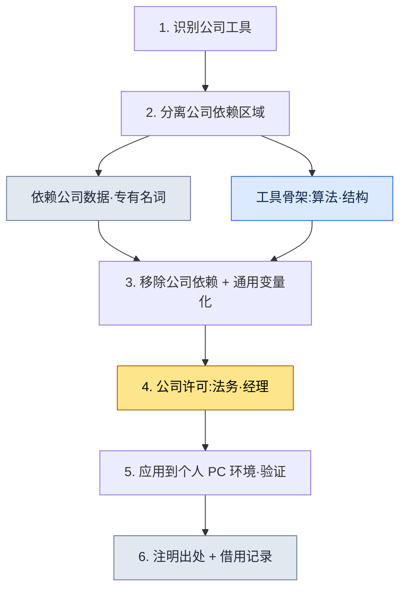

# 附录 B. 工具借用流程(从公司到个人的通用化)

> 本附录整理了作者把在公司项目A中构建并运营的工具·技能,拿到个人 PC 和一般性工作中重新使用的流程。核心问题只有一个:"如何在不侵犯公司知识资产的前提下,只合法地借用从中学到的工具骨架?"本附录展示了如何划定这条边界,把什么拿了过来、又把什么留在原处,以及如何将这些决定留存为记录。

本附录的使用方法如下:先对照自己的处境阅读 B.1 的五条原则,再把 B.3 的流程原样走一遍。然后复制 B.4 的记录模板,按照自己想借用的工具填写即可。既然处理的是公司资产,那么比起"快",能"留下记录"更为优先,整篇附录都是以这一视角构建的。

---

## B.1 借用的五条原则

这是在拿取工具之前已达成共识的五条原则。这五条不是顺序,而是必须同时满足的条件——只要其中一条崩塌,就搁置借用本身。前三条是关于"拿取什么"的技术边界,后两条是关于"如何堂堂正正地拿取"的流程边界。

| 原则 | 说明 |
|---|---|
| 1. 不包含公司 IP | 移除公司名·实名·专有名词 |
| 2. 只拿取工具骨架 | 屏蔽公司领域数据 |
| 3. 通用化重构 | 重新构建为一般使用场景 |
| 4. 引用·出处明确 | 注明为从公司借用的工具 |
| 5. 法务·人事共识 | 走完公司的许可流程 |

最常动摇的一行是第 2 条。算法与结构(骨架)可以拿取,但如果连那套骨架所预设的公司数据格式也一并带过来,那一刻就等于把 IP 也拿走了。把骨架与数据剥离开来的工作,才是借用的主体。

---

## B.2 借用的六种工具·技能

按照原则实际拿到个人 PC 的工具共有六种(截至 2026 年 5 月)。它们有一个共同点——都是处理数据的工具,而这并非偶然。因为数据处理工具的骨架(解析·转换·可视化逻辑)与领域(公司表格的具体格式)相对更容易剥离。

| 工具 | 公司原版 | 个人通用版 |
|---|---|---|
| excel-reader | xlsm 表格·VBA 提取 | 通用 Excel 处理 |
| relation-map-gen | FK 关系 HTML | 通用数据关系图 |
| schema-doc | 从表格生成 Markdown 模式(schema) | 通用模式文档化 |
| table-creator | 批量生成数据表格 | 通用表格生成 |
| gdd-gen | 自动生成 GDD | 通用文档生成 |
| gdd-export | 从 Markdown 转换为多表格 xlsx | 通用 xlsx 转换 |

对比表格的中间与右侧两栏,就能看出通用化意味着什么。左边那栏是"公司表格""GDD"这类带有领域的名称,右边那栏是"通用 Excel""通用文档"这类剥掉领域的名称。名称中公司消失,正是通用化的第一个信号。

---

## B.3 借用流程

把原则(B.1)落到实际操作上,就是下面六个步骤。最关键的分岔点是第 2 步和第 4 步。若在第 2 步没能把骨架与领域干净地分开,后面所有步骤都会被污染;若跳过第 4 步的公司许可,那么无论做得多好,都会成为一件无法使用的工具。



六个步骤中最耗时的一环,不是编码工作(第 2·3 步),而是第 4 步——公司达成共识与法务通过。这意味着最大的关卡不是技术,而是信任;因此借用总是按照先谈妥共识、再打磨代码的顺序推进。

---

## B.4 借用记录

对借用的工具,必须一并留下记录。因为日后可能会有人追问"这件工具从哪里来、移除了什么、得到了谁的许可"。下面是以 excel-reader 为例的记录模板,你可以直接复制这个框架,按照自己的工具填写。

```yaml
---
tool: excel-reader (个人通用版)
original_source: 公司项目A
adopted: 2026-05
permission: 公司经理 + 法务通过
modifications:
  - 移除对公司表格格式的依赖
  - 移除公司领域函数(xlsm VBA)
  - 泛化为通用 csv/xlsx 处理
  - 全面移除公司名·实名引用
usage_in_book: 本书的工具案例引用 (Part 1·5·6·8 等)
---
```

模板中的日期栏(`adopted`)要像 `2026-05` 这样写成确定的年-月。"2026 年 5 月前后"之类的随意写法看起来像是留待日后填写的空格,因此要当场把确定借用的时点钉死。

这份记录中最有价值的两行是 `permission` 和 `modifications`。前一行证明借用是正当的,后一行证明剥离了什么。有了这两行,即使日后有人提出疑问,也留有可供追溯的依据。

---

## B.5 未借用的工具

拿走了什么固然重要,留下了什么同样重要。这里记下了公司工具中被有意不予借用的部分及其理由。这些被留下的工具有一个共同点:要么是公司的核心 IP,要么深深绑定在公司组织结构上,以致无法把骨架与领域剥离开来。

| 工具 | 未借用理由 |
|---|---|
| 公司战斗系统工具 | 公司核心 IP,公司独占 |
| 公司叙事文档工具 | 依赖公司世界观 |
| 公司战斗 TF 工具 | 依赖公司组织结构 |
| 公司人事·财务工具 | 不适配外部环境 |

这与 B.2 中拿走的工具全部是"数据处理"形成了鲜明对比。拿走的是能与领域分离的工具,留下的是与领域浑然一体的工具。可分离性决定了可借用性。

---

## B.6 读者参考 —— 借用前的自查表

最后,这是在拿取工具之前必须让自己逐一通过的五个项目。这张表是一份判定合格/不合格的检查清单——只有五项全部通过才借用,只要有一项卡住就搁置。没有"大体上还行"这回事。因为处理公司资产的工作,容不得部分通过。

| 检查项目 | 通过标准 |
|---|---|
| 是否已获得公司许可 | 经理·法务的明确同意 |
| 是否通过法务审查 | 书面或有记录的确认 |
| 是否已完全移除公司 IP | grep watchlist 检查为 0 件 |
| 是否验证了通用性 | 确认在其他环境中也能运行 |
| 是否有事故应对流程 | 定义了追踪·回收路径 |

请不要把这五项读作五格的通过,而要读作五道锁。把在公司学到的东西正当地变为个人的资产,这件事确实可行,但那份正当性只有在这五道锁全部扣上时才成立。
