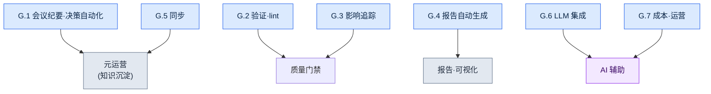

# 附录 G. 运营脚本案例集

本附录是把正文中提到的运营自动化脚本汇集到一处的案例集。正文在行文中说明了每个脚本"为什么需要",但真要动手做类似的工具时,还需要一张能一眼看清"哪些脚本以什么角色归为一组"的地图。本附录就是这张地图。

这里一并写出了脚本名称、一句话说明,以及正文在哪一节讨论过它。对于能够干净利落地一般化的核心脚本(G.1.1 格式检查·G.2.1 一致性检查·G.3.1 关系图·G.7.1 成本追踪器),以及 G.8 的测试·hook 示例,我们用与公司资料无关的通用骨架重新编写,并验证其可直接运行,收录的是实测代码。输入示例、输出乃至退出码,都是实际运行确认过的值。其余条目只写了名称、角色和关联的正文小节,其中缘由会在附录 G.9 中如实说明。读者可以把实测代码条目当作范本,自行做出适合自己环境的实现。

用法如下。先确定想要自动化的工作性质(是验证,是生成报告,还是同步),然后翻到对应的小节(G.1\~G.7)。在那里选出最接近的脚本,再前往括号中的正文小节编号,确认其背景与设计意图。最后对照 G.8 的运营原则,检查自己的脚本是否遵守了这些原则。

按角色把全部脚本归组,如下所示。



---

## G.1 会议纪要·决策自动化

让会议中产生的决策不致散失、而是沉淀为知识资产的一组脚本。从会议纪要验证到 atom 提取,再到正式升格,一脉相连。

### G.1.1 meeting_lint.py

检查会议纪要是否具备既定格式(必需的头部·必需的章节)的脚本。格式散乱的会议纪要会导致后续自动提取失效,因此在入口处拦截(17.2.2)。

下面是与公司资料无关的通用骨架。只用标准库(仅 sys),可直接运行。它检查 Markdown 会议纪要的头部(由 `---` 包裹的块)键与正文章节标题(`## ...`)是否齐全。若有缺失就报出 violation 并 exit 1,全部齐全则 exit 0。

```python
#!/usr/bin/env python3
"""meeting_lint.py

检查 Markdown 会议纪要是否具备既定格式。
- 头部(--- 块)中是否包含全部必需键。
- 正文中是否包含全部必需的章节标题(## ...)。
若有缺失项就输出 violation 并 exit 1,没有则 exit 0。
只使用标准库。

用法:
    python meeting_lint.py meeting.md
"""
import sys

REQUIRED_FRONTMATTER = ["type", "date", "category", "attendees"]
REQUIRED_SECTIONS = ["## 议题", "## 决策", "## 行动项", "## 下次会议"]


def lint(text):
    """接收会议纪要正文字符串,返回缺失项列表(violation)。"""
    violations = []

    # 头部:若首行是 ---,则把到下一个 --- 之间视为头部。
    lines = text.splitlines()
    front = []
    if lines and lines[0].strip() == "---":
        for line in lines[1:]:
            if line.strip() == "---":
                break
            front.append(line)
    front_keys = [ln.split(":", 1)[0].strip() for ln in front if ":" in ln]
    for key in REQUIRED_FRONTMATTER:
        if key not in front_keys:
            violations.append({"kind": "frontmatter", "missing": key})

    # 章节:正文中是否原样包含相应的标题行。
    body_lines = [ln.strip() for ln in lines]
    for section in REQUIRED_SECTIONS:
        if section not in body_lines:
            violations.append({"kind": "section", "missing": section})

    return violations


def main(argv=None):
    argv = sys.argv[1:] if argv is None else argv
    if len(argv) != 1:
        sys.stderr.write("用法: python meeting_lint.py meeting.md\n")
        return 2
    with open(argv[0], encoding="utf-8") as f:
        violations = lint(f.read())

    for v in violations:
        print(f"[VIOLATION] {v['kind']}: {v['missing']}")
    if violations:
        sys.stderr.write(f"[FAIL] 格式违规 {len(violations)}处\n")
        return 1
    sys.stderr.write("[PASS] 格式合格\n")
    return 0


if __name__ == "__main__":
    sys.exit(main())
```

两个常量就是检查基准。例如,把一份头部缺少 `attendees`、正文没有 `## 下次会议` 的会议纪要传入,就会像下面这样报出两处,退出码为 1。

```text
[VIOLATION] frontmatter: attendees
[VIOLATION] section: ## 下次会议
```

### G.1.2 decision_parser.py

读取会议纪要的"决策"章节,自动抽取知识 atom 候选的脚本。替代过去由人逐条誊抄的工作(17.2.3)。

### G.1.3 promote.py

把待审(pending)状态的 atom 升格到正式 atom 文件夹的脚本。在自动提取与正式资产之间设一道人工评审关卡(17.2.6)。

---

## G.2 验证·lint

自动查出数据与内容是否违反规则的质量门禁。让机器先过滤掉人眼容易遗漏的一致性错误。

### G.2.1 integrity_check_id_uniqueness.py

验证数据项的 ID 是否唯一、无重复的脚本。ID 冲突是要到运行时才爆发的事故,因此在数据阶段就加以拦截(10.1.2)。

下面是与公司资料无关的通用骨架。只用标准库(csv·json·sys·argparse),原样保存即可直接运行。输入采用任何游戏数据都可能具备的简单格式,即带 `id` 列的 CSV。

```python
#!/usr/bin/env python3
"""integrity_check_id_uniqueness.py

检查 CSV 数据的 id 列是否唯一。
- 若存在重复 id,就输出 violation 列表并 exit 1。
- 全部唯一则 exit 0。
只使用标准库。

用法:
    python integrity_check_id_uniqueness.py data.csv
    python integrity_check_id_uniqueness.py data.csv --id-column quest_id
"""
import argparse
import csv
import json
import sys


def find_duplicate_ids(rows, id_column):
    """在 rows(字典列表)中查找 id_column 值的重复项。

    返回:violation 列表。每一项形如
    {"id": 值, "row_numbers": [从 1 开始的行号, ...]}。
    把表头算作第 1 行,数据首行从 2 开始计数。
    """
    seen = {}  # id 值 -> 出现过的行号列表
    for index, row in enumerate(rows):
        row_number = index + 2  # 从表头(第 1 行)之后开始
        key = row.get(id_column, "")
        seen.setdefault(key, []).append(row_number)

    violations = []
    for key, row_numbers in seen.items():
        if len(row_numbers) > 1:
            violations.append({"id": key, "row_numbers": row_numbers})
    violations.sort(key=lambda v: v["row_numbers"][0])
    return violations


def load_rows(csv_path):
    with open(csv_path, newline="", encoding="utf-8") as f:
        return list(csv.DictReader(f))


def main(argv=None):
    parser = argparse.ArgumentParser(description="CSV id 唯一性检查")
    parser.add_argument("csv_path", help="要检查的 CSV 文件路径")
    parser.add_argument("--id-column", default="id", help="用作 id 的列名(默认: id)")
    args = parser.parse_args(argv)

    rows = load_rows(args.csv_path)
    violations = find_duplicate_ids(rows, args.id_column)

    # G.8 输出标准:把 violation_list 以 JSON 形式输出到标准输出。
    print(json.dumps({"violation_list": violations}, ensure_ascii=False, indent=2))

    if violations:
        sys.stderr.write(f"[FAIL] 发现重复 id {len(violations)}处\n")
        return 1
    sys.stderr.write("[PASS] 无重复 id\n")
    return 0


if __name__ == "__main__":
    sys.exit(main())
```

输入示例(`data.csv`):

```text
id,name
Q001,初次委托
Q002,遗失的佩饰
Q001,初次委托(重复)
```

运行结果如下。`Q001` 在第 2 行和第 4 行出现了两次,因此报出一处 violation,退出码为 1。

```json
{
  "violation_list": [
    {
      "id": "Q001",
      "row_numbers": [2, 4]
    }
  ]
}
```

### G.2.2 voice_lint.py

检查 NPC 台词的"声音"(voice,即语气·性格)一致性的脚本。抓出同一角色在各章使用不同语气的偏差(5.2·5.4)。

### G.2.3 visual_regression.py

在资源(美术·UI 等)发生变化时,比对是否产生了非预期视觉变化的回归检查脚本(12.1.5)。

---

## G.3 影响追踪

追踪"改动一处会牵动什么"的一组脚本。沿着文档·决策·资源之间的连接,展示变更的波及范围。

### G.3.1 wikilink_graph.py

抓取文档间的 Wikilink(`[[目标]]`)、自动构建连接图的脚本。让人一眼看清哪个文档引用了哪个文档(24.3.4)。

下面是与公司资料无关的通用骨架。只用标准库(os·re·json·argparse)。它读取一个文件夹中的 `.md` 文件,把文件名(去掉扩展名)当作节点,把 `[[...]]` 链接当作边。结果会一并输出邻接表与 Mermaid 图示代码。

```python
#!/usr/bin/env python3
"""wikilink_graph.py

把文件夹中 .md 文档的 [[Wikilink]] 连接构建为图。
- 节点:去掉扩展名的文件名。
- 边:文档正文中的 [[目标]] 标记。若为 [[目标|显示]] 形式,只取目标。
只使用标准库。

用法:
    python wikilink_graph.py ./docs
    python wikilink_graph.py ./docs --format mermaid
"""
import argparse
import json
import os
import re
import sys

WIKILINK = re.compile(r"\[\[([^\]|#]+)")  # [[目标]] / [[目标|显示]] / [[目标#锚点]]


def extract_links(text):
    """从正文中按出现顺序、去重地提取链接目标名称。"""
    result = []
    for match in WIKILINK.findall(text):
        target = match.strip()
        if target and target not in result:
            result.append(target)
    return result


def build_graph(doc_dir):
    """遍历文件夹中的 .md,构建 {文档名: [链接目标, ...]} 邻接表。"""
    graph = {}
    for name in sorted(os.listdir(doc_dir)):
        if not name.endswith(".md"):
            continue
        node = name[:-3]
        path = os.path.join(doc_dir, name)
        with open(path, encoding="utf-8") as f:
            graph[node] = extract_links(f.read())
    return graph


def to_mermaid(graph):
    """把邻接表转换为 Mermaid flowchart 代码字符串。"""
    lines = ["flowchart LR"]
    for node, targets in graph.items():
        if not targets:
            lines.append(f'    {_id(node)}["{node}"]')
        for target in targets:
            lines.append(f'    {_id(node)}["{node}"] --> {_id(target)}["{target}"]')
    return "\n".join(lines)


_ID_CACHE = {}


def _id(name):
    """Mermaid 节点 id 必须是 ASCII。非 ASCII 名称(如中文)会按首次出现的
    顺序赋予 n1、n2、…… 这样的短 ASCII id,并在标签[...]中保留原名。"""
    if name not in _ID_CACHE:
        _ID_CACHE[name] = "n%d" % (len(_ID_CACHE) + 1)
    return _ID_CACHE[name]


def main(argv=None):
    parser = argparse.ArgumentParser(description="Wikilink 连接图构建器")
    parser.add_argument("doc_dir", help="存放文档(.md)的文件夹")
    parser.add_argument("--format", choices=["json", "mermaid"], default="json")
    args = parser.parse_args(argv)

    graph = build_graph(args.doc_dir)
    if args.format == "mermaid":
        print(to_mermaid(graph))
    else:
        print(json.dumps(graph, ensure_ascii=False, indent=2))
    return 0


if __name__ == "__main__":
    sys.exit(main())
```

输入示例(文件夹 `docs/` 中的三个文件):

```text
docs/世界观.md      正文中有 [[地区_汉阳]] 和 [[势力_义禁府]] 链接
docs/地区_汉阳.md   正文中有 [[势力_义禁府]] 链接
docs/势力_义禁府.md  无链接
```

以 `--format mermaid` 运行,会得到下面的图示代码。节点按文件名顺序(世界观 → 势力_义禁府 → 地区_汉阳)处理,标签中原样保留原本的名称。哪个文档伸向何处、终点(`势力_义禁府`)是什么,都一目了然。

```text
flowchart LR
    n1["世界观"] --> n2["地区_汉阳"]
    n1["世界观"] --> n3["势力_义禁府"]
    n3["势力_义禁府"]
    n2["地区_汉阳"] --> n3["势力_义禁府"]
```

### G.3.2 decision_impact.sh

分析某个决策卡会影响哪些文档·资源的脚本。在推翻决策之前,先确认其波及范围(18.4.3)。

### G.3.3 find_skills_using.py

反向找出使用某个资源的技能的脚本。在修改·删除资源之前,先弄清依赖它的地方(11.2.4)。

---

## G.4 报告自动生成

把散落的数据汇整为人可阅读的报告·图示的脚本。将反复的定期汇报自动化,减少费手的工作。

### G.4.1 alpha_gap_report_generator.py

汇总 Alpha 阶段相对目标的缺口(gap),自动生成周报的脚本(10.3.3)。

### G.4.2 decision_graph_to_mermaid.py

把决策卡之间的连接关系转换为 Mermaid 图示代码的脚本。用图来看决策流(24.2.3)。

### G.4.3 weekly_kpi_summary.py

按周汇总主要指标(KPI)的脚本(13.2)。

---

## G.5 同步

高效地对齐分散在多处的资料的脚本。不必每次复制全部,只挑出变更的部分进行同步。

### G.5.1 incremental_sync.py

只挑出会议纪要的变更部分、而非全部进行同步的脚本。资料越积越多,全量复制就越慢,因此采用增量方式(17.5.4)。

### G.5.2 基于 git diff 的变更检测

利用 git 的 diff 高效检测发生了哪些变更的做法。无需额外的追踪装置,直接把 git 本身当作变更检测器(17.5.4.1)。

---

## G.6 LLM 集成

把分类·调用这类需要判断的工作交给 LLM 的脚本。用 LLM 辅助来处理规则无法干净拆解的事情。

### G.6.1 faq_classifier.py

把收到的 FAQ 按类别自动分类的脚本(13.1.3)。

### G.6.2 meeting_classifier.py

把会议按性质类别自动分类的脚本。用于填充会议纪要头部的 category(17.3.6)。

### G.6.3 prompt_library_loader.py

从预先整理好的提示词库中载入所需提示词的脚本。避免每次重复编写相同的提示词(22.1.2)。

---

## G.7 成本·运营

管理自动化本身,使其不致制造成本与资料追踪盲区的脚本。

### G.7.1 llm_cost_tracker.py

追踪 LLM 调用成本并施加上限(cap)的脚本。在事前而非事后阻止成本暴涨(22.3.5)。

下面是与公司资料无关的通用骨架。只用标准库(json·os·argparse)。它记录每次调用的 token 数并计算累计成本,超过上限就发出拒绝信号(exit 2)。单价是代码中的常量,实际值可替换为各自所用模型的单价表(下面的值是用于说明的占位值)。

```python
#!/usr/bin/env python3
"""llm_cost_tracker.py

累计记录 LLM 调用 token 并检查每日成本上限。
- record:把单次调用(输入/输出 token)累加到 ledger 文件。
- 累计成本超过 cap 时以 exit 2 阻止调用(事前拦截)。
只使用标准库。

用法:
    python llm_cost_tracker.py --ledger ledger.json --in 1200 --out 800
    python llm_cost_tracker.py --ledger ledger.json --in 1200 --out 800 --cap-usd 5.0
"""
import argparse
import json
import os
import sys

# 单价:每 1,000 token 的 USD。用于说明的占位值——请替换为实际模型的单价表。
PRICE_PER_1K_INPUT = 0.003
PRICE_PER_1K_OUTPUT = 0.015


def cost_of(in_tokens, out_tokens):
    """用输入/输出 token 计算单次调用的成本(USD)。"""
    return (in_tokens / 1000) * PRICE_PER_1K_INPUT + (out_tokens / 1000) * PRICE_PER_1K_OUTPUT


def load_ledger(path):
    if os.path.exists(path):
        with open(path, encoding="utf-8") as f:
            return json.load(f)
    return {"calls": 0, "in_tokens": 0, "out_tokens": 0, "total_usd": 0.0}


def save_ledger(path, ledger):
    with open(path, "w", encoding="utf-8") as f:
        json.dump(ledger, f, ensure_ascii=False, indent=2)


def main(argv=None):
    parser = argparse.ArgumentParser(description="LLM 成本追踪·上限")
    parser.add_argument("--ledger", required=True, help="累计记录 JSON 文件路径")
    parser.add_argument("--in", dest="in_tokens", type=int, required=True, help="本次调用的输入 token")
    parser.add_argument("--out", dest="out_tokens", type=int, required=True, help="本次调用的输出 token")
    parser.add_argument("--cap-usd", type=float, default=None, help="累计成本上限(USD)。超过则拦截")
    args = parser.parse_args(argv)

    ledger = load_ledger(args.ledger)
    this_cost = cost_of(args.in_tokens, args.out_tokens)

    ledger["calls"] += 1
    ledger["in_tokens"] += args.in_tokens
    ledger["out_tokens"] += args.out_tokens
    ledger["total_usd"] = round(ledger["total_usd"] + this_cost, 6)
    save_ledger(args.ledger, ledger)

    print(json.dumps({"this_call_usd": round(this_cost, 6), "ledger": ledger}, ensure_ascii=False, indent=2))

    if args.cap_usd is not None and ledger["total_usd"] > args.cap_usd:
        sys.stderr.write(f"[CAP] 累计 {ledger['total_usd']} USD > 上限 {args.cap_usd} USD —— 拦截\n")
        return 2
    return 0


if __name__ == "__main__":
    sys.exit(main())
```

输入示例与结果。在空状态下记录输入 1,200·输出 800 token,本次调用成本为 `1200/1000*0.003 + 800/1000*0.015 = 0.0036 + 0.012 = 0.0156` USD。

```json
{
  "this_call_usd": 0.0156,
  "ledger": {
    "calls": 1,
    "in_tokens": 1200,
    "out_tokens": 800,
    "total_usd": 0.0156
  }
}
```

若一并给出 `--cap-usd 0.01`,累计 0.0156 超过上限 0.01,于是以退出码 2 阻止下一次调用。这就是"在事前而非事后阻止"的实际行为。

### G.7.2 source_tracker.py

自动记录引用·参考资料出处的脚本。留存下来,以便日后回溯出处(24.5.4)。

---

## G.8 脚本运营原则

比起多造脚本,让造出的脚本可靠地运转更重要。下面五条原则通用于上述所有脚本。

| 原则 | 说明 |
|---|---|
| 简单 | 回避复杂的库 |
| 测试 | 所有脚本单元测试 |
| 输出标准 | violation_list 等标准(10.1.7) |
| 版本管理 | git |
| 人工评审关卡 | 自动化也须人工评审 |

尤其最后一条原则很重要。自动化不是替代人,而是缩减人做判断之前的环节。无论是验证、提取还是生成,在最终应用之前都务必设一道由人过目一次的关卡。

### G.8.1 单元测试示例

"测试"原则不只停留在口头,这里给出用标准库 `unittest` 验证 G.2.1 核心函数 `find_duplicate_ids` 的实际测试。没有外部依赖,原样保存即可用 `python -m unittest test_integrity_check -v` 运行。关键在于:待验证的函数要与文件输入输出分离,才能这样轻松地测试(所以 G.2.1 中把检查逻辑与 `load_rows` 分开了)。

```python
# test_integrity_check.py
import unittest

from integrity_check_id_uniqueness import find_duplicate_ids


class TestFindDuplicateIds(unittest.TestCase):
    def test_no_duplicates_returns_empty(self):
        rows = [{"id": "Q001"}, {"id": "Q002"}]
        self.assertEqual(find_duplicate_ids(rows, "id"), [])

    def test_one_duplicate_reports_row_numbers(self):
        rows = [{"id": "Q001"}, {"id": "Q002"}, {"id": "Q001"}]
        self.assertEqual(
            find_duplicate_ids(rows, "id"),
            [{"id": "Q001", "row_numbers": [2, 4]}],
        )

    def test_missing_column_treated_as_empty_string(self):
        rows = [{"name": "a"}, {"name": "b"}]
        result = find_duplicate_ids(rows, "id")
        self.assertEqual(result, [{"id": "", "row_numbers": [2, 3]}])


if __name__ == "__main__":
    unittest.main()
```

运行后,三个测试全部通过。

```text
test_missing_column_treated_as_empty_string ... ok
test_no_duplicates_returns_empty ... ok
test_one_duplicate_reports_row_numbers ... ok

----------------------------------------------------------------------
Ran 3 tests in 0.000s

OK
```

### G.8.2 hook 的静默失败(exit 0)

上述原则中容易被漏掉的是 hook 的失败处理。在提交前或保存时自动运行的 hook,本应是主作业(提交·保存)的旁支。可一旦 hook 因内部错误返回非 0 退出码,绑定该 hook 的整个主作业也会被彻底卡住。这等于辅助装置把主体挟持为人质。因此,辅助性质的 hook 无论内部发生什么,都只把警告写入标准错误(stderr),并返回退出码 0,从而不阻塞主作业。下面就是它的最小形态,即便内部抛出异常,退出码也是 0。

```python
import sys

def run_hook():
    raise RuntimeError("发生内部错误")

def main():
    try:
        run_hook()
    except Exception as exc:
        sys.stderr.write(f"[hook] 警告: {exc} —— 不阻塞主作业\n")
    return 0  # 辅助 hook 无论如何都不阻塞主作业

if __name__ == "__main__":
    sys.exit(main())
```

运行后,警告会显示,但退出码为 0。也就是说,人能知道哪里出了岔子,而作业流程不会中断。

```text
[hook] 警告: 发生内部错误 —— 不阻塞主作业
(退出码 0)
```

不过,这种"静默失败"只用于辅助 hook。像 G.2 的质量门禁那样、以是否通过本身为目的的验证,反过来必须在失败时返回非 0 码(前面见过的 exit 1),让流水线停下。要区分:同样是 hook 的位置,视其为"辅助"还是"门禁",退出码策略正好相反。

### G.8.3 如何察觉并复原静默失败

上一节的 exit 0 策略有一个代价。辅助 hook 无论如何都不阻塞主作业,反过来说就意味着 **hook 悄然死掉,主作业照样正常运转**。像上下文自动注入这类在旁支上运行的 hook,即便好几天不运行,作业流程也不会亮起红灯。因此,辅助 hook 除了"失败也不拦截",还必须配上"让人哪怕迟一些也能看到失败"这个搭档装置。缺了这个搭档,你会在某天复盘时发现"这个 atom 最近一次都没弹出过",这才意识到 hook 已经死了一个星期。

这个搭档就是日志。别让上一节最小形态(`sys.stderr.write(...)`)留下的警告白白挥发,而要把它落到文件里:正常调用留一行,失败调用连同缘由留一行。在作者的环境中,这些痕迹积累在 `~/.claude/hooks/_injection_log.txt`(同一份日志在 §21.3.4 的触发验证中也会被读取)。运营循环并不宏大。走一遍三个步骤的检查·恢复流程就够了。

| 阶段 | 看什么 | 做什么 |
|---|---|---|
| 检测 | 日志中最近的正常注入行是否中断,或同一缘由的失败行是否反复出现 | 在周复盘中扫一眼日志尾部(自动捕获一行即可) |
| 隔离 | 失败缘由是 hook 自身的 bug,还是输入数据(损坏的 manifest·缺失的 atom 文件) | 用 stderr 缘由字符串把两者区分开——代码问题就查代码,数据问题就查 manifest |
| 恢复 | 触发后能否再次出现正常注入 | 修好后在新会话中输入一次预期的触发词,确认日志里是否重新留下正常行(与 §21.3.4 的触发验证相同) |

关键在于:把"检测"交给的不是人的注意力,而是 **一份日志文件和一行复盘**。exit 0 挡住的是主作业的中断,而非对失败的掩盖。失败经由 stderr→日志暴露出来,复盘定期查看这份日志,恢复则原样复用平时使用的触发验证。唯有当"不拦截 + 暴露 + 定期查看 + 以同样方式复原"成为一个整体时,静默失败才不会固化为静默放任。

---

## G.9 读者参考

本案例集的代码有两类。一类是像 G.1.1·G.2.1·G.3.1·G.7.1·G.8 这样,用与公司资料无关的通用骨架重新编写、并验证可直接运行的代码。它们只用标准库,上面所写的输入示例·输出·退出码,都是实际运行确认过的结果。可以直接复制粘贴使用,只需把单价表或列名之类的占位值换成适合自己环境的即可。

另一类是像其余各节那样,只写了名称·角色·关联正文小节的条目。没有把这一类以完整代码收录,坦白说有两个理由。第一,公司运营脚本的原件属于公司 IP,无法原样搬来。第二,其逻辑相当一部分绑定在公司特有的数据模式·文件夹结构·决策卡格式上,一旦抽走这些前提,就不会剩下对一般读者直接有用的代码。因此,只把能够干净利落地一般化的四个(格式检查·一致性检查·关系图·成本追踪器)升格为实测代码,其余留作骨架。读者可以把这四个当作范本,以同样的方式——分离检查逻辑与输入输出、以标准输出报出 violation 列表、附上单元测试——自行做出适合自己环境的实现。

把既有工具拿来做变奏的步骤,参见附录 B。
