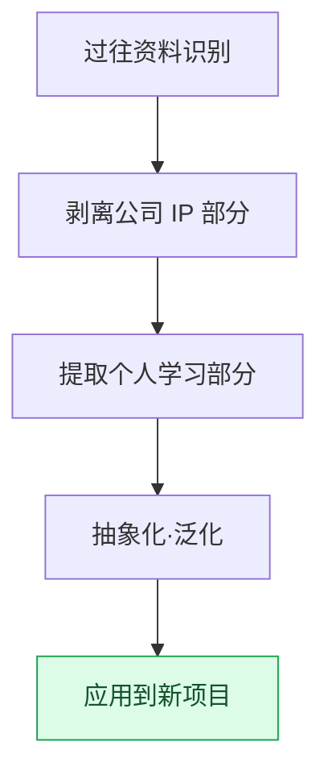

# 附录 H. 过往工作资料的复用

从业多年的策划会积累下数十年的工作资料。会议记录、决策记录、复盘、学习笔记,乃至从失败中得到的教训。本附录讨论如何把这些资料重新用于新项目。核心张力只有一个:这些资料的很大一部分属于公司 IP,不能随意搬走,但其中同时又夹杂着在任何地方都通用的个人学习。区分这两者,正是复用的起点。

如何使用本附录,取决于你所处的位置。如果你正想把旧资料引入新项目,请依次阅读 H.2(分离原则)和 H.3(流程)。如果你担心搬运过程中会出事故,请先阅读 H.5(五个陷阱),提前规避。如果你还处于职业生涯早期、可积累的资料不多,请参考 H.6,从现在起决定要留下什么、如何留下。

这里讲的原则并非什么宏大的资产管理理论。它可以压缩成一句话:"把具体的东西留在公司,只带走抽象的模式。"其余内容都是把这句话应用到实际情形中的方法。

---

## H.1 过往资料的价值

首先来看会积累哪些资料,以及各自的留存权限有何不同。因为留存权限不同,可复用的范围也会随之不同。

| 资料 | 留存 |
|---|---|
| 会议记录(公司资料) | 公司权限内 |
| 决策卡(公司资料) | 公司权限内 |
| 季度复盘(个人+公司) | 可保留个人副本 |
| 学习笔记(个人) | 个人永久 |
| 事故记录(个人学习) | 个人永久 |

会议记录和决策卡留在公司权限之内。复盘可以保留个人副本,而学习笔记和事故记录则完全属于个人资产。长期积累的资料本身就是巨大的学习资产,但绝不能模糊公司 IP 领域与个人领域的边界。边界越清晰,就越能安心地复用。

---

## H.2 公司 IP 与个人学习的分离

分离的标准是"具体还是抽象"。具体的产出属于公司,而产生它的思考模式属于个人。同一项工作会同时带出这两个方面——这一点是关键。

| 领域 | 公司 IP | 个人学习 |
|---|---|---|
| 决策内容 | 公司 | — |
| 决策模式(某种情形下适合某种决策) | — | 个人 |
| 游戏数据 | 公司 | — |
| 运营经验(规则手册·工具运营) | — | 个人 |
| 代码 | 公司 | — |
| 算法·结构 | — | 个人 |

"做了什么决策"属于公司 IP,而"在这种情形下这种决策更奏效"这样的模式则是个人学习。游戏数据的数值本身属于公司,但运营这些数据的诀窍属于个人。把具体资料留在公司,只带走抽象模式——这就是分离的原则。

---

## H.3 复用流程

把分离原则落实到实际工作中,就成了以下五个步骤。识别资料、剥离 IP、提取学习、加以泛化,然后应用到新项目。

这一流程务必在经过公司权限确认与法务审核之后再推进。即便抽象化已经足够,只要起点是公司资料,按流程留一份确认会更安全。

---

## H.4 复用案例——本书

最切近的复用案例就是本书本身。正文各处都源自作者过往的工作,是经过上述流程加以泛化、匿名化后的结果。

| 领域 | 出处 | 复用 |
|---|---|---|
| Layer 整合设计(第 6 部分) | 作者多年运营 | 个人学习 → 泛化 |
| 会议记录系统(第 17 部分) | 作者的项目A运营 | 公司模式 → 匿名化 |
| 运营经验(第 24 部分) | 多年积累 | 个人学习 → 泛化 |
| 附录 A 清单 | 公司项目A | 匿名化 + 部分加工 |

Layer 设计与运营经验是把个人学习加以泛化,会议记录系统与附录 A 则是把公司模式匿名化。所有条目都通过了公司的许可,公司 IP 全部无一遗漏地做了匿名化。本书这一产出本身,可以说就是 H.3 流程的实证。

---

## H.5 复用的 5 个陷阱

复用做得好是资产,做不好就是事故。下面这五个陷阱都是实际中经常踩的点,针对每一个都给出了对策。

### H.5.1 陷阱 1 —— 未通过公司许可

未经公司许可就使用资料,会演变成纠纷。对策很简单:使用之前先取得公司许可。

### H.5.2 陷阱 2 —— 匿名化遗漏

只要公司名或真实姓名残留在任何一处,就会酿成 IP 事故。对策是自动 grep 检查。把公司名·真实姓名·路径做成 watchlist,让机器无一遗漏地扫一遍。

### H.5.3 陷阱 3 —— 原样套用过往

把很久以前的经验原封不动地拿来用,就会与当下的时点脱节。对策是顺应时代重新构建。保留原理,但把工具与语境更新到当前。

### H.5.4 陷阱 4 —— 抽象化不足

只搬运具体案例,就很难套用到其他环境。对策是把抽象模式与具体示例放在一起。用模式获得普适性,用示例获得理解。

### H.5.5 陷阱 5 —— 根本不做学习

资料再多,若不再翻看,就等于没有。对策是定期的学习周期。像日·周·月复盘那样,建立一个重新接触资料的周期。

---

## H.6 读者参考——复用自己的资料

这一原则并非作者专属。读者也可以用同样的方式复用自己职业生涯的资料。下面是从现在起就能开始的推荐习惯。

| 推荐做法 | 理由 |
|---|---|
| 每季度复盘自己的决策 | 发现模式 |
| 单独保存学习笔记 | 与公司 IP 分离 |
| 明确写出抽象模式 | 便于未来复用 |
| 指导他人·对外演讲 | 分享模式 |
| 出书·博客(取得公司许可后) | 让学习永存 |

每季度复盘自己的决策,就能看出模式;把学习笔记与公司资料分开保存,日后就能安心地取用。把这些模式通过指导他人、演讲、写作输出出去,学习就不会用过一次即消失,而会长久留存。归根结底,自己的学习就是自己的资产。
