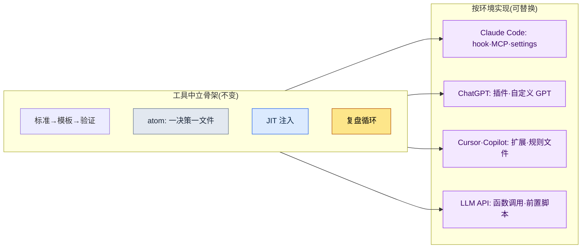

# 附录 K. 移植到其他 LLM·驱动框架(harness)

本书的案例与工具几乎全部以一种环境——即 Claude Code——为前提写成。因此在审批场合或外部评审中,几乎每次都少不了一条质疑:"这会不会被绑死在某家公司的特定工具上?"策划负责人对审批依赖单一供应商的决策感到有负担,怀疑论者担心一旦工具更换,本书的方法便会整体崩塌,而评估海外版权的一方则会问:当对方国家以别的工具为标准时,本书是否还有用。三者的表述各异,本质却相同——都是对供应商锁定(vendor lock-in),即被一种工具困住的不信任。

本附录的目的就是回应这种不信任。先说结论:本书所倡导的工作骨架是工具中立的。它既不绑定于某个特定的模型名称,也不绑定于某个特定的命令行工具。Claude Code 只是把这套骨架实现得最为顺畅的容器而已,同样的骨架可以换装到别的容器中。本附录将(1)用表格呈现什么才是与工具无关的骨架,(2)把 Claude Code 的各个要素与移植到其他环境后所对应之物一一配对,(3)在"模型世代会不断更替"这一前提下,确立一条确认最新状态的原则,(4)坦率写下移植时会失去什么、又能守住什么。

---

## K.1 与工具无关的骨架

贯穿本书全书的工作方式,可以概括为五根支柱。这五者中没有任何一个是某个特定模型或命令行工具的功能名称,而都是对"人与人工智能协同工作时,如何反复稳定地产出可信结果"这一问题的回答。因此即便工具更换,它们依然留存。

| 骨架 | 是什么 | 为何工具中立 |
|---|---|---|
| 标准 → 模板 → 验证关卡 | 把达成共识的规则(标准)固化为填空式的框架(模板),并设置一道自动筛查结果是否遵守了规则的关卡(门禁) | 规则、框架、检查这些概念,在任何工具中都能用文字或脚本表达 |
| atom = 一决策一文件 | 把一个决策写进一个小文件,需要时取出使用,修改时只改那一处 | 把决策拆细放进文件,只需有文件系统即可 |
| JIT 注入 | 只把当前对话真正需要的决策,即时(Just-In-Time)挑选出来喂给模型 | 这是"只注入必要上下文"的原则,注入方式不过因工具而异 |
| 复盘循环 | 以日、周、月为单位回顾所做的工作,把反复出现的模式提升为下一次工作的规则 | 回顾与改进的流程靠的是习惯与文档,而非工具 |
| 工具借用边界 | 借来的只有骨架(算法、结构),领域数据留在原处(附录 B) | 借什么、留什么的判断,在任何工具中都相同 |

这张表最右一栏才是关键。五根骨架的定义之中,没有一次出现某个特定产品的名称。出现的只有规则、文件、上下文、习惯、边界这类任何工作环境里都存在的普适概念。因此,"要是不能再用 Claude Code 该怎么办"这个问题,实际上就转化成了"如何在别的工具里实现这五个概念"这个远为好答的问题。答案就在下一节。

---

## K.2 要素对应表(Claude Code → 其他环境)

Claude Code 里有一些具体装置,能方便地实现上述骨架。hook(在特定时点自动执行的脚本)、MCP(把外部工具与数据连接到模型的规约)、settings 文件(权限与环境设置)、斜杠命令(把常用流程用一行调用的快捷命令)、技能(可复用的工作组合)等。这些虽是 Claude Code 特有的名称,但其角色在其他环境中几乎都有对应物。下面这张表就是它们的配对。

| Claude Code | ChatGPT(网页·应用) | Cursor / Copilot | 通用 LLM API |
|---|---|---|---|
| hook(时点自动执行) | 对话前后的手动流程 / 自定义 GPT 指令 | 编辑器操作前后的任务·pre-commit 钩子 | 在调用前后插入的前置·后置脚本 |
| MCP(外部连接规约) | 插件 / 动作(Action) / 代码解释器 | 扩展(extension) / 内置工具调用 | 函数调用(function calling) / 自建 API 封装 |
| settings 文件(权限·环境) | 自定义 GPT 设置界面 / 项目设置 | `.cursor`·工作区设置文件 | 代码内的设置对象 / `.env`·YAML 设置文件 |
| 斜杠命令(流程快捷) | 保存的提示词 / 自定义 GPT | 代码片段(snippet) / 用户自定义命令 | 提示词模板函数 |
| 技能(可复用工作组合) | 自定义 GPT / 提示词集合 | 规则文件 + 脚本 | 模块化的提示词·代码函数 |
| CLAUDE.md / 记忆 | 自定义指令 / 记忆功能 | 项目规则文件(rules) | 系统提示词 + 外部记忆存储 |
| atom 文件集合 | (与工具无关)Markdown 文件 | (与工具无关)仓库内的 Markdown | (与工具无关)文件·数据库记录 |

看这张表,有一点会变得清晰:越往右走,即越靠近通用 LLM API 一侧,"原本自动替你完成的",就越变成"必须自己动手搭建才能插入的"。在 Claude Code 中一行 hook 就能搞定的自动注入,到了通用 API 里就成了调用前亲手编写的前置脚本。自动化的便利虽有减少,但骨架本身照原样迁移。也就是说,移植不是"失去功能",而是"用自己的双手把便利重新铺设一遍"。

这张图就是整篇附录的一页概要。上方的方框(骨架)无论箭头指向哪个环境,内容都不改变;只有下方的方框(实现)会随环境替换。审批中一旦有人说出"供应商锁定",你只需摊开这一张图,回答"被绑住的是下面那一栏,不是上面那一栏"即可。

---

## K.3 "模型名称会变"这一前提

谈到移植,最快过时的信息就是模型名称。若把写作本书时最新的模型名称钉死在正文里,那么下一代模型问世的那一刻,那句话就成了错误信息。因此本书从一开始就遵循一条原则:不依赖某个特定模型的名称与世代编号来讲解,而依赖模型所承担的角色(推理、摘要、代码生成之类的功能)来讲解。

| 会变的(不要钉死) | 不变的(可以依赖) |
|---|---|
| 模型产品名·世代编号 | 诸如"擅长推理的模型""能接收长上下文的模型"这类角色区分 |
| 上下文上限的具体数值 | "既有上限,就只注入必要上下文"的 JIT 原则 |
| 价格·速度的具体数值 | "昂贵的作业只运行通过了关卡的那部分"的成本意识 |
| 某项功能的开关方法 | "该功能所承担的角色"以及可替代它的骨架 |

在实务中确认最新模型与功能的方法,每种工具也只需一行。在 Claude Code 中,用 `/model` 命令即可立即查看当前所用的模型及可选项;ChatGPT、Cursor 之类的工具,也会在设置界面或模型选择下拉菜单中给出同样的信息。因此,如果本书的某句话看上去与模型名称不符,那不是那句话错了,而是模型已过了一代。只要角色相同,方法便照旧适用。读书时若觉得模型名称陌生,请不要怀疑正文,而应先用 `/model` 之类的命令,确认你手中工具的最新状态。

---

## K.4 移植时失去的与守住的

换工具一定会失去一些东西。若掩盖这一事实,反而会失去信任,所以我先坦率写下会失去什么。不过,失去的几乎都属于"便利"的范畴,守住的则属于"骨架"的范畴。也就是说,失去的是重新铺设便可找回的,守住的则本就不曾绑定在工具上。

| 类别 | 项目 | 说明 |
|---|---|---|
| 失去的(便利) | 自动执行的顺畅 | 原本像 hook 那样自动介入的自动化,如今得靠前置·后置脚本亲手搭建 |
| 失去的(便利) | 一体化的单一界面 | 原本命令、工具、文件汇聚于同一流程,如今可能得分散到多个工具上 |
| 失去的(便利) | 即取即用的技能·命令 | 斜杠命令与技能得按那个工具的方式重新注册 |
| 守住的(骨架) | 标准·模板·验证关卡 | 规则、框架与检查都是文字或脚本,在任何地方都照原样存活 |
| 守住的(骨架) | atom·JIT·复盘循环 | 靠文件与习惯运转,故工具更换也依旧维持 |
| 守住的(骨架) | 工具借用边界(附录 B) | 借什么、留什么的判断标准与环境无关 |

把这张表压成一句话便是:移植中失去的,是花些时间就能复原的自动化便利;守住的,则是本书从一开始就竭力置于工具之外的工作骨架。因此,对"这不是供应商锁定吗"之问,最诚实的回答是:确有被绑住的部分,但那是可以替换的容器,而真正的价值——内容物——从一开始就不曾绑定于任何容器。愿这一篇附录,能在审批场合替你给出这个答案。
