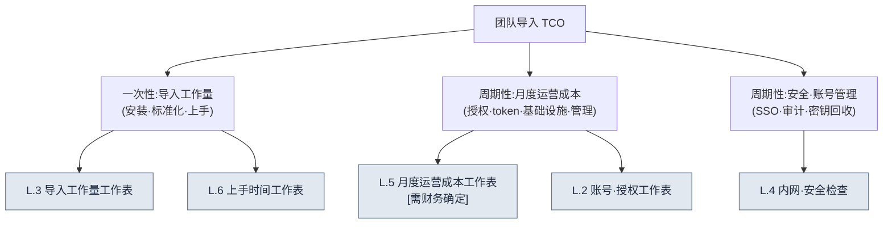

# 附录 L. 团队导入 TCO·上手工作表

> 本附录是一份填空式工作表,用来回答工作室 PD·负责人的这样一个问题:"当把单人六个月的系统扩展到中等规模团队时,导入工作量·运营成本·账号·内网安全该用什么、如何估算?"如果说正文 19.3(AI 导入策略与说服管理层)讲的是"不要粉饰 ROI",那么本附录就是把这一原则同样应用到导入成本一侧。也就是说,**本附录不提供任何数字。**所有单元格都是空白,填写它们靠的是你所在团队的测量·估算;凡标注 `[需财务确定]` 的单元格,在财务填写之前任何人都不得凭估算填补。

本附录的使用方法如下。首先在 L.1 中,用一张图把 TCO(Total Cost of Ownership,总拥有成本)拆分为哪些项目理清楚。接着把 L.2\~L.6 的五张工作表按自己团队规模所在的行,以空白状态打印出来,自己去测量,或用一行问题交给财务·信息安全负责人。最后用 L.7 的自查清单确认没有遗漏的单元格即可。本附录的价值不在于填好的数字,而在于**把容易遗漏的成本项目预先做成单元格**。

---

## L.1 TCO 不等于授权费用

PD 最常掉进的陷阱,是只把导入成本看作"订阅费 × 人数"。实际的总拥有成本要比这宽得多。它分成一次性投入即结束的**导入工作量**(安装·标准化·上手(onboarding))与每月周期性的**运营成本**(授权·token·基础设施·管理人力),在此之上再叠加看不见的**安全·账号管理**成本。

这三条分支中,PD 容易低估的是左侧(导入工作量)与右侧(安全·账号)。授权费用会写在报价单上,而"把单人六个月里手工积累的标准·技能整理成团队可共享形态的工作量"与"决定内网中允许外部 LLM 调用到何种程度的安全评审",报价单上都没有,因此它们总是让工期与预算超支。本附录的工作表,目的正是先把这些看不见的成本哪怕以空白的形式揭示出来。

> 正文 19.3.6 说过:"成本的绝对值不写进书里——它是要从财务那里拿来填的空白。"本附录就是把这些空白该放在何处,逐项铺开。

---

## L.2 账号·授权工作表

这是最先填写的表。把谁使用哪个工具、这些权限如何发放·回收,连同人数一并记录。人数栏用你团队的实际人头填,单价栏从报价单或公开价目表取来填。本书不写单价。

| 项目 | 填写什么 | 由谁填写 | 本团队值 |
|---|---|---|---|
| 各工具席位数 | 每个工具所需的账号(席位)数 | 主管 | ______ 席位 |
| 权限等级分布 | full / 按任务 cap / 外包一次性人员(附录 C.1.2) | 主管 | full __人 / 一般 __人 / 外包 __人 |
| 席位单价 | 各工具的每月席位费用 | 财务·采购 | ______ /席位·月 |
| 是否公用密钥 | 团队公用 API 密钥 vs 个人密钥 | 信息安全 | □ 公用 □ 个人 |
| 发放流程 | 新入职者账号的发放路径·耗时 | 主管 | ______ |
| 回收流程 | 离职·外包结束时密钥/席位的回收路径 | 信息安全 | ______ |

规则有两条。第一,**外包·短期人员不要常设发放席位,而应按任务单位开通并回收**(附录 C.1.2)。第二,**回收流程栏为空时,不启动发放。**最常见的事故是离职者账号未被回收,导致成本与密钥泄露一并外泄,因此要先设计回收、再设计发放。

---

## L.3 按团队规模的导入工作量工作表

这是一张按规模估算"单人六个月"扩展为团队时新增的一次性工作量的表。工作量栏以**人日(一个人工作一天的量)**为单位,由你团队实际测量或估算填写。本书不提供人日数——因为它随团队的熟练度·既有标准的整理程度而大幅变化。

| 导入工作量项目 | 1\~3 人 | 4\~10 人 | 11\~30 人 | 31\~50 人 | 测量/估算主体 |
|---|---|---|---|---|---|
| 环境安装·配置(工具·hook·权限) | ___人日 | ___人日 | ___人日 | ___人日 | 主管/基础设施 |
| 单人资产的团队共享化(技能·标准·atom 整理) | ___人日 | ___人日 | ___人日 | ___人日 | 主管 |
| 团队标准的建立(命名·前置元数据·规则手册,附录 D) | ___人日 | ___人日 | ___人日 | ___人日 | 主管 |
| 验证关卡搭建(lint·规则手册自动化) | ___人日 | ___人日 | ___人日 | ___人日 | QA/主管 |
| 上手资料制作(与 L.6 联动) | ___人日 | ___人日 | ___人日 | ___人日 | 主管 |
| 合计(导入一次性工作量) | ___人日 | ___人日 | ___人日 | ___人日 | — |

填这张表时容易漏掉的是第二行。单人在六个月里积累在脑中与个人文件夹里的资产,若要团队共享,就需要有人把它取出、整理并做成文档的额外工作量。若把这份工作量当作"0",导入进度必然拖延。此外,表格的单元格形状也预先呈现出:规模越大,比起安装工作量,**标准建立·验证关卡(verification gate)**的工作量增长得更陡——因为人一多,需要达成一致的标准数量就会增加。

> 遵循正文 19.3.1 的分阶段导入(由保守到进取),就不必在一个季度内把这份工作量用尽,而可以从第 1 阶段(上下文注入)的试点开始分散投入。不要试图一次性把表中的合计报批,而是先把第 1 阶段的工作量单独拆出来报批,这才现实。

---

## L.4 内网·安全检查工作表

这是 PD·负责人最直接惧怕的领域。逐项检查有什么会流向外部 LLM、内网中允许外部调用到何种程度。这张表是一份判定合格/暂缓的检查清单(与附录 C.6 安全联动),只要有一项未定,就暂缓该范围的导入。

| 检查项目 | 通过标准 | 负责 | 状态 |
|---|---|---|---|
| 向外部 LLM 传输的数据范围 | 敏感数据用占位符(placeholder)/自托管(C.6) | 信息安全 | □ 通过 □ 暂缓 |
| 支付·个人信息传输 | 明文规定无例外禁止传输 | 信息安全 | □ 通过 □ 暂缓 |
| 内网外部调用策略 | 定义允许域名·代理·日志保留期 | 基础设施 | □ 通过 □ 暂缓 |
| 是否需要自托管 | 决定核心 IP 是否用自托管模型处理 | 负责人/信息安全 | □ 已决定 □ 未定 |
| 密钥泄露事故应对 | 立即更换 + 使用记录审查路径(C.7) | 信息安全 | □ 通过 □ 暂缓 |
| 审计日志 | 记录·保存谁·何时·调用了什么 | 基础设施 | □ 通过 □ 暂缓 |
| 公司 IP 外泄检查 | grep watchlist 等事前检查流程(附录 B.6) | 主管 | □ 通过 □ 暂缓 |
| 外包访问隔离 | 外包账号阻断核心资产访问·按任务隔离 | 信息安全 | □ 通过 □ 暂缓 |

这张表中成本差距最大的一栏是第四行(是否需要自托管)。一旦决定核心 IP 绝不能发往外部 LLM,自托管的基础设施成本就会整块叠加到 L.5 的运营成本上。因此这一决定不该由主管、而应由**负责人·信息安全共同**作出;在决定之前,L.5 的基础设施栏无法确定。两张工作表通过这一栏相连。

---

## L.5 月度运营成本工作表 [需财务确定]

这是一张把每月周期性成本逐项分解的表。**本表的金额栏全部为空白;凡标注 `[需财务确定]` 的单元格,在财务填写之前任何人都不得凭估算填补。**token 单价·订阅费·基础设施费用会随模型·调用量·合同每月变化,因此本书不写绝对值。

| 运营成本项目 | 计算方式 | 由谁填写 | 每月金额 |
|---|---|---|---|
| 授权·订阅 | 席位数 × 席位单价(L.2) | 财务 | [需财务确定] |
| LLM token 成本 | 调用量 × token 单价,各工具上限(cap)之和 | 财务 | [需财务确定] |
| 基础设施(自托管时) | 依 L.4 决定的服务器·GPU·存储 | 财务·基础设施 | [需财务确定] |
| 备份·同步 | 存储库·备份存储(附录 C.5) | 财务 | [需财务确定] |
| 运营管理人力 | 工具·密钥·日志管理负责人的时间折算 | 主管·财务 | [需财务确定] |
| 每月合计 | 上述项目之和 | 财务 | [需财务确定] |

这张表的规则只有一条,**让空白保持空白**。请回想正文 19.3.2 中 AI 把运营成本栏煞有介事地捏造成 `$4,500` 的失败——无论人还是 AI,一旦凭估算填补这一栏,那份报告在第一个提问下就会崩塌。真正控制成本的机制不是金额,而是**各工具设有每月上限(cap)、超额会自动上报的结构**(19.3.6)。报批时要向管理层展示的,不是填好的金额,而是"设有上限、超额会上报"的结构,以及交给财务去填的空白清单。

> 第五行(运营管理人力)最常被遗漏。工具装好并非就此了事,它每月都在吃掉那个回收密钥、查看日志、调整上限的人的时间。若把这一栏置为 0,那份工作就会藏进主管看不见的加班里。

---

## L.6 上手时间工作表

这是一张分阶段估算一名新成员在系统之上做到独当一面所需时间的表。时间栏最准确的做法,是在你团队里实际让人上手一次再测量(与正文 19.3.7 的基线测量方法同一做法)。测量之前,保持空白。

| 上手阶段 | 做什么 | 测量时间 | 备注 |
|---|---|---|---|
| 环境安装 | 直到工具·hook·账号配置完成 | ___小时 | 与 L.2 发放流程联动 |
| 标准学习 | 熟悉命名·前置元数据·规则手册(附录 D) | ___小时 | 有资料则可缩短 |
| 首个任务(保守) | 用上下文注入产出首个成果·通过评审 | ___小时 | 19.3.1 的第 1 阶段 |
| 适应验证关卡 | 按 lint·规则手册关卡开展工作 | ___小时 | — |
| 达到独立工作 | 无需监督即可工作·作出采纳判定 | ___天 | 上手完成标准 |

填完这张表,就会显出导入工作量(L.3)中"上手资料制作"一栏为何重要。上手资料整理得越好,第二·第三行的时间就越短;新成员越多,这份节省就越是累积。也就是说,上手资料制作是一次性工作量,而回收则按成员数量反复发生。正文 19.3.3 所说的"JIT 自动注入 221 条——新成员也在同一套规则之上工作",在这张表里体现为第三行的时间缩短。

> 最后一行(达到独立工作)才是上手的真正完成标准。若把环境安装完成误当作上手完成,监督成本就会不断堆积在主管身上。标准应当是"无需监督即可作出采纳判定"。

---

## L.7 导入前自查清单

最后,是把这些工作表拿给管理层之前,自己必须先通过的项目。秉持与附录 B.6(借用前检查)相同的精神,只要有一项为空,就推迟报批,先填那一栏。

| 检查项目 | 通过标准 |
|---|---|
| 是否已定义账号回收流程 | L.2 的回收流程栏不为空 |
| 安全检查是否全部通过/已决定 | L.4 中 □暂缓·□未定 为 0 项 |
| 运营成本的空白是否已交给财务 | L.5 的 [需财务确定] 已作为问题发出 |
| 是否把导入工作量拆成了阶段 | 不按 L.3 合计,而从第 1 阶段的工作量开始报批 |
| 上手完成标准是否为"独立工作" | 以 L.6 最后一行判定完成 |
| 是否未把估算值写成断言 | 在所有估算栏标注"估算·样本数" |

请不要把这张表读作五栏的合格,而请把它读作六道锁。把单人系统扩展为团队这件事确实可行,但这一扩展的成本并非授权费用;唯有诚实地填满这六栏空白,整体图景才会显现。而且,任何一栏都不要交给 AI 去填——AI 会像正文 19.3.2 那样,用煞有介事的数字填补空白。AI 的位置,止于接过你测量的值、整理成报批幻灯片的文句。
