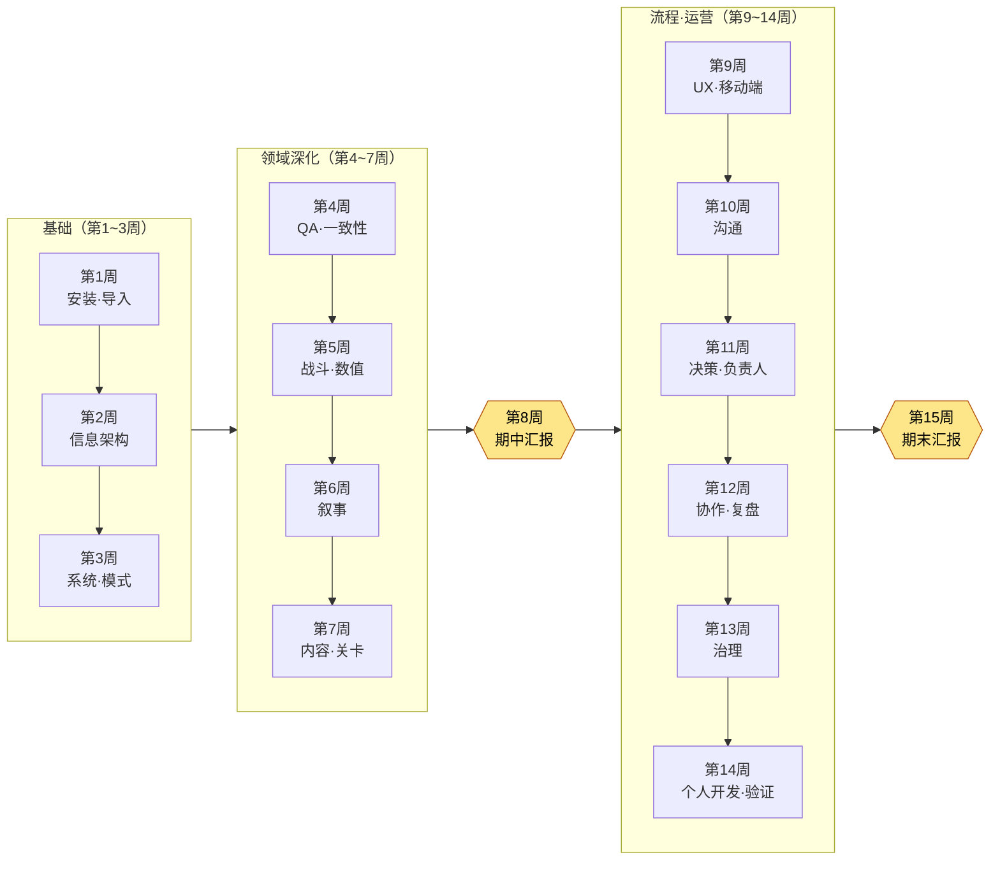

# 附录 N. 教学用 15 周进度表·难度指南

本附录面向想把本书用作一学期课程教材的读者——大学、专科院校、培训机构的授课教师，企业内训负责人，学习小组的组织者。要把一本近1,000页的大部头按学期切分，比想象中更让人无从下手。哪一部分放在第几周、如何把正文中的「动手试试」转化为作业、以什么标准为提交物评分——这三点一旦卡住，再好的书也难以被选作教材。本附录把这三件事做成可以照搬使用的工具。

本附录的使用方法如下。首先，结合自己的教学日程阅读 N.1 的 15周进度表（16周与短学期的变体另见 N.2），再用 N.3 的难度徽章与先修知识表衡量学员水平。接着，复制 N.4 的评分量规(rubric)，按自己的作业只替换其中的条目即可。所有表格都编排成可以直接打印、贴进教学大纲(syllabus)的形式。

有一点需要先说明。本书每一章都以「动手试试」收尾。让读者不是读完就合上，而是当天就动手——这正是正文的目标；而在教学中，这个「动手试试」正好成为作业的第一手素材。本附录的进度表之所以一并写明如何把正文的「动手试试」转化为各周作业，原因就在这里。

---

## N.1 15周标准进度表

这是按最常见的15周制（每周1次、每次3小时）学期编排的标准进度表。本书的24个部分不会在一个学期内全部讲完——硬塞进去的话，哪一部分都不会真正留在手上。取而代之，我们选择了这样的结构：**先把基础（第1·2部分）夯实，从各领域中挑出有代表性的5\~6个深入讲解，再从流程·运营中只选取核心内容收尾**。未讲解而留下的部分标注为「延伸阅读」，引导感兴趣的学员自行展开。

学习目标全部以“学员能做到什么”的动词来写。不是“知道”，而是“做出·验证·选出”。全书反复强调“AI 给出候选，人来筛选”这一句话，因此目标的动词也遵循这一分工。

| 周次 | 涉及的部分·章节 | 学习目标（结课后能做到） | 转化为作业的「动手试试」 |
|---|---|---|---|
| 1 | 1.0 开始之前 + 第1部分（导入） | 讲解终端·账号·计费结构，在自己的 PC 上安装 AI 工具并开启第一个会话 | 1.0 安装「动手试试」——提交安装截图 + 第一次的提示词与输出 |
| 2 | 第2部分（信息架构） | 用 YAML frontmatter 将文档数据化，设计文件夹·命名规范 | 2.1 frontmatter「动手试试」——为自己的3份文档添加 frontmatter |
| 3 | 第3部分（系统策划） | 以模式优先(schema-first)原则，先定义数据表的 $스키마 | 3.2 模式「动手试试」——为一种迷你数据表编写规格书 |
| 4 | 第10部分（QA·一致性） | 跟着做出用代码检查30张数据表 FK 一致性的工具 | 10.1 一致性验证「动手试试」——**用 N.4 量规评分的核心作业** |
| 5 | 第4部分（战斗） + 第8部分（数值） | 将战斗数值按 Layer 分解，把确定性的数值平衡公式沉淀为规则手册 | 8.1 数值公式「动手试试」——一种伤害公式 + 模拟 |
| 6 | 第5部分（叙事） | 制作 NPC 台词的 voice_profile，用 voice_lint 抓出语气偏离 | 5.2 voice_profile「动手试试」——为一名角色编写语气档案(voice profile) |
| 7 | 第6部分（内容） + 第7部分（关卡） | 区分程序化生成的两条轴（规则·AI），批量产出并评审内容候选 | 6.2 生成器「动手试试」——生成10条内容候选 + 评审日志 |
| 8 | **期中检查·汇报** | 整合第1\~7周的作业，以自己的迷你项目进行演示 | 期中作业汇报（整合第3\~6周产出的演示） |
| 9 | 第9部分（UX·UI） + 第14部分（移动端） | 用 lint 检查 HUD，抓出视线偏移·对比度不足，并把 PC 端 HUD 压缩到移动端 | 9.1 HUD lint「动手试试」——一种界面的 lint 报告 |
| 10 | 第16部分（沟通者） + 第17部分（会议纪要） | 在隔离的工作空间中只将决定定为正本，并把会议纪要结构化 | 17.x 会议纪要「动手试试」——将1份真实会议录音结构化 |
| 11 | 第18部分（决策） + 第19部分（团队负责人） | 把决定留存为可追溯的卡片，把愿景转化为决策的评分表 | 18.1 决策追溯「动手试试」——编写3张决策卡 |
| 12 | 第20部分（协作记忆） + 第21部分（自我改进） | 把协作上下文作为记忆来运营，让复盘运转成自我改进的循环 | 第21章 复盘「动手试试」——1份周复盘 + 1条抽取规则 |
| 13 | 第22部分（治理） | 检查提示词·幻觉·成本·法务·伦理的边界并订立规则 | 22.1 提示词「动手试试」——1份工作指示书 + 幻觉检查流程 |
| 14 | 第23部分（个人开发） + 第24部分（运营进阶） | 用单人精简版迁移工具，用代码验证一致性·链接·stale | 24.1 验证「动手试试」——一种针对自己项目的验证脚本 |
| 15 | **期末项目汇报·评估** | 设计·演示·验证一条贯穿整个学期的个人工作流 | 期末作业汇报（以 N.4 扩展量规评估） |

> **延伸阅读（不含在课程内，建议自主学习）：** 第11部分（角色·宠物·坐骑）、第12部分（美术指导）、第13部分（数据·KPI）、第15部分（运营）。这四个部分领域针对性很强，故留给感兴趣的学员结合自身领域自行展开。以附录 F（案例索引）为向导，便可从贴近自己环境的案例开始反向检索进入。

进度流程一目了然，如下所示。这是一个具有两座高峰（期中·期末）的结构：基础 → 领域深化 → 期中整合 → 流程·运营 → 期末整合。

---

## N.2 学期长度变体（16周 / 短学期8周）

各学校的学期长度不尽相同。除标准的15周外，这里给出最常遇到的两种变体的调整方案。无论采用哪种变体，都建议保留核心作业（第4周的一致性检查）与两座汇报高峰——因为这里正是本书诚实原则（“展示的不是效果，而是结构”）体现得最充分的地方。

| 学期形态 | 调整方法 |
|---|---|
| 16周制 | 标准15周 + 第16周增设 **补强·再评估周**。给予期末作业重新提交的机会，或从「延伸阅读」4个部分中由学员投票选定1个部分开设专题讲座 |
| 短学期8周（每周2次或集中授课） | 第1周（安装·导入） → 第2周（信息·模式） → 第3周（一致性，核心作业） → 第4周（战斗·数值·叙事合并） → 第5周期中汇报 → 第6周（会议·决策·协作） → 第7周（治理·验证） → 第8周期末汇报。领域缩减为有代表性的3个，「动手试试」在课堂上作为实操吸收消化 |
| 翻转课堂(flipped classroom) | 把通读正文放到课前作业，课堂时间全部分配给「动手试试」实操与量规互评。本书的代码无需外部依赖即可直接运行，适合以实操为中心的教学 |

---

## N.3 章节难度徽章·先修知识

即便在同一本书里，各章所要求的背景知识也不相同。有些章即使是初次接触终端的大一学生也能跟上，有些章则需要具备数据库键的概念或统计基础才能完全消化。为便于按学员水平调整进度、或指引先修课程，这里用三级徽章加以归纳。

各徽章的含义如下。

| 徽章 | 等级 | 含义 |
|---|---|---|
| 🟢 入门 | 入门 | 非专业、大一学生也能跟上。代码只需达到复制·运行的程度即可 |
| 🟡 实务 | 实务 | 需要能读懂代码并按自己的数据加以修改。建议理解策划实务的语境 |
| 🔴 进阶 | 进阶 | 处于设计·扩展算法与结构的阶段。若无先修知识，消化难度较高 |

各周核心部分的徽章与先修知识如下。“先修知识”是指为顺利跟上该周而最好提前具备的背景，并非没有它就无法修读。

| 周次 | 核心部分 | 徽章 | 先修知识 |
|---|---|---|---|
| 1 | 1.0·第1部分 导入 | 🟢 入门 | 无（以初次接触终端为前提） |
| 2 | 第2部分 信息架构 | 🟢 入门 | 使用文本编辑器 |
| 3 | 第3部分 系统·模式 | 🟡 实务 | 表格/电子表格基础，数据类型概念 |
| 4 | 第10部分 一致性验证 | 🔴 进阶 | **Python 基础**（函数·循环），关系键(FK)概念 |
| 5 | 第4·8部分 战斗·数值 | 🟡 实务 | 四则运算式，**表格计算**（Excel 函数） |
| 6 | 第5部分 叙事 | 🟢 入门 | 角色·剧本写作的感觉 |
| 7 | 第6·7部分 内容·关卡 | 🟡 实务 | 程序化生成概念（建议），坐标·网格的感觉 |
| 9 | 第9·14部分 UX·移动端 | 🟡 实务 | 屏幕布局·分辨率概念 |
| 10 | 第16·17部分 沟通 | 🟢 入门 | 无（有协作经验更有利） |
| 11 | 第18·19部分 决策·负责人 | 🟡 实务 | 团队协作·项目管理经验（建议） |
| 12 | 第20·21部分 协作·复盘 | 🟡 实务 | 修完第2周信息架构 |
| 13 | 第22部分 治理 | 🟡 实务 | **基础统计**（平均值·分布，幻觉检测语境），著作权基础 |
| 14 | 第23·24部分 个人·运营 | 🔴 进阶 | Python 基础，git 基础，修完第4周一致性 |

> **先修课程一句话说明（供教学大纲使用）：** “建议具备 Python 入门或与之相当的编程基础，但并非必需。第4·14周的进阶章节以 Python 函数·循环的水平为前提；未修读者可通过第1\~3周的入门轨道充分跟上，为此将作业分轨运营。”

根据学员构成的运营建议如下。

- **非专业·通识课：** 若把 🔴 进阶（第4·14周）以“让 AI 生成代码、由人评审结果”的形式运营，即使是未修读 Python 的学员也能达成学习目标。本书正文所展示的“人守住评审者的位置”这一分工，便可直接成为教学设计。
- **专业·实务培养课程：** 在 🔴 进阶章节中，让学员亲自逐行阅读并讲解 AI 生成的代码，评审能力本身便成为评估对象（与 N.4 量规第4项相连）。

---

## N.4 评分量规示例 —— 一致性检查工具的动手试试（第4周核心作业）

没有量规，「动手试试」的提交物很容易只按“能跑/不能跑”的二分法来评分。这样一来，本书最为看重的东西——**评审并拒绝 AI 输出的过程**——就会在评估中消失。因此，这里以第4周核心作业（10.1 一致性验证 atom「动手试试」）为例，给出一份不仅评判成果、还评判其过程的量规。其他各周的作业也只需替换条目名称即可照搬使用。

**作业定义：** 针对自己制作的（或提供的）多种数据表，与 AI 一起做出检查表间外键(FK)一致性的工具，并演示该工具能否抓出故意埋入的错误。提交物包括：① 工具代码 ② 检查运行结果（通过/失败报告） ③ 向 AI 输入的提示词全文，以及其中被拒绝·修改的输出的记录。

量规由4个条目、每项25分（共100分）构成。关键在于：与“工具能跑”（第2项）相区别，**如何驾驭 AI**（第3·4项）以一半的权重来评估。

| # | 评估条目 | 分值 | 欠缺（0\~12） | 一般（13\~19） | 优秀（20\~25） |
|---|---|---|---|---|---|
| 1 | **一致性规则定义** —— 是否明确了检查哪些 FK 关系、为何检查 | 25 | 检查对象关系不明确或随意 | 识别出主要 FK 关系，但依据说明不足 | 将表间关系连同图示·依据一并定义，并说明检查的优先级 |
| 2 | **工具运行·错误检出** —— 是否真正抓出埋入的错误 | 25 | 无法运行，或漏掉明显的错误 | 抓出大部分错误，但有部分遗漏·误报 | 抓出所有埋入的错误，且无误报，报告以人可读的形式输出 |
| 3 | **AI 使用过程的透明度** —— 提示词全文与输出是否以可复现的方式记录 | 25 | 无提示词·输出记录，或仅附结果 | 有提示词，但缺少拒绝·修改的过程 | 将输入的提示词全文、原始输出、拒绝·再指示的过程按时间顺序留存 |
| 4 | **评审·拒绝的判断** —— 拒绝·修改了 AI 输出的什么、为什么 | 25 | 原样接受输出（无评审痕迹） | 做了部分修改，但判断依据薄弱 | 指出并拒绝错误·幻觉·过度设计，并用自己的话说明其判断依据 |

> **评分运营备注：** 第3·4项（合计50分）是这份量规的脊梁。即便工具运行得完美无缺（第2项满分），若对 AI 输出不加批判地接受（第4项欠缺），则视为未达本作业的学习目标——“人守住评审者的位置”。反过来，即使工具尚有不完善之处，只要拒绝·再指示的过程扎实，也能拿到高分。评估的不是效果（能跑出的结果）而是结构（如何驾驭），本书的这一原则在评分中同样适用。

对于期末作业，建议在上述4项之上再加 **⑤ 工作流泛化（说明如何移植到自己的领域）** 1项，构成5项、每项20分的扩展量规。能否把整学期讲过的工具迁移到自己的项目中——这正是本书在最后所提出的问题，而课程的最终评估也用同一个问题就足够了。

---

## N.5 教学运营一页速览

最后，把本附录浓缩为一页，就是这样。

- **做取舍，不要全塞进去。** 不要试图把24个部分全部讲完，而是用基础（第1·2部分）+ 一致性（第10部分）+ 领域代表5\~6个 + 流程·运营核心来编排一个学期。其余留作「延伸阅读」。
- **把「动手试试」转化为作业。** 正文本就设计成让人动手，因此作业设计的一半已在书中。
- **评分的是评审，而不是结果。** 把量规的重心放在“如何驾驭 AI”上。这正是让本书自始至终反复强调的那句话——AI 给出候选，最后的决定由人来做——在课堂上保持鲜活的方法。

这份进度表是起点，而非标准答案。请结合自己学员的水平与教学日程，调整周次、更换作业。把本书整本喂给 AI 工具，让它“按我课程的16周安排和学员水平重新编排这份进度表”——正如本书最快的用法那样——也是一条敞开的路。
